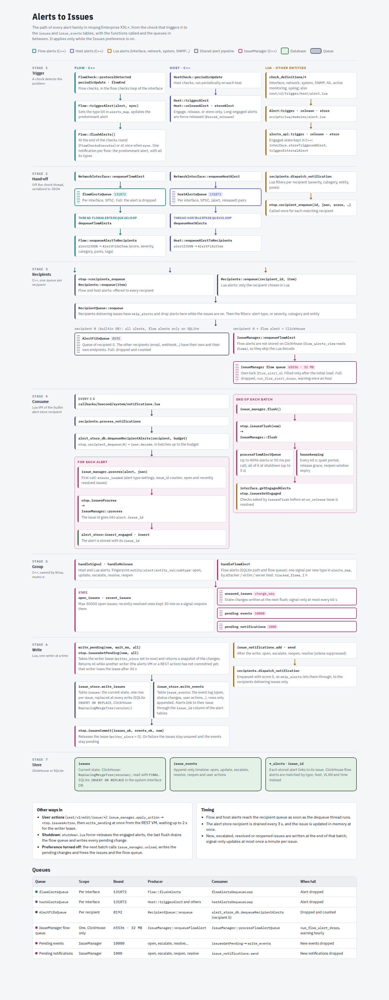

# Issues Architecture

Issues (Enterprise XXL+) group the alerts of the same problem into one item with
a status, so that a problem is seen, handled and notified once instead of once
per alert. The alerts of an issue are called *signals*: they are still stored
as usual, and each one is linked to its issue.

User documentation: `doc/src/user_interface/shared/alerts/issues.rst`.

## Availability

Issues are an experimental feature, off by default: preference *Issues* in
Preferences > Alerts (`toggle_issues`, Redis `ntopng.prefs.issues_enabled`,
cached in C++ as `Prefs::are_issues_enabled()`, also false when alerts are
disabled).

- `ntop.issuesIsEnabled()`: Enterprise XXL+ and the preference. Used by the
  non-pro code: `alert_store_db.lua` (engine), the `issue_id` filter of the
  Alerts Explorer (`alert_store.lua`), `recipients.can_deliver_issues()`, the
  dashboard `issues` module, the Issues tab of the host details.
- `issue_utils.is_available()`: `ntop.issuesIsEnabled()` and alerts enabled. It
  gates the REST API. `issue_utils.is_enabled()` (UI: menu entry, `issues.lua`
  and `issue_details.lua`, redirect when off) is the same.
- `RecipientQueue::enqueue` pushes the ClickHouse flow alerts to the manager
  only while it is on.

Changes apply without a restart. The preferences REST
(`rest/v2/set/ntopng/preferences.lua`) reloads the preferences and registers the
recipients again (`recipients.register_all()`): recipients with the `issues`
delivery mode skip the alerts in C++ only while the issues are on, otherwise
they receive the alerts. When the preference is turned off, the next batch of
`alert_store_db.lua` calls `issue_manager.unload()`: all the pending changes are
written, then `ntop.issuesUnload()` frees the issues and the flow queue. When it
is turned on again, the first alert loads them from the database.

## Files

| Path | Role |
|------|------|
| `pro/include/IssueManager.h`, `pro/src/IssueManager.cpp` | The engine (C++, one instance owned by `Ntop`, `ntop->getIssueManager()`): in-memory state, grouping, open/escalate/resolve/reopen, user actions, flow alerts queue, limits and timings (`ISSUES_*`) |
| `pro/include/Issue.h`, `pro/src/Issue.cpp` | An issue: stored and runtime fields, conversion from/to Lua tables, status/policy/resolution/event enums |
| `pro/src/LuaEngineNtopPro.cpp` | `ntop.issues*` bindings |
| `pro/scripts/lua/modules/issues/issue_consts.lua` | Status, resolve policies, resolutions, event ids, the timings used by Lua |
| `pro/scripts/lua/modules/issues/issue_manager.lua` | Lua side of the engine: initial load, `process()`, `flush()`, engaged alerts checks, writes, notifications, user actions (`acknowledge()`, `assign()`, `suppress()`, `set_severity()`, `resolve()`, `reopen()`) |
| `pro/scripts/lua/modules/issues/issue_store.lua` | Database access (SQLite and ClickHouse): write, load, list, facets, groups, signals, events |
| `pro/scripts/lua/modules/issues/issue_notifications.lua` | Issue notifications to the recipients |
| `pro/scripts/lua/modules/issues/issue_utils.lua` | REST helpers: filters, formatting, facets, heatmap, groups, alerts URL, gating |
| `pro/scripts/lua/rest/v2/get/issue/*.lua` | list, details, signals, events, counters, facets, groups, heatmap, assignees, stats (admin) |
| `pro/scripts/lua/rest/v2/edit/issue/*.lua` | acknowledge, assign, comment, reopen, resolve, resolve_all, severity, suppress |
| `pro/scripts/lua/issues.lua`, `issue_details.lua` | Page entry points |
| `pro/http_src/vue/page-issues.vue`, `page-issue-details.vue`, `modal-issue-action.vue`, `dashboard-issues-badge.vue` | UI |
| `httpdocs/tables_config/issues_list.json`, `issue_signals.json` | Table definitions |
| `tests/e2e/rest/tests/v2/issues_*.yaml` | REST e2e tests |

## Design

The state machine and the state live in C++ (`IssueManager`, one instance per
ntopng process, allocated by `Ntop` and reached with `ntop->getIssueManager()`,
thread-safe with one mutex, plus one for the flow alert queue). The Lua VMs cannot hold them: the
periodic scripts, including the one consuming the alerts, run in a new VM every
minute or so, which would lose the open issues, the pending resolutions and the
signal-only updates.

Lua keeps what needs Lua:

- the database (`issue_store.lua`): C++ hands the changed issues and the
  events to Lua (`getPending`), which writes them and confirms (`commit`);
- the alert definitions: their issue settings are passed to C++ once
  (`ntop.issuesSetAlertTypes`);
- the engaged alerts checks of the `on_release` issues
  (`interface.getEngagedAlerts`);
- the notifications to the recipients (`issue_notifications.lua`).

Lua bindings (`pro/src/LuaEngineNtopPro.cpp`):

| Binding | Role |
|---------|------|
| `ntop.issuesIsEnabled()` | Enterprise XXL+ and the Issues preference on |
| `ntop.issuesIsLoaded()` | True after the initial load |
| `ntop.issuesUnload()` | Free the issues and the flow queue (preference turned off) |
| `ntop.issuesSetAlertTypes(list)` | `meta.issue` / `meta.issue_resolve_policy` of the alert types |
| `ntop.issuesLoad(issues, initial)` | Load issues read from the database |
| `ntop.issuesProcess(json)` | Process an alert, returns its issue id |
| `ntop.issuesFlush(now)` | Flow queue + housekeeping, returns the engaged alerts checks to do |
| `ntop.issuesSetEngaged(issue_id, engaged)` | Result of an engaged alerts check |
| `ntop.issuesGetPending(now, all)` | Issues, events and notifications to write/send (nil while another writer is active) |
| `ntop.issuesCommit(issues_ok, events_ok, now)` | Confirm the writes |
| `ntop.issuesAcknowledge(issue_id, user)` | Acknowledge an issue |
| `ntop.issuesAssign(issue_id, user, assignee)` | Assign an issue (comma-separated users, empty to unassign) |
| `ntop.issuesSuppress(issue_id, user, duration)` | Suppress an issue for duration seconds (0 removes the suppression) |
| `ntop.issuesSetSeverity(issue_id, user, severity)` | Set the severity of an open issue |
| `ntop.issuesResolve(issue_id, user)` | Resolve an open issue |
| `ntop.issuesReopen(issue_id, user)` | Reopen a resolved issue |
| `ntop.issuesGet(issue_id)` | The issue, if in memory |
| `ntop.issuesStats()` | Statistics (also `rest/v2/get/issue/stats.lua`) |

## Data Flow



The path of every alert family (flow and host alerts from C++, the other entities
from Lua), from the check that triggers it to the `issues` and `issue_events`
tables, with the functions called and the queues in between. In short:

```
C++ / Lua checks
   │  alerts (engage / release / store)
   ▼
recipients queue 0 (builtin DB recipient)  ── ClickHouse flow alerts ──▶ IssueManager flow queue
   │                                                                       (enqueueFlowAlert)
   ▼
alert_store_db.lua (endpoint VM)
   ├─ issue_manager.process(alert)   -- ntop.issuesProcess: sets alert.issue_id
   ├─ alert_store:insert*(alert)     -- stores the alert with its issue_id
   └─ issue_manager.flush()          -- end of each batch:
         ├─ ntop.issuesFlush: flow queue batch, housekeeping (every 60 s)
         ├─ engaged alerts checks → ntop.issuesSetEngaged
         ├─ ntop.issuesGetPending → write the changed issues and events → ntop.issuesCommit
         └─ send the issue notifications → recipients delivering issues
```

`issue_manager.process()` runs in the VM of the builtin alert store recipient
(`scripts/lua/modules/notifications/endpoints/alert_store_db.lua`), which
receives the alerts of all the entities and interfaces. The first call loads
the issues (`ensure_loaded`): the alert types settings, the issue_id counter
sync, the open issues and those resolved within the reopen window. Until then
C++ ignores the flow alerts. Errors in the manager are caught
(`call_issue_manager`) and logged at most once a minute. They never stop alerts
from being stored.

Writes are done by one writer at a time: `getPending` returns nil while
another writer (the alerts VM or a REST call, see User Actions) has not
committed yet. A writer not committing within 30 s (`ISSUES_WRITER_TIMEOUT`) is
replaced. Issues changed after `getPending` stay unsaved (`change_seq`) and are
written at the next flush.

Issues belong to the ntopng instance, not to an interface. `issue.ifids` lists
the interfaces where signals were seen; the system interface is stored as
`0xFFFF`.

## Grouping (Fingerprint)

An issue has one alert type on one entity:

```
fingerprint = "<entity_id>|<alert_id>|<entity_val>|<subtype>"
```

Optional settings in the alert definitions (documented in
`scripts/lua/modules/alert.lua`):

- `meta.issue = false`: the alert never opens issues (informational alerts,
  e.g. `alert_user_activity`, `alert_process_notification`).
- `meta.issue_resolve_policy = "on_release" | "quiet_period" | "manual"`.
  The default is `on_release` for engaged alerts and `quiet_period` for the
  others. `on_release` on a stored-only alert falls back to the default.

They are read once per process, at the load (`get_alert_types_settings`, with
the fallbacks of `alert_consts.getAlertType`).

The manager keeps two maps in memory, keyed by fingerprint:

- `open_issues`: the issues with status open.
- `recent_issues`: issues resolved less than the reopen window ago (*Issues
  Reopen Window* preference, `ntopng.prefs.issues_reopen_window` in seconds, 1 hour
  by default, 5 minutes to 24 hours: `Prefs::get_issues_reopen_window()`, and
  `ntop.getPrefs().issues_reopen_window` in Lua). At most one per fingerprint.

A signal whose fingerprint matches a recent issue reopens that issue instead of
opening a new one.

## Lifecycle

| Status | Value |
|--------|-------|
| open | 0 |
| resolved | 1 |

- **Open**: first signal of a fingerprint. No issue is opened above the
  *Issues Maximum Open* preference (`ntopng.prefs.issues_max_open`, 50000 by
  default, 100 to 1000000); a warning is logged at most once an hour.
- **Update**: each signal increments `signal_count`, extends `last_seen`, raises
  `score` (highest score), adds its score to `total_score`, adds the interface and the peer, adds the tags of the alert to
  `tags_bitmap` (union of the tags of all the alerts), and records
  `host_pool_id` in `issue.json` for the recipient filters.
- **Escalate**: a signal with a higher severity (`ntop.mapScoreToSeverity`)
  raises the issue severity. This clears the acknowledgement and notifies.
- **Resolve**, by resolve policy:
  - `on_release` (0): when the last engaged alert of the issue is released.
    The manager's set of engaged alerts can be incomplete (e.g. restart), so
    before resolving it asks the interfaces of the issue
    (`interface.getEngagedAlerts`, from Lua: `ntop.issuesFlush` returns the
    checks, `ntop.issuesSetEngaged` gets the result).
    A *forced* release resolves only if the alert is not engaged again within
    `max(MIN_RELEASE_GRACE, 2 * granularity)` (`resolve_after`). An alert is
    force-released when it has been engaged too long
    (`CONST_MAX_ALERT_ENGAGE_TIME`, `forced_release` serialized in
    `Host::alert2JSON`) or at shutdown (`alerts_api.setForcedReleases(true)` in
    `shutdown.lua`).
  - `quiet_period` (1): after `QUIET_PERIOD` (24 h) without signals.
  - `manual` (2): only by a user. Used by compromise alerts (malware contacted,
    malicious fingerprint/SHA1, exfiltration, lateral movement, web mining,
    blacklisted host).
- **Reopen**: a signal within the reopen window of the resolution, or a user
  action. An issue a user reopens switches to the `manual` policy. Reopen fails
  with `newer_issue_open` if a newer issue already has the same fingerprint.

`resolution` records how the issue was closed: 0 none, 1 released, 2 quiet
period, 3 manual.

At startup (`ensure_loaded`), the open issues and those resolved within
the reopen window are read back from the database, and the issue_id counter is
synced (`sync_issue_id_counter`). Engaged alerts are not notified again after a
reload, so every `on_release` issue gets `resolve_after = now + grace`; the
housekeeping then checks C++ before resolving it.

## Flow Alerts

A flow carries several alert types (`alerts_map`), and C++ notifies the flow
again whenever a new type is set, with all its types.
`IssueManager::handleFlowAlert`:

- Splits the notification into one signal per alert type in `alerts_map`
  (hex, most significant first).
- Uses `tracked_flows` (`<ifid>|<ntopng.key>|<hash_entry_id>`) to count only
  the new types of a flow. Entries expire after `FLOW_TRACKING_TIME` (1 h). At
  `MAX_FLOWS_TRACKED` (100000) the table is cleared, so `signal_count` may be
  overestimated.
- Groups each type by the host the alert is about: the attacker, otherwise the
  victim, otherwise the server. `entity_val = "<ip>@<vlan>"` and
  `subtype = role`. The other host is the peer.
- Takes the roles of each type from `json.alerts[<type>]`; the notification
  itself only has the roles of the predominant type.
- Sets `alert.issue_id` to the issue of the predominant type.

### ClickHouse

With ClickHouse, flow alerts are not stored: `flow_alerts_view` is a view on
the `flows` table, written by C++. In `RecipientQueue::enqueue`
(`src/RecipientQueue.cpp`), flow alerts for the builtin DB recipient are not
enqueued. On XXL+ they are pushed instead to the flow queue of the manager
(`IssueManager::enqueueFlowAlert`), so they do not take room from the alerts
to be stored and are not decoded by Lua:

- The queue has its own lock, and is bounded at 65536 alerts or 32 MB
  (`ISSUES_FLOW_ALERT_QUEUE_MAX_*`). When full, alerts are dropped and counted
  (`num_flow_alert_drops`), with a warning at most once an hour. Alerts are queued
  only after the initial load.
- `flush()` processes it in batches of at most 4096 alerts or 50 ms
  (`ISSUES_FLOW_ALERT_BATCH_MAX_*`); the rest stays queued, in order. At shutdown
  the whole queue is processed (up to 5 s, `ISSUES_FLOW_ALERT_DRAIN_MAX_MSEC`).

`flow_alert_store:insert()` returns immediately on ClickHouse.

The `flows` table has no `issue_id`, so `flow_alert_store:_has_issue_id_column()`
is false on ClickHouse. Flow issues find their alerts by matching instead
(`issue_store.get_flow_alerts_condition`, also used on SQLite for consistency):

- the alert type bit in `alerts_map`: `bitTest(unhex(...))` on ClickHouse,
  `alerts_map_l`/`alerts_map_h` on SQLite;
- the host: `srv_ip` for *server* issues, otherwise `cli_ip` or `srv_ip`,
  because the roles of non-predominant types are not stored;
- the VLAN;
- flows overlapping `[first_seen, last_seen]`.

`issue_utils.get_alerts_url` opens the Alerts Explorer with
`alert_id` + `ip` + `vlan_id` + time range for flow issues, and with `issue_id`
for the others.

Because matching is by type, host and time (and signals may be dropped when
the flow queue is full), the alerts shown can differ from `signal_count`.

## Storage

Schemas: `httpdocs/misc/db_schema_clickhouse.sql` (and `_cluster`),
`httpdocs/misc/alert_store_schema.sql` (SQLite).

- **`issues`**: the current state of each issue. On ClickHouse it is a
  `ReplacingMergeTree(version)` ordered by `(ntopng_instance_name, issue_id)`.
  Every change inserts a new row, and reads use `FINAL`. On SQLite it is
  `INSERT OR REPLACE` on `issue_id` in the database of the system interface.
  `version` is `max(version + 1, now_ms)`.
  `tags_bitmap` (UInt64 / INTEGER) is the union of the tags of the alerts (bit N
  = tag id N). Only host and flow alerts carry tags (flow alerts only the tags
  of the flow, not of its hosts, see `Flow::getTags`). It is passed to Lua as a
  signed integer and written as a hex literal, so that bit 63 is kept.
- **`issue_events`**: append-only audit log, used for the timeline:
  - 1 open
  - 2 update
  - 3 escalate
  - 4 resolve
  - 5 reopen
  - 6 acknowledge
  - 7 assign
  - 8 comment
  - 9 suppress
  - 10 severity changed by a user
- **`issue_id` column** in each alerts table (default 0) and in the
  `*_alerts_view` views. `alert_store:insert()` and `insert_engaged()` add the
  column only when `alert.issue_id > 0`.
- **issue_id counter**: Redis `ntopng.issues.last_issue_id`. Ids are unique per
  instance; on ClickHouse every query is filtered by `ntopng_instance_name`.

Writes are batched in `flush()`. Status changes (`state_changed`) are written
immediately; signal-only changes at most once per `ISSUES_UPDATE_WRITE_INTERVAL`
(60 s) per issue, and all of them at shutdown. If a write fails, the issues
stay unsaved and the events stay pending (up to 10000).

Keep the numeric ids in sync in `Issue.h`, `issue_consts.lua` and the column
comments of the schemas, and the timings in `IssueManager.h` and
`issue_consts.lua` (`QUIET_PERIOD`), and the default and range of the preferences
in `ntop_defines.h` and `prefs_menu_schema.lua`.

## User Actions

The edit endpoints (`issue_utils.answer_action` → `issue_manager.<action>`, e.g.
`issue_manager.resolve`) apply the action directly in C++ (one binding per action,
e.g. `ntop.issuesResolve`, thread-safe) from the REST VM; the steps below are shared
by all the actions (`run_action` in Lua):

1. An issue not in memory (`not_found`, e.g. resolved more than
   the reopen window ago) is read from the database, loaded
   (`ntop.issuesLoad(..., false)`) and the action retried.
2. The change is written at once (`write_pending`, waiting up to 2 s for
   another writer), so the lists, read from the database, show it when the
   page reloads them.

`edit/issue/resolve_all.lua` (Resolve All of the issues page) reads the ids of the
open issues matching the list filters (`issue_store.list_issue_ids`, at most
`issues_max_open`) and resolves them with `issue_manager.resolve_list`: no reload
from the database (the open issues are all in memory), changes written every 500
issues resolved, so that the pending events and notifications stay below their
limits.
3. The answer is sent after the write: no polling, no pending answers.

Actions: `acknowledge`, `assign` (comma-separated users, sorted; empty
unassigns), `suppress` (duration, 0 removes it), `severity` (a raise is an
escalation and is notified; sets `json.user_severity`), `resolve`, `reopen`.
Comments only append an event, written directly by the REST VM.

Errors: `not_found`, `not_open`, `not_resolved`, `newer_issue_open`,
`invalid_action`. Issues loaded only for an action are freed by the next
housekeeping.

## Notifications

A recipient (not the builtin one) can have the delivery mode `issues`
(`recipients.DELIVERY_MODES.issues`, `recipients.delivers_issues`). It then
receives issue notifications instead of alerts; the check is in
`recipients.dispatch_notification`.
The recipient modal shows it as the *Issues* item of the *Send* select,
after *Alerts*: it saves `recipient_notifications_type=alerts` and
`recipient_delivery_mode=issues` (stored and REST API unchanged).

- Notified events: open, escalate, reopen and resolve. A reopen by a signal is
  notified as reopen; a reopen by a user is notified too.
- Not notified while `suppressed_until > now`.
- The notification looks like an alert notification built from the issue
  (`action = "issue"`, entity, alert type, severity, category, `host_pool_id`,
  `tags_bitmap`), so the recipient filters and the endpoints work unchanged. It
  also carries the details in `notification.issue`, including the details page
  URL. When the triggering alert is of the issue type, that alert is included
  as `notification.alert`.
- Notifications are queued in C++ (at most 1000) and sent by the writer, after
  the write.
  They are enqueued with score 0, like other non-alert notifications.

## Related Changes

- *Require Attention* / *Acknowledged* is removed from the alerts UI in all
  editions. The `rest/v2/acknowledge/*` endpoints are kept but deprecated.
- *Silence Duplicated Alerts* (`alert_utils.check_alert_policy`,
  `filter_notification`) is removed. On XXL+, issue delivery replaces it.

## Debugging

```sql
-- Current state of the open issues (ClickHouse)
SELECT issue_id, fingerprint, severity, signal_count, first_seen, last_seen
FROM issues FINAL WHERE status = 0 ORDER BY last_seen DESC LIMIT 20;

-- Timeline of an issue
SELECT tstamp, event, user, json FROM issue_events WHERE issue_id = 42 ORDER BY tstamp;

-- Alerts linked to an issue (non-flow)
SELECT tstamp, alert_id, description FROM host_alerts_view WHERE issue_id = 42;
```

- Manager statistics (admin): `curl -u admin:<pwd>
  http://localhost:3000/lua/pro/rest/v2/get/issue/stats.lua`: issues in
  memory (`num_open`, `num_recent`), pending writes (`num_unsaved`,
  `num_pending_events`), `writer_since`, and the flow queue (`flow_alert_queue_len`,
  `num_flow_alert_drops`, `last_flow_alert_batch_alerts`, `last_flow_alert_batch_msec`).
