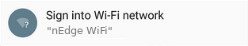
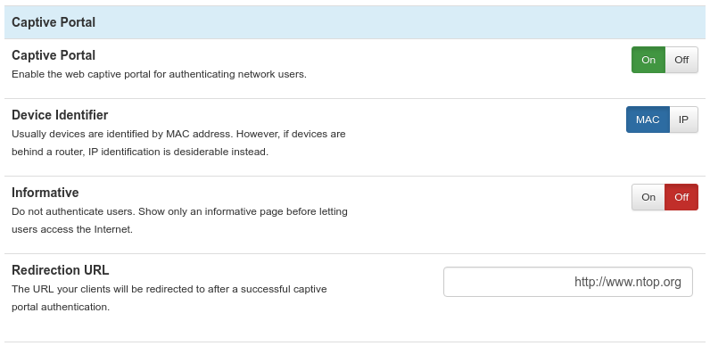

# Captive Portal {#captive-portal}

nEdge can provide a captive portal for devices authentication. New devices will
not able to access the rest of the network unless the authenticate successfully
via the web captive portal. Devices already belonging to a nEdge user will not
need to authenticate again.

The redirection to the captive portal usually happens automatically when the
device first connects to the network.

::: warning
On Windows 10 hosts with chrome browser, captive portal is only detected while
connected to a WiFi network.
:::

The captive portal basically provides a way to associate a device to a nEdge user.
After the association is successful, the policies defined for the given user will
be applied to the device. The access credentials for the captive portal are the ones configured in the
[users] page. A device label is also required. Although this is a free field, the user is
expected to insert a string to describe its device, e.g. `Joe's Laptop`.

Upon successful authentication, the device will be redirected to the web. A
customized *redirection URL* can be set up to redirect the devices to a specific website.

By leaving the field blank, the devices will be redirected to the original website
they were trying to visit before the captive portal login.

The *Device Identifier* specifies how new devices authenticating to the captive
portal will be added to the corresponding user. Usually it's desirable to
add the devices via their MAC address as it's bound to a specific device. However,
when the devices are connected to a router (not a simple switch, the router is their
default gateway) before reaching the nEdge device, their MAC address will be hidden
by the router MAC address and nEdge will always see the same MAC address, so the
captive portal would be useless. In this case the IP based identification should
be used, so that the IP address is used in place of the MAC. This assumes each
device has it's own fixed IP, so it won't work properly with DHCP.

## User Logout {#user-logout}

Disconnecting a device by explicitly logging out is usually not required, however
in case a nEdge user wants to disassociate himsemf from the device, this is possible
through the `http://<Captive Portal IP>:3000/lua/logout.lua` page from the
browser.

## Informative Captive Portal {#informative-captive-portal}

The captive portal can also operate in informative mode. No user
authentication is performed in informative mode. An informative page
is just shown to newly connected users, to present them the terms and
conditions of the Internet access that is being provided. Users will
be able to access the Internet upon acceptance of the presented terms
and conditions.

Active users will be forced to renew their acceptance of the terms and
conditions every day. Inactive users will be presented with the
informative page as soon as they become active and try to access the
Internet again.

## Selective Captive Portal {#selective-captive-portal}

It is possible to disable the captive portal for specific devices or network
segments. Check out the [users documentation] for more details.

::: info
With this setup, since routers mask the devices MAC addresses, it's necessary
to change *Device Identifier* from the captive portal preferences to "IP"
in order for this to work properly.
:::

## Radius Integration {#radius-integration}

nEdge can use an external RADIUS server to authenticate the captive portal users
as well as GUI users. Check out the ntopng [user authentication documentation] for
more details.

::: info
When RADIUS is used for captive portal authentication, only the configured [nEdge users]
will be able to authenticate. This constrain is necessary since a user is used to
associate the device to a policy.
:::

[nedge users]: /users.md
[user authentication documentation]: https://www.ntop.org/guides/ntopng/advanced_features/authentication.html
[users]: /users.md
[users documentation]: /users.md#segmenting-the-network
