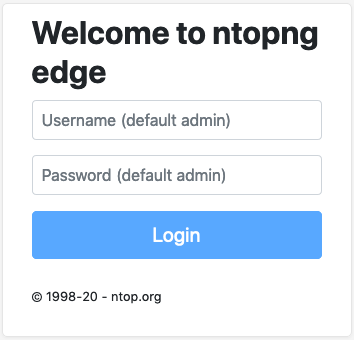
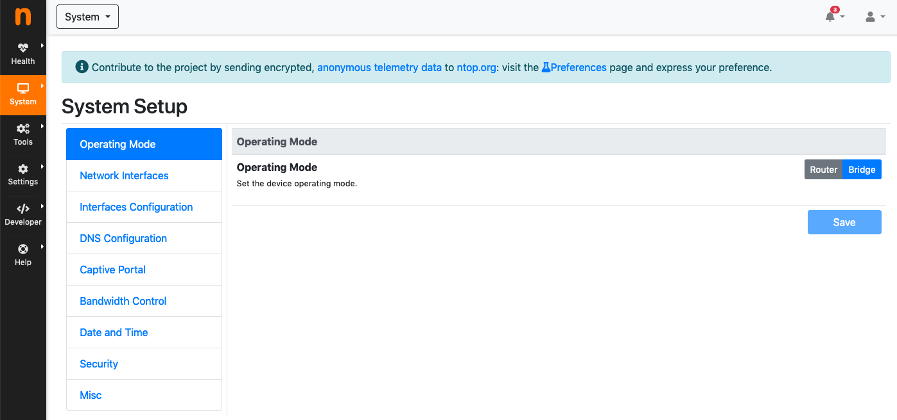
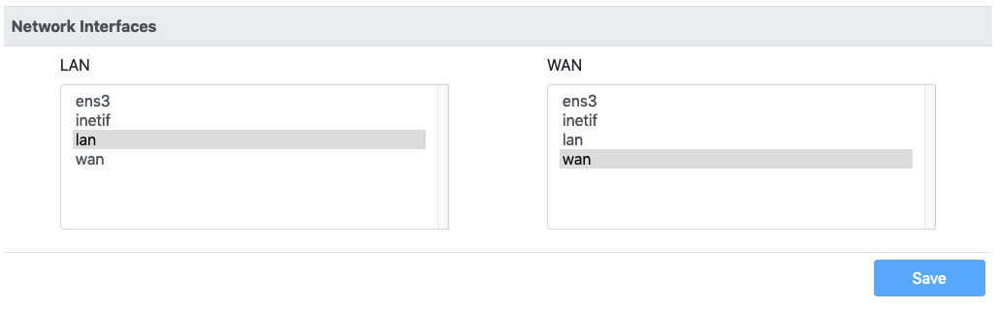
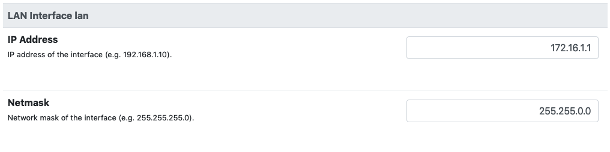

# Getting Started {#getting-started}

nEdge can be installed on Ubuntu 24 LTS using apt, it is thus necessary to configure the ntop repository by following the
instructions at <http://packages.ntop.org> . After configuring the repository, nEdge can be
installed with the below commands:

`apt-get update`

`apt-get install nedge`

::: info
nEdge requires at least **two wired network interfaces** in order to run.
:::

::: warning
nEdge will **change the system configuration** of the device where it is installed.
The original network configuration file is stored in `/etc/netplan/*.yaml.old`.
The nEdge package will force the removal of the network manager as it
conflicts with the nEdge operation.
:::

## First Start {#first-start}

Any change in the configuration operated from
the GUI requires explicit confirmation before being applied.
Some changes may require a device reboot.

After installing the package, nEdge will start automatically. The nEdge web GUI
will be available on port 3000. For example, if the device has the IP address
192.168.1.10 the nEdge GUI will be available at the URL <http://192.168.1.10:3000>.
Chrome, Firefox and Safari are the web browser officially supported.

The credentials for accessing the GUI the first time are user **admin** and password **admin**.

After logging in into the GUI for the first time, visit the System Interface and access the System Setup. The first thing to look at is the `Operating Mode`. The following operating modes
are available:

- **Bridge Mode**: provides minimal configuration and easy integration with existing network
- **Router Mode**: provides advanced routing with multiple gateways

After choosing the operating mode, it's necessary to define which network interfaces
available in the system will be used as WAN or LAN interfaces. In case of `router`
mode, multiple WAN interfaces can be selected from the multiple choice list.

**NOTE:** the interfaces list available into nEdge is based on the network interfaces
available in the system at the time of the first startup. After removing or adding
a new network interface to the system, **a factory reset is required** in order to make it
available into the nEdge GUI.

Based on the chosen setup, the `Network Configuration` will provide interfaces
configuration. For bridge mode, only LAN configuration is necessary. In router
mode, both LAN and WANs configurations are necessary. LAN and WAN network
addresses should not collide.

It is important to remember the configured **LAN address**, as it will be necessary
to access the nEdge GUI after the reboot. In case of bridge mode where the LAN is
set in DHCP client mode, it's necessary to view the DHCP server log or other
tools in order to figure out, after the reboot, the IP address assigned to the LAN.

After setting up the basic configuration, clicking the `Apply` button on the top of the page to write
the system configuration to disk and reboot the device. After the reboot, the nEdge device will be available at the configured LAN address,
port 3000.

In case of troubles reaching the device, the nEdge device should still be reachable
via its recovery address as discussed in the device [recovery] section.

## Running into a VM {#running-into-a-vm}

In order to run nEdge into a Virtual Machine, a feature called PCI Passthrough
must be enabled on the VM hypervisor. The PCI Passthrough will give the VM guest
full control on the physical network interface.

Here is a guide to enable it on some virtualization platforms:
<https://www.ntop.org/guides/pf_ring/vm/virsh_hostdev.html> .

::: info
The link above is just a reference to setup the Passthrough. PF_RING ZC will
be useless with nEdge.
:::

[bridge]: /bridging.md
[recovery]: /recovery.md
[router]: /routing.md
