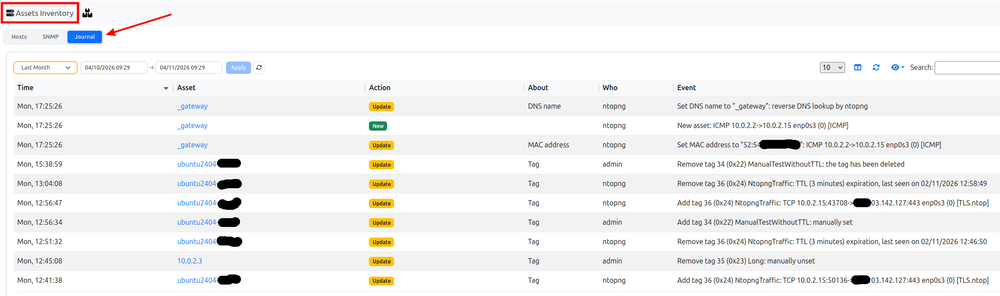
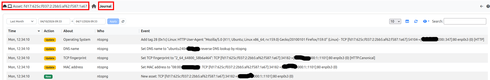

.. _AssetsJournal:

Assets Journal
==============

The assets inventory keeps the current state of the hosts seen on the
network. The **assets journal** records how that state has changed over time:
one entry for every event (an asset created or deleted, a field changed, a tag
added or removed), with **who** caused it and **why**.

.. note::

  This feature is available only from Enterprise L license, with the assets
  inventory enabled.

The journal is disabled by default. It can be enabled from *Settings >
Preferences > Behaviour Analysis* (section *Assets*), with the *Enable Assets Journal*
preference. When it is enabled a *Baseline* entry is written for every asset
already in the inventory; while it is disabled nothing is recorded, and when it
is enabled again a new *Baseline* is written.

Viewing the Journal
-------------------

The journal is shown in two places:

- The *Journal* tab of the *Assets Inventory* page (*Network* menu, see
  :ref:`Assets`): the events of all the assets of the selected interface.
- The *Journal* tab of the details page of an asset: the events of that asset
  only.

  The Journal tab of the Assets Inventory page

  The Journal tab of the details page of an asset

Each row is an event, newest first:

- **Time**: when the event happened.
- **Asset**: the asset (only in the *Assets Inventory* page). Click it to open
  its details.
- **Action**: *Baseline*, *New*, *Update*, *Delete* or *Note* (see below).
- **About**: what has changed, e.g. *MAC address*, *DNS name*,
  *TCP fingerprint*, *Operating System* or *Tag*. Empty when the event is
  about the asset as a whole.
- **Who**: ``ntopng`` for the events detected automatically, otherwise the
  user that caused the event (e.g. ``admin`` for a tag set by hand).
- **Event**: what happened and why (see `Causes`_). For an event seen in the
  traffic, it shows the flow (connection) where it has been seen.

By default the last month is shown: choose another time interval with the
selector above the table and click *Apply*. The table can be searched (the
IP of the asset, the user, the action, the subaction and the values of the
event), and the columns shown can be
chosen with the eye icon.

The tabs are enabled only when the journal is enabled (see above): otherwise
they are disabled, and a tooltip says how to enable it. Without an Enterprise L
license the tooltip says that an upgrade is needed.

Entries
-------

Every entry has:

- **Event time**: when the event happened (epoch).
- **Created time**: when the entry has been written (epoch).
- **Who**: ``ntopng`` for the events detected automatically, otherwise the
  name of the user that caused the event from the GUI or the REST API.
- **Action**: see below.
- **Subaction** (*About* in the GUI): what the entry is about: ``os`` (the
  Operating System tags), ``tag`` (the other tags), the name of the field
  (``ip``, ``mac``, ``vlan``, ``tcp_fingerprint``, ``dhcp_fingerprint``,
  ``dns_name``, ``kerberos_name``), ``usernames`` (the usernames of the
  host), empty for the asset as a whole (Baseline, New, Delete, Manual).
- **Asset**: the interface id, the type of the asset (``host``) and its key,
  as in the assets inventory.
- **Message**: what happened, and its cause.

Actions:

- **Baseline**: the asset was already in the inventory when the journal has
  been enabled (one entry per asset, no details).
- **New**: the asset has been created. The entry is followed by one *Update*
  entry for each field with a value (except the ones in the key of the asset,
  i.e. IP address and VLAN) and for each tag of the new asset.
- **Update**: one property of the asset changed or has been added/removed (i.e.
  a new tag has been set or a fingerprint changed).
- **Delete**: the asset has been deleted.
- **Manual** (*Note* in the GUI): a free text note, written by a user or by an integration.

The fields of the host assets currently recorded are: IP address, MAC
address, VLAN, TCP fingerprint, DHCP fingerprint, DNS name, Kerberos machine
account, the usernames and the tags. The name of the host is not recorded, as
it is derived from the other names of the host (DNS, DHCP, mDNS, ...).

The usernames are the users seen in the traffic of the host, each with the
protocol it has been seen with (e.g. ``alice@corp.local (Kerberos)``, the
client of a Kerberos authentication accepted by the KDC). A host keeps the 3
most recent ones: a new one replaces the one seen least recently. Each username
added or removed has its own entry and cause.

Causes
------

The message always tells the cause of the event, with all the information
available. An event caused by the traffic reports the flow it has been seen in,
with the interface that has seen it (with a view interface, the viewed
interface the flow belongs to):

.. code-block:: text

  New asset: UDP 192.168.1.93:51409->192.168.1.1:53 eth0 (0)
  Set MAC address to "10:13:31:F1:39:76": UDP 192.168.1.93:51409->192.168.1.1:53 eth0 (0)
  Add tag 0 (0x00) DNS Server: UDP 192.168.1.93:52340->192.168.1.1:53 eth0 (0) [DNS]
  Add tag 13 (0x0d) Non-PQC Compliant: risk Non PQC Compliant Flow - TCP 192.168.1.93:61562->92.122.247.92:443 eth0 (0) [TLS]
  Update TCP fingerprint from "2_128_64240_47466ece" to "2_64_64240_789c1d1f": TCP 172.16.1.137:39970->116.203.142.127:80 eth0 (0) [HTTP.ntop]
  Remove tag 31 (0x1f) Windows: replaced by tag 28 (0x1c) Linux, Linux (TCP Fingerprint) - TCP 172.16.1.137:39970->116.203.142.127:80 eth0 (0)
  Add username dave@corp.local (Kerberos): UDP 10.0.0.5:50012->10.0.0.1:88 eth0 (0) [Kerberos]
  Remove username alice@corp.local (Kerberos): replaced by dave@corp.local (Kerberos) - UDP 10.0.0.5:50012->10.0.0.1:88 eth0 (0) [Kerberos]

A flow is shown as ``<protocol> <client>-><server> <interface name> (<interface id>) [<application>]``,
the application only when it is known. When the cause has an evidence other
than the flow (the risk of a tag bound to a risk, the fingerprint or the
User-Agent an Operating System has been learnt from) the evidence comes first,
followed by a dash (``-``) and the flow.

The flow of a *New* entry is the first flow of the host (the one that has
created it), shown without application, as it was not yet known when the host
has been created.

The other causes:

.. list-table::
   :header-rows: 1

   * - Event
     - Example
   * - Tag set or unset by a user on a host
     - ``Add tag 41 (0x29) Servers: manually set``
   * - Tag deleted
     - ``Remove tag 41 (0x29) Servers: the tag has been deleted``
   * - Tag expired (see :ref:`Asset Tag Expiration (TTL) <AssetTagsTTL>`)
     - ``Remove tag 8 (0x08) SSH Server: TTL (30 days) expiration, last seen on 01/10/2026 10:00:00``
   * - Tag of a host in the network configuration
     - ``Add tag 0 (0x00) DNS Server: from network configuration``
   * - Name resolved by ntopng
     - ``Set DNS name to "www.example.com": reverse DNS lookup by ntopng``
   * - Asset deleted by a user
     - ``Asset deleted``
   * - Assets not seen for a while deleted
     - ``Asset deleted: not seen since 01/09/2026 00:00:00``
   * - Duplicated asset deleted
     - ``Asset deleted: duplicate of asset 0_192.168.1.10@0 (same IP address and VLAN)``
   * - Assets imported
     - ``New asset: imported``

Storage
-------

The entries are stored in the ``assets_journal`` table, in ClickHouse when
available, otherwise in the SQLite database of the interface. Entries are
**never deleted**: not by the data retention, and not when their asset is
deleted, so that the history of a deleted asset is still available.

Besides the *Journal* tabs (see `Viewing the Journal`_), the entries of an
asset can also be read with SQL, e.g. with ClickHouse:

.. code-block:: sql

  SELECT event_time, who, action, subaction, message_id, message_values, message
  FROM ntopng.assets_journal
  WHERE ifid = 0 AND key = '0_192.168.1.1@0'
  ORDER BY event_time, created_time

The messages are stored as a template (``message_id``) and its values
(``message_values``, JSON), and shown in the language of the user; free text
notes are stored in ``message``.

Lua API
-------

The journal can be read and written by Lua code (e.g. by integrations) with the
``assets_journal`` module (``pro/scripts/lua/modules/assets_journal.lua``):

- ``assets_journal.get(ifid, key, from, to)``: the entries of an asset in a
  time interval (epochs in seconds, both ends included), oldest first,
  with the text of their messages.
- ``assets_journal.add(entry)`` and ``assets_journal.addBatch(entries)``:
  write one or more entries. They can be called concurrently, never raise an
  error, and do nothing while the journal is disabled. An entry has an
  ``action`` (``assets_journal.actions``), an optional ``subaction`` (e.g. the
  name of the integration), and either a free text ``message`` or a template
  (``message_id``, ``message_values``).

An entry written by an integration:

.. code-block:: lua

  local assets_journal = require "assets_journal"

  assets_journal.add({
     ifid = 0,
     key = "0_192.168.1.1@0",
     who = assets_journal.currentUser(), -- "ntopng" outside of a request
     action = assets_journal.actions.manual,
     subaction = "wazuh",
     message = "Moved to the server room",
  })
