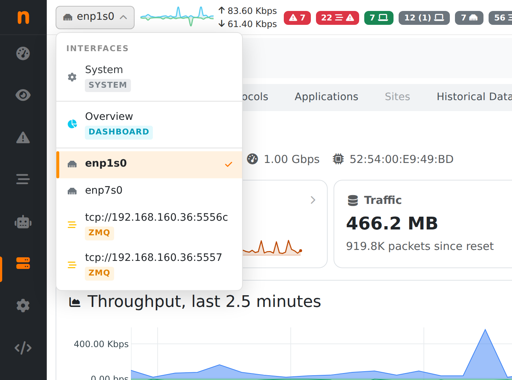
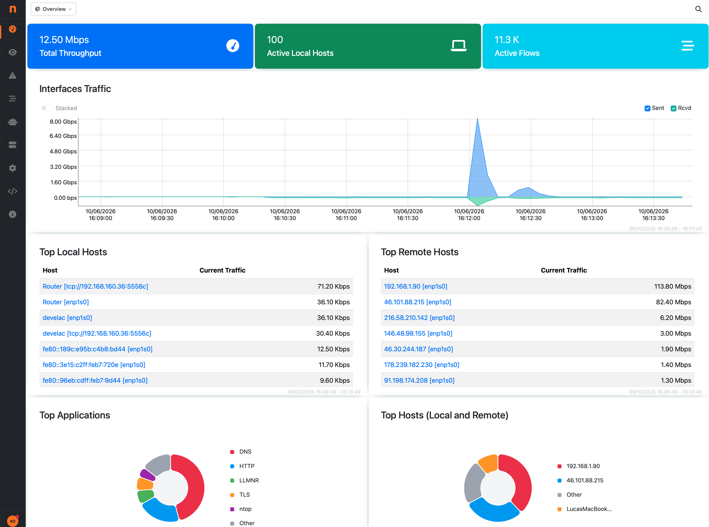
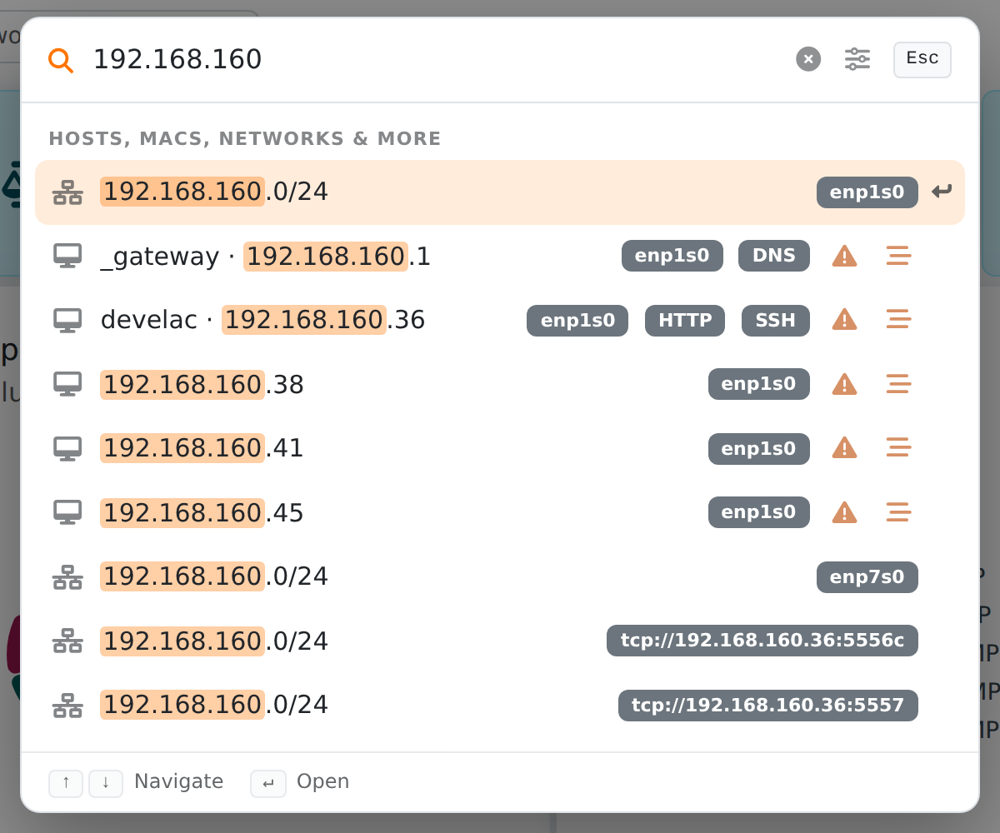
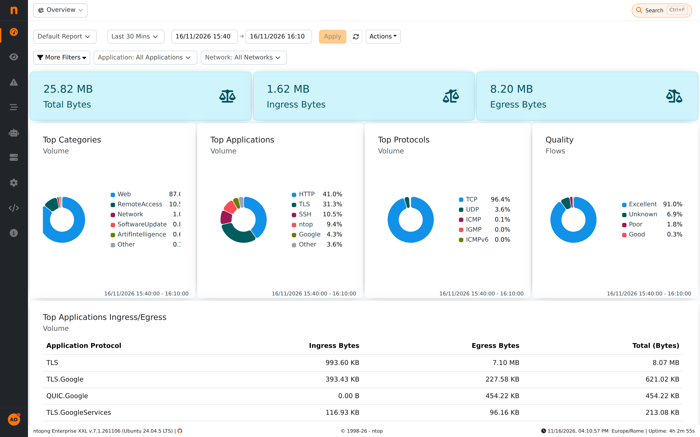
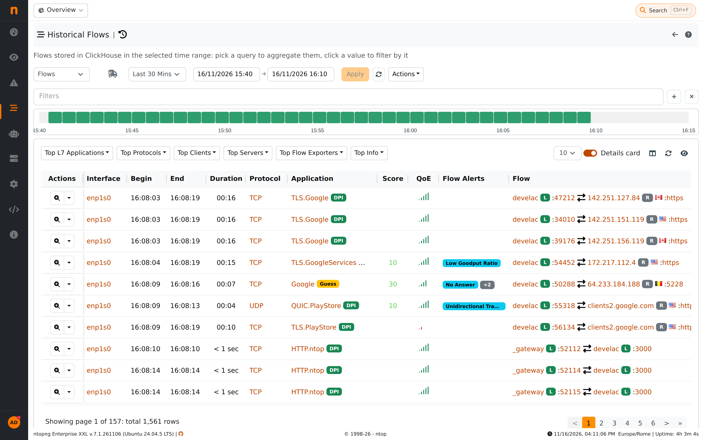
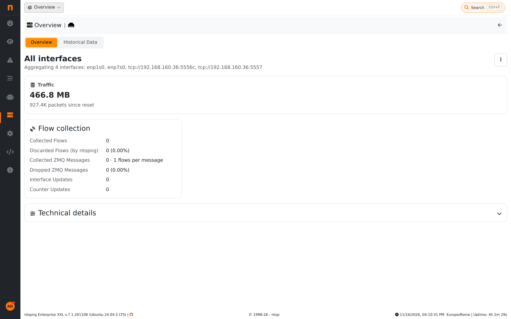
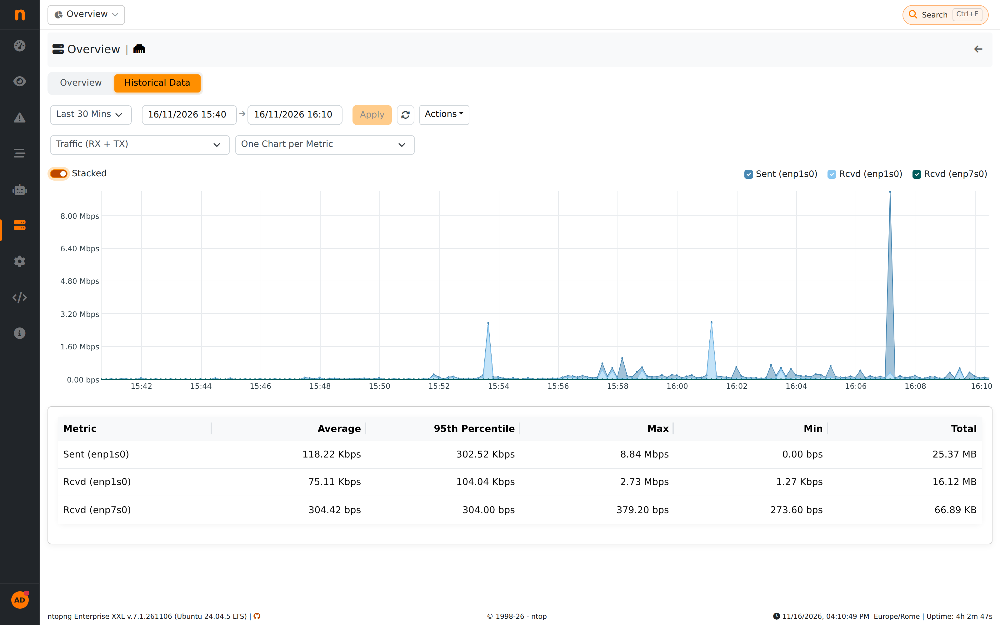

# Light View {#light-view}

When ntopng monitors more than one network interface (e.g. when multiple ZMQ endpoints are used for
load-balancing flows for scaling at high flow rates, or when multiple packet interfaces or streams are
configured for processing high packet rates), the Interfaces dropdown menu in the top toolbar lists
an additional *Overview* entry. Selecting it switches the web GUI to a *light view* that combines
the data of all the local interfaces of the ntopng instance, so that a single page shows the overall
picture instead of one interface at a time.

This light view does not require any configuration: it is computed on demand from the interfaces
ntopng is already monitoring. It is not an interface itself, nothing is added to the command line,
and no extra traffic processing takes place in the background. This is the main difference with
[View Interfaces](/advanced_features/interfaces/view_interfaces.md), which are created
via the command line and merge traffic of the underlying interfaces into a real logical interface.

The Overview entry is shown in the dropdown when:

- ntopng monitors two or more interfaces (the [System Interface](/basic_concepts/system_interface.md)
  is not counted), and
- no View Interface is configured. When a View Interface exists, that is the intended way to see
  aggregated data, and the Overview entry is hidden.

While Overview is selected, the menu only shows the pages that are able to combine data of all the
interfaces:

- the live [Dashboard] with the aggregated traffic;
- the [Global Search] of hosts on all the interfaces;
- the [Report] on the aggregated traffic;
- the [Historical Flows] of all the interfaces;
- the [Interface Details] with the aggregated counters and the aggregated or per-interface
  [Timeseries];
- the [Alerts] of all the interfaces (with ClickHouse only).

The other menu entries are disabled with the *Not available in Overview* hint;
select a regular interface from the dropdown to access them.

## Dashboard {#dashboard}

This light view has its own live dashboard. Counters, charts and tables are computed by querying
every local interface and merging the results:

- the *Total Throughput*, *Active Local Hosts* and *Active Flows* counters are the sum of all the
  interfaces;
- the *Interfaces Traffic* chart shows the total traffic (sent and received) of all the
  interfaces;
- the *Top Local Hosts* and *Top Remote Hosts* tables report, next to each host, the name of the
  interface where the host has been seen (e.g. `develac [enp1s0]`). Clicking a host opens its
  details page on that interface.

## Global Search {#global-search}

In the light view, the [Search](/user_interface/shared/other_components.md#globalsearch) always looks for hosts, networks and the other
supported items on all the interfaces, regardless of the *Search In All Interfaces* preference.
Each result reports the name of the interface where it has been found. The same host or network
can be listed more than once when it is seen on more than one interface.

- Clicking a result opens its details page on the interface where it is active.
- The *Alerts* and *Historical Flows* icons next to a host open those pages within the
  light view, filtered by the host, so the results cover all the interfaces.

## Report {#report}

The Report (Dashboard menu) summarizes the traffic of all the interfaces in the selected time
range: total, ingress and egress bytes, top categories, applications and protocols, flow quality,
top local and remote hosts, top clients and servers, top networks and countries, and the traffic
chart. It works as the [Traffic Report](/flow_dump/clickhouse/reports.md) of a single
interface, with the *Any Interface* option always enabled: the values are computed once on the
flows of all the interfaces, so each host, network or country is listed once with its total.

Time range, report templates, filters and the other report actions work as for a regular
interface. As the report is built from the flows stored in the database, it needs
[ClickHouse](/flow_dump/clickhouse/clickhouse.md).

## Historical Flows {#historical-flows}

The [Historical Flows Explorer](/flow_dump/clickhouse/historical_flows.md) lists the flows
(connections) stored in ClickHouse for all the interfaces. The *Interface* column reports
the interface where each flow has been seen. Queries, filters, the top lists (applications,
protocols, clients, servers, ...) and the flow details work on the flows of all the interfaces.

## Interface Details {#interface-details}

The Interface Details page reports the totals of all the local interfaces: traffic, packets,
drops, flows, flow exporters and probes (for collector interfaces), database export statistics and
alert counters. The list of the interfaces being aggregated is reported at the top of the page,
in place of the identity information (name, MAC address, speed, etc.) of a single interface.
Counters are refreshed automatically as for a regular interface.

Only the information that can be meaningfully summed is shown. Per-interface sections, such as
storage utilization, traffic recording, live capture and the traffic breakdown charts, are available
by selecting the actual interface.

The *Reset Counters* action resets the counters of all the local interfaces.

### Timeseries {#timeseries}

The *Historical Data* tab of the Interface Details page shows the interface timeseries
(traffic, packets, flows, ...) of all the local interfaces. Pick the timeseries in the dropdown
and the time range as for a regular interface.

By default the chart shows the **aggregated** timeseries: the sum of all the interfaces. The
comparison with the previous period (e.g. *30m ago*) and the statistics table (average,
95th percentile, max, min, total) refer to the sum.

")

Enabling the *Stacked* toggle on the chart splits the sum into **one series per interface**,
stacked on top of each other, so that the contribution of each interface to the total is visible.
Each series is labeled with the interface name (e.g. *Sent (enp1s0)*, *Rcvd (enp7s0)*), and the
statistics table lists one row per interface. In this mode both sent and received traffic are drawn
above the axis, so the top of the stack is the total traffic. Interfaces with no traffic in the
selected time range are not shown. Disable the toggle to go back to the aggregated view; the
choice is remembered for the next visits.

## Alerts {#alerts}

When ClickHouse is enabled, the Alerts Explorer is available in the light view and lists the
alerts of all the interfaces, both engaged and past alerts. All the explorer actions work on the
whole set of alerts: filters, acknowledging and deleting alerts, and opening alert details.

Actions that refer to a single interface, such as the live flows of a host or the extraction of
the traffic of a flow from the traffic recording, require jumping on the actual interface.

::: info
Alerts are only available in the light view when ClickHouse is enabled. With the default
(SQLite) alert database, the Alerts menu is disabled in the light view.
:::
