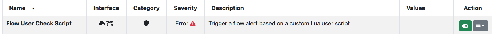

.. _ApiFlowChecks target:

Flow Checks
===========

Flow checks are written in C++ for efficiency reasons. However ntopng also lets you write your own flow
checks in Lua, for instance to detect anomalies in OT protocols (Modbus function codes used too often,
proprietary protocols carrying values out of range) without changing ntopng.

To use them:

1. Enable the `Flow User Check Script` behavioural check (`Settings` > `Behavioural Checks` > `Flows`).
2. Put your scripts, one detection per file, in `/etc/ntopng/custom_checks/flows/` (any name ending in `.lua`).
3. Restart ntopng, or save the behavioural checks configuration: the scripts are loaded again.

The ntopng log reports every script loaded (`Loaded custom flow script <file> [title: <title>] on <interface>`)
and the scripts discarded, with the reason (e.g. an unknown key or an invalid IP address). A script that fails
while running is reported once, and the other scripts keep working.

Two complete examples are installed in `scripts/callbacks/checks/flows/examples/` (`modbus_function_code_rate.lua`
and `proprietary_protocol_range.lua`): copy them to `/etc/ntopng/custom_checks/flows/` and adapt them.

Script Format
-------------

A script returns a table:

.. code:: lua

  return {
    title  = "Modbus custom function code rate", -- optional, default: the file name
    score  = 100,                                -- optional, default 50: score of its alerts (1-255)
    hooks  = { "periodic", "end" },              -- optional, default: all
    filter = { l7_proto = "Modbus", ip = "10.10.0.0/16" }, -- optional, default: every flow
    exclude = { srv_port = 8080 },               -- optional: flows to skip

    check = function(flow)
      if flow.srv_port() == 502 and flow.bytes() > 1000000 then
        flow.triggerAlert("Too much Modbus traffic to " .. flow.srv())
      end
    end,
  }

- `check` (required) is called for every flow that matches the filter, in the selected hooks.
- `hooks`: `detected` (when nDPI detects the application protocol), `periodic` (periodically while the flow is
  active), `end` (when the flow ends).
- Each script runs in its own Lua interpreter, kept for the whole ntopng run (one per interface): local variables
  of the script keep their value between flows and between hooks.

Flow Filters
------------

`filter` selects the flows the script receives; `exclude` (same fields) skips flows. The filters are evaluated
by ntopng before calling the script, so a script with a narrow filter costs nothing on the other flows.

- `cli_ip`, `srv_ip`: client or server IP address or network (CIDR), IPv4 or IPv6
- `ip`: client or server (either side)
- `cli_port`, `srv_port`: client or server port
- `port`: client or server port (either side)
- `l4_proto`: name (`TCP`, `UDP`, `ICMP`, `ICMPv6`, `GRE`, `ESP`, `SCTP`, `IGMP`) or number
- `l7_proto`: nDPI protocol name (e.g. `Modbus`, `DNS`, `TLS`) or number, matched on both the application and the
  master protocol

Each field accepts a value or a list. Different fields must all match; a list matches when any of its values does.
For instance ``{ ip = { "10.0.0.0/8", "192.168.1.5" }, port = { 502, 20000 } }`` selects the flows with
either side in 10.0.0.0/8 or equal to 192.168.1.5, on port 502 or 20000.

Alerts
------

`flow.triggerAlert(message)` (or `flow.triggerAlert(score, message)`) triggers a `Custom Script` alert on the flow,
with the title of the script. When several scripts trigger on the same flow, the flow has a single alert with all
their titles and messages, and the highest score.

In the Alerts Explorer (`Flow` tab) the `Custom Script` filter selects the alerts by script title: `=` for the
exact title, `contains` for part of it. Prefer titles made of letters, numbers and spaces: quotes and `<`, `>`
cannot be used in the filter.

Helpers
-------

- | **counter.inc(key, window_secs [, n])**
  | Adds `n` (default 1) to the counter `key` in a window of `window_secs` seconds (default 60) and returns the
    count of the window; a new window starts when it expires. Use it for "too many times per minute" checks,
    e.g. ``counter.inc(flow.srv() .. "/65", 60) > 100``.

- | **counter.get(key)**
  | The count of the current window of `key`, 0 when expired.

- | **counter.reset(key)**
  | Clears the counter `key`.

Flow Object Methods
-------------------

- | **flow.cli()**
  | Read the flow client IP (string)

- | **flow.cli_port()**
  | Read the flow client port (number)

- | **flow.srv()**
  | Read the flow server IP (string)

- | **flow.srv_port()**
  | Read the flow server port (number)

- | **flow.protocol()**
  | Read the flow layer 4 protocol (number)

- | **flow.vlan_id()**
  | Read the flow VLAN Id (number)

- | **flow.is_oneway()**
  | Check if the flow is unidirectional, meaning that there is no traffic from server to client (boolean)

- | **flow.is_unicast()**
  | Check if the flow has unicast peers (boolean)

- | **flow.cli2srv_bytes()**
  | Read the flow bytes from client to server (number)

- | **flow.srv2cli_bytes()**
  | Read the flow bytes from server to client (number)

- | **flow.bytes()**
  | Read the total (sent + received) flow bytes (number)

- | **flow.l7_master_proto()**
  | Read the flow nDPI master protocol (number)

- | **flow.l7_proto()**
  | Read the flow nDPI application protocol (number)

- | **flow.l7_proto_name()**
  | Read the flow nDPI protocol name (string)

- | **flow.direction()**
  | Read the flow (e.g. local2remote) direction (string)

- | **flow.http()**
  | For HTTP flows, it reports protocol information (e.g. HTTP URL or return code) or nil otherwise (table)

- | **flow.dns()**
  | For DNS flows, it reports protocol information (e.g. domain name) or nil otherwise (table)

- | **flow.ssh()**
  | For SSH flows, it reports protocol information (e.g. SSH client signatute) or nil otherwise (table)

- | **flow.tls_quic()**
  | For TLS/QUIC flows, it reports protocol information (e.g. TLS ciphers or SNI) or nil otherwise (table)

- | **flow.json_info()**
  | The additional fields sent with the flow by the probe (e.g. the fields extracted by nProbe plugins), as a table; an empty table when there are none (table)

- | **flow.ot()**
  | The OT protocols dissected by ntopng for the flow: ``modbus``, ``s7comm``, ``profinet``, ``iec104``, each with e.g. ``function_codes`` (calls per function code since the flow start), ``function_codes_transitions``, ``registers`` (Modbus) and ``num_exceptions``; an empty table for other flows (table)

- | **flow.triggerAlert([score,] message)**
  | Triggers an alert for the selected flow. The message (string) is a human-readable description of the issue; the optional score (number, up to 255) overrides the score of the script.
