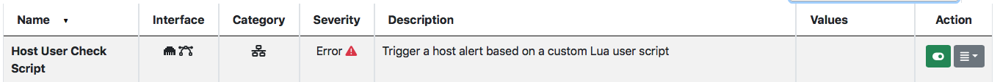

<a id="apihostchecks-target"></a>

# Host Checks {#host-checks}

Host checks are written in C++ for efficiency reasons. However ntopng also offers a Lua API that can be used to create host checks. All you need to do is to enable the `Host User Check Script` behavioural check under the `Settings` menu sidebar. Done that you need to create a script named `custom_host_lua_script.lua` under `/usr/share/ntopng/scripts/callbacks/checks/hosts/`.



ntopng has a sample host script that you can find [here](https://github.com/ntop/ntopng/tree/dev/scripts/callbacks/checks/hosts) and that can be used as reference.

## Operational Mode {#operational-mode}

The lua script check is executed periodically on all hosts (typically every minute). Through the Lua API, developers have access to the `host` object that can be used to access information about the host being checked and also to trigger a host alert.

## Script Example {#script-example}

Below you can find a simple `custom_host_lua_script.lua` script.

```bash
if(host.ip() == "1.2.3.4") then
   local score   = 100
   local message = "dummy alert message"

   host.triggerAlert(score, message)
 end

 -- IMPORTANT: do not forget this return at the end of the script
 return(0)
```

In the script above an alert is triggered host hosts whose server port is 53.

## Host Object Methods {#host-object-methods}

- **host.ip()**
  Read the host IP address (string)
- **host.name()**
  Read the symbolici host name (string)
- **host.vlan_id()**
  Read the host VLAN Id (number)
- **host.is_unicast()**
  Check if host has an unicast IP address (bool)
- **host.is_multicast()**
  Check if host has an multicast IP address (bool)
- **host.is_broadcast()**
  Check if host has a broadcast IP address (bool)
- **host.is_blacklisted()**
  Check if the host is blacklisted (bool)
- **host.bytes_sent()**
  Read the (total) host bytes sent (number)
- **host.bytes_rcvd()**
  Read the (total) host bytes received (number)
- **host.bytes()**
  Read the (total sent and received) host bytes (number)
- **host.l7()**
  Read the host nDPI protocol statistics (table)
- **host.triggerAlert(score, message)**
  Triggers an alert for the selected host. The score parameter (numeric) is used to set the alert score, and the message (string) is used to set the alert string that typically contains a human-readeable message related to the triggered alert.
