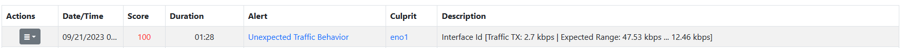
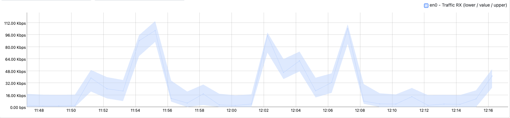
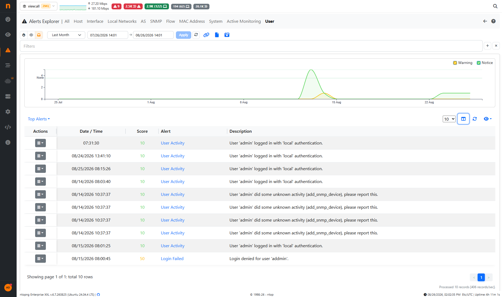
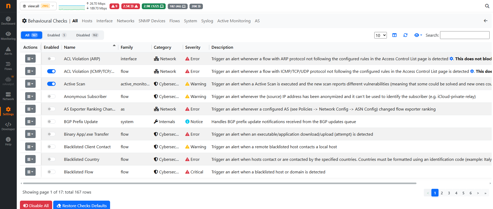
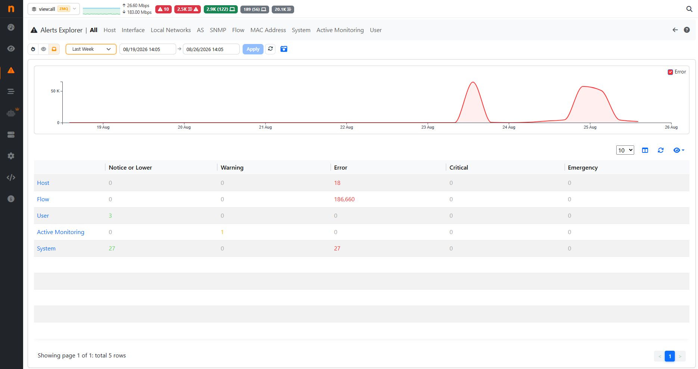

# Alerts {#alerts}

ntopng generates alerts to report the occurrence of events and user-configurable thresholds. Bahavioral Checks are responsible for the generation of most alerts. Enabling and disabling a Check enables or disables the corresponding alerts. A few system alerts are not generated by a Check and are always enabled (see [Always Enabled System Alerts](/user_interface/shared/alerts/others/system_checks.md#alertsalwaysenabled)).

Alerts include, but are not limited to:

- The detection of a new device
- The status change of a switch port detected via SNMP
- The contact of a malware host
- A user activity

Certain alerts are configurable. For example, alerts can be triggered when certain user-configurable thresholds are crossed. As soon as ntopng detects a certain threshold is crossed, it immediately triggers the corresponding alert.

Examples of thresholds include:

- "The traffic generated by an host falls below a certain threshold"
- "The number of SYN sent by an host exceeds a certain number so it is considered a scanner"
- "Packet drops of an interface exceeds a given percentage of the total number of monitored packets"
- "The total traffic originated at a network exceeds a certain threshold"

ntopng checks perform the evaluation of thresholds periodically, at predefined time intervals.

Alerts associated with a threshold have a duration, that is, they are active for a certain period of time. This period of time starts then the threshold is first met and stops when the threshold is no longer met. For this reason, such alerts are said to be *engaged* or *past*, depending on whether the triggering threshold is still met or not.

## Behavioral Alerts {#behavioral-alerts}

Unlike other alert families, usually based on a static threshold or check, bahavioral checks have the ability to learn throught the time and change their threshold dinamically.

This is achived by using one of the three foresighting alghoritm developed by nDPI: Simple Exponential Smoothing, Double Exponential Smoothing, Triple Exponential Smoothing (Holt-Winters alghoritm).

These alghoritms have the ability to foresight the future and give a prediction of the analized value. Based on this foresighted value the alert is triggered.

The alert is triggered only if the real value is lesser or greater then certain thresholds that nDPI calculates (it gives a lower and upper bound).

::: info
Behavior Alerts are available only with ntopng Enterprise L license.
:::

## User Activities {#user-activities}

ntopng keeps track of user activities that are related to system management and security, storing them as alerts.
These activities include:

- Users management: user added or remove, password changed
- Live traffic downloaded
- Traffic extraction (live or PCAP downloaded)
- Host JSON downloaded
- Flows data downloaded
- Alerts settings changes: alerts disabled or enabled, alerts data deleted
- Failed or successful logins
- Traffic recording enabled or disabled
- Hosts/interfaces data deleted
- SNMP device added or removed

User activities are available in the [System Interface](/basic_concepts/system_interface.md#basicconceptsysteminterface), under the *Past Alerts* page:

## Severity {#severity}

Event and threshold alerts are always associated with a severity that tells the importance of such occurrence. For example, the contact of a blacklisted host is emphasized with a *warning*, whereas a threshold crossed by an host is highlighted with an *error*. Currently, severity levels available those defined in RFC 3164, namely:

- *Emergency*: system is unusable
- *Critical*: critical conditions
- *Error*: error conditions
- *Warning*: warning conditions
- *Notice*: normal but significant condition

## Entities {#entities}

Every alert has an entity (subject for which the alert has been generated). The list of entities supported by ntopng are:

- **Host**: Layer-3 IP address
- **Interface**: monitored ntopng interface
- **Network**: ntopng local network
- **SNMP device**: device added to ntopng from the SNMP page
- **SNMP device interface**: device added to ntopng from the SNMP page
- **Flow**: monitored flow
- **MAC Address**: Layer-2 Mac address
- **Host Pool**: the user-created host pool
- **Process**: the ntopng process itself
- **User**: the ntopng GUI user

For example, an alert triggered for host `192.168.1.2` that has exceeded a traffic threshold will have *"host"* as entity and "*192.168.1.2"* as entity value. Similarly, network `192.168.2.0/24` that has exceeded a traffic threshold will have *"network*" as entity and *"192.168.2.0/24"* as entity value.

Entities are not shown when browsing ntopng alert pages as they are clear from the context and alert messages. Understanding how entities work can be useful when propagating alerts to third-party endpoints such as syslog.

## Type {#type}

The full list of alerts is available under the Settings section, page *Behavioral Checks*, except the [Always Enabled System Alerts](/user_interface/shared/alerts/others/system_checks.md#alertsalwaysenabled).

## Recipients {#recipients}

Alerts are not only available within the ntopng web GUI, they can also be propagated to the outside using recipients that include mail, slack and syslog. To see the configuration details necessary to use recipients refer to [Notifications](/user_interface/shared/alerts/available_endpoints.md#availableendpoints): the notification policies choose which alerts are sent to which recipients.

## Alerts Explorer {#alerts-explorer}

ntopng features a built-in Alerts Explorer for navigating and analysing alerts, for further information please read the [Alerts Explorer](/user_interface/shared/alerts/alerts_explorer.md#alertsexplorer) section.

[device protocols]: ../advanced_features/device_protocols.html
