<a id="reports"></a>

# Traffic Reports {#traffic-reports}

When ClickHouse is enabled, a Reports page becomes available in the ntopng web GUI under the Dashboard > Reports menu.

This section describes how to use this functionality to build traffic reports on demand or automatically/periodically and get notified about their availability.

::: info
Historical Flows Explorer and Reports are only available ntopng Enterprise M or above with ClickHouse enabled.
:::

Reports contain charts of monitored interfaces overall traffic, local versus remote traffic, local networks traffic, as well as the traffic grouped by:

- Application Protocols (e.g., HTTPS, Skype)
- Countries
- Local Hosts (hosts belonging to local networks) and Remote Hosts
- Autonomous Systems

The picture below shows an example of report generate by ntopng:

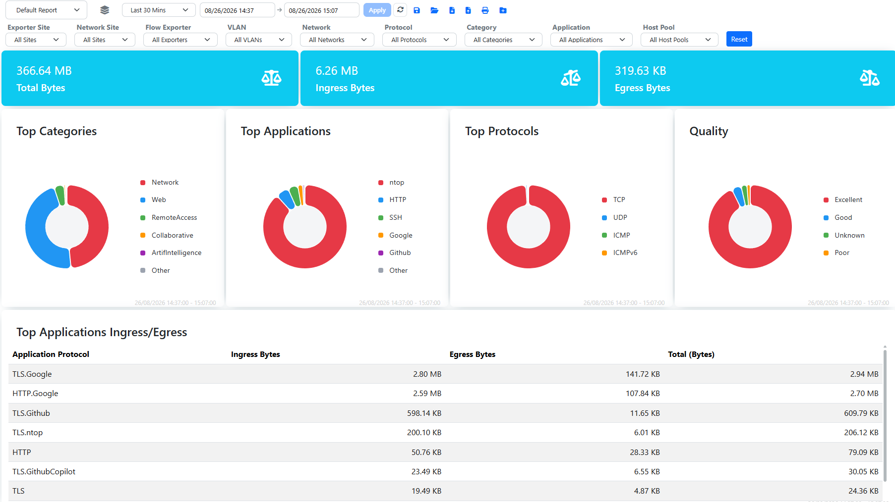

ntopng implements a flexible dashboarding engine that allows you to define custom reports by means of graphical components and data sources.
This means that multiple templates can be defined, according to the user requirements, to build reports with charts and data which is meaningful
for the specific user, network and use case. A dropdown at the top of the Reports page lets you select the desired template to be used to build
the report out of those available.

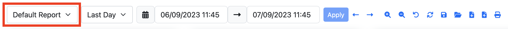

The report is build using traffic information in a selected time frame. It is possible to select an arbitrary time interval by using the
dropdown and the range picker at the top of the Reports page. Fixed-width temporal intervals are also available (e.g. for the last one hour,
day, weeek, etc.) producing a report that spans a time range that starts at the present and that goes backwards in time until the clicked
interval is reached.

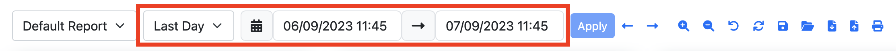

## Save/Open Reports on ntopng {#save-open-reports-on-ntopng}

After selecting a report template and a time window, a report is generated and displayed. It is possible to save it by clicking on the
Save button.

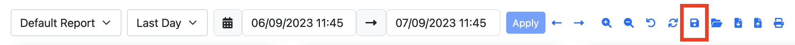

A dialog will ask for a name for the report. By clicking Save, the report is stored on disk the same machine running ntopng as a JSON file
containing all the information required to reload the same report in future for further analysis.

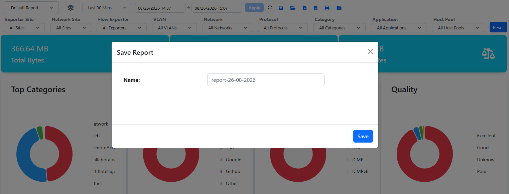

In order to reload a previously-saved report, an Open button is available.

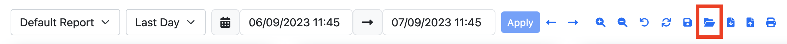

A dialog will let you select the report, out of those previously saved in ntopng.

::: info
In case of multiple users, reports generated by an administrator is visible by all administrators, instead reports generated by a non-privileged user is visible only to
the same user (and traffic visibility restrictions will apply according to the configured user permissions), and the non-privileged user cannot see reports generated by administrators.
:::

Through the same dialog it is also possible to delete a report (the selected one) or all reports.

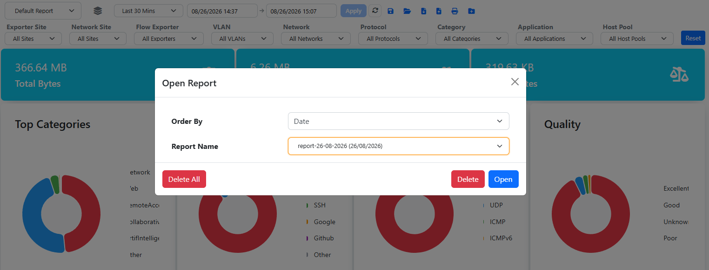

::: warning
Reports are automatically deleted after some time according to the configured data retention. Please read the Data Retention section for further information.
:::

## Backup/Load Reports Locally {#backup-load-reports-locally}

In addition to saving reports on the machine running ntopng, it is also possible to download a report locally to keep a backup or forward it to someone else.
In order to dowload a report backup click on the Download button. This will download a JSON file containing all the information required to reload the report
on the same or a different ntopng installation for visualization.

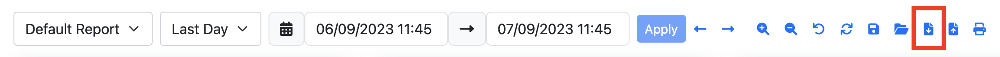

In order to reload a report from a JSON file previously downloaded, click on the Upload button.

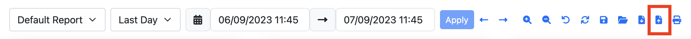

A dialog allows you to upload a report backup in JSON format and visualize it in ntopng. Please note this report is just visualized, no copy is stored on
the machine running ntopng. However it is also possible to save it by clicking on the Save button as described in the previous section.

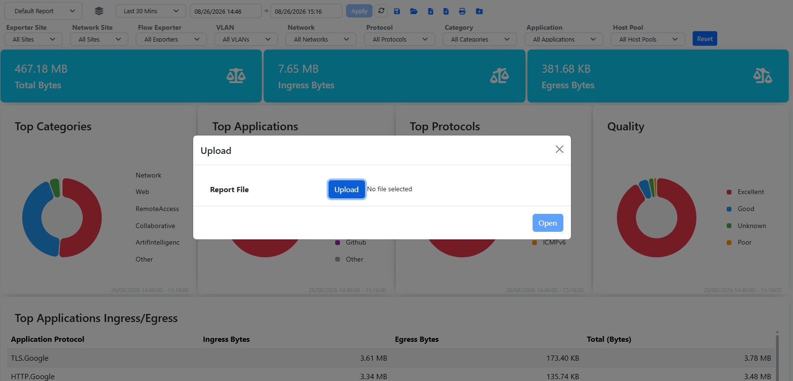

## Print Report (PDF) {#print-report-pdf}

A print functionality is also available to actually print or generate a PDF from a reports, this is possible by clicking on the Print button.

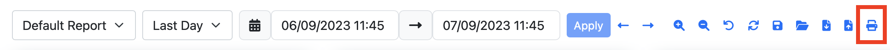

When printing a report the rendering engine does its best to fit all the graphical components in standard printing formats (e.g. A4).

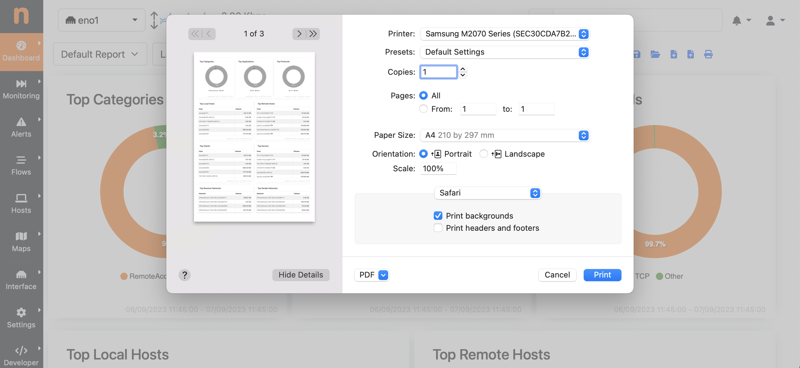

## Automatic Reports and Notifications {#automatic-reports-and-notifications}

In addition to the manual Report generation, automatic reports can also be enabled in ntopng. This means that ntopng can build
for instance daily reports every night, with traffic information for the last 24h.

::: info
Periodic Reports are only available in ntopng Enterprise L or above.
:::

In order to enable this, a global setting is
available under Settings -> Preferences -> Reports -> Daily Reports Generation.

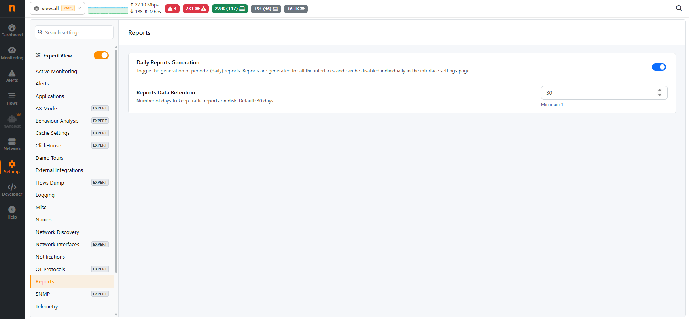

By enabling Daily Reports Generation, ntopng generates a report for every interface, every day. It is possible to disable automatic
reports on selected interfaces through the Interface -> Details -> Settings -> Create Daily Reports setting, which is enabled by
default after enabling the global setting.

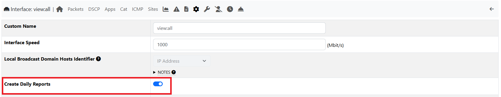

When a new report has been generated and it is available, ntopng can also send a notification to inform the user, e.g. by sending an
email. In order to enable notifications, an email Recipient and a [Notification Policy](/user_interface/shared/alerts/available_endpoints.md#notificationpolicies) should be configured.
In the policy, Traffic Reports should be selected as *Send*, with the email Recipient.

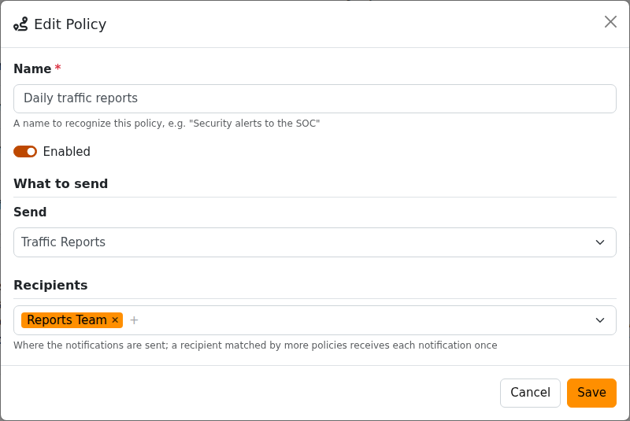

Below you can find an example of email notification sent by ntopng to notify the user about the availability of a new daily report,
with a direct link to go to the actual report.

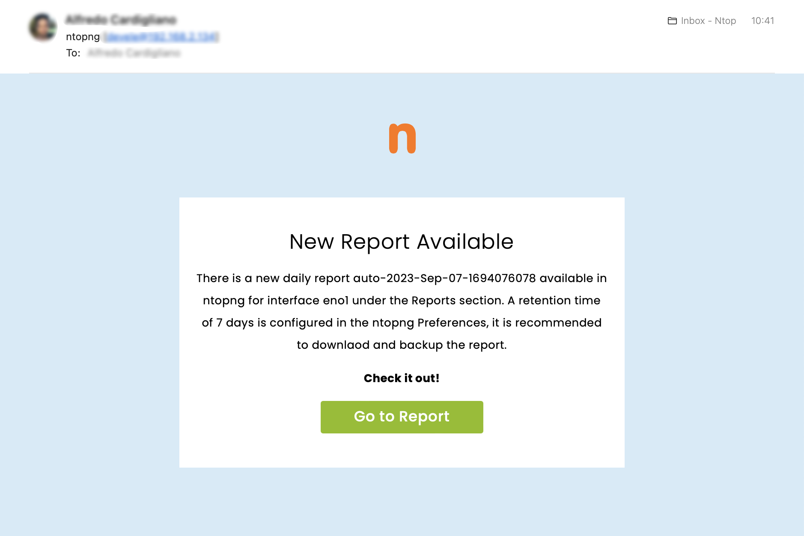

## Data Retention {#data-retention}

All the reports stored on ntopng, both manually or automatically created, can be automatically deleted by ntopng after some time
in order to implement a data retention policy and avoid filling the disk due to the number of reports growing undefinitely.
There is a default data retention time configured in ntopng, this can be changed from the Settings -> Preferences -> Reports ->
Reports Data Retention section.


## Reports Editor {#reports-editor}

The reports editor allows you to build custom reports by creating new templates.
A collection of widgets is available, they can be combined to define a template.

::: info
The Reports Editor is only available in ntopng Enterprise XL.
:::

The Dashboard -> Traffic Report page includes a button in the toolbar to create
a new template, as shown in the picture below.

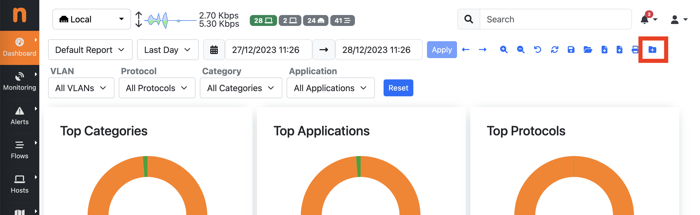

A dialog appears to configure the Template name.

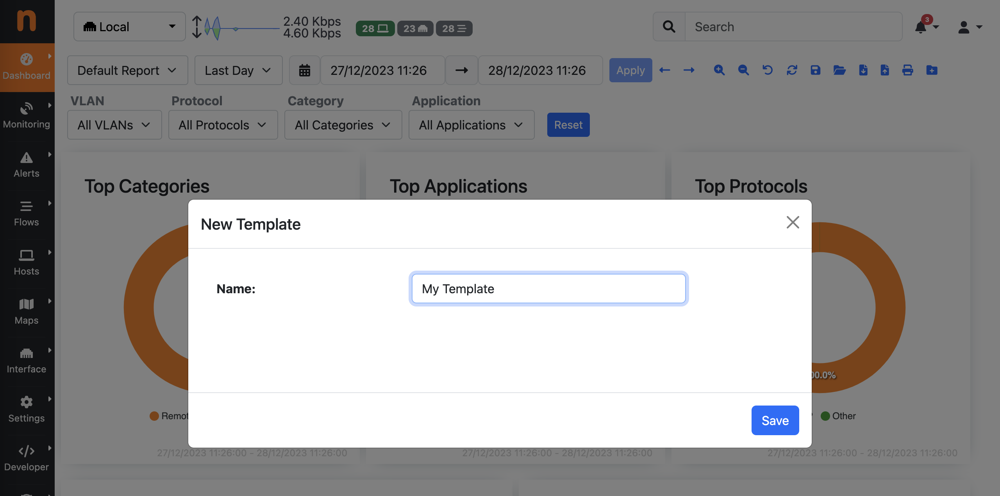

After creating the new template, it becomes available and can be selected
from the reports selector dropdown.

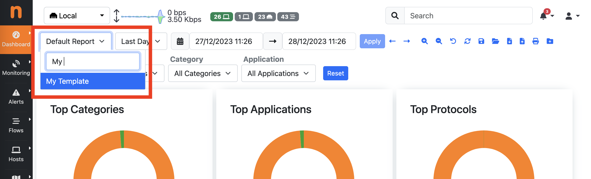

By seleting a new template, an empty report is shown as the template is
initially empty and need to be customized.

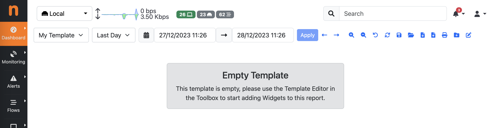

A Template Editor toggle is available in the toolbox when a custom
template is selected. This allows you to enter the edit mode.

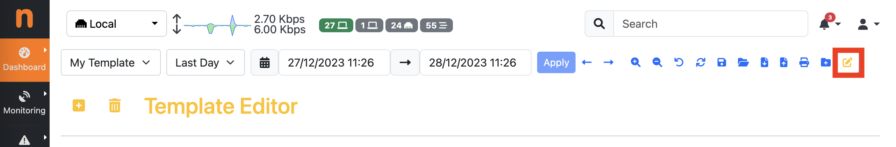

When entering the edit mode, a new toolbox for the Template Editor appears.
The toolbox includes buttons for adding Widgets to the template, or deleting
the template. By clicking on the Add Widget button, a dialog appears with a
list of available Widgets that can be added to the template.

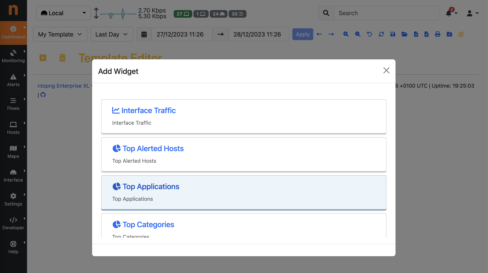

When adding a Widget, this is appended to the template, with a default configuration.

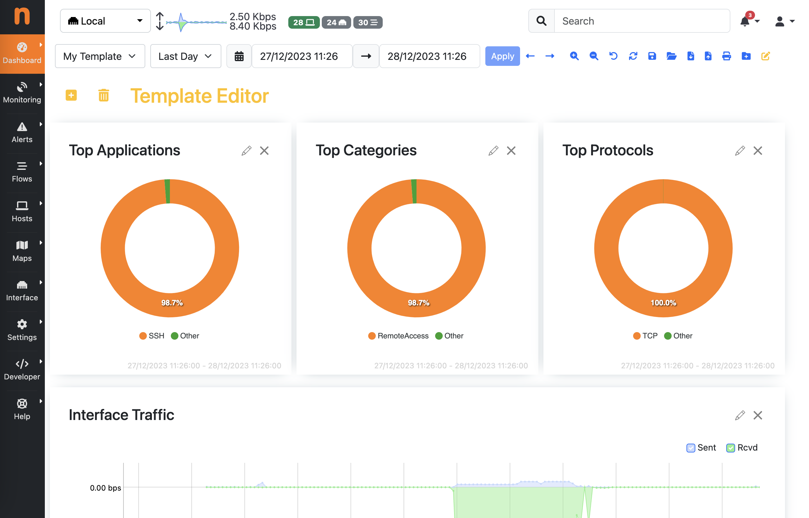

Widget can be organized and sorted by dragging and dropping them around.

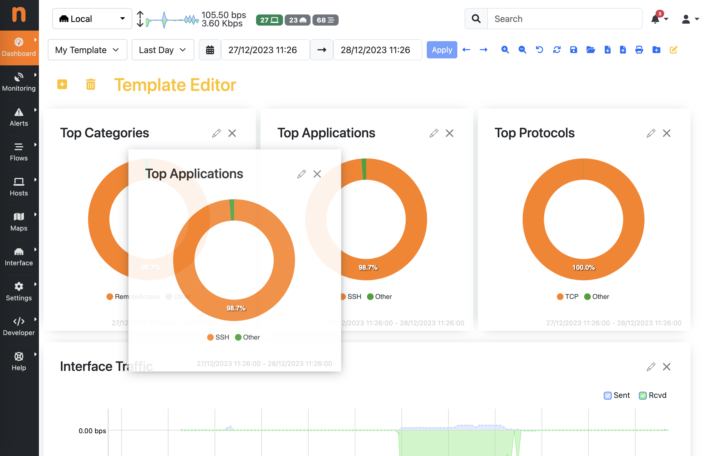

In edit mode, a few controls appear on the widgets themselves, including buttons
for editing the widget configuration or removing them from the template.

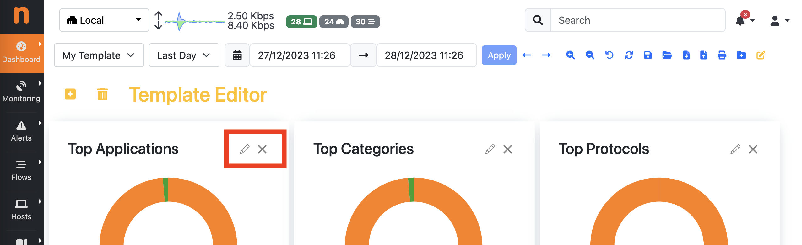

By clicking on the edit button on a widget, it is possible to configure them,
including changing:

- displayed title
- widget size (heigth and width)
- time reference (the Time Offset is used to show traffic information with a time shift with respect to the time selected for the report, e.g. show traffic information 1 week ago, to compare it with the current traffic)

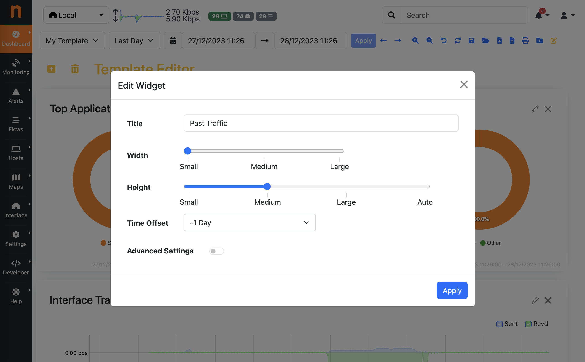

An Advanced Settings toggle is also available. This allows to deeply customize
the content of the Widget, by changing settings including the REST API URL and
parameters, which are encoded in JSON format.

Special tokens are also supported in the JSON configuration to dynamically pass
arguments to the widgets, e.g. \$IFID\$ is dynamically replaced with the current
interface ID selected in ntopng while rendering the report.

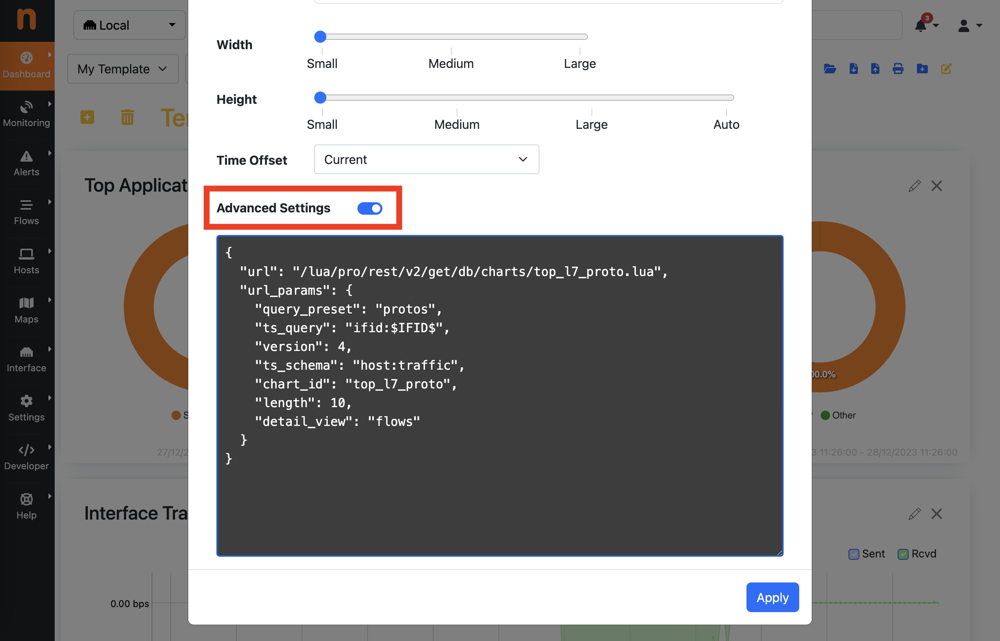

Any change to the template is automatically saved (there is no Save button in
the template editor).

### Charts with Multiple Timeseries {#charts-with-multiple-timeseries}

The Interface Traffic widget can draw several timeseries in the same chart,
for instance the traffic of an Autonomous System (AS) next to the traffic of
the whole interface. Add the widget, open its settings, enable Advanced Settings
and list one entry per timeseries in the `ts_requests` section. Leave the
other settings as they are.

Each entry has a name of your choice (it only has to be unique in the widget) and:

- `ts_schema`: the timeseries to draw, e.g. `iface:traffic` (interface traffic)
  or `asn:traffic` (AS traffic). The full list is in [Metrics](/api/timeseries/metrics.md).
- `ts_query`: what the timeseries refers to, as `name:value` pairs separated
  by commas, using the tags listed for that timeseries (e.g. `ifid:$IFID$,asn:15169`
  for AS 15169 on the interface selected in ntopng).
- `tskey`: the main value of the query (the AS number, the interface ID, the host...).

The example below draws AS 15169 (Google) and the whole interface in one chart:

```json
{
  "url": "/lua/pro/rest/v2/get/timeseries/ts_multi.lua",
  "url_params": {},
  "post_params": {
    "limit": 180,
    "version": 4,
    "ts_requests": {
      "google": { "ts_schema": "asn:traffic",   "ts_query": "ifid:$IFID$,asn:15169", "tskey": "15169" },
      "iface":  { "ts_schema": "iface:traffic", "ts_query": "ifid:$IFID$",           "tskey": "$IFID$" }
    }
  },
  "source_type": "interface"
}
```

Each line of the chart is named after its source (e.g. "AS15169 (Google LLC) - Sent",
or the interface name) followed by the name of the value.

Special entry names add one timeseries per item, using the same settings:

- `$ANY_IFID$`: one timeseries per monitored interface.
- `$ANY_EXPORTER$`: one timeseries per flow exporter (e.g. a router sending NetFlow).
- `$ANY_NETWORK$`: one timeseries per local network.

**Total instead of separate values.** Some timeseries contain more than one value,
e.g. `asn:traffic` has the traffic sent and the traffic received by the AS.
Add `"sum_series": true` to the entry to draw a single "Total" line with their
sum; the statistics shown below the chart (average, 95th percentile, total) are
computed on the sum too:

```json
"google": { "ts_schema": "asn:traffic", "ts_query": "ifid:$IFID$,asn:15169", "tskey": "15169", "sum_series": true }
```

Things to know when combining timeseries:

- Timeseries can be stored with different resolutions (e.g. every second for the
  interface traffic, every minute or every 5 minutes for an AS). In the same chart
  all of them are shown with the coarsest one: every point of the chart covers the
  same time for all the lines, so their values can be compared.
- "Sent" and "Received" do not mean the same thing everywhere: for an AS they are
  the traffic sent and received by the hosts of that AS, for an interface they
  are the outgoing and incoming traffic seen by the interface. To compare an AS
  with the interface, compare the AS total (`"sum_series": true`) with the
  interface total (`iface:traffic`).
- Values received are drawn below the zero line, values sent above it.
