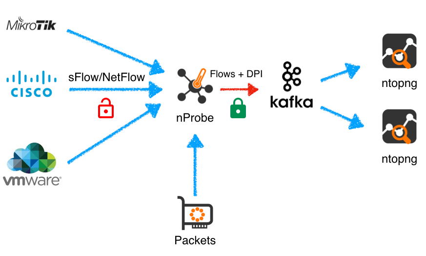

# Kafka {#kafka}

[Apache Kafka](https://kafka.apache.org) is a popular message broker platform that is supported by ntopng (Enterprise M+ license is required). It can be used both as ZMQ drop-in replacement, or to deliver data produced by ntopng to remote consumers. Contrary to ZMQ, a Kafka broker implements some message persistency that enables applications (e.g. nProbe and ntopng) to be decoupled.

::: info
We suppose that the kafka broker has been already setup and configured in order to be used by ntopng.
:::

Below you can read mode about how to use Kafka with ntopng (and nProbe):

- [Exporting Flows to Kafka](/flow_dump/kafka/export_flows.md)
  - [Example](/flow_dump/kafka/export_flows.md#example)
- [Collecting nProbe Flows Using Kafka](/flow_dump/kafka/collect_flows.md)
  - [Example](/flow_dump/kafka/collect_flows.md#example)
- [Sending Messages to Kafka](/flow_dump/kafka/send_kafka_messages.md)
  - [Example](/flow_dump/kafka/send_kafka_messages.md#example)

