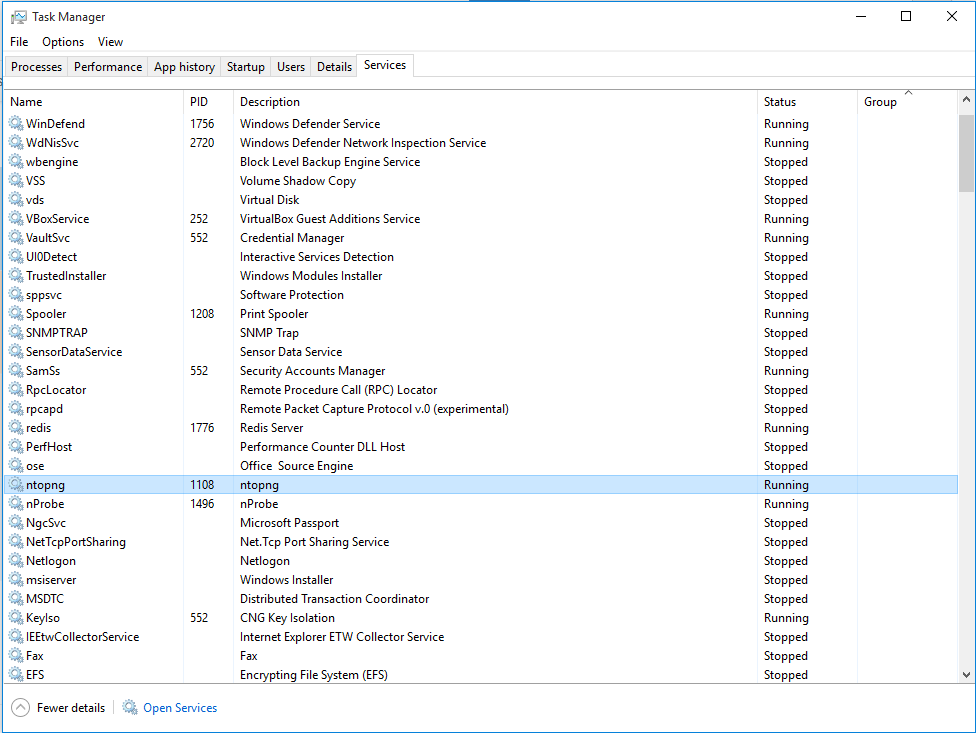

# Running on Windows {#running-on-windows}

on Windows ntopng runs as service. The ntopng installer registers the service and automatically starts is as shown below.



You can start ntopng from cmd.exe only for debug purposes or for manipulating the service settings. In this case you can start cmd.exe (i.e. Windows Commands Prompt) and navigate to the ntopng installation directory (i.e. C:\\Program Files\\ntopng). Commands are issued after a `/c` that stands for *console*. For example to display the inline help it suffices to run

```bash
ntopng /c -h
```

::: warning
ntopng requires the `Redis` service to be up and running or it will not start. Make sure this service is running and auto-started on boot. Check its status from the Services application.
:::

## List Monitored Interfaces {#list-monitored-interfaces}

As network interfaces on Windows can have long names, a numeric index is associated to the interface in order to ease the ntopng configuration. The association between interface name and index is shown in the inline help.

```bash
c:\Program Files\ntopng>ntopng /c -h
[...]
Available interfaces (-i <interface index>):
1. Intel(R) PRO/1000 MT Desktop Adapter
{8EDDEFE3-D6DB-4F9B-9EDF-FBC0BFF67F3C}
[...]
```

In the above example the network adapter Intel(R) PRO/1000 MT Desktop is associated with index 1. To select this adapter ntopng needs to be started with `-i 1` option.

## Manipulating ntopng Windows Service Settings {#manipulating-ntopng-windows-service-settings}

Windows services are started and stopped using the Services application part of the Windows administrative tools. When ntopng is used as service, command line options need to be specified at service registration and can be modified only by removing and re-adding the service. The ntopng installer registers ntopng as a service with the default options.

In order to run ntopng with custom options it's suggested to use nssm; it can be downloaded from [here](https://nssm.cc/download).

::: info
There are two folders inside the downloaded folder, one for 32bit systems and one for 64bit systems.
:::

Extract everything and run the nssm.exe program from the CMD:

```bash
C:\nssm\nssm.exe install ntopng
```

After running this command a GUI is going to open, where it is possible to customize the process, with the executable path of the process to run (ntopng in this case) and the arguments to use when running.

::: warning
In windows, a configuration file can't be used as a parameter like on Linux, so all the options needs to be specified in the Arguments section.
:::

::: warning
In windows, before the arguments there must be a `/c`, for example `/c -i 1 -i tcp://127.0.0.1:5556 -m 192.168.2.0/24`.
:::

After correctly configuring the process, the service needs to be launched (by either using the `sc start ntopng` command from the CMD or by using the Windows Services).

## Troubleshooting {#troubleshooting}

ntopng requires the Redis service to be activated in order to start. You can check Redis status from the Services application.

In some Windows PCs, in particular those with WiFi adapters, ntopng might not be able to detect these adapters. Shall this be the case, we suggest you to uninstall the Win10Pcap drivers that are installed with ntopng and move to the ncap Windows drivers that can be installed from [npcap Windows drivers](https://nmap.org/npcap/windows-10.html).
