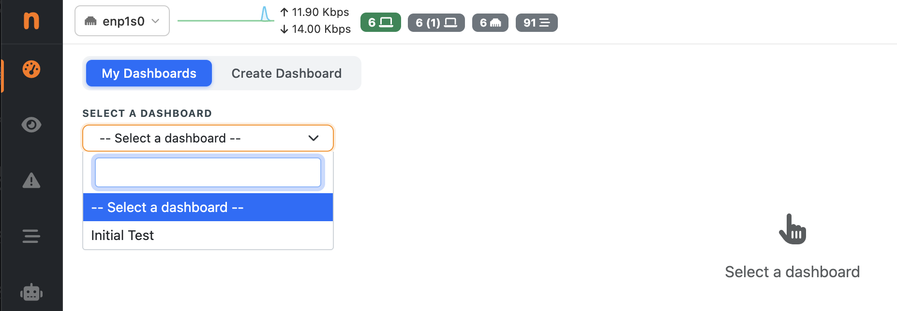
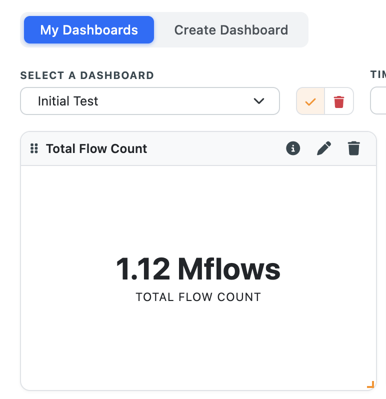
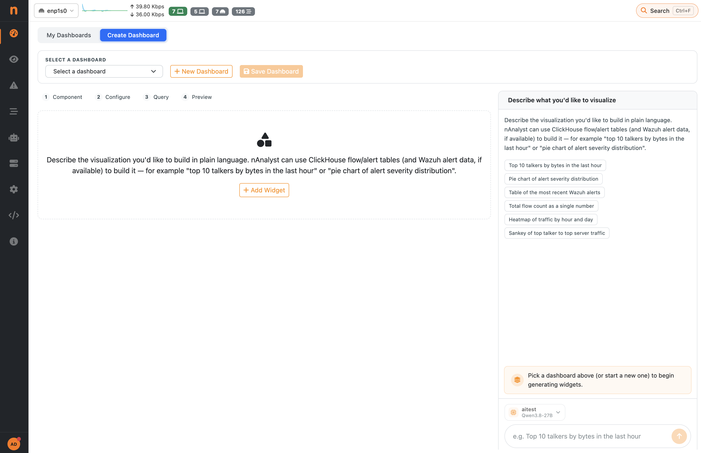
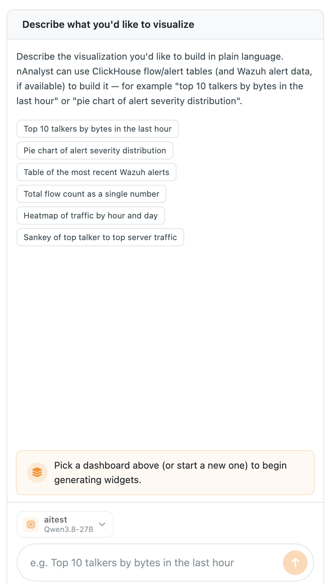
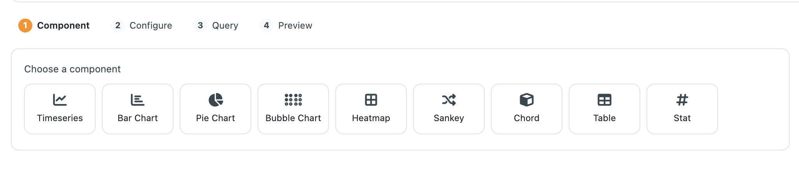
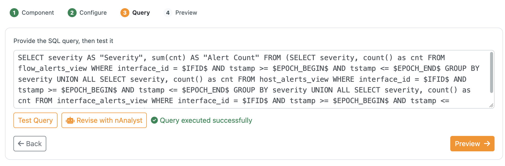

.. _nAnalystAIDashboards:

AI Dashboards
=============

AI Dashboards let you build your own persistent dashboards out of widgets (charts, tables, counters, flow diagrams) whose data comes from ClickHouse queries. Widgets can be generated by nAnalyst from a plain language description, or assembled manually with a step by step wizard. Once saved, a dashboard can be reopened at any time, evaluated again over any time range, and rearranged by drag and drop.

.. note::

  AI Dashboards require **ntopng Enterprise XL** and a ClickHouse enabled ntopng instance (historical flows must be stored in ClickHouse). When these requirements are not met, the **AI Dashboard** menu entry is hidden. Generating widgets with nAnalyst also requires a configured LLM provider (see :ref:`nAnalystLLMSetup`). Creating, editing and deleting dashboards is restricted to administrators.

Opening the page
----------------

The page is available from the ntopng menu under **AI Dashboard**. It is organized in two tabs:

- **My Dashboards**: view, rearrange and delete the saved dashboards.
- **Create Dashboard**: create dashboards and add or edit their widgets.

The active tab and the selected dashboard are stored in the page URL, so a dashboard can be bookmarked or shared with another user of the same ntopng instance.

My Dashboards
-------------

   A saved dashboard in the My Dashboards tab

Pick a dashboard from the **Select a dashboard** dropdown to display it. The toolbar contains:

- **Edit / Done editing** (pencil button): switches the layout edit mode on and off (see :ref:`nAnalystAIDashboardsLayout`).
- **Delete** (trash button): permanently deletes the selected dashboard after a confirmation. This cannot be undone.
- **Time Range**: date/time picker, with refresh, that applies to every widget of the dashboard at once. Widget queries are run again every time the range changes.
- **Filters**: a filter bar (same syntax as the historical flows page) applied to all the widgets. Use it, for example, to restrict the whole dashboard to a single host, port or protocol.

If a widget shows *"No data in the selected time range and filters"* the query ran successfully but returned no rows: widen the time range or remove some filters.

.. _nAnalystAIDashboardsInfo:

Seeing how the data is extracted
~~~~~~~~~~~~~~~~~~~~~~~~~~~~~~~~

Every widget header has an **info button** (the circle i icon) at the top right. Hover over it to see the ClickHouse query that feeds the widget, and click it to copy the query to the clipboard (the icon briefly turns into a check mark). The query uses the dashboard time range and filters, so you can paste it in a ClickHouse client to inspect the raw rows behind a chart, verify a number, or use it as the starting point for a new widget. Nothing is hidden: you can always see exactly where the data of a widget comes from.

.. _nAnalystAIDashboardsLayout:

Moving and resizing widgets
---------------------------

   Layout edit mode: drag handle, resize handle, edit and remove buttons

Dashboards use a 12 column grid. Click the pencil button to enter edit mode, then:

- **Move**: drag a widget by the grip handle in its header and drop it in the new position. Other widgets are compacted automatically.
- **Resize**: drag the resize handle in the bottom right corner of the widget. The minimum size is 2 columns by 2 rows, and a widget cannot be dragged outside the grid.
- **Edit**: the pencil in the widget header opens the widget in the *Create Dashboard* tab (see below).
- **Remove**: the trash icon in the widget header removes the widget from the dashboard.

Every move or resize is saved automatically a moment after it happens, so nothing is lost if you switch tab. Click the pencil button again (**Done editing**) to leave edit mode; a confirmation toast is shown when the layout has been saved.

Creating a dashboard
--------------------

Widgets can be created in two ways: **with the AI assistant**, describing what you want in plain language, or **manually**, choosing the chart type, unit and query yourself. AI generated widgets must be reviewed before saving; manually created widgets are considered reviewed, since you configure each step yourself.

   The Create Dashboard tab

Open the **Create Dashboard** tab. At the top of the page:

1. Select an existing dashboard to add widgets to it, or click **New Dashboard** to start a new one. For a new dashboard enter a **Dashboard name** (any text except the single quote character).
2. Add one or more widgets, using nAnalyst or the manual wizard described below.
3. Click **Save Dashboard**. You are taken back to *My Dashboards* with the dashboard selected.

Widgets that have not been saved yet are listed under *New widgets (not yet saved)*, and a counter reports how many are pending. If you leave the page with unsaved widgets, ntopng asks for confirmation; unsaved widgets are also kept as a draft, and when you come back you are offered to **Restore** or **Discard** them.

Generating widgets with nAnalyst
~~~~~~~~~~~~~~~~~~~~~~~~~~~~~~~~

   Generating widgets from a natural language description

The panel on the right works like a small chat. Select the LLM provider, describe what you want to see and press Enter, for example:

- *Top 10 talkers by bytes in the last hour*
- *Pie chart of alert severity distribution*

nAnalyst explores the available ClickHouse tables, writes the SQL query, validates it against the database (retrying and fixing it automatically if it fails) and returns the finished widgets. Progress is displayed live in the panel, and you can stop the generation at any time. If the request is ambiguous, nAnalyst asks a clarifying question instead of guessing.

Reviewing the generated widgets
~~~~~~~~~~~~~~~~~~~~~~~~~~~~~~~

nAnalyst decides, for every widget it builds, the **chart type** that best fits the data, the **title**, the **unit of measure** (bytes, bps, packets, flows, percentage, ...) and the **SQL query**. Since these choices are made by an AI, each new widget is marked *Needs review* and **must be reviewed before the dashboard can be saved**. For each widget check that:

- the **title** describes what the widget shows;
- the **unit of measure** is the right one for the values (for example bytes versus bits per second);
- the **chart type** suits the data (a ranking is better as a bar chart, a share of the total as a pie chart, a trend over time as a time series, and so on);
- the **query** returns what you expect: use the info button (see :ref:`nAnalystAIDashboardsInfo`) to read it, or *Test Query* in the editor to run it and preview the result.

To change any of these, click the pencil on the widget. This opens the same wizard used for manual creation, prefilled with the nAnalyst choices, where every step (*Component*, *Configure*, *Query*, *Preview*) can be reviewed and modified. Once you are satisfied, either confirm the changes or click the *Looks good, mark as reviewed* button on the widget. A reviewed widget changes its badge from *Needs review* to *Reviewed*, and a counter (for example *2/3 reviewed*) shows the progress. The **Save Dashboard** button is enabled only when all the new widgets have been reviewed.

To change the query of an existing widget, edit it and use **Revise with nAnalyst**: describe the change (for example *only count TCP flows*) and nAnalyst modifies only the SQL, leaving title, chart type and layout untouched.

Adding a widget manually
~~~~~~~~~~~~~~~~~~~~~~~~

If you prefer not to use an LLM, or you already know the query you want, widgets can be created entirely by hand, without nAnalyst. Both ways can be freely mixed in the same dashboard.

   Widget wizard: choosing the component

Click **Add Widget** to start the four step wizard:

1. **Component**: choose the widget type (see the list below).
2. **Configure**: set the title, the unit used to format the values, and, for charts, the axis titles.
3. **Query**: write the ClickHouse SQL query and press **Test Query**. The *Preview* step is available only once the query executes successfully. You can also ask nAnalyst to revise the query.
4. **Preview**: the widget is rendered with live data. Choose its **Width (columns)** and **Height (rows)**, from 2 to 12, then click **Add to Dashboard**.

   Widget preview with width and height

Queries must use the following placeholders, which ntopng replaces at run time with the dashboard time range and the selected interface:

.. code-block:: sql

  SELECT ... FROM flows
  WHERE FIRST_SEEN >= $EPOCH_BEGIN$ AND FIRST_SEEN <= $EPOCH_END$ AND IFID = $IFID$

Widget types
------------

.. list-table::
   :header-rows: 1
   :widths: 20 80

   * - Type
     - Description
   * - Time series
     - Line chart of one or more values over time.
   * - Bar chart
     - Ranked values, vertical or horizontal, optionally stacked.
   * - Pie chart
     - Share of each item over the total.
   * - Bubble chart
     - Three dimensional comparison (X, Y and bubble size).
   * - Heatmap
     - Intensity of a value across two dimensions.
   * - Sankey
     - Traffic flowing from a source to a target.
   * - Chord
     - Relationships and volumes between a set of entities.
   * - Table
     - Raw rows returned by the query.
   * - Stat
     - A single highlighted number (for example the total number of flows).

Values can be formatted with the following units: number, full number, bytes, bps, flows, packets, pps, ms, percentage, or no formatting.

Related pages
-------------

- :ref:`nAnalystToolsLicensing`: editions required by nAnalyst features.
- :ref:`nAnalystLLMSetup`: configuring the LLM provider used to generate widgets.
