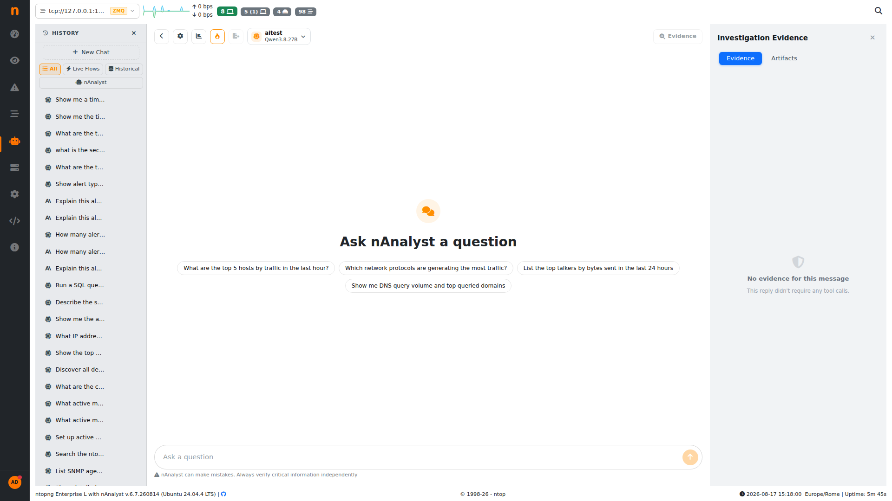
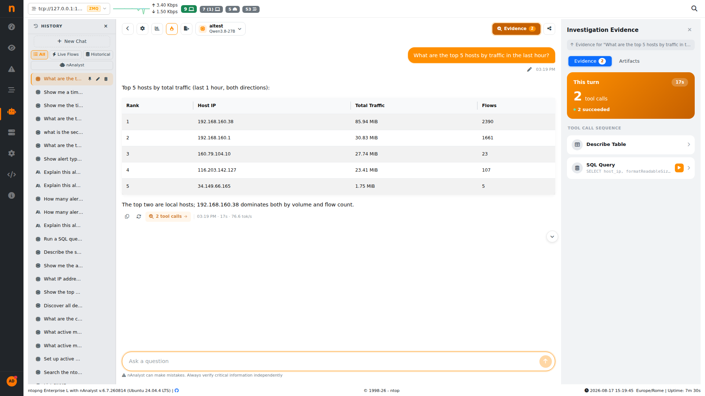
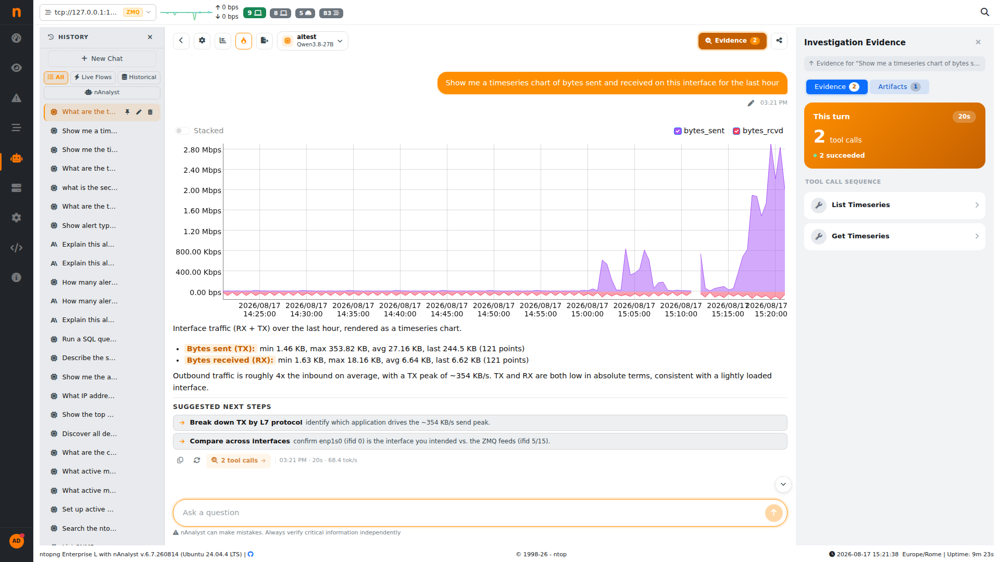
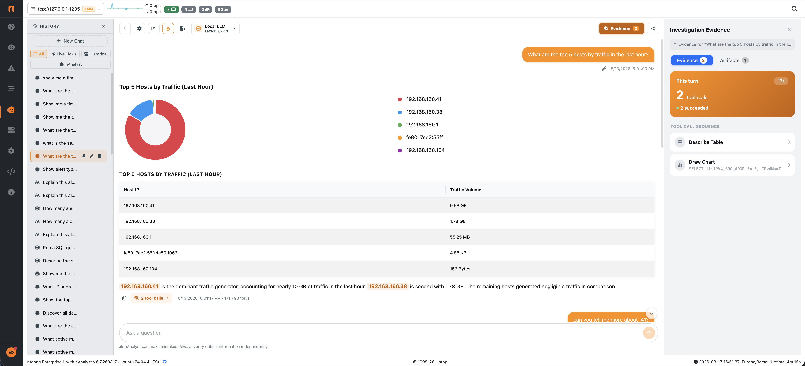

<a id="nanalystchat"></a>

# Chat Interface {#chat-interface}

nAnalyst's primary interface is a conversational chat window embedded in the ntopng web UI. It allows analysts to query network data, trigger actions, and review evidence without writing SQL or navigating multiple dashboards.



## Accessing the chat {#accessing-the-chat}

The nAnalyst chat is available from the ntopng menu -> nAnalyst. Each conversation is tied to the authenticated user and persists across browser sessions so context from previous investigations is retained.


## Asking questions {#asking-questions}

Questions can be asked in plain English. nAnalyst understands network terminology natively:

```text
"Show me DNS query volume for each hour in the last day and the top queried domains"

"Which hosts contacted the most external IPs in the last 6 hours?"

"Is there any unusual outbound traffic from 192.168.1.50?"

"What applications are consuming the most bandwidth on the LAN?"
```

The agent will:

- Select the relevant tools and data sources
- Execute the necessary SQL queries
- Return a structured answer with embedded charts and an evidence table
- Suggest actionable next steps

## Reading the response {#reading-the-response}

Each nAnalyst response consists of three parts:

**Answer**

: A plain-language explanation of what was found, grounded in the evidence collected.

**Evidence log**

: A collapsed but expandable section showing every tool called, the SQL executed, and the raw results returned. This is the "no black box" guarantee — you can verify every claim.

**Suggested next steps**

: When relevant, nAnalyst proposes follow-up investigations or actions such as creating a policy, adding an active monitoring script, or silencing a known-good alert.




## Inline charts {#inline-charts}

When a query returns time-series or ranked data, nAnalyst automatically generates and embeds a chart (line, bar, or table) directly in the chat response. Charts are interactive and export-ready.





## Seeing what the agent can do {#seeing-what-the-agent-can-do}

The chat header has a **Tools** button (toolbox icon). It opens the
[Tools Catalog](/nanalyst/tools_and_licensing.md#nanalysttoolscatalog) — the full list of tools available
to the agent on this instance, each with its description, the license that
unlocks it, and its annotations (read-only vs. write, whether it produces a
chart artifact, whether it needs ClickHouse). Use it to understand the
assistant's capabilities and what a license upgrade would add.

## Multi-turn conversations {#multi-turn-conversations}

nAnalyst maintains context across turns in a session. You can ask follow-up questions without repeating context:

```text
Turn 1: "Show me the top talkers on the LAN"
Turn 2: "Investigate the top one further"
Turn 3: "Create a policy to alert if that host exceeds 100 Mbps"
```

Session history is persisted so investigations can be resumed after a page reload or the next day.
