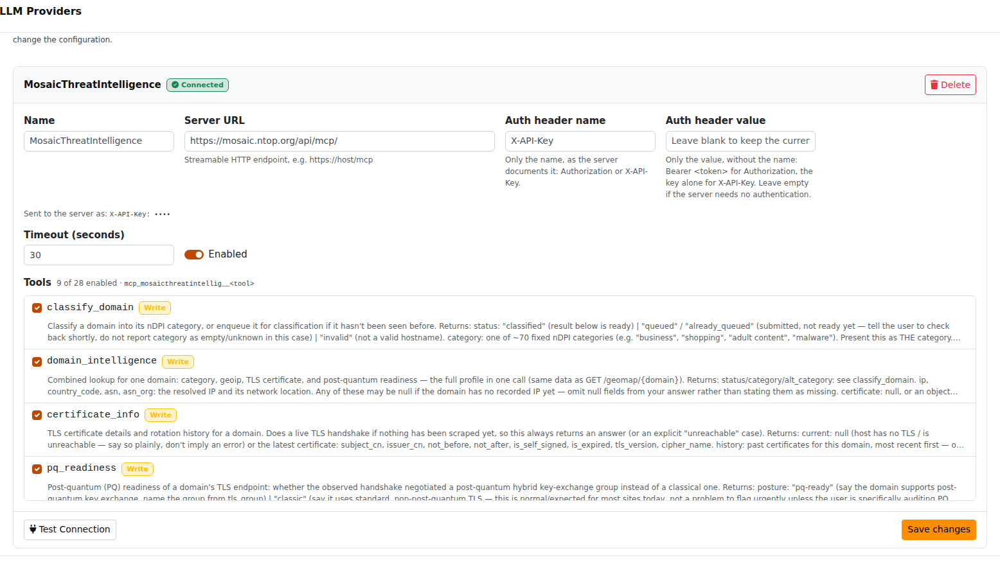
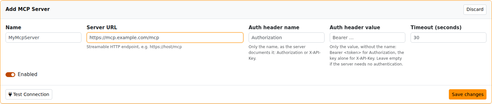
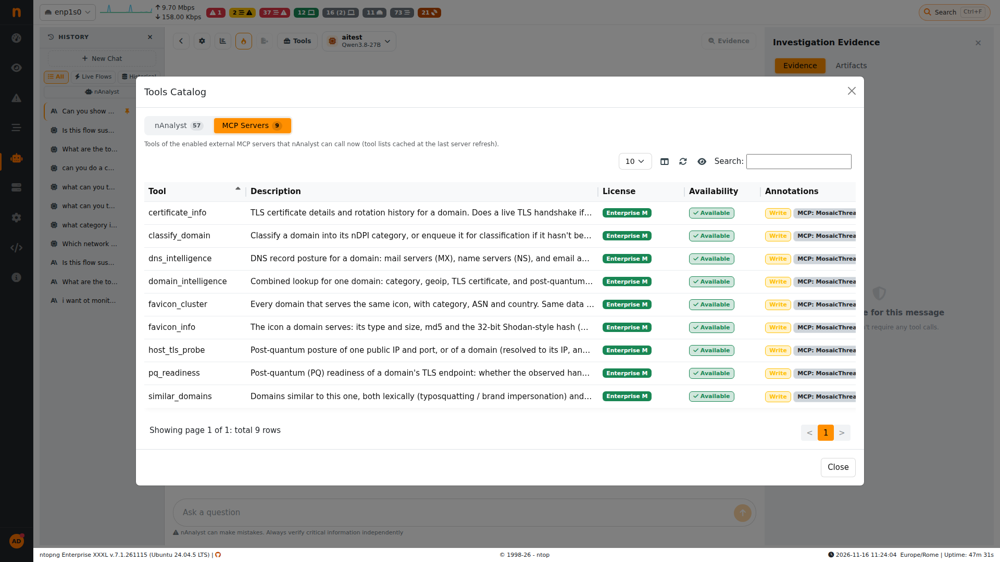
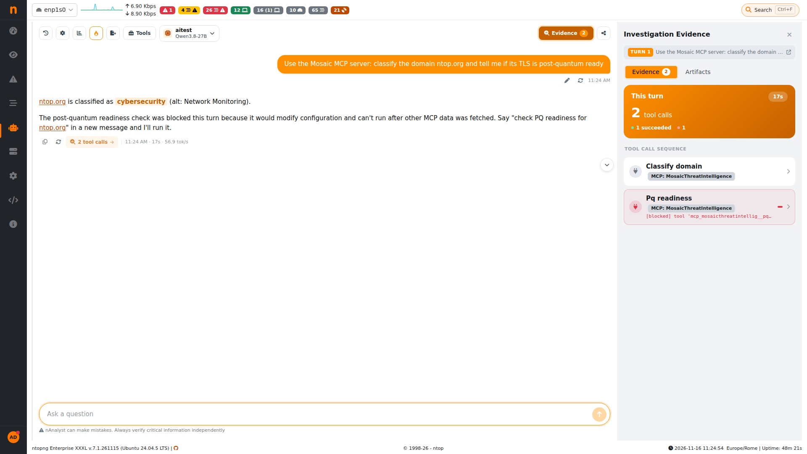

<a id="nanalystmcpclient"></a>

# External MCP Servers {#external-mcp-servers}

nAnalyst can also act as an MCP *client*: it can call the tools of external [Model Context Protocol](https://modelcontextprotocol.io) servers, next to its own network tools. This lets a single question combine ntopng data with other sources, for example a threat intelligence service, a ticketing system or an asset database.

::: info
This is the opposite direction of [MCP Server](/nanalyst/mcp_server.md#nanalystmcp). There, external AI clients (Claude Code, Cursor) call ntopng. Here, nAnalyst calls external servers.
:::

## How it works {#how-it-works}

1. An administrator registers an external MCP server in ntopng.
2. ntopng connects to it and downloads the list of its tools.
3. The administrator chooses which tools nAnalyst may use.
4. In the chat, nAnalyst decides by itself when a question needs one of these tools, exactly as it does for its own tools.

Every call is shown in the evidence panel with the server it went to, so the answer stays verifiable.

## Requirements {#requirements}

- nAnalyst with a configured LLM provider (see [LLM Setup](/nanalyst/llm_setup.md#nanalystllmsetup)).
- An MCP server reachable from the ntopng host over HTTP or HTTPS, using the **Streamable HTTP** transport.
- Administrator access to the ntopng preferences.

::: warning
Not supported: servers that run as a local process (stdio transport) and servers that require an OAuth login. Authentication is a single static HTTP header.
:::

## Adding a server {#adding-a-server}

Open **Settings -> Preferences -> LLM Providers** and scroll to the **MCP Servers** section. Registered servers are listed as cards, one per server.



Click **+ Add MCP Server** and fill in the fields:



| Field | Description |
|---|---|
| Name | A label for the server, up to 64 characters. It is also used to build the names of its tools (see below). |
| Server URL | The Streamable HTTP endpoint, for example `https://host/mcp`. Only `http://` and `https://` URLs are accepted. |
| Auth header name | Only the header name, as the server documents it: `Authorization` or `X-API-Key`. Default: `Authorization`. |
| Auth header value | Only the value, without the name: `Bearer <token>` for `Authorization`, the bare key for `X-API-Key`. Leave empty if the server needs no authentication. |
| Timeout (seconds) | How long ntopng waits for the server. From 5 to 600, default 30. |
| Enabled | A disabled server is kept in the list but its tools are not available to nAnalyst. |

Press **Test Connection** to check the URL and credentials without saving anything. On success a message reports the server name and the number of tools found. Then press **Save changes**.

::: info
The authentication value is a secret. After saving, it is never shown again: the card only displays that a header is set. To keep the current value when editing a server, leave the field blank. At most 32 servers can be registered, with up to 128 tools each.
:::

### Server status {#server-status}

Each card has a status badge. Hover it to see the last check time and, in case of failure, the error.

| Status | Meaning |
|---|---|
| Connected | The last connection and tool list download succeeded. |
| Unreachable | The server could not be reached or rejected the request. An unreachable server is retried automatically after a few minutes. |
| Disabled | The server is switched off. |
| Not checked | Saved, but never contacted yet. Use **Test Connection**. |

## Choosing which tools nAnalyst can use {#choosing-which-tools-nanalyst-can-use}

Under **Tools** each card lists every tool published by the server, with its description. Tick the tools nAnalyst is allowed to call, then press **Save changes**. The counter shows how many are enabled.

Tools carry one of two badges:

- **Read-only**: the tool only reads data. Enabled by default.
- **Write**: the tool may change something on the external system. Disabled by default: enable these one by one, and only for servers you trust. nAnalyst runs an enabled tool without asking for confirmation.

::: warning
A tool is marked Read-only only if the server declares it so. A server that does not publish this information has all of its tools marked **Write**, even if they only read data. In the screenshot above, all the tools of the threat intelligence server are marked Write for this reason and were enabled manually.
:::

### Tool names {#tool-names}

Tools of an external server are exposed to the LLM as `mcp_<server>__<tool>`, where `<server>` is the server name in lowercase, limited to letters, digits and underscores and shortened to 20 characters. If two servers would get the same prefix, a number is appended. This prefix is shown under the tool list of each card.

## Seeing all the available tools {#seeing-all-the-available-tools}

Open the nAnalyst chat and click **Tools** in the header. The Tools Catalog has two tabs: **nAnalyst** for the built-in tools and **MCP Servers** for the tools of the enabled external servers that nAnalyst can use right now.



The tool lists shown here are the ones downloaded at the last server refresh. Use **Test Connection** on the server card to refresh them.

## Using external tools in the chat {#using-external-tools-in-the-chat}

No special syntax is needed. Ask for what you want and, when useful, name the source:

```text
"Use the Mosaic server: classify the domain ntop.org"

"Which external domains contacted by 192.168.1.50 in the last hour are classified as malware?"
```

In the second example nAnalyst first queries ntopng for the domains, then asks the external server about them.



The **Evidence** panel lists every tool call of the turn. Calls to external servers are labelled **MCP: \&lt;server name>**, so you can always tell them apart from ntopng's own data. Open a call to see what was sent and what came back.

## Safety rules {#safety-rules}

Text returned by an external server is untrusted: it could contain instructions that try to steer the LLM. For this reason nAnalyst applies a rule on top of the tool selection described above:

**In a chat turn where nAnalyst has already used data from an external MCP server, it does not run any tool that changes the ntopng configuration** (creating policies, adding monitoring scripts, silencing alerts). The call is blocked and nAnalyst tells you what it would have done. Send a new message to run it.

This is what happened in the example above: the first tool call (classification) succeeded, and the second one was blocked because the tool is marked Write and external data had already been fetched in that turn. The answer explains this and asks for a new message.

Other recommendations:

- Register only servers you trust and keep the token permissions of each server as narrow as possible.
- Enable Write tools only when needed.
- Review the evidence panel before acting on an answer that depends on external data.

## Troubleshooting {#troubleshooting}

| Symptom | What to check |
|---|---|
| *Unreachable* badge | URL and port reachable from the ntopng host, certificate valid for HTTPS, timeout high enough. The hover text shows the error. |
| Test fails with an authentication error | Header name and value: the value must not contain the header name, and `Bearer` is needed only if the server expects it. |
| *No tools fetched yet* | Save or test the server. The server must implement the MCP `tools/list` method. |
| nAnalyst never uses the tool | Tool enabled and saved, server enabled, and the question mentions what the tool does. Check the **MCP Servers** tab of the Tools Catalog. |
| Call blocked in the evidence panel | The tool is marked Write and external data was already used in the turn. Send it again in a new message. |
