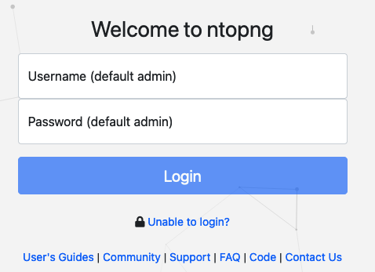
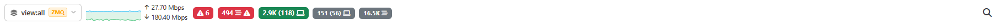
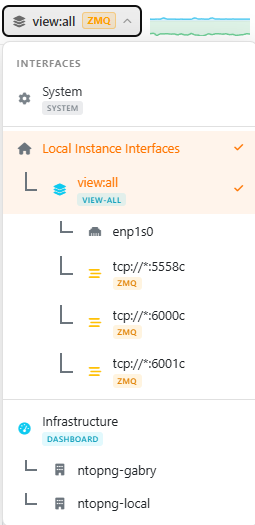

# User Interface Guide {#user-interface-guide}

After ntopng has started you can view the GUI. By default, the GUI can be accessed from any web browser at `http://<ntopng IP>:3000/`. A different port can be specified as a command line option during ntopng startup. The first page that always pops out contains the login form - provided that the user has not decided to turn authentication off during startup.

The default login is

| **username** | admin |
|---|---|
| **password** | admin |

During the first access, a page asks to change the default password: type the new password twice
(from 5 to 128 characters, different from *admin*) and, if you want, choose the language of the
interface. Until the password is changed every other page leads back here; after the change you go
to the page you asked for. *Logout* leaves without changing it.

Administrator privileges are granted to user *admin*. If an unauthenticated user attempts to access a specific ntopng URL, the system will redirect the browser to the login page and then, upon successful authentication, to the requested resource. Ntopng GUI web pages have a common structure the user will soon be familiar with. The pages are mostly composed of an always-on-top status bar and some body content.

The header bar show the ntopng status information, in particular:

- The currently [selected interface](/basic_concepts/interfaces.md).
- The interface Up/Down throughput chart.
- A series of coloured badges.
- The Search button (or <kbd>Ctrl+F</kbd>), which finds pages, preferences, hosts and more (see [Search](/user_interface/shared/other_components.md#globalsearch)).
- The notifications bell and the [user administration menu](/user_interface/shared/settings/users.md).

The coloured indicate the status of many components in ntopng. The badges in the above picture have the following meaning (from left to right):

- Yellow triangle with the [Engaged alerts](/basic_concepts/alerts.md#engaged-alerts) count.
- Yellow triangle with the Warning [Alerted Flows](/basic_concepts/alerts.md#flow-alerts) count.
- Red triangle with the Error [Alerted Flows](/basic_concepts/alerts.md#flow-alerts) count.
- Green badge with the number of active local hosts.
- Gray badge with the number of active remote hosts.
- Gray badge with the number of active devices.
- Gray badge with the number of active flows.

Red badges are often symptoms of problems. For example, if the active hosts ore flows badges are red
it means that the ntopng hash tables are full and some statistics can be lost
([here](/operating_ntopng_on_large_networks.md#red-badges) can be found more information on this topic).

A menu bar is always available on the left to navigate across ntopng pages.
Entries in the menu bar change depending on the currently selected interface. The [System Interface](/basic_concepts/system_interface.md#basicconceptsysteminterface) has menu entries which are different from the other interfaces.
Each individual menu bar entry will be discussed below.

The Interfaces dropdown menu entry in the top toolbar contains lists all the interfaces that are currently
monitored by ntopng. Among all interfaces listed, one has a check mark that indicates the interface is
currently selected. A special interface is always present in ntopng, the [System Interface](/basic_concepts/system_interface.md).
Most of the data and information shown in ntopng web GUI is related to the currently selected
interface. Any interface listed can be selected simply by clicking on its name.

The dropdown menu is only used to switch between selected interfaces, it is also used to actually see
interface traffic statistics.

When two or more interfaces are monitored, the dropdown also lists the [Overview](/advanced_features/lightview/index.md)
entry, which combines the data of all the local interfaces in a single view.

- [Network Interface](/user_interface/network_interface/index.md)
  - [Dashboard](/user_interface/network_interface/index.md#dashboard)
  - [Monitoring](/user_interface/network_interface/index.md#monitoring)
  - [Alerts](/user_interface/network_interface/index.md#alerts)
  - [Flows](/user_interface/network_interface/index.md#flows)
  - [Hosts](/user_interface/network_interface/index.md#hosts)
  - [Maps](/user_interface/network_interface/index.md#maps)
  - [Interface](/user_interface/network_interface/index.md#interface)
  - [Traffic Dashboard](/user_interface/network_interface/dashboard/dashboard.md)
  - [Traffic Reports](/flow_dump/clickhouse/reports.md)
  - [Sites](/user_interface/network_interface/interface/sites.md)
  - [Network Discovery](/user_interface/network_interface/monitoring/network_discovery.md)
  - [Active Scan](/user_interface/network_interface/monitoring/active_scan.md)
  - [Flow Alerts Analyser](/user_interface/network_interface/alerts/flow_alerts_analyser.md)
  - [Flows](/user_interface/network_interface/flows/flows.md)
  - [Historical](/flow_dump/clickhouse/historical_flows.md)
  - [Server Ports](/user_interface/network_interface/flows/server_ports.md)
  - [Hosts](/user_interface/network_interface/hosts/hosts.md)
  - [Analysis](/user_interface/network_interface/maps/analysis_map.md)
  - [Geo Map](/user_interface/network_interface/maps/geo_map.md)
  - [Hosts](/user_interface/network_interface/maps/host_map.md)
  - [Details](/user_interface/network_interface/interface/interfaces.md)
  - [Networks](/user_interface/network_interface/interface/networks.md)
  - [Host Pools](/user_interface/network_interface/interface/host_pools.md)
  - [Autonomous Systems](/user_interface/network_interface/interface/autonomous_systems.md)
  - [Countries](/user_interface/network_interface/interface/countries.md)
  - [VLANs](/user_interface/network_interface/interface/vlans.md)
  - [Assets Inventory](/user_interface/network_interface/interface/assets.md)
  - [Operating Systems](/user_interface/network_interface/interface/operating_systems.md)
  - [Pods and Containers](/user_interface/network_interface/interface/containers.md)
  - [Live Captures](/user_interface/network_interface/interface/live_captures.md)
  - [Traffic Report](/user_interface/network_interface/interface/traffic_report.md)
- [System Interface](/user_interface/system_interface/index.md)
  - [Health](/user_interface/system_interface/index.md#health)
  - [System](/user_interface/system_interface/health/system.md)
  - [Interfaces](/user_interface/system_interface/health/interfaces.md)
  - [Redis](/user_interface/system_interface/health/redis.md)
  - [InfluxDB](/user_interface/system_interface/health/influxdb.md)
  - [ClickHouse](/user_interface/system_interface/health/clickhouse.md)

## Alerts {#alerts}

- [Alerts Explorer](/user_interface/shared/alerts/alerts_explorer.md)
  - [Issues](/user_interface/shared/alerts/issues.md)
  - [Alerts Graph](/user_interface/shared/alerts/others/alerts_graph.md)
  - [Engaged Alerts](/user_interface/shared/alerts/alerts_type/engaged_alerts.md)
  - [Past Alerts](/user_interface/shared/alerts/alerts_type/past_alerts.md)
  - [Flow Alerts](/user_interface/shared/alerts/alerts_type/flow_alerts.md)
  - [Alerts Filters](/user_interface/shared/alerts/others/alerts_filters.md)
  - [Custom Queries](/user_interface/shared/alerts/others/custom_queries.md)
  - [Mitre Classification](/user_interface/shared/alerts/others/mitre_classification.md)
  - [Remediations](/user_interface/shared/alerts/remediations/index.md)
- [Notifications](/user_interface/shared/alerts/available_endpoints.md)
  - [Recipients and Connections](/user_interface/shared/alerts/available_endpoints.md#recipients-and-connections)
  - [The Alerts Database](/user_interface/shared/alerts/available_endpoints.md#the-alerts-database)
  - [Notification Policies](/user_interface/shared/alerts/available_endpoints.md#notification-policies)
  - [Sending Issues](/user_interface/shared/alerts/available_endpoints.md#sending-issues)
  - [Available Endpoints](/user_interface/shared/alerts/available_endpoints.md#available-endpoints)

## Monitoring {#monitoring}

- [Active Monitoring](/user_interface/shared/monitoring/active_monitoring.md)
  - [Measure Alerts](/user_interface/shared/monitoring/active_monitoring.md#measure-alerts)
  - [Measure Timeseries](/user_interface/shared/monitoring/active_monitoring.md#measure-timeseries)
- [Infrastructure Monitoring](/user_interface/shared/monitoring/infrastructure_monitoring.md)
- [SNMP](/user_interface/shared/snmp/index.md)
  - [Configuration and Discovery](/user_interface/shared/snmp/configuration.md)
  - [Device Monitoring](/user_interface/shared/snmp/monitoring.md)
  - [SNMP Usage](/user_interface/shared/snmp/usage.md)
  - [Interface Similarity](/user_interface/shared/snmp/similarity.md)
  - [Network Topology](/user_interface/shared/snmp/topology.md)
  - [Device rules](/user_interface/shared/snmp/rules.md)
  - [Statistics and Troubleshooting](/user_interface/shared/snmp/statistics_and_troubleshooting.md)

## Policies {#policies}

- [Access Control List](/user_interface/shared/policies/access_control_list.md)
  - [Configuration](/user_interface/shared/policies/access_control_list.md#configuration)
  - [Adding Rules](/user_interface/shared/policies/access_control_list.md#adding-rules)
  - [Editing Rules](/user_interface/shared/policies/access_control_list.md#editing-rules)
  - [Delete Rules](/user_interface/shared/policies/access_control_list.md#delete-rules)
  - [Alert](/user_interface/shared/policies/access_control_list.md#alert)
  - [Scope Filters](/user_interface/shared/policies/access_control_list.md#scope-filters)
- [Allowed Applications](/user_interface/shared/policies/allowed_applications.md)
- [Device/MAC Address Tracking](/user_interface/shared/policies/device_mac_address_tracking.md)
- [Host Policy](/user_interface/shared/policies/network_configuration.md)
  - [Configuration](/user_interface/shared/policies/network_configuration.md#configuration)
  - [Alert Generation](/user_interface/shared/policies/network_configuration.md#alert-generation)
- [Traffic Rules](/user_interface/shared/policies/traffic_rules.md)
  - [Available Rules](/user_interface/shared/policies/traffic_rules.md#available-rules)
  - [Configure Rules](/user_interface/shared/policies/traffic_rules.md#configure-rules)
  - [Monitor All Local Hosts](/user_interface/shared/policies/traffic_rules.md#monitor-all-local-hosts)
  - [Edit/Delete Rules](/user_interface/shared/policies/traffic_rules.md#edit-delete-rules)
- [Behavioural Checks](/user_interface/shared/alerts/others/available_alerts.md)
  - [Check Tags](/user_interface/shared/alerts/others/available_alerts.md#check-tags)
  - [Interface Types](/user_interface/shared/alerts/others/available_alerts.md#interface-types)
  - [Alerts List](/user_interface/shared/alerts/others/available_alerts.md#alerts-list)
  - [Alerts List per License](/user_interface/shared/alerts/others/alerts_list_per_license.md)
  - [Host Behavioural Checks](/user_interface/shared/alerts/others/host_checks.md)
  - [Interface Behavioural Checks](/user_interface/shared/alerts/others/interface_checks.md)
  - [Local Networks Behavioural Checks](/user_interface/shared/alerts/others/local_network_checks.md)
  - [SNMP Behavioural Checks](/user_interface/shared/alerts/others/snmp_checks.md)
  - [Flow Behavioural Checks](/user_interface/shared/alerts/others/flow_checks.md)
  - [System Behavioural Checks](/user_interface/shared/alerts/others/system_checks.md)
  - [Active Monitoring Behavioural Checks](/user_interface/shared/alerts/others/active_monitoring_checks.md)
  - [Syslog Behavioural Checks](/user_interface/shared/alerts/others/syslog_checks.md)
  - [Autonomous Systems Behavioural Checks](/user_interface/shared/alerts/others/as_checks.md)
- [Behavioural Checks Exclusion](/user_interface/shared/alerts/others/behavioural_checks_exclusion.md)
  - [Exclude Risks Domain/Networks with nDPI](/user_interface/shared/alerts/others/behavioural_checks_exclusion.md#exclude-risks-domain-networks-with-ndpi)
- [Traffic Profiles](/user_interface/shared/policies/traffic_profiles.md)
  - [Realtime Profiles](/user_interface/shared/policies/traffic_profiles.md#realtime-profiles)
  - [Historical Profiles Statistics](/user_interface/shared/policies/traffic_profiles.md#historical-profiles-statistics)

## Settings {#settings}

- [Users](/user_interface/shared/settings/users.md)
  - [Multitenancy](/user_interface/shared/settings/users.md#multitenancy)
- [Preferences](/user_interface/shared/settings/preferences.md)
  - [Change ntopng Index Page](/user_interface/shared/settings/preferences.md#change-ntopng-index-page)
  - [Data Retention](/user_interface/shared/settings/preferences.md#data-retention)
  - [User Authentication](/user_interface/shared/settings/preferences.md#user-authentication)
- [Blacklists](/user_interface/shared/settings/blacklists.md)
  - [Custom Blacklists](/user_interface/shared/settings/blacklists.md#custom-blacklists)
- [Configurations](/user_interface/shared/settings/configurations.md)
  - [Pool Import via CSV](/user_interface/shared/settings/configurations.md#pool-import-via-csv)
  - [Import/Export via API](/user_interface/shared/settings/configurations.md#import-export-via-api)
- [Applications and Categories](/user_interface/shared/settings/applications_and_categories.md)
  - [Category](/user_interface/shared/settings/applications_and_categories.md#category)
  - [Custom Applications](/user_interface/shared/settings/applications_and_categories.md#custom-applications)
  - [Custom Categories](/user_interface/shared/settings/applications_and_categories.md#custom-categories)
  - [Adding a Rule from a Flow](/user_interface/shared/settings/applications_and_categories.md#adding-a-rule-from-a-flow)
- [Tags](/user_interface/shared/settings/tags.md)
  - [Built-in Tags](/user_interface/shared/settings/tags.md#built-in-tags)
  - [User-Defined Tags](/user_interface/shared/settings/tags.md#user-defined-tags)
  - [Application- and Risk-Based Tagging](/user_interface/shared/settings/tags.md#application-and-risk-based-tagging)
  - [Asset Tag Expiration (TTL)](/user_interface/shared/settings/tags.md#asset-tag-expiration-ttl)
  - [Tags on Flows](/user_interface/shared/settings/tags.md#tags-on-flows)
  - [Where Tags Are Shown](/user_interface/shared/settings/tags.md#where-tags-are-shown)
  - [Using Tags for Notifications](/user_interface/shared/settings/tags.md#using-tags-for-notifications)

## Developer {#developer}

- [REST API](/user_interface/shared/developer/rest_api.md)
- [Analyze PCAP File](/user_interface/shared/developer/analyze_pcap_file.md)
- [Manage Data](/user_interface/shared/developer/manage_data.md)
- [ClickHouse Explorer](/user_interface/shared/developer/clickhouse_explorer.md)
- [Behavioural Checks](/user_interface/shared/developer/behavioural_checks.md)
- [Alert and Flow Status Definitions](/user_interface/shared/developer/alert_and_flow_status_definitions.md)
- [Directiories](/user_interface/shared/developer/directories.md)

## Help {#help}

- [About](/user_interface/shared/help/about.md)
- [ntop Blog](/user_interface/shared/help/ntop_blog.md)
- [Report an Issue](/user_interface/shared/help/report_an_issue.md)

