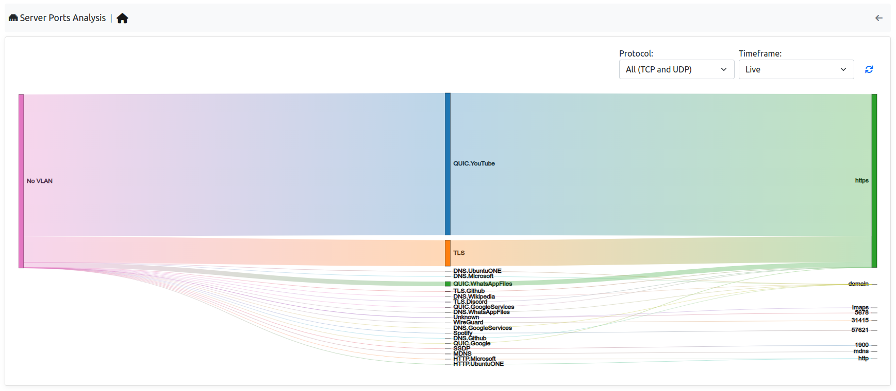
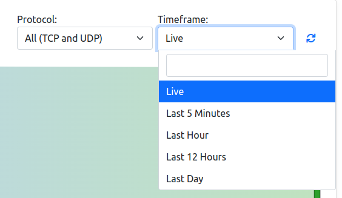

.. _ServerPorts:

Server Ports
------------

This view is the Server Ports tab of the Live Flows page (Flows menu, Live Flows entry).

.. note::
  Server Ports is available only with Enterprise L license

This page is used to understand which server ports are currently in use in the current Interface.

|

On the left side of the map, there are the VLANs that currently have traffic on some server ports, in the center instead the protocol can be found and on the right, the server port used.
It's possible add some filters by selecting the entries available in the right upper part of the table.
Moreover if ClickHouse is enabled, it's possible to change the timeframe and not only take a look at the live traffic but even at the historical traffic.

|

When clicking on a port or VLAN name in the map, the user is redirected to the live (or, with a timeframe, historical) flows with the requested filter.
When clicking on a link (VLAN, protocol, port), the flows of that link are shown aggregated by client and server: the Aggregation tab of the live flows, or the "Server Contacts" query of the historical flows with the selected timeframe, filtered by VLAN, L4 protocol, application and server port.
