.. _Hosts:

Hosts
#####

Hosts is a menu of the sidebar that contains a bunch of links to host-
related information pages. The dropdown is as follows:

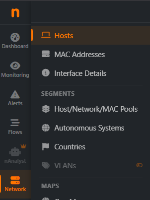

  The Hosts Dropdown Menu

Host-related information pages available have the following content

- Hosts: shows all hosts seen
- MAC addresses: shows all MAC addresses seen
- Assets: shows all the assets available (Active or Inactive)

Hosts
-----

The Hosts page shows the devices (hosts) that ntopng sees on the selected network interface.
It has two tabs:

- *Active Hosts*: the hosts that are exchanging traffic right now.
- *Local Hosts Activity*: how much traffic your local hosts made over a period of time.

If you open the page from an Autonomous System (for example from the AS list), an *AS Info*
link appears at the top right: it opens the details of that Autonomous System.

Active Hosts
^^^^^^^^^^^^

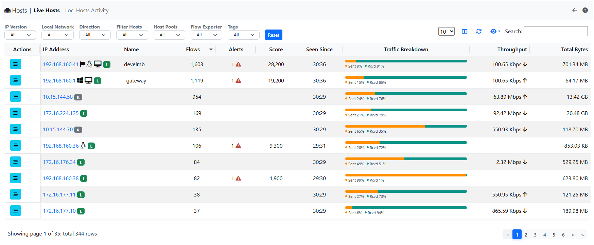

  The Active Hosts Tab

This tab lists all the hosts that are active now, both inside your network (local) and
outside it (remote). The list refreshes by itself every 10 seconds. Click a column title to
sort the list by that column.

For each host you can see:

- its IP address, with small icons that describe it: the operating system, the country flag,
  **L** for a local host, **R** for a remote host, and others (for example a blacklisted host)
- its name
- its VLAN (shown only if your network uses VLANs)
- how many connections (flows) and alerts it has, and its score (the higher, the more
  suspicious its traffic)
- how long ago it was first seen
- how much traffic it sends and receives, its current speed and its total traffic

To open all the details of a host, click the button in the *Actions* column, or the small
arrow icon next to its IP address. The menu next to the button also shows the connections
(flows) of the host.

Finding hosts
"""""""""""""

Use the filters above the list to see only some hosts, for example only the local ones, only
those of a VLAN or of a group (host pool). When there are many filters, they are inside the
*Filters* button. Each active filter is shown above the list: click the **x** to remove it,
or *Clear filters* to see all the hosts again.

You can also filter by clicking a value in the list: for example click a country flag to see
only the hosts of that country, or the **L** badge to see only the local hosts.

The filters you choose are kept in the address of the page, so you can bookmark it or send it
to a colleague.

Local Hosts Activity
^^^^^^^^^^^^^^^^^^^^

.. note::

   This tab needs an Enterprise M license (or higher), and the host timeseries must be
   enabled in the Preferences. If one of them is missing, the tab is greyed out: move the
   mouse over it to see what is needed.

This tab shows how much traffic each local host made in the period you choose with the time
selector above the list (*Live* shows the traffic right now).

For each host you can see the traffic sent and received, the traffic with other local hosts
and with remote hosts, and the total. The *Availability* column shows one square for each part
of the period: grey means no traffic, and the darker the green, the more traffic the host made.

With *Hosts Type* you choose which hosts to list: those with traffic (the default), those
without traffic, all the visible ones or the hidden ones.

From the *Actions* column you can:

- see the traffic chart of the host (only for the hosts that are active now)
- hide a host you are not interested in, so it no longer appears in the list
- show a hidden host again (first choose *Hidden* in *Hosts Type* to find it)

Only administrators can hide or show hosts.

Host Details
^^^^^^^^^^^^

The host details page shows everything ntopng knows about one host. Its views are the tabs
below the page title: a view that can never apply to the host is not shown (for example *DNS*
for a remote host), a view that is not available yet is greyed out and its tooltip says why
(no data seen for the host, a license or a preference needed). When there are many views the
tab bar scrolls sideways.

Next to the tabs:

- *Alerts Explorer*: the alerts of the host (engaged ones when the host has some).
- *Historical Flows*: the flows of the host stored in ClickHouse.
- the **⋮** menu: the *Periodicity Map* and the *Service Map* of the host (behaviour analysis).

Overview
^^^^^^^^

*Overview* is the default view of the Host Details page and provides detailed information including host MAC
Address (or the last router MAC address if the host is remote) and its device type, IP Address (with network
mask if detected), host pool, tags, operating system, Autonomous System, symbolic hostname (or IP address)
with its badges (local or remote, private, blacklisted...), date and time of first and last packet seen
for the host, traffic breakdown, amount of traffic packets received/sent, score, number of flows and peers
as client/server, TCP problems, the further names of the host and, for local hosts, the usernames seen in
its traffic (each with a badge telling the protocol, e.g. Kerberos, and when it was first and last seen).
The values update by themselves every 3 seconds: the arrow next to a counter shows whether it grew since
the last update. If the host becomes idle, a message says so and the values stop updating.

Administrators can reset the counters of the host (all of them, or only the blacklisted hosts counters)
and, on inline interfaces, drop the traffic or the active flows of a local host. The *Active Monitoring*
row adds the host to the ICMP active monitoring, or shows its last round trip time. All of this
information is also available in JSON format by clicking on the *JSON* link; on packet interfaces the
*Download pcap* button downloads the live traffic of the host.

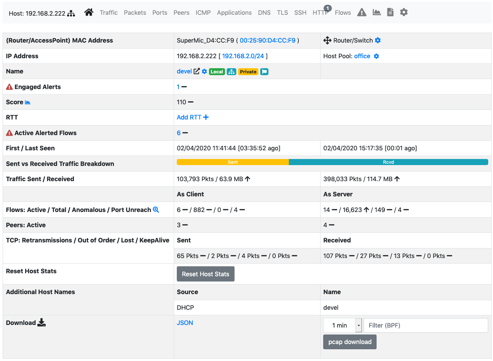

  The Overview of the Host Details Page

Also in case Wazuh is integrated in ntopng (see `Wazuh Integration`_ for more details), a button with the possibility to jump to Wazuh alerts will appear, giving the
possibility to instatly check the Wazuh Alerts of an host.

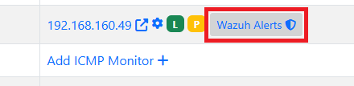

  Wazuh Button

.. note::

   Wazuh link is enabled only for Local Hosts.

.. _`Wazuh Integration`: ../../../third_party_integrations/wazuh.html

Traffic
^^^^^^^

The Traffic Page provides Layer-4 protocol statistics for the host. A pie chart showing L-4 protocol
breakdown is show at the top of page. A table with detailed statistics is shown below the chart.

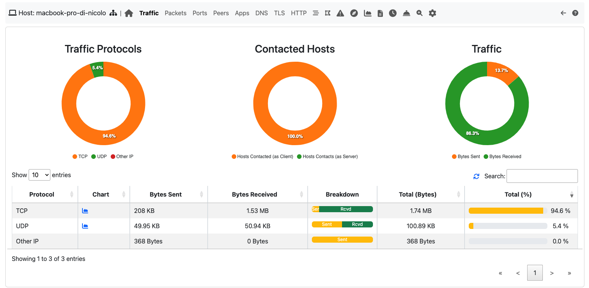

  The Traffic View of the Host Details Page

Packets
^^^^^^^

Packets page provides pie charts with packet size distribution, both for sent and received packets.

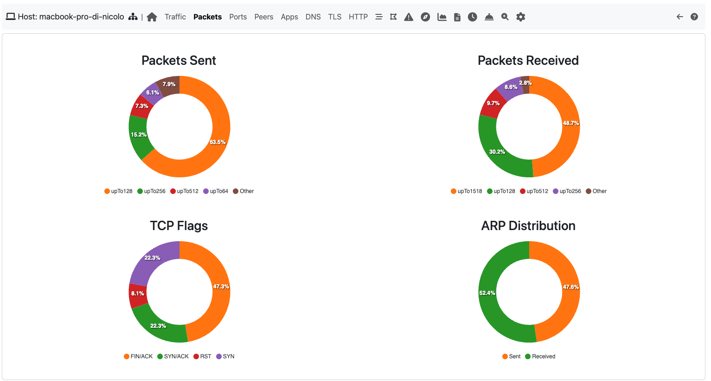

  The Packets View of the Host Details

Ports
^^^^^

Ports page lists the server ports the host answered on and the server ports it contacted, split by UDP and
TCP, each with its application. Click a server port of the host to open its historical flows (or the live
flows of that port when ClickHouse is not enabled). Below, pie charts with traffic statistics grouped by port:
a chart is available for client ports and another one is available for server ports.

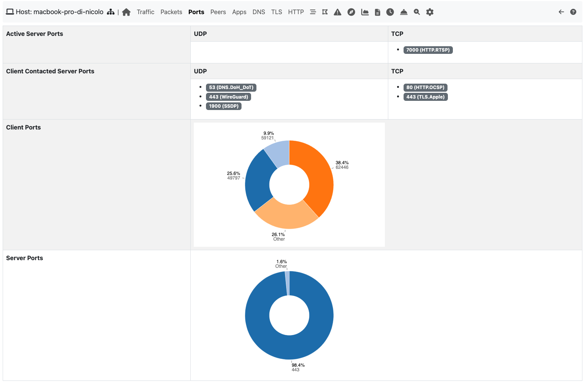

  The Ports View of the Host Details Page

ICMP
^^^^

The ICMP messages (type and code) sent and received by the host, with the last peer of each direction and
the packets. The table updates every 5 seconds. Click a message to see the live flows with that ICMP type
and code.

Applications
^^^^^^^^^^^^

Using the DPI information, this page provides in pie chart and tabular format the amount of traffic divided
by application. An additional pie chart provides a statistics about protocol type. A click on the protocol
name redirects the user to the page with detailed statistics about the selected protocol.

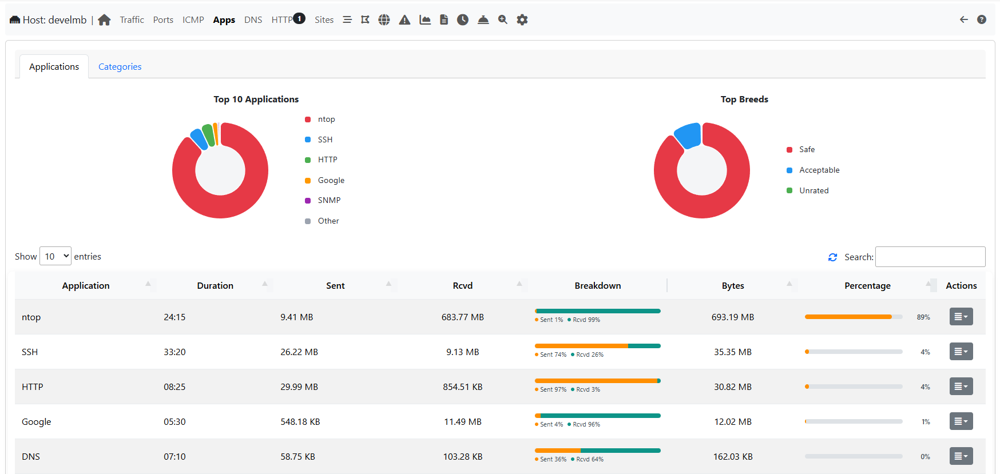

  The Protocols View of the Host Details Page

DNS
^^^

The chart and the table displayed on this page report DNS statistics, such as the number of queries, their
type (e.g., A, AAAA, PTR, and so on), and possible errors, plus the DoH/DoT servers used by the host. The
values update every 3 seconds. The view is available only for local hosts.

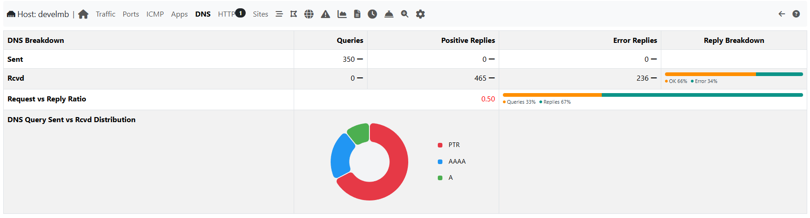

  The DNS View of the Host Details Page

TLS
^^^

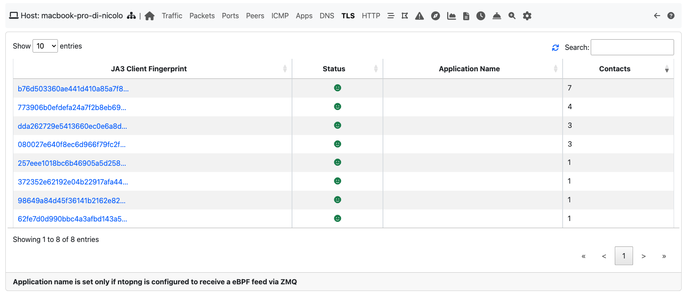

  The TLS View of the Host Details Page

ntopng registers the `JA3`_ TLS fingerprints of an host (either when the host is a client or a server) along with their the number of uses.
As explained in the `Flows section`_, this information is very important in order to uncover possible threats on the encrypted
traffic. By clicking on the signature it is possible to manually check if the JA3 signature
corresponds to a known malware into the `abuse.ch database`_.

By taking a snapshot of the signatures registered on an host it is possible to know, for example,
if the host has installed a new program or has updated an existing one. This may be very important
on environments where the programs installed into an host are not supposed to change.

By enabling the `nProbe Agent integration`_, this view can be further augmented
with the name of the process which initiated or received the TLS connection.

.. _`nProbe Agent integration`: https://www.ntop.org/guides/ntopng/using_with_nprobe_agent.html
.. _`abuse.ch database`: https://sslbl.abuse.ch/ja3-fingerprints
.. _`JA3`: https://github.com/salesforce/ja3
.. _`Flows section`: ../flows/flows.html#tls-information

SSH
^^^

ntopng registers the `HASSH`_ fingerprints of an host, either when the host initiates or receives an SSH connection,
along with their the number of uses. As explained in the `related Flows section`_, this information can be used to identify
malicious applications or vulnerable SSH versions.

.. _`HASSH`: https://engineering.salesforce.com/open-sourcing-hassh-abed3ae5044c
.. _`related Flows section`: ../flows/flows.html#ssh-signature

HTTP
^^^^

This page provides information about the HTTP protocol in terms of requests done and responses
received for each HTTP method, together with response codes. Counters are provided both as tables and
pie charts. In the case of virtual host being detected, a badge with the number of virtual hosts detected for
the same IP address is displayed in the host bar and an entry for each virtual server is displayed in a
virtual server table.

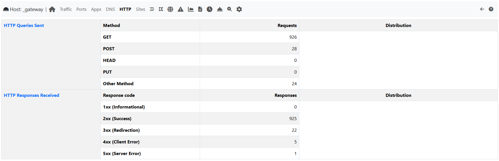

  The HTTP View of the Host Details Page with Virtual Hosts

.. _Sites:

Sites
^^^^^

.. note::

   This page is only available at lieast with a Pro License.

ntopng can keep track of top visited sites for any monitored local
host. Enabling the tracking of top visited sites requires preference
"Top HTTP Sites" to be set using the ntopng preferences page.

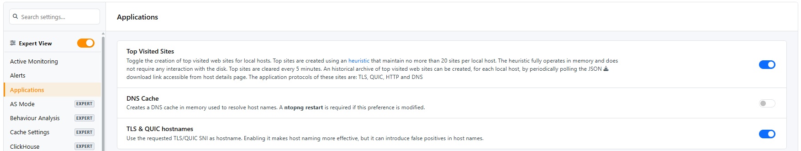

  The Preferences Page to Enable Visited Sites

Once the preference has been enabled, this page will start showing
visited websites, which are shown over the two most recent 5-minute
intervals. Newly visited sites are placed under the "Current
Sites". Every 5 minutes ntopng moves the "Current Sites" under "Last 5
Minute Sites", and starts over with a clean "Current Sites".

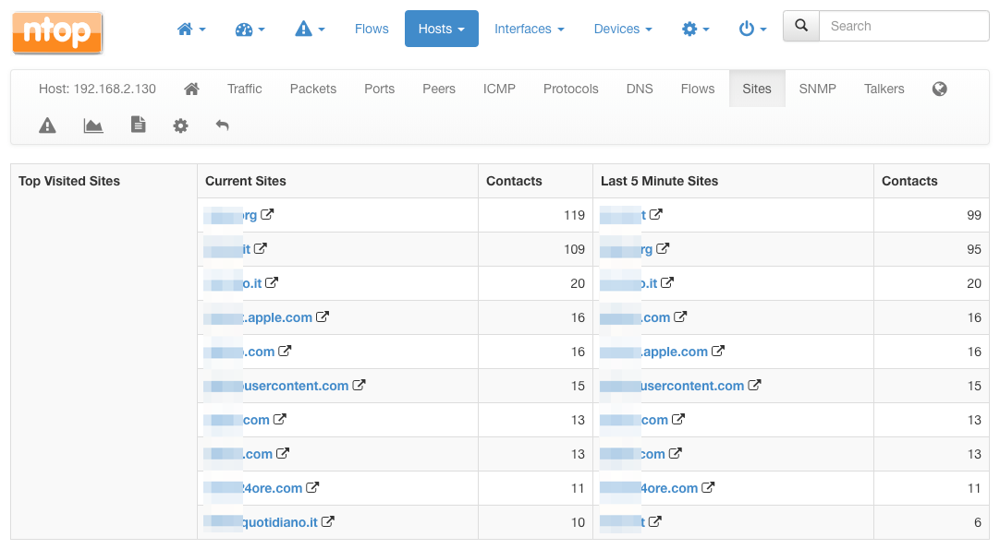

  The Sites View of the Host Details Page

Column "Contacts" count the number of time a particular website has
been visited. Every time the host visit a site, the corresponding
"Contacts" counter is increased by one. The *Time range* selector shows
the sites of another period (the hours of today, yesterday).

.. note::

   The Sites tab is greyed out until the preference is enabled and the
   host has visited at least one website: its tooltip says which one.

.. _Flows:
   
Host Flows
^^^^^^^^^^

The *Host Flows* tab lists all the active flows that have the selected host as an endpoint: the same list
of the Live Flows page, always filtered by the host, with the other filters of the list (application,
alerted flows...). A section of this manual discuss in greater detail the statistics shown for flows.

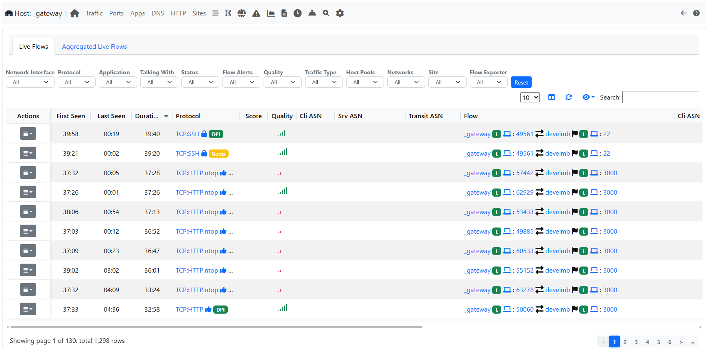

  The Flows View of the Host Details Page

SNMP
^^^^

SNMP page shows the SNMP devices and ports where the MAC address of the host was seen and, when the host is a
monitored SNMP device, its system information. Needs an Enterprise M License.

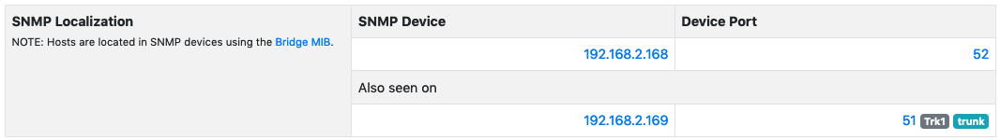

  The SNMP View of the Host Details Page

Listening Ports
^^^^^^^^^^^^^^^

The TCP/UDP ports the host listens on, with the process and the package, as reported by the nProbe agent
running on the host. The tab is greyed out when no listening port was reported.

Geomap
^^^^^^

Geomap page provides an interactive map that shows the selected hosts, its flows, and its
peers. The map is zoomable, both using the mouse rotor or the buttons at the top right corner. Each dot on the map is a host, by hovering the mouse on a dot a tooltip opens and information about the given host are presented.

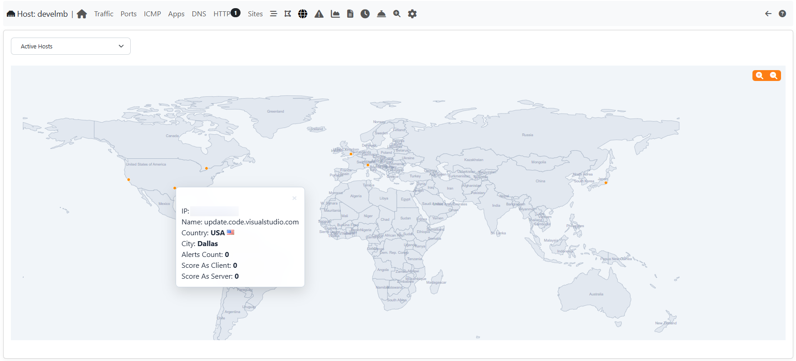

  The Geomap View of the Host Details Page

Statistics
^^^^^^^^^^

Statistics page (the *Charts* tab) provides historical traffic statistics for the selected host. The user can choose to filter
statistics on a protocol basis and display data in several formats (e.g., bytes, packets, flows, and so on).

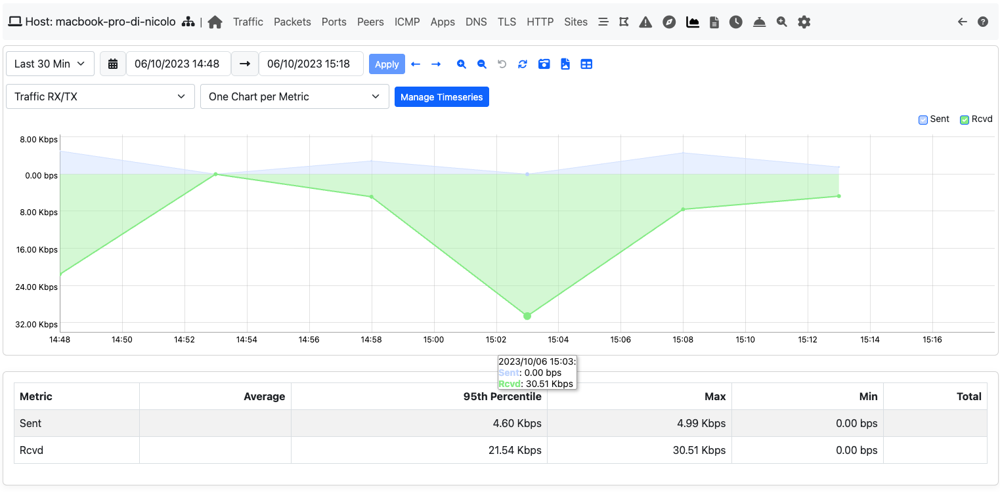

  The Statistics View of the Host Details Page

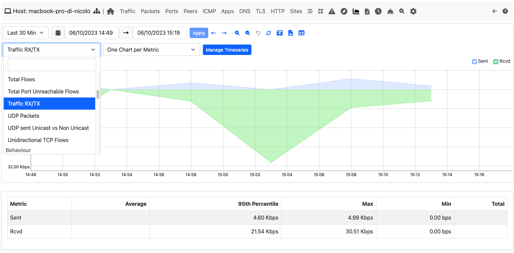

  The Dropdown menu in The Statistics View of the Host Details Page

Periodicity Map
^^^^^^^^^^^^^^^

.. note::

   This page is only available with an Enterprise L License.

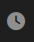

  The Periodicity Map entry of the **⋮** menu on the Host Details Page

The Periodicity Map is used to understand the local communication between hosts in a network.
More information can be found at :ref:`Periodicity Map`.

Service Map
^^^^^^^^^^^

.. note::

   This page is only available with an Enterprise L License.

  The Service Map entry of the **⋮** menu on the Host Details Page

The Service Map is used to understand the local communication between hosts in a network.
More information can be found at :ref:`Service Map`.

Historical Flow
^^^^^^^^^^^^^^^

.. note::

   This page is only available with an Enterprise License and only if ClickHouse is enabled

  The Historical Flow link on the Host Details Page

The Historical Flow is used to understand the local communication between hosts in a network.
More information can be found at :ref:`Historical Flow Explorer`.

Host Configuration
^^^^^^^^^^^^^^^^^^

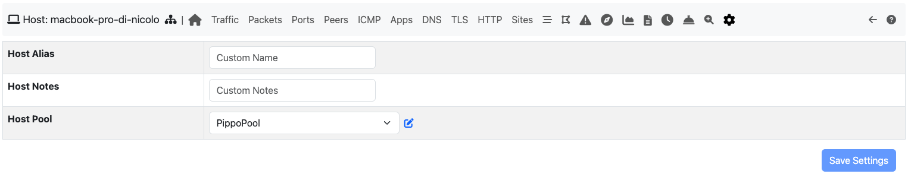

  The Host Configuration on the Host Details Page

In this page a user is able to give an Alias to an Host (an alternative name for an host that's going to be used in all ntopng), give a description to an host, 
assign this host to an host pool or hide this host from the Top Talkers computation.

MAC Addresses
-------------

The MAC Addresses page lists the network cards (MAC addresses) that ntopng sees on the
selected network interface. Devices that are idle are not listed.

For each MAC address you can see:

- the MAC address
- its manufacturer, and the model when ntopng recognizes it
- the device type (for example laptop, phone, printer), with an icon
- its name; when it has none, the first host (IP address) that uses it and how many other
  hosts use it
- how many hosts use it and how many ARP packets (the messages that link an IP address to
  a MAC address) it sent and received
- how long ago it was first seen
- how much traffic it sends and receives, its current speed and its total traffic

On nEdge a *Location* column also shows whether the device is on the LAN or on the WAN.

Use the filters above the table to show only the MAC addresses that sent traffic (*Source
Only*), or the ones of a manufacturer or of a device type. You can also click a manufacturer,
a device type or a location in the table to filter by it. *Clear filters* removes all the
filters.

To open all the details of a MAC address, click the button in the *Actions* column, or the
small arrow icon next to the MAC address. The menu next to the button also lists the hosts
that use that MAC address.

MAC Address Details
^^^^^^^^^^^^^^^^^^^

The details page of a MAC address has these views, shown as tabs below the page title. A view
that is not available is greyed out: move the mouse over it to see why.

- *Overview*: the MAC address and its manufacturer name, the device type (and model when
  known), the hosts (IP addresses) that use it, where it was seen on the monitored SNMP
  switches, its name and host pool, the DHCP fingerprint (a signature of the device built from
  its DHCP requests), when it was first and last seen, the traffic it sent and received
  (updated every few seconds, with an arrow when it grows), its DHCP and ARP packets and when
  its counters were last reset. Administrators can reset its counters from here: the charts
  may have a gap after the reset.
- *Packets*: how its packets split between IPv4 and IPv6.
- *SNMP*: the SNMP switches and ports where the MAC address was seen. It needs Enterprise M
  and SNMP devices monitored by ntopng.
- *Charts*: the traffic of the MAC address over time. Enable the MAC address timeseries in
  *Preferences > Timeseries* to record them.
- *Settings* (administrators only): the alias shown instead of the MAC address, the device
  type and the host pool.

The *Historical Flows* button next to the tabs opens the stored flows of the MAC address
(it needs ClickHouse).
