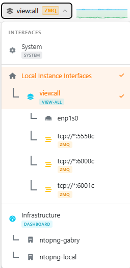

# Network Interface {#network-interface}

This Web Interface is used to monitor the status of a Network Interface; there can be different types of network interfaces, see this [section] for more info.

By changing interface and jumping to the Network Interface some options are going to be available.

## Dashboard {#dashboard}

- [Traffic Dashboard](/user_interface/network_interface/dashboard/dashboard.md)
- [Traffic Reports](/flow_dump/clickhouse/reports.md)
- [Sites](/user_interface/network_interface/interface/sites.md)

## Monitoring {#monitoring}

- [Network Discovery](/user_interface/network_interface/monitoring/network_discovery.md)
- [Active Scan](/user_interface/network_interface/monitoring/active_scan.md)
  - [Active Scan Page](/user_interface/network_interface/monitoring/active_scan.md#active-scan-page)
  - [Scan Details](/user_interface/network_interface/monitoring/active_scan.md#scan-details)
  - [Alerts](/user_interface/network_interface/monitoring/active_scan.md#alerts)
  - [Charts](/user_interface/network_interface/monitoring/active_scan.md#charts)
  - [Open Ports](/user_interface/network_interface/monitoring/active_scan.md#open-ports)
  - [Scan Reports](/user_interface/network_interface/monitoring/active_scan.md#scan-reports)

## Alerts {#alerts}

- [Flow Alerts Analyser](/user_interface/network_interface/alerts/flow_alerts_analyser.md)

## Flows {#flows}

- [Flows](/user_interface/network_interface/flows/flows.md)
  - [Live](/user_interface/network_interface/flows/flows.md#live)
  - [Flow Analysis](/user_interface/network_interface/flows/flows.md#flow-analysis)
  - [Geo Map View](/user_interface/network_interface/flows/flows.md#geo-map-view)
- [Historical](/flow_dump/clickhouse/historical_flows.md)
  - [Details](/flow_dump/clickhouse/historical_flows.md#details)
  - [Track Flows](/flow_dump/clickhouse/historical_flows.md#track-flows)
  - [Enabling Flow Dump](/flow_dump/clickhouse/historical_flows.md#enabling-flow-dump)
  - [Custom Queries](/flow_dump/clickhouse/historical_flows.md#custom-queries)
  - [Exporting Flows](/flow_dump/clickhouse/historical_flows.md#exporting-flows)
  - [Data Retention](/flow_dump/clickhouse/historical_flows.md#data-retention)
  - [Hourly Historical Flows](/flow_dump/clickhouse/historical_flows.md#hourly-historical-flows)
  - [Aggregation Preferences](/flow_dump/clickhouse/historical_flows.md#aggregation-preferences)
  - [Replay Historical Flows](/flow_dump/clickhouse/historical_flows.md#replay-historical-flows)
  - [Historical Flows Archive for Compliance](/flow_dump/clickhouse/historical_flows.md#historical-flows-archive-for-compliance)
  - [Benefits](/flow_dump/clickhouse/historical_flows.md#benefits)
  - [Enabling Flow Export](/flow_dump/clickhouse/historical_flows.md#enabling-flow-export)
  - [Default Export Location](/flow_dump/clickhouse/historical_flows.md#default-export-location)
  - [Custom Export Directory](/flow_dump/clickhouse/historical_flows.md#custom-export-directory)
  - [Importing Archived Flow Data](/flow_dump/clickhouse/historical_flows.md#importing-archived-flow-data)
  - [Viewing Imported Data in ntopng](/flow_dump/clickhouse/historical_flows.md#viewing-imported-data-in-ntopng)
  - [Important Notes](/flow_dump/clickhouse/historical_flows.md#important-notes)
- [Server Ports](/user_interface/network_interface/flows/server_ports.md)

## Hosts {#hosts}

- [Hosts](/user_interface/network_interface/hosts/hosts.md)
  - [Hosts](/user_interface/network_interface/hosts/hosts.md#id1)
  - [MAC Addresses](/user_interface/network_interface/hosts/hosts.md#mac-addresses)

## Maps {#maps}

- [Analysis](/user_interface/network_interface/maps/analysis_map.md)
  - [Graph](/user_interface/network_interface/maps/analysis_map.md#graph)
  - [Services and Hosts Ranking](/user_interface/network_interface/maps/analysis_map.md#services-and-hosts-ranking)
  - [Filters](/user_interface/network_interface/maps/analysis_map.md#filters)
  - [Service status and learning](/user_interface/network_interface/maps/analysis_map.md#service-status-and-learning)
- [Geo Map](/user_interface/network_interface/maps/geo_map.md)
- [Hosts](/user_interface/network_interface/maps/host_map.md)

## Interface {#interface}

- [Details](/user_interface/network_interface/interface/interfaces.md)
  - [Overview](/user_interface/network_interface/interface/interfaces.md#overview)
  - [Networks](/user_interface/network_interface/interface/interfaces.md#networks)
  - [Protocols](/user_interface/network_interface/interface/interfaces.md#protocols)
  - [Applications](/user_interface/network_interface/interface/interfaces.md#applications)
  - [ICMP](/user_interface/network_interface/interface/interfaces.md#icmp)
  - [Sites (Professional Version)](/user_interface/network_interface/interface/interfaces.md#sites-professional-version)
  - [Statistics](/user_interface/network_interface/interface/interfaces.md#statistics)
  - [Traffic Profiles (Professional Version)](/user_interface/network_interface/interface/interfaces.md#traffic-profiles-professional-version)
  - [Recording](/user_interface/network_interface/interface/interfaces.md#recording)
  - [Settings](/user_interface/network_interface/interface/interfaces.md#settings)
  - [Disaggregation](/user_interface/network_interface/interface/interfaces.md#disaggregation)
  - [Mirrored Traffic](/user_interface/network_interface/interface/interfaces.md#mirrored-traffic)
- [Networks](/user_interface/network_interface/interface/networks.md)
  - [Networks Dashboard](/user_interface/network_interface/interface/networks.md#networks-dashboard)
- [Host Pools](/user_interface/network_interface/interface/host_pools.md)
  - [Pool Members](/user_interface/network_interface/interface/host_pools.md#pool-members)
  - [Traffic Policies](/user_interface/network_interface/interface/host_pools.md#traffic-policies)
- [Autonomous Systems](/user_interface/network_interface/interface/autonomous_systems.md)
  - [Timeseries](/user_interface/network_interface/interface/autonomous_systems.md#timeseries)
  - [Ingress/Egress Stats](/user_interface/network_interface/interface/autonomous_systems.md#ingress-egress-stats)
  - [Hosts/Flows](/user_interface/network_interface/interface/autonomous_systems.md#hosts-flows)
- [Countries](/user_interface/network_interface/interface/countries.md)
- [VLANs](/user_interface/network_interface/interface/vlans.md)
- [Assets Inventory](/user_interface/network_interface/interface/assets.md)
  - [Hosts seen on several VLANs](/user_interface/network_interface/interface/assets.md#hosts-seen-on-several-vlans)
  - [Asset details](/user_interface/network_interface/interface/assets.md#asset-details)
- [Operating Systems](/user_interface/network_interface/interface/operating_systems.md)
- [Pods and Containers](/user_interface/network_interface/interface/containers.md)
- [Live Captures](/user_interface/network_interface/interface/live_captures.md)
- [Traffic Report](/user_interface/network_interface/interface/traffic_report.md)

[section]: /advanced_features/interfaces/index.md
