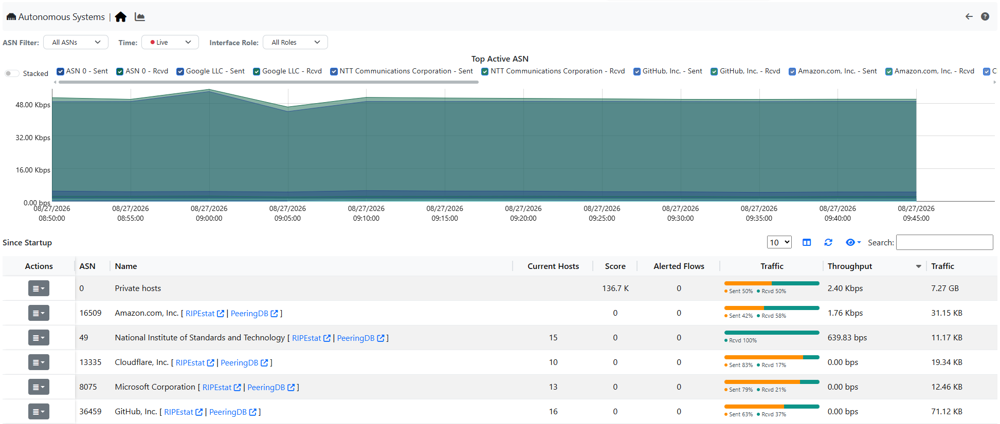

.. _AutonomouseSystems:

Autonomous Systems
------------------

Autonomous Systems shows all autonomous systems discovered by ntopng. Autonomous Systems require :ref:`Geolocation` enabled.

  The Hosts Autonomous Systems Summary Page

Ntopng uses a Maxmind database to gather information about Autonomous Systems (AS) and based on
this it groups hosts belonging to the same AS. AS number 0 contains all hosts having private IP addresses.

It is possible to tell ntopng which ASNs are your own, which ones belong to your customers, and which ones
are simply relevant for your business: see :ref:`ASNConfiguration` for the configuration details.

The page has two tabs: *Overview*, with the chart of the top Autonomous Systems and the table, and *Historical Data*,
with the Autonomous System timeseries of the interface. *Historical Data* is greyed out until Autonomous System
timeseries are enabled in *Settings* > *Preferences* > *Timeseries*.

The filters above the chart apply to both the chart and the table:

- *ASN Filter*: all the ASNs, or only your ASNs, your customers ASNs, the relevant remote ASNs or the other ones
  (see :ref:`ASNConfiguration`)
- *Time*: `Live` or a past time range (last 30 minutes up to last week). Only shown when ClickHouse is enabled
- *Interface Role*: the traffic seen on IX, peering or transit SNMP interfaces. Needs Enterprise M

*Clear filters* sets all of them back to their default.

The chart (when the timeseries are enabled, Enterprise license) shows the top active Autonomous Systems over time.

When the `Live` time is selected (or when ClickHouse is not available), the table below the chart is labeled
`Active ASN Since Startup`: it reports the traffic of each Autonomous System cumulated since ntopng startup,
and it is independent from the time range selected for the chart. Hovering the label shows a tooltip with this explanation.

This happens because the Autonomous Systems historical table is built from the data stored in ClickHouse, while the
Timeseries do not require ClickHouse. As a consequence, without ClickHouse the chart can be moved to any time range,
but the table always shows the data collected since ntopng startup.

.. note::

  When ClickHouse is enabled, select a `Time` value other than `Live` to show the historical table for the selected period.

The name of each Autonomous System links to its RIPEstat and PeeringDB pages (in a new browser tab). The icons
next to the name mark your ASNs, your customers ASNs and the relevant remote ASNs.

The button of the *Actions* column opens the hosts of the Autonomous System. Its menu also has:

- *Flows of this AS*: the live flows, or the historical flows of the selected time range when *Time* is not `Live`
- *Timeseries*
- *Ingress/Egress Stats*: only with flows from an nProbe exporter, not for the private hosts (ASN 0)

Unavailable actions are shown greyed out with the reason (for example, a past time range can show an Autonomous
System that has no active hosts now: its hosts and ingress/egress statistics are not available).

Timeseries
^^^^^^^^^^

.. figure:: ../../../img/web_gui_top_asn_ts.png
  :align: center
  :alt: Top ASN Timeseries

  The Top ASN Timeseries

.. warning::

  To be able to see the Timeseries, they must be enabled from the Settings (Timeseries section).

It is possible to access the Autonomous Systems Timeseries in two different ways:

- By clicking on the Action (button) -> Timeseries, in this way the timeseries of the selected AS are shown;
- By clicking on the *Historical Data* tab, in this way all the AS timeseries of the selected Interface are shown;

.. warning::

  In case many Autonomous Systems are present, the loading of all the Timeseries (second option above) could may take a while

Ingress/Egress Stats
^^^^^^^^^^^^^^^^^^^^

This page is used to understand, each AS, where it is sending/receiving the traffic.

.. figure:: ../../../img/web_gui_as_view.png
  :align: center
  :alt: AS View

  The Autonomous Systems View

There are two different Criteria:

- AS View;
- Ingress/Egress Interfaces;

In the first case the statistics of each AS that are talking to other ASes are shown. Also the Transit AS are shown here (for example ASN 174 is talking to ASN 16509 by using ASN 6939 as Transit).
The table shows the same data as the sankey but in a table view (sortable and searchable).

.. note::

  The table below is available only from Enterprise L license

.. figure:: ../../../img/web_gui_ingress_egress_interfaces.png
  :align: center
  :alt: AS View

  The Autonomous Systems View

In the second view instead, it's shown from which exporter and interface each AS is sending/receiving traffic.

.. note::

  The second view is only available if there is at least an exporter sending traffic towards ntopng (see :ref:`UsingNtopngWithNprobe`)

Hosts/Flows
^^^^^^^^^^^

All the hosts or flows being part of the selected Autonomous System, are shown on the respective :ref:`Hosts` and :ref:`WebGuiFlows` pages
