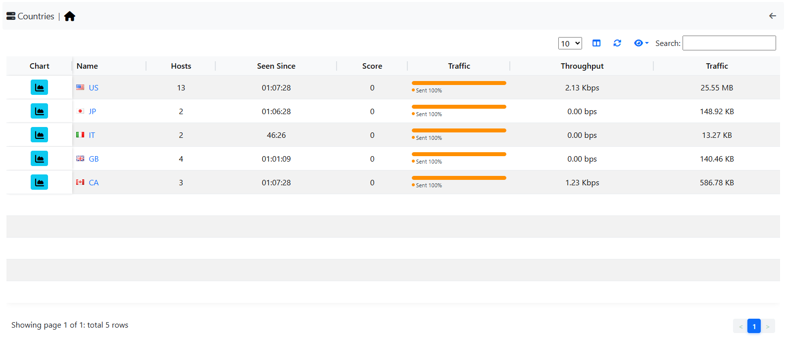

.. _Countries:

Countries
---------

The Countries page lists the countries of the hosts currently active on the selected interface.
The country of a host comes from the geolocation database, so this page needs :ref:`Geolocation` enabled.

  The Hosts Countries Summary Page

Each row shows:

- The country flag and code
- Hosts, the number of active hosts in the country
- Seen Since, the time since the first packet of a host of the country
- Score, the sum of the scores (how suspicious the traffic is) of the country hosts
- Breakdown, a bar with the share of sent and received traffic
- Throughput, the current throughput
- Traffic, the total traffic exchanged

The button of the *Actions* column opens the list of the hosts in that country. Its menu also has
*Country timeseries*, the historical traffic charts of the country. It is disabled until country
timeseries are enabled in *Settings* > *Preferences* > *Timeseries*.
