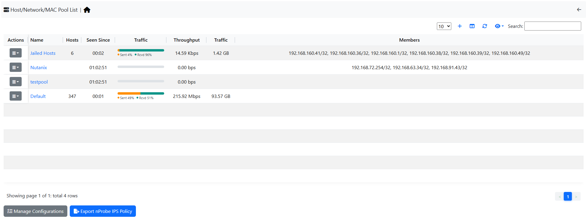
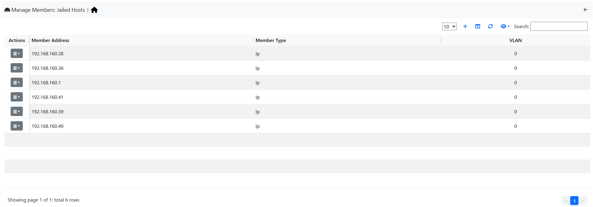

.. _HostPools:

Host Pools
----------

Host Pools are logical groups of hosts that are described in detail in the “Network Interfaces" section of
this document. This page show the list of defined and currently active Host Pools.

  The Host Pools List Hosts Page

Each row of the table shows, for each pool:

- The pool name, as defined when the pool was created
- Hosts, the number of active hosts in the pool
- Seen Since, the time since the first packet of a host of the pool
- Traffic Breakdown, a bar with the share of sent and received traffic
- Throughput, the current throughput of the pool
- Traffic, the total traffic exchanged by the pool
- Members, the addresses, networks and MAC addresses that belong to the pool

The button of the *Actions* column opens the list of the active hosts of the pool. Its menu also has:

- *Timeseries*, the historical traffic charts of the pool. It is disabled until host pool timeseries
  are enabled in *Settings* > *Preferences* > *Timeseries*.
- *Manage Members*, the page to add and remove members (administrators only; not available for the
  *Default* pool, which holds all the hosts not assigned to another pool)
- *Edit Name*, to rename the pool and change its members
- *Edit Traffic Policy*, the traffic policy of the pool (administrators only, needs ntopng Pro)
- *Delete*, to remove the pool. The built-in *Default* and *Jailed Hosts* pools cannot be deleted.

Pools are added with the *Add pool* button above the table. Adding, editing and deleting pools needs the
Pools capability of the user (administrators always have it). Unavailable actions are shown greyed out
with the reason.

  The Host Pool Page

The Host Pools configuration, which includes the definition of host pools along with
the pools members, can be easily exported to JSON and imported into another ntopng instance
from the *Settings* > *Manage Configuration* page. Imported host pools will replace the existing ones.

An “Alias” can be associated to each pool member to ease the its identification. Typically, one would
assign a mnemonic label as member alias (e.g., “John’s iPhone” or “Smart TV”).

A view of host pool statistics is accessible from the actual interface, *Hosts* > *Host Pools* menu. The view shows live pool information (e.g., overall pool throughput)
and provides access to the historical pool traffic timeseries (Professional version) as well as to the 
currently active pool members.

.. _`relevant section`: hosts.html#host-pools
.. _HostPools:
.. _`network interface page`: interfaces.html#host-pools

Traffic Policies
^^^^^^^^^^^^^^^^

Host pools can also be used to enforce traffic policies (e.g, block YouTube traffic for the “John” pool and
limit Facebook traffic at 1 Mbps for the “Guests” pool). This feature is available in nEdge (when ntopng is
used inline as described in the “Advanced Features” section of this document), or when ntopng is used in 
combination with `nFW <https://www.ntop.org/guides/nFW>`_ (see :ref:`UsingNtopngWithNFW`).

The *Edit Traffic Policy* action of a pool opens its traffic policy (administrators only, needs
ntopng Pro; not on nEdge, which has its own user policies):

- **Default Policy**: what happens to the traffic of the pool that matches no rule, *Pass* or *Drop*.
- **Rules**: the exceptions to the default policy, by application protocol, application category,
  host name (or IP address), country, continent and flow risk. *Add Rule* chooses the value and
  the action (*Pass*, *Slow Pass*, *Slower Pass* or *Drop*); click a rule to change its action,
  the ✕ removes it. The flows with one of the selected risks are always dropped.
- **Save** applies the changes (it is disabled until something changes).
- **Auto Configure** replaces the rules with the ones suggested by the traffic of the hosts of the
  pool (the protocols and the sites they use are allowed) and sets the default policy to *Drop*,
  after a confirmation. It needs the *Top Visited Sites* option enabled in Preferences >
  Applications, ideally a day before.
