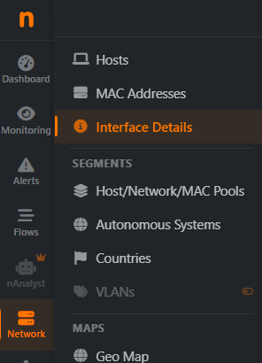
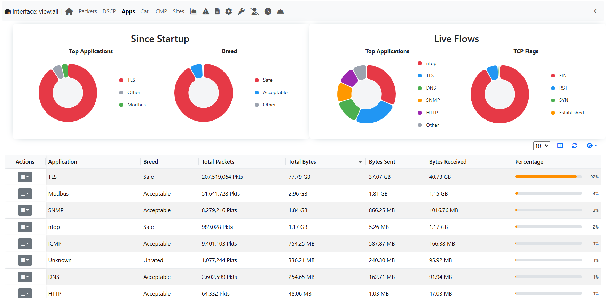
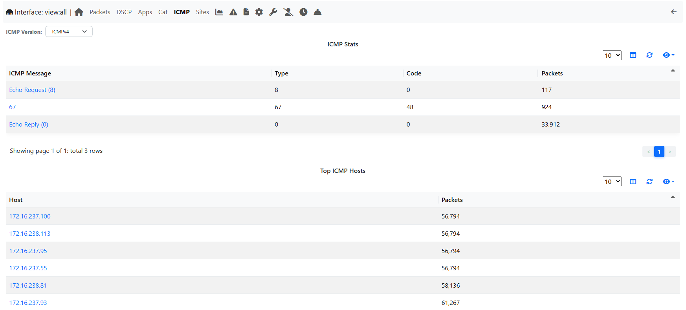
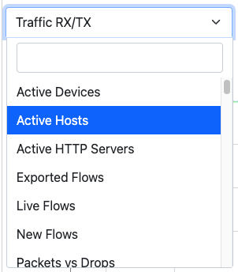
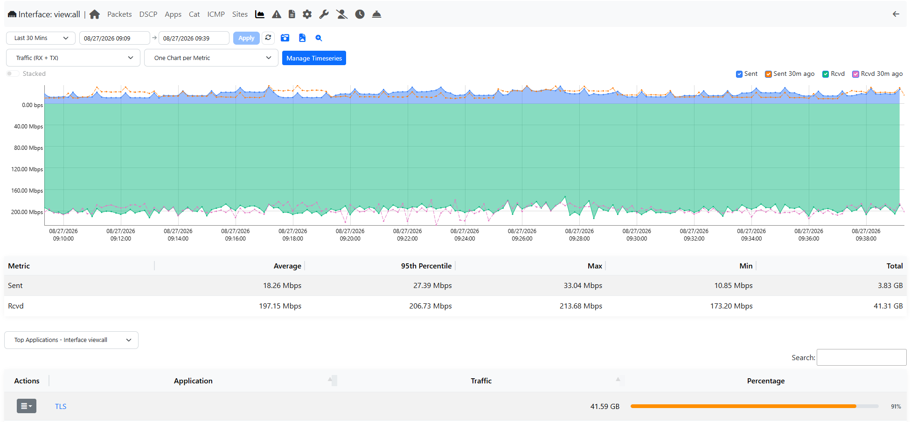
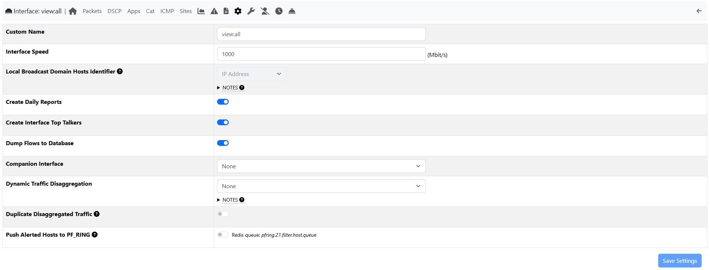
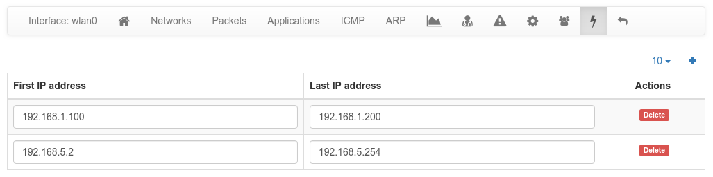
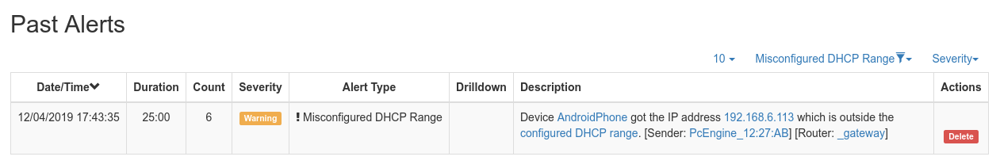
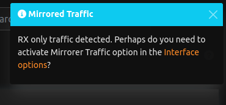

.. _InterfaceDetails:

Details
-------

.. note::
  See the available Network Interfaces types `here`_

  The Home View of the Interface Details Page

The views of the interface are tabs right below the page title: Overview, Networks, Protocols,
Applications, Sites, Historical Data, Traffic Profiles, Recording, Report and, for
administrators, Settings. Each tab is discussed below. The alerts of the interface and its
service and periodicity maps open from the Overview. The internals of the interfaces (hash
tables, periodic activities, checks) are in *Health* > *Interfaces Status* > *Internals*.

Only the tabs that apply to the interface are listed: for example Networks only for the
interfaces that capture packets. A tab that applies
but cannot be used yet is shown greyed out: move the mouse over it to see why and how to enable
it (e.g. Historical Data needs the interface timeseries, enabled in Preferences > Timeseries).

.. _`System Interface`: ../basic_concepts/system_interface.html
.. _`here`: ../interfaces/index.html

Overview
^^^^^^^^

The Overview shows first what matters, from top to bottom:

- **The interface**: its name, its Id (the number ntopng gives to each interface), its type
  (e.g. PF_RING, ZMQ), speed and MAC address, and whether it is *Active* or *Paused*.
  Administrators can pause the monitoring with *Pause* (while paused, its traffic is not
  processed) and resume it with *Resume*. The ⋮ button holds the other actions: *Live capture*
  (download a pcap file of the next seconds of traffic, optionally only the packets matching a
  BPF filter), the service and periodicity maps, *Reset drop counters* and *Reset all counters*
  (the counters restart from zero, the historical charts are kept).
- **What needs attention**: shown only when something is wrong, e.g. packets dropped by the
  interface, messages from nProbe lost, flows not exported to the database, alerts dropped
  because the alerts queue was full. Each item links to its chart when there is one.
- **Key figures**: throughput (with the packets and the new flows per second), traffic since the last reset, active hosts, active flows and
  engaged alerts (alerts still in progress). Click a figure to open its page: the charts, the
  applications, the hosts, the flows or the alerts of the interface.
- **Throughput**: sent (above the line) and received (below it) in the last minutes; move the
  mouse over the chart to read the values of a moment.
- **Traffic**: how the traffic splits
  between sent and received, local and remote hosts, IPv4, IPv6 and the other protocols.
- **Top local hosts** and **Top remote hosts**: the five local and the five remote hosts with the
  most traffic (updated every minute). Click one to open it, or *All hosts* for the full list.
- **Top applications**: the applications with the most traffic since ntopng started. Click one
  to see its active flows, or *All applications* for the full list.
- **Source of the traffic**: for an interface that captures packets, its family, MTU, speed and
  dropped packets; for an interface that collects flows (connections) from nProbe, the collected
  and discarded flows, the messages received and lost and the connected nProbe instances; for a
  syslog interface, the collected and handled logs.
- **Technical details** (closed, click to open): the system name of the interface, the behaviour
  anomalies (how many times, since ntopng started, the flows or the score of a host went out of
  their expected range), the disk space it uses, the flow export to the databases, the traffic recording windows and, for the
  administrators of a ZMQ interface, the encryption key to add to the nProbe configuration.

The figures are updated every few seconds. The name of the interface can be changed in the
Settings tab.

Networks
^^^^^^^^

For the interfaces that capture packets: the IP addresses of the interface (read from its
configuration; click one to open its host) and the broadcast domains (the local networks seen in
the ARP traffic), each with the number of ARP packets seen. Click a domain to see its hosts. A
domain marked *Ghost* does not belong to any network of the interface addresses: a device may be
misconfigured. Administrators can forget the domains seen so far with *Reset Broadcast Domains*:
they are learned again from the traffic.

Protocols
^^^^^^^^^

- **TCP Packets Analysis**: the TCP packets resent (retransmissions), received out of order and
  lost, also as a share of all the packets.
- **Packet distributions**: how the packets split by size, by IP version, by TCP flags, by DSCP
  class (the priority set in the packets) and by ARP type (requests and replies). The size is not
  shown for the interfaces that collect flows; DSCP and ARP need an interface that sees the MAC
  addresses.

The figures are updated every few seconds.

Applications
^^^^^^^^^^^^

Applications page provides the pie charts and the table of the nDPI-detected protocols for the selected
interface. Choose *Group by* *Application* or *Category* (the groups of applications, such as Web
or Streaming) to see the traffic by application or by category.

In the two top pie charts ntopng shows the application distribution and its categorization. The bottom pie
chart shows nDPI-detected applications for currently active flows. All labels are clickable and point to
detailed statistics pages. Belo pie charts there is a list of protocols detected with the corresponding total
traffic, both in absolute terms and as a percentage of the total traffic.
By selecting any Application Protocol, it is possible to display a statistics page with temporal charts for that
protocol. Similarly, by clicking on the magnifying lens icon, it is possible to display all active flows for that
protocol.

  The Protocols View of the Interface Details Page

ICMP
^^^^

At the bottom of the Protocols tab: the ICMP messages of the interface (IPv4 or IPv6) and the
hosts that sent and received the most ICMP packets.

  The ICMP View of the Interface Details Page

Sites (Professional Version)
^^^^^^^^^^^^^^^^^^^^^^^^^^^^

The web sites most visited by the local hosts of the interface (at most 20), seen in their HTTP,
TLS, QUIC and DNS traffic. Choose the time range: now, the last 5 minutes, one hour of today or
yesterday. Needs the creation of the top visited sites enabled in Preferences.

Statistics
^^^^^^^^^^

Statistics page provides historical traffic statistics for the selected interface. The user can choose to filter
statistics on a protocol basis and display data in several formats (e.g., bytes, packets, flows, and so on). In
the Professional Version of ntopng, traffic for interface views in shown as stacked per physical interface.
Physical interface visualization can be toggled by clicking on the coloured dot just left of interface name.

The time series span can be adjusted by selecting values from 5 minutes up to 1 year. Moreover, drill-
down is possible by clicking on the time series itself. Every click zooms the chart in, centering the time
series around the clicked point.

In addition, time series shown can be chosen via the dropdown menu labelled ‘Time series’. For example,
it is possible to visualize all or just one protocol, traffic, packets, active hosts and flows, and so on. Ntopng
is VLAN aware, hence if several VLANs are detected, traffic is accounted also on a VLAN basis.

  The Dropdown Time Series Menu in the
  Statistics View of the Interface Details Page

  The Statistics View of the Interface Details
  Page (Professional Version)

Historical interface minute top talkers are shown on the right of the page, and get refreshed automatically
when the mouse moves over the chart.

Traffic Profiles (Professional Version)
^^^^^^^^^^^^^^^^^^^^^^^^^^^^^^^^^^^^^^^

The traffic of each traffic profile (the flows matching its filter) on the interface, updated
every few seconds. Click a profile to see its charts. Administrators open *Manage profiles* to
add or change them. See later in this manual for more information.

Recording
^^^^^^^^^

Administrators record here the traffic of the interface with n2disk (continuous traffic
recording), in three views: *Status* (running or failed, the time range on disk, the n2disk
log), *Settings* (disk space, capture filter, smart recording, storage utilization) and *Jobs*
(the traffic extractions and their pcap files, Enterprise M). The tab needs n2disk installed:
on the interfaces that capture packets it is otherwise shown disabled, with the reason. On a
view only the jobs are shown. See :ref:`ContinuousTrafficRecording` for the details.

Settings
^^^^^^^^

Administrators change here the settings of the interface. Only the settings that apply to the
interface are listed. After a change a bar asks to *Save changes* or to *Discard* them.

  The Settings View of the Interface Details Page

General
~~~~~~~

**Custom Name**:
A name shown instead of the system one (at most 64 characters, without < > " ' `). Leave it
empty to show the system name.

**Interface Speed**:
The speed of the interface in Mbit/s. Typically ntopng detects it; leave it empty to use the
detected one.

**Scaling Factor** (interfaces that capture packets):
Packets arriving on the interface could have been sampled upstream, for example by a packet
broker or another device. This setting tells ntopng the sampling rate, to scale the traffic up.

Traffic
~~~~~~~

**Mirrored Traffic** (interfaces that capture packets):
Turn it on when the interface receives the traffic of a mirror/SPAN port. Typically such
interfaces have no IP address. ntopng then skips the activities that cannot work on mirrored
traffic, such as the network device discovery. With mirrored traffic you can list the
**Gateway MAC addresses**, used to tell the direction of the traffic.

**Dump Flows to Database**:
Whether the flows of this interface are stored in the flows database (`-F` startup option).
Turning it off on some interfaces reduces the disk load. A change needs a restart of ntopng.

**Create Interface Top Talkers**:
Whether the top talkers (the hosts with the most traffic) of the interface are kept, as shown
in the ntopng report.

**Automatic Reports** (Enterprise L, when enabled in Preferences):
Whether the traffic reports of the interface are created automatically.

**Companion Interface**:
Another interface (e.g. a syslog one) whose events and alerts are bound to the traffic of this
interface.

**Traffic Recording Provider** (when n2disk instances are installed):
Which recorder stores the traffic of the interface: ntopng itself or an n2disk instance.

Hosts
~~~~~

**Local Broadcast Domain Hosts Identifier**:
Determines if `Local Broadcast Domain`_ hosts whose IP address is inside a configured
`DHCP range`_ are identified by their MAC address or IP address, also in their timeseries. In a
DHCP network the IP address of a host usually changes, so the MAC address identifies it better.
Mirrored traffic and the interfaces that collect flows always use the IP address.

**Periodic Interface Network Discovery**:
Whether ntopng periodically discovers the devices of the network of this interface. The
frequency is set in Preferences (15 minutes by default).

Traffic disaggregation
~~~~~~~~~~~~~~~~~~~~~~

**Dynamic Traffic Disaggregation**:
Splits the traffic of the interface into dynamic interfaces, as explained in the
`Interfaces Disaggregation`_ section.

.. _`Local Broadcast Domain`: ../../../basic_concepts/local_broadcast_domain.html
.. _`DHCP range`: #id1
.. _`Interfaces Disaggregation`: ../../../advanced_features/dynamic_interfaces_disaggregation.html

**Duplicate Disaggregated Traffic**:
When the Dynamic Traffic Disaggregation is set, normally ntopng reports the traffic only on the
disaggregated interfaces, hence the main interface has no traffic. With this option the traffic
is also reported on the main interface.

**Push Alerted Hosts to PF_RING**:
Pushes the IP address of the alerted hosts to PF_RING through a Redis queue, to filter or
further analyse their traffic with third party tools (e.g. an IDS).

DHCP ranges
~~~~~~~~~~~

In Settings, for the interfaces that see the DHCP traffic. When a DHCP server is active in the
network monitored by a network interface, it's advisable to configure in ntopng the ranges of
IP addresses which such server can assign: *Add range*, then type the first and the last IP
address, and save with the other settings.

When a DHCP range is configured, ntopng will monitor the DHCP traffic on the interface
and report anomalous behavior. For example, it detects if IP addresses are assigned outside
the configured range and generate an alert. This can happen, for example, if a new
misconfigured network device is attached to the network.

Since DHCP responses are usually directed to a specific host, this setting is
most effective when the interface monitors mirrored traffic.

Custom disaggregation (Enterprise M)
~~~~~~~~~~~~~~~~~~~~~~~~~~~~~~~~~~~~

In Settings: the sub-interfaces that receive the traffic matching a filter (nBPF for the
interfaces that capture packets, xnBPF for the ones that collect flows). *Add sub-interface*,
give it a name and its filter; edit or delete one from its menu. A change is saved at once and
needs a restart of ntopng.

Syslog producers
~~~~~~~~~~~~~~~~

In Settings, for the syslog interfaces: the hosts that send their logs to the interface and the
type of their logs (e.g. Suricata). *Add producer*, type its IP address or host name and choose
the type; edit or delete one from its menu. A change is saved at once.

Mirrored Traffic
^^^^^^^^^^^^^^^^

The Alert notifies the user to enable mirroring when the system detects RX only.
The toast is going to show only if the user has RX-only traffic (TX traffic is 0 and RX is greater then 0).
It's still a dismissable toast (if you click dismiss, it's not going to pop-up again) and you can jump to the interface configuration by clicking the link in the toast.

|

