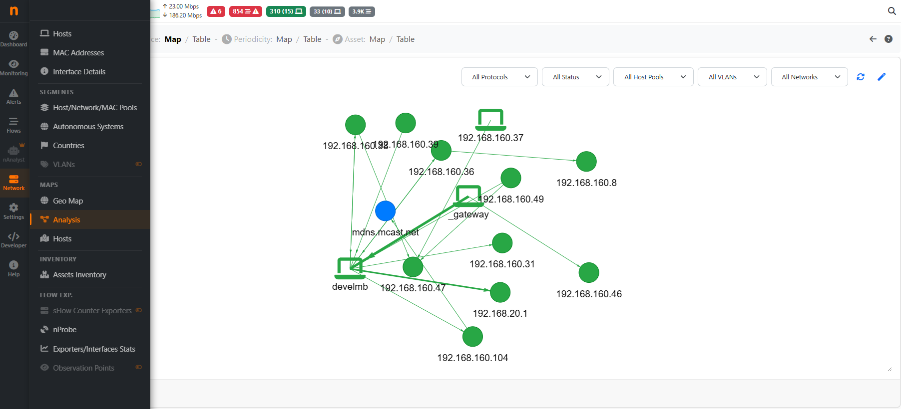
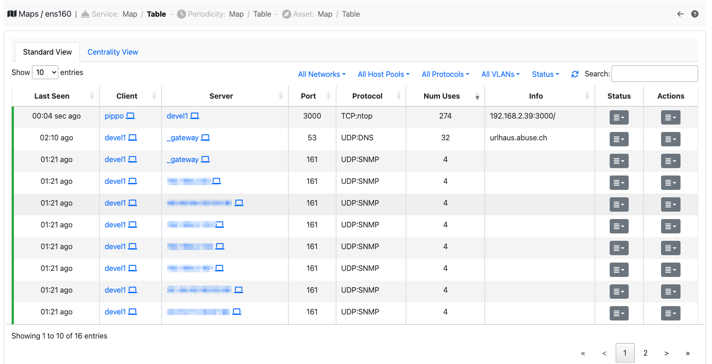

.. _AnalysisMap:

Analysis
========

The Analysis entry of the menu opens the maps that ntopng learns from the flows (connections)
of the selected interface. There are two maps, one per tab:

- **Service Map**: the services used in the network (a client that talks to a server on a port
  with an application, e.g. DNS or SSH).
- **Periodicity Map**: the communications repeated at a regular interval (e.g. a host that
  contacts a server every 5 minutes).

Each map has three views, chosen with the buttons on the right of the page description:

- **Graph**: hosts are circles, the services between them are lines.
- **Services**: the table of the services.
- **Hosts Ranking**: the hosts ranked by how important they are in the map (how many services
  they offer or use).

.. note::
    The maps need an Enterprise L license and the behaviour analysis enabled on the interface.

Graph
-----

  Service Map

The color of a circle says the kind of host: local host, remote host, multicast, broadcast or MAC
address (a device seen without an IP address). In the Service Map the color of a line says the
status of the service: authorized, unauthorized or undecided. The legend below the graph
explains the colors.

- Click a host to highlight the hosts it talks with.
- Double click a host to show only its services: the host is added to the filters.
- Use the mouse wheel to zoom.
- The arrange button places the hosts again, the reload button reads the map again.

The graph shows at most 2500 services: a warning icon appears when there are more, use the
filters to see the others.

Services and Hosts Ranking
--------------------------

    Service Map Table

The Services table lists the client, the server, the port, the application, the VLAN, how many
times the service was used (Service Map) or observed and its frequency in seconds (Periodicity
Map), when it was first and last seen and its status (Service Map).

- Click a host, an application, a VLAN or a status to filter the table by it.
- Click the arrows icon next to a host to open its details.
- The actions button opens the live flows of the service; its menu opens the historical flows
  (they need ClickHouse) and, for administrators, changes the status of the service of the
  Service Map.

The Hosts Ranking table lists the hosts with their rank and the number of services they use
(outgoing edges) and offer (incoming edges).

Filters
-------

Both maps can be filtered by local network, host pool, application and VLAN. The Service Map
can also be filtered by status, the Periodicity Map by direction (local only, remote only,
outbound or inbound). The filters are the same in the three views. **Clear filters** removes
them all.

**Download** saves the data of the current view, with the filters set, as a JSON file.

Service status and learning
---------------------------

During a learning period (set in Preferences > Traffic Behaviour) ntopng marks the new
services with a default status (authorized, undecided or unauthorized); after it, the new
services get another default status. If the `Lateral Movement` alert is enabled, a flow of an
unauthorized service triggers an alert.

Administrators can change the status of a service from its actions menu, and delete all the
services learnt by a map with **Delete Services** (below the view): the map then learns them
again from the new traffic.

.. _Service Map:

.. _Periodicity Map:

More details: `Service Map Page`_, `Periodicity Map Page`_.

.. _`Service Map Page`: https://www.ntop.org/ntop/whats-new-in-ntopng-keep-an-eye-to-lateral-movements/

.. _`Periodicity Map Page`: https://www.ntop.org/news/whats-new-in-ntopng-a-periodic-problem/
