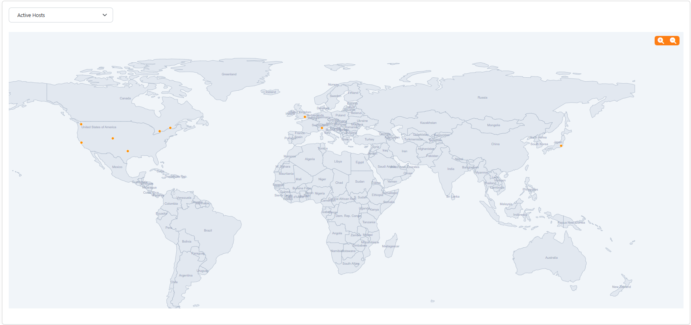

.. _GeoMap:

Geo Map
=======

The Hosts Geo Map page shows on a world map where the hosts currently active on the selected
interface are, according to the geolocation database. :ref:`Geolocation` must be enabled.

  The Hosts Geo Map Summary Page

The buttons above the map choose the hosts shown:

- *Active Hosts*, the hosts with the most traffic
- *Alerted Hosts*, the hosts with a score (how suspicious their traffic is) above zero, the highest first
- *Local Hosts* and *Remote Hosts*, the hosts of the local networks or outside them

At most 512 hosts are shown. Hosts with a private address, or that the geolocation database cannot
place, are not on the map. Moving the mouse over a host shows its address, name, country, city, alerts
and score; the address opens the host details and the flag the list of the hosts of that country.
