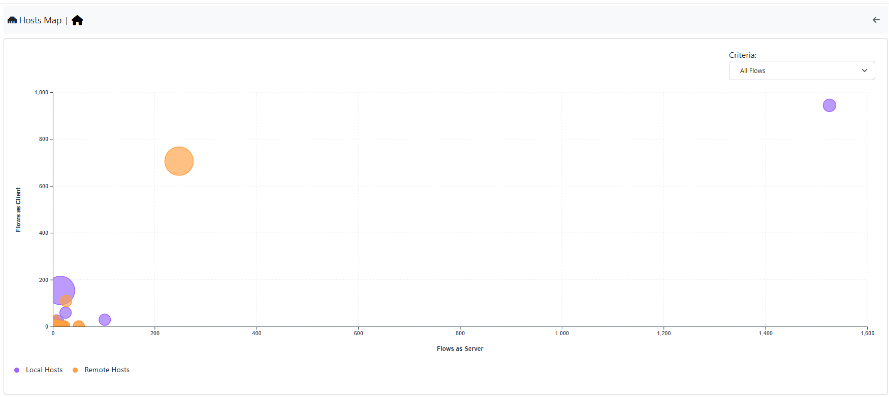

.. _HostMap:

Hosts
=====

The Hosts Map shows the hosts currently active on the selected interface as bubbles on a chart,
placed according to the criteria chosen above the chart (for example flows as client and as server,
alerted flows, DNS queries, SYN packets, score). The bubble size grows with the host traffic, and local
and remote hosts have different colors. Anomalies are easy to spot: look at the hosts far from the others.

  The Hosts Map page

Up to 64 local and 64 remote hosts are shown. Moving the mouse over a bubble shows the host and its
values; clicking it opens the host details.

The criteria based on SYN and RST packets need packet counters, so they are not offered on interfaces
that receive flows (for example from nProbe) and on view interfaces. The page needs ntopng Enterprise.
