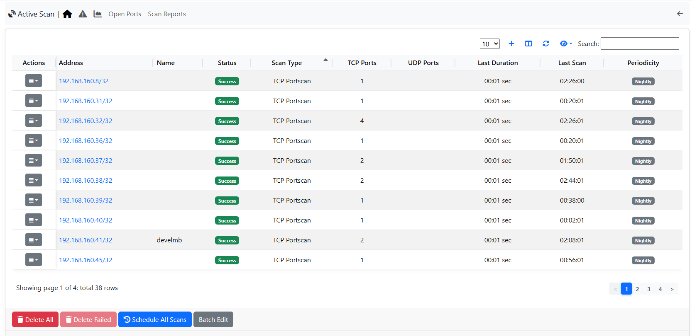
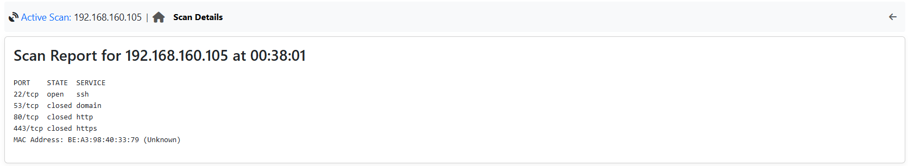
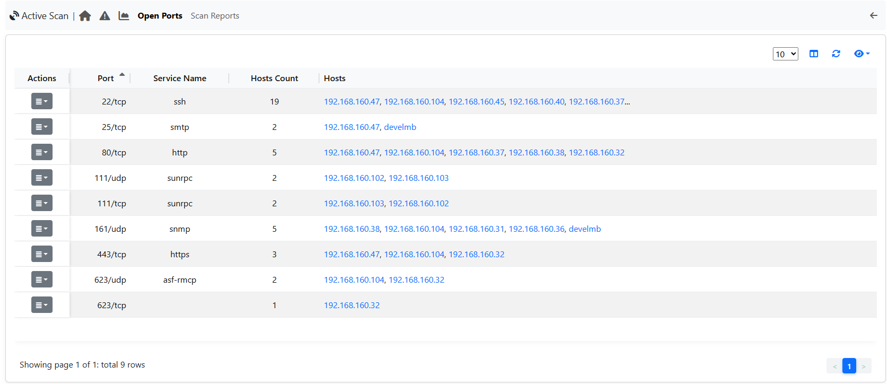
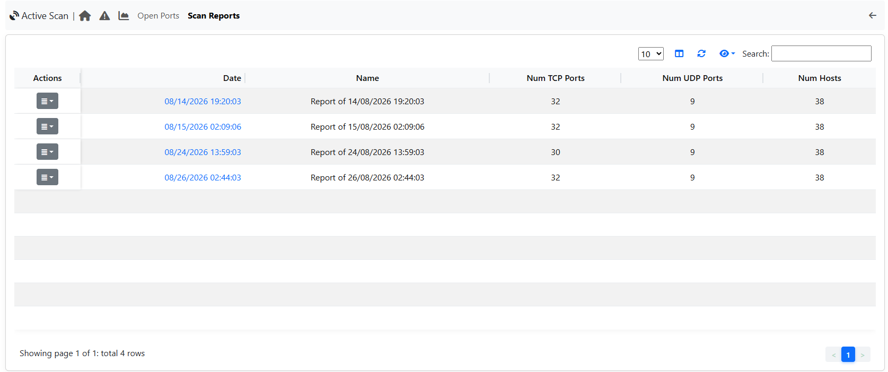
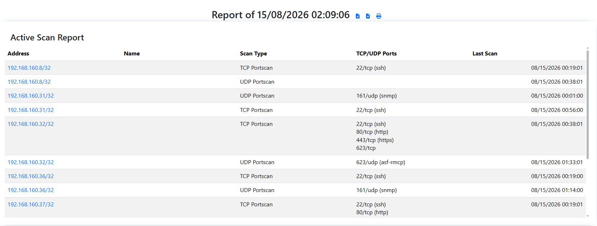
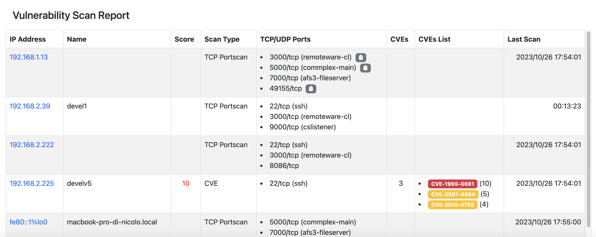
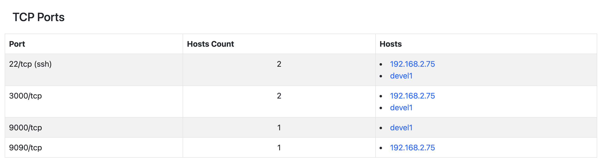
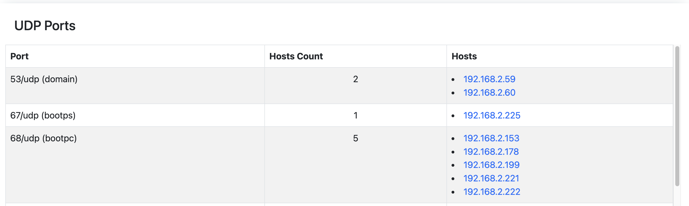

Active Scan
###########

.. warning::

  This feature support is not available on Windows.

ntopng is able to both passively monitor network and perform a scan, whose goal is to discover TCP or UDP open ports in provided services.

The current implementation leverages on `nmap <https://nmap.org>`_. The code is designed to add new scanner types by simply defining new `modules <https://github.com/ntop/ntopng/tree/dev/scripts/lua/modules/active_scan/modules>`_.

The page is in the Monitoring menu and only administrators can open it. It needs nmap installed on the ntopng system: without it the buttons that start a scan are disabled, and their tooltip says why.

The page has five tabs:

- Overview: the hosts to scan (see below);
- Open Ports: the open ports found by the scans (needs ntopng Enterprise L or better);
- Scan Details: the result of one scan. It opens from a row of the Overview; until then the tab is disabled;
- Historical Data: the charts of the scans (needs ntopng Pro or better);
- Scan Reports: the scan reports (needs ntopng Enterprise L or better).

A tab that needs a license you do not have is shown disabled: move the mouse over it to see why.

Active Scan Page
~~~~~~~~~~~~~~~~

  Active Scan Page

On the Active Scan page, it is possible to view the registered hosts that can be scanned, along with various details about the last executed scan, such as:

- Scan Status (can be "Scanning", "Scheduled", "Success", "Not Scanned", "Failed", "Error");
- Scan Type;
- TCP Ports (number of open TCP ports found);
- UDP Ports (number of open UDP ports found);
- Last Duration;
- Last Scan;
- Periodicity

After the ntopng execution of a TCP or UDP Portscan, ntopng compares the open ports detected by the network monitoring with the open ports discovered during the scan:

- If the Active Scan identifies an open TCP (or UDP) port that is not currently in use according to network monitoring results, a ghost icon |ghost| will be displayed near the number of open TCP (or UDP) ports of the specific host; 
- If the Active Scan fails to identify a TCP (or UDP) port that is actually in use, but ntopng has detected it through network monitoring (the port was filtered by the Active Scan), a filter icon |filter| will be displayed near the number of open TCP (or UDP) ports for the specific host.

.. |ghost| image:: ../../../img/active_scan_ghost_icon.png
  :height: 25px

.. |filter| image:: ../../../img/active_scan_filtered_icon.png
  :height: 25px

Above the table there are three buttons:

- Alerts Explorer (to see the alerts generated by the scans, see `Alerts`_);
- Schedule All Scans (to schedule a scan for all hosts in the active scan list);
- Add Host to Scan (to add a host or a network, see below).

Below the table there are the buttons that change the whole list:

- Batch Edit (to update the periodicity scan for all hosts in the active scan list, needs ntopng Enterprise L or better);
- Delete Failed (to remove from the active scan list only the hosts whose last scan failed, that is, the hosts that were unreachable or could not be scanned. The button is enabled only when at least one failed host is present);
- Delete All (to remove all hosts from the active scan list).

Without ClickHouse only the last report is kept: a note below the table reminds it.

At the end of a `Scan All` execution, if a notification endpoint and the related recipient have `Notification Type` set to `Active Scan Reports`, a notification is sent when the periodic scan ends.

Add Host to Active Scan List
---------------------------------

.. figure:: ../../../img/active_scan_modal.png
  :align: center
  :alt: Add Host to Active Scan List

  Add Host to Active Scan List

By clicking on the `Add Host to Scan` button on the Active Scan page, the user can add a new host or include all hosts active under a specific CIDR (a network, e.g. 192.168.1.0/24).

If a user designates a specific active host, ntopng will automatically populate the Ports field with the known server ports of such other. If unknown the field will be empty and all the ports will be checked. Note that scanning all ports can require a long amount of time, hence we suggest (if possible) to limit the scan to a small port set.

After selecting the host and ports, it is mandatory to choose one of the Active Scan Types. 
Currently, three types of scans are supported:

- TCP Portscan
- UDP Portscan
- IPv4 Netscan (finds the hosts of a network; the hosts found can then be scanned with the scan types chosen in the same window)

.. warning::

  The 'UDP Portscan' is available only on Linux.

Periodic Scans
--------------

.. note::

   Periodic Scans require ntopng Enterprise L or better.

Scans can be performed on demand (one shot) or periodically. You have the option to specify a daily scan (performed every days at midnight) or weekly (every Sunday at midnight). In order to avoid hogging the network with aggressive scans, only one scan at time is performed.

If a notification endpoint and the related recipient with the 'Notification Type' set to 'Active Scan Reports' are enabled, a notification is sent when the periodic scan ends.

Actions
-------

.. figure:: ../../../img/active_scan_actions_menu.png
  :align: center
  :alt: Row Actions menu

  Row Actions menu 

Each row has an Actions button: the button itself edits the host, the arrow next to it opens the other actions:

- Edit Host (to modify the specifications of the selected row);
- Schedule Scan (to schedule the scan for the selected host);
- Download Last Scan Report (to download the file containing the most recent scan result); 
- Show Last Scan Report (to display the last scan result in the Scan Details tab);
- Delete (to delete the specific host from the scan list); 

Download Last Scan Report and Show Last Scan Report are disabled until the host is scanned the first time.
Clicking on the address of a scanned host also opens its last scan result.

Settings
--------

.. figure:: ../../../img/active_scan_settings.png
  :align: center
  :alt: Active Scan Preferences

  Active Scan Preferences

Under the `Active Scan` tab of the Preferences page, it is possible:

- To modify the maximum number of scans executed simultaneously. The default value is 4, with a minimum of 1 and a maximum of 16.
- To enable the slow scan mode to decrease the aggression level of the scan.

Scan Details
~~~~~~~~~~~~

  Scan Details

Clicking on `Show Last Scan Report` in the Actions menu of a specific row (or on the address of the host) opens the Scan Details tab with the last scan result of the selected host, as written by nmap. The title of the page shows the path `Active Scan / <host>`: click on `Active Scan` to go back to the list. If ntopng currently sees the host, its address links to the host page.

Alerts
~~~~~~

If scans are performed periodically, ntopng compares each scan iteration and it generates alerts when someting changes such as a new port is open or the number of CVEs changed. Alerts needs to be enabled in the Behavioural Checks page as follows

.. figure:: ../../../img/active_scan_alert.png
  :align: center
  :alt: Enable Active Scan Alerts

Generated alerts can be accessed from the Alerts Explorer page under the Active Monitoring menu, or with the `Alerts Explorer` button of the Active Scan page. The button is disabled when the alerts are disabled in Preferences.

Charts
~~~~~~

.. figure:: ../../../img/active_scan_timeseries.png
  :align: center
  :alt: Active Scan Charts Page

The Historical Data tab shows the charts of timeseries filled with scan data (needs ntopng Pro or better).

Ntopng currently records the following data:

- Hosts (number of hosts ready to be scanned);
- Open Ports (number of open ports discovered);
- Scanned Hosts (number of scanned hosts);

Open Ports
~~~~~~~~~~

On the Open Ports page, it is possible to display the list of TCP and UDP open ports detected by the Active Scan, along with the following information:

- Service Name;
- Hosts Count;
- Hosts (the list is limited to five hosts if more than five are available);

By clicking on the `Show Hosts` button of a specific row, ntopng goes back to the Overview and shows only the hosts with the selected open port. The port is shown as a filter above the table: click on its `x` (or on `Clear filters`) to see all the hosts again.

Clicking on a host of the Hosts column opens its last scan result in the Scan Details tab.

Scan Reports
~~~~~~~~~~~~

.. note::

   Reports page require ntopng Enterprise L or better.

.. note::

    If ClickHouse is disabled, the Scan Reports tab shows only the report of the last scan executions, instead of the list of the reports.

When ClickHouse is enabled, the Scan Reports tab lists all reports automatically generated by ntopng.

With the Actions button of a single report it is possible to edit the name of the report (the button itself) or delete the report (from the arrow next to it).

Clicking on the date of a row opens the selected report. The title of the page shows the path `Active Scan / Scan Reports / <report name>`: click on `Scan Reports` to go back to the list. Next to the report name there are the buttons to download the report as a file, to upload a report file downloaded before and to print the report (it opens a printable version in a new window).

A report is generated:

- At the end of periodic scans;
- After all scan executions initiated by clicking on the 'Schedule All Scans' button;
- At the end of an individual scan;

A active scan report is made up of four differently reports: the Active Scan Report, the CVEs Count, the TCP Ports, and the UDP Ports.

Active Scan Report
------------------

The Active Scan Report shows the following information:

- IP Address;
- Name (Host Name);
- Scan Type;
- TCP/UDP Ports (List of open TCP/UDP ports);
- Last Scan (Date of most recent scan execution);

It is possible to open the Scan Details of that host by clicking on the IP address.

TCP Ports Report
----------------

The TCP Ports Report shows the following information:

- Port (formatted as: `<portID/tcp (service name)>`);
- Hosts Count;
- Hosts;

UDP Ports Report
----------------

The UDP Ports Report shows the following information:

- Port (formatted as: `<portID/udp (service name)>`)
- Hosts Count;
- Hosts;
