<a id="availableendpoints"></a>

# Notifications {#notifications}

ntopng can send its alerts, and other notifications such as traffic reports, outside the web
interface: by email, to a chat (Slack, Telegram, Discord...), to a webhook, to a syslog server and
more. The *Alerts > Notifications* page has three tabs:

- **Recipients**: where the notifications go, for example an email address or a Slack channel.
- **Policies**: what is sent and to which recipients, for example the severe security alerts to
  the SOC team.
- **Connections**: the settings shared by the recipients of the same channel, for example the
  mail server or the Slack webhook.

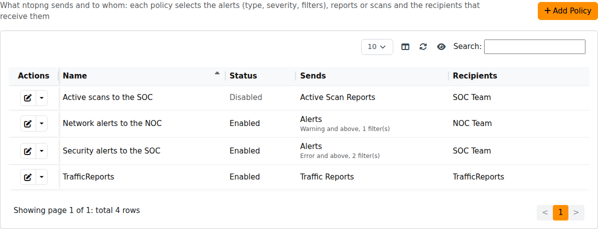

## Recipients and Connections {#recipients-and-connections}

A recipient is a channel (email, Slack, webhook...) plus its destination, for example an email
address. Click *Add Recipient*, choose the channel and fill in its settings. The connection is
created together with the first recipient of a channel: the following recipients of the same
channel can reuse it. For example, the *email* connection holds the mail server, and each *email*
recipient holds one destination address. The settings of each channel are described in
[Available Endpoints] below.

A recipient receives only what its policies send: in the *Policies* field of the recipient (or in
the *Recipients* field of a policy) choose the policies that send to it. A recipient that is not in
any policy receives nothing: the *Policies* column of the list shows *None: nothing is sent*.

*Send test* sends a test message to check the settings of a recipient.

## The Alerts Database {#the-alerts-database}

The *Alerts database* recipient is always present and can not be deleted. It stores the alerts in
the ntopng database (SQLite or ClickHouse), so that they can be seen in the web interface, for
example in the Alerts Explorer. It does not take part in the policies: edit it to choose the
minimum severity of the stored alerts. Engaged alerts (still active) are always shown, whatever
their severity.

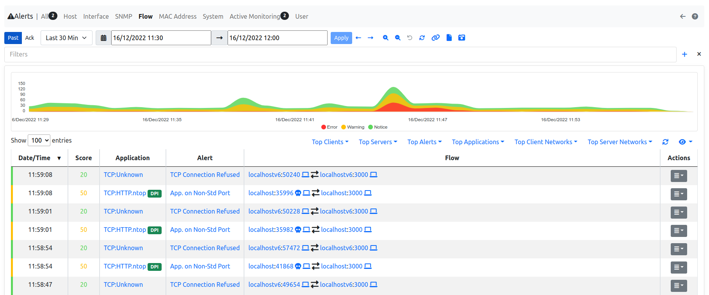


<a id="notificationpolicies"></a>

## Notification Policies {#notification-policies}

A policy says what is sent and to whom. Click *Add Policy* in the *Policies* tab and set:

- **Name** and **Enabled**: a disabled policy sends nothing, without deleting it.
- **Send**: the kind of notification: *Alerts*, *Traffic Reports* (email recipients only),
  *Active Scan Reports*, *Wazuh Alerts* (Enterprise M and above) and *Issues* (see
  [Sending Issues]). When the issues are available, new policies send *Issues*.
- **Minimum severity**, **Tags** and **Advanced filters**: which alerts are sent (alerts and issues
  only, see below).
- **Recipients**: where the notifications are sent.

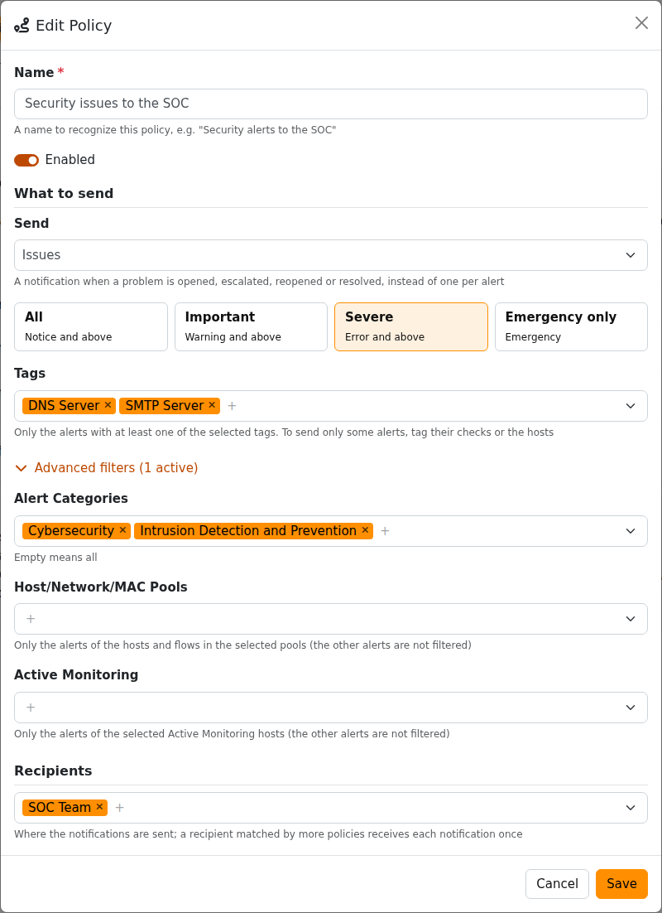

A notification is sent to a recipient when at least one enabled policy matching it lists that
recipient. A recipient listed by more matching policies receives it once. Up to 128 policies can be
defined.

A syslog recipient using the CEF format can only receive alerts and issues.

### Which Alerts Are Sent {#which-alerts-are-sent}

The alerts sent by a policy are selected with:

- **Minimum severity**: the alerts at least this severe: *All* (*Notice* and above), *Important*
  (*Warning* and above), *Severe* (*Error* and above) or *Emergency only*.
- **Tags**: only the alerts carrying at least one of the selected [Tags](/user_interface/shared/settings/tags.md#tags).

*Advanced filters* has the other filters:

- **Alert Categories**: only the alerts of the selected categories (e.g. Cybersecurity, Network).
- **Host/Network/MAC Pools**: only the alerts of the hosts in the selected pools (for flow alerts, the client
  or the server host).
- **Active Monitoring**: only the alerts of the selected Active Monitoring hosts. The other alerts
  are not filtered.

An empty filter does not filter. When more filters are set, an alert must match all of them.

When a host pool or a tag is deleted, it is removed from the policies. A policy whose filter had
only that pool or tag is disabled, instead of sending every alert: edit it and enable it again.

To send only some alerts, or the alerts of some hosts, use the tags: tag the checks whose alerts
should be sent (see [Check Tags](/user_interface/shared/alerts/others/available_alerts.md#checktags)) or the hosts, and select those tags in the
policy. For example, tag the hosts of the datacenter and send their alerts to a dedicated
recipient.

When ntopng is upgraded from a version without policies, the filters of each recipient become a
policy named after the recipient. The filters on the alert entity and on specific alerts are
dropped: use the tags instead.


<a id="notificationsimulation"></a>

### Simulating the Notifications {#simulating-the-notifications}

To see who is notified when an alert is triggered, click *Simulate Notifications* in the edit dialog of a
[Behavioural Check](/user_interface/shared/alerts/others/available_alerts.md#behaviouralchecks) (also the Access Control List alerts), a Traffic Rule, an
SNMP device rule, an Active Monitoring measurement or an AI policy. Nothing
is sent and nothing is saved: the simulation uses the values in the dialog, also before you
save them, so you can try a different severity or different tags first.

For each alert the dialog can trigger, the simulation shows its severity and category, and the
list of the actions taken when the alert is triggered:

- the alert is stored in the alerts database, or why it is not (e.g. its severity is below the
  minimum severity of the alerts database);
- the alert opens or updates an issue, when the issues are enabled (Enterprise XXL);
- each notified recipient, with its channel (e.g. Email, Discord) and the notification policies
  that notify it. A recipient is *Conditional* when its policies depend on something only known
  when the alert is triggered (e.g. the policy sends only the alerts of some host pools, and the
  host is not known yet): the condition is shown next to the policy.


<a id="issuesdeliverymode"></a>

## Sending Issues {#sending-issues}

In ntopng Enterprise XXL and above, with the [issues](/user_interface/shared/alerts/issues.md#issues) enabled, the *Send* option of a
policy has the *Issues* item. Its recipients receive a notification when an issue is opened,
escalated (its severity is raised), reopened or resolved, instead of one notification per alert.
When the same problem generates thousands of alerts, the recipients are notified once.

The minimum severity and the filters of the policy apply to the issues too. The severity of an
issue is the highest severity of its alerts: a policy with a minimum severity can send the
escalation of an issue whose opening was below that severity. Suppressed issues are not notified.

When the issues are turned off, a policy sending issues sends the alerts (*Issues (disabled: the
alerts are sent)*), and the issues again when they are turned on.

The notification tells what happened to the issue, the alert that caused it (if any), the number of
alerts and peers of the issue and the link to the issue details, for example:

```text
[Interface: eth0] [Severity: Notice] [Flow] [Unsafe Protocol] [192.168.1.58 (Attacker)] [Issue #3 Opened]
Insecure protocol used - Alerts: 1 since 28/10/2026 07:05:22 - Peers: 1 - Details: https://ntopng:3000/lua/pro/issue_details.lua?issue_id=3
```

Webhook and other JSON endpoints receive the alert fields with `"action": "issue"` and an `issue`
object with `issue_id`, `event` (open, escalate, reopen, resolve), `status`, `severity`,
`first_seen`, `last_seen`, `resolution`, `signal_count`, `peers_count`, `role` and `url`.

The link uses the *Host Address* preference, when set.

## Available Endpoints {#available-endpoints}

Currently available Endpoints and license required are:

|                | Community | Pro | Enterprise M | Enterprise L/XL |
| -------------- | --------- | --- | ------------ | --------------- |
| Discord        | x         | x   | x            | x               |
| Elasticsearch  |           | x   | x            | x               |
| e-mail         | x         | x   | x            | x               |
| Fail2Ban       |           | x   | x            | x               |
| Mattermost     | x         | x   | x            | x               |
| MS Teams       |           |     |              | x               |
| PagerDuty      |           |     |              | x               |
| Shell Script   | x         | x   | x            | x               |
| Slack          | x         | x   | x            | x               |
| Syslog         | x         | x   | x            | x               |
| Syslog checkmk |           |     | x            | x               |
| Syslog CEF     |           |     |              | XL only         |
| Telegram       | x         | x   | x            | x               |
| Webhook        | x         | x   | x            | x               |
| WeChat         |           |     |              | x               |
| TheHive        |           | x   | x            | x               |

Below a guide on how to configure each Endpoint/Recipient.

### Discord {#discord}

Discord (<https://discord.com>) is a popular collaboration application that can be used by ntopng to deliver alerts to recipients. In order to deliver alerts you need to configure a new Discord server as described in this document <https://support.discord.com/hc/en-us/articles/204849977-How-do-I-create-a-server>- and the to create a webhook as decribed here <https://support.discord.com/hc/en-us/articles/360045093012-Server-Integrations-Page>

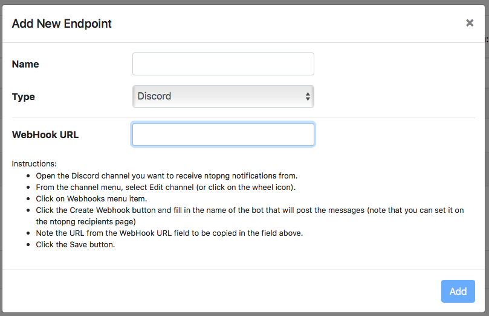

Once in the webhook click on the "Copy Webhook URL" button that will copy the URL into your clipboard. Done this we're ready to create a ntopng Discord Endpoint. On the System interface (upper menubar, dropdown menu) select Notifications -> Endpoints and click on the + icon. A new dialog windown will open: select Discord from the endpoint type menu and insert the Webhook URL you have previusly copied on your clipboard, pick a endpoint name you like and save it.

Done this you can create a recipient for this endpoint. You can optionally specify a Username in the recipient page that is used when messages are delivered to Discord. If you do not set a username the one used in the Discord Webhook page will be used (usually set to 'Captain Hook').

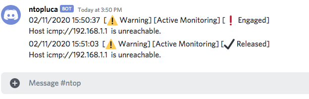

The above picture shows sample alerts delivered to a discord server.


<a id="elasticsearchalerts"></a>

### Elasticsearch {#elasticsearch}

This recipient is designed to send alerts to [Elasticsearch](https://www.elastic.co/).

::: info
Elasticsearch recipient is only available in ntopng Enterprise M or above.
:::

The endpoint requires the Elasticsearch URL to be specified, along with (optional) parameters for the authentication.

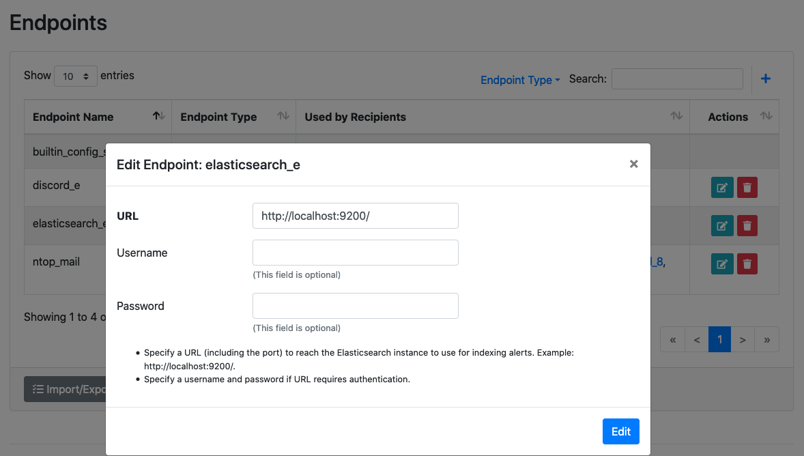

Multiple recipients can then be associated to the Elasticsearch endpoint. Any recipient can use a different prefix for the index names.

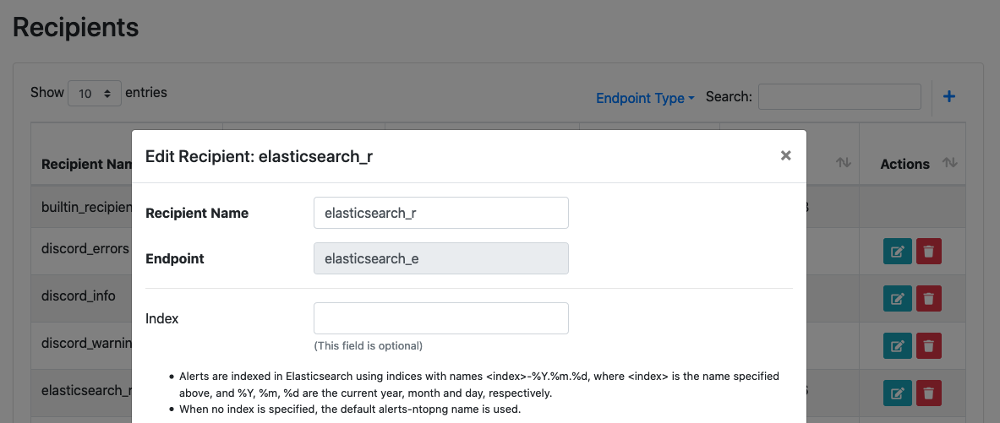

By default, alerts are sent to Elasticsearch indexes `alerts-ntopng-<year>.<month>.<day>`. A new index is created every day. For example, index names used for two consecutive days of April 17th and 18th 2020 are `alerts-ntopng-2020-04-17` and `alerts-ntopng-2020-04-18`. If an index prefix is specified in the endpoint, then the prefix is used in place of `alerts-ntopng`.

The Elasticsearch connection can be tested by clicking the "Test Connection" button of the preferences.

::: info
Elasticsearch alert endpoint requires at least Elasticsearch version 7. Version can be tested by clicking the "Test Connection" button of the preferences.
:::

Alerts are sent to Elasticsearch in JSON format, following the ECS format (more info at [ECS](https://www.elastic.co/guide/en/ecs/current/index.html/)). The following keys are always present:

- `@timestamp`: UTC/GMT alert detection date and time in ISO format yyyy-MM-dd'T'HH:mm:ss.SSSZ.
- `message`: the message field containing the log message
- `ecs.version`: ECS version this event conforms to.
- `event.category`: represent the category of the event, one of {`authentication`, `configuration`, `database`, ...}. `List of all the available types <https://www.elastic.co/guide/en/ecs/current/ecs-allowed-values-event-category.html>`
- `event.created`: contains the date/time when the event was first read, in ISO format yyyy-MM-dd'T'HH:mm:ss.SSSZ.
- `event.dataset`: name of the dataset.
- `event.kind`: gives high-level information about what type of information the event contains, one of {`alert`, `event`, `metric`, `state`, `pipeline_error`, `signal`}.
- `event.module`: name of the module this data is coming from.
- `event.risk_score`: risk score or priority of the event.
- `event.severity`: the numeric severity of the event according to your event source.
- `event.severity_label`: the severity of the event written in human readable format, one of {`low`, `medium`, `high`, `critical`}.
- `organization.name`: organization name.
- `rule.name`: the name of the rule or signature generating the event.

Flow Alerts have the following additional fields:

- `source.ip`: IP address of the source (IPv4 or IPv6).
- `source.port`: port of the source.
- `source.as.number`: unique number allocated to the autonomous system. The autonomous system number (ASN) uniquely identifies each network on the Internet.
- `source.geo.city_name`: geolocalization of the source, city name (when available).
- `source.geo.continent_name`: geolocalization of the source, continent name (when available).
- `source.geo.country_name`: geolocalization of the source, country name (when available).
- `source.geo.country_iso_code`: geolocalization of the source, country ISO code (when available).
- `source.geo.location.lat`: latitude of the source.
- `source.geo.location.lon`: longitude of the source.
- `network.community_id`: a hash of source and destination IPs and ports, as well as the protocol used in a communication. This is a tool-agnostic standard to identify flows.
- `network.protocol`: L7 Network protocol name. ex. http, lumberjack, tls.
- `network.transport`: L4 Network protocol name. ex. tcp, udp.
- `network.vlan.id`: VLAN ID.
- `destination.ip`: IP address of the destination (IPv4 or IPv6).
- `destination.port`: port of the destination.
- `destination.as.number`: unique number allocated to the autonomous system. The autonomous system number (ASN) uniquely identifies each network on the Internet.
- `destination.geo.city_name`: geolocalization of the destination, city name (when available).
- `destination.geo.continent_name`: geolocalization of the destination, continent name (when available).
- `destination.geo.country_name`: geolocalization of the destination, country name (when available).
- `destination.geo.country_iso_code`: geolocalization of the destination, country ISO code (when available).
- `destination.geo.location.lat`: latitude of the destination.
- `destination.geo.location.lon`: longitude of the destination.

```lua
json_format = {
  "organization": {
    "name": "ntop"
  },
  "rule": {
    "name": "Low Goodput Ratio"
  },
  "ecs": {
    "version": "1.6.0"
  },
  "event": {
    "severity_label": "low",
    "created": "2020-11-23T14:20:56.0Z",
    "category": "network",
    "module": "ntopng",
    "kind": "alert",
    "severity": 3,
    "dataset": "alerts",
    "risk_score": 10
  },
  "source": {
    "port": 60952,
    "ip": "192.168.1.29"
  },
  "destination": {
    "geo": {
      "continent_name": "NA",
      "country_iso_code": "US"
    },
    "ip": "23.206.251.35",
    "as": {
      "number": 16625
    },
    "port": 80
  },
  "network": {
    "community_id": "1:fUGQhJ6nxu/LILCAW+Lb8dF4sKU=",
    "transport": "tcp",
    "protocol": "http"
  },
  "message": "{\"cli_os\":\"Intel Mac OS X 10_13_6\",\"cli_continent_name\":\"\",\"flow_status\":12,\"cli_blacklisted\":false,\"alert_entity\":4,\"alert_entity_val\":\"flow\",\"proto.ndpi\":\"HTTP\",\"srv_localhost\":false,\"proto\":6,\"alert_tstamp\":1606141256,\"cli_addr\":\"192.168.1.29\",\"srv_addr\":\"23.206.251.35\",\"srv2cli_packets\":5,\"alert_severity\":3,\"srv_continent_name\":\"NA\",\"srv_os\":\"\",\"srv_asn\":16625,\"community_id\":\"1:fUGQhJ6nxu/LILCAW+Lb8dF4sKU=\",\"first_seen\":1606141240,\"score\":10,\"action\":\"store\",\"cli_localhost\":true,\"cli_port\":60952,\"cli_city_name\":\"\",\"srv2cli_bytes\":558,\"is_flow_alert\":true,\"alert_type\":72,\"cli2srv_bytes\":681,\"alert_json\":\"{\"info\":\"ocsp.int-x3.letsencrypt.org/MFgwVqADAgEAME8wTTBLMAkGBSsOAwIaBQAEFH7maudymrP8%2BKIgZGwWoS1gcQhdBBSoSmpjBH3duubRObemRWXv86jsoQISAz5JqGV%2B4ao1EMKq6MZy01gX\",\"status_info\":\"{\"goodput_ratio\":39.790153503418,\"ntopng.key\":3631703348,\"alert_generation\":{\"subdir\":\"flow\",\"script_key\":\"low_goodput\",\"confset_id\":0},\"hash_entry_id\":8210}\"}\",\"cli_country_name\":\"\",\"cli2srv_packets\":6,\"srv_country_name\":\"US\",\"cli_asn\":0,\"srv_port\":80,\"srv_city_name\":\"\",\"l7_master_proto\":7,\"ifid\":0,\"srv_blacklisted\":false,\"vlan_id\":0,\"l7_proto\":7}",
  "@timestamp": "2020-11-23T14:20:56.0Z"
}
```

### Email {#email}

One can create the email endpoint as follows

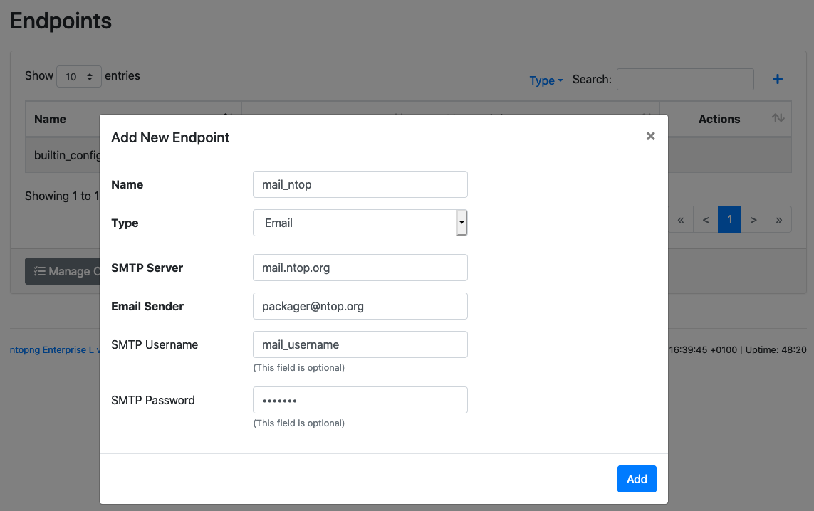

Then, one can create multiple email recipients sharing the same
endpoint but each one with a different destination email address:

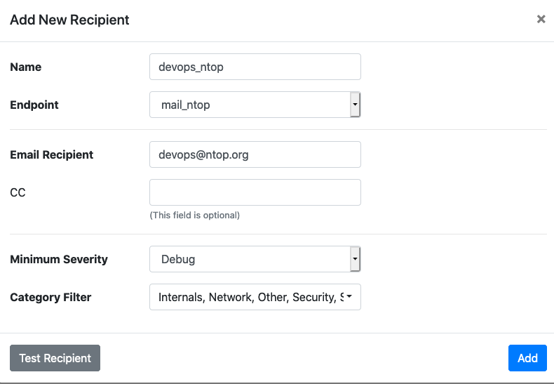

::: info
If TLS Encryption is a must, (so the notifications always need to be sent encrypted), use: smtps://youremail.org

By adding the 's' after smtp, ntopng will ensure to force the communication to be encrypted. Also in case this is the case,
the STARTSSL option will be ignored
:::

### Fail2Ban {#fail2ban}

First of all, install Fail2Ban, for infos about the download check [Fail2Ban](https://www.fail2ban.org/wiki/index.php/Downloads).
After that you will be able to see the Fail2Ban Endpoint.

After creating the endpoint, create a new recipient to associate with the new endpoint just created and put inside the JAIL option the JAIL that's going to be used to ban the dangerous IP (to have more infos about the JAIL check [here](https://www.fail2ban.org/wiki/index.php/MANUAL_0_8#Jails)).

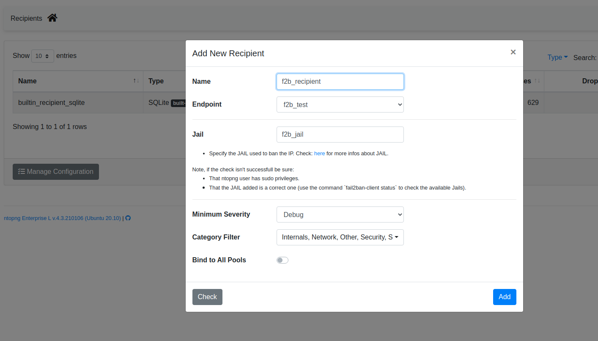

::: info
If the Recipient Check isn't succesfull, be sure that ntopng has sudo privileges and that the JAIL added is a correct one.

Fail2Ban Endpoint isn't going to be called for each alert but only for those that supports it, in the specific case only those with the Attacker available; check the specific user guide section for more infos Alert Summary.
:::

### Mattermost {#mattermost}

[Mattermost](https://mattermost.com) is an Open Source, self-hostable online chat service designed as an internal chat for organisations and companies.

After creating the endpoint, create a new recipient with the new endpoint just created and put the channel id for a valid mattermost channel inside of it.

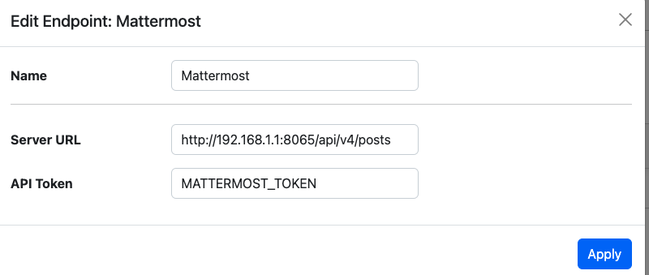

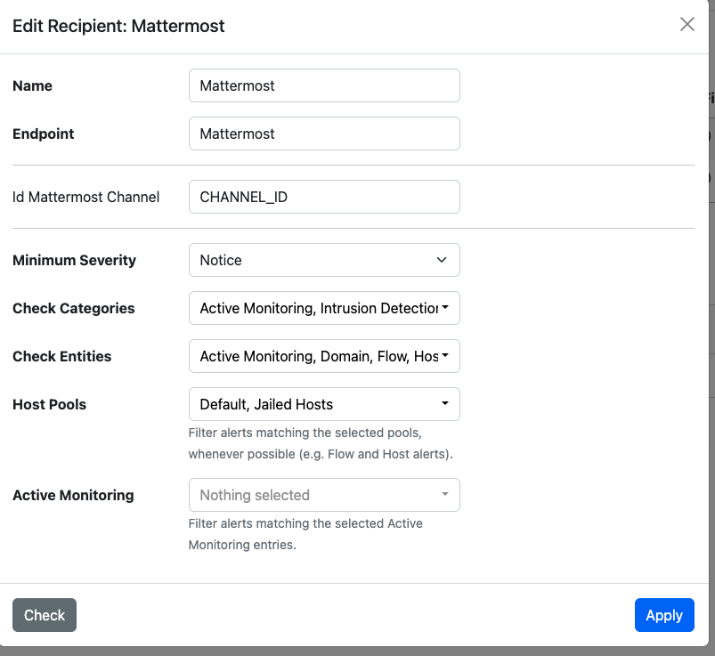

::: info
If the Recipient Check isn't succesfull, be sure that ntopng has sudo privileges and that the Mattermost URL and protocol/port added are correct.

Mattermost will be called for all alerts that match the criteria specified in the recipient config.
:::


<a id="microsoft-teams"></a>

### MS Teams {#ms-teams}

Like for the Webhook, Microsoft Teams endpoint can be used to deliver alert information to a MS Teams Channel configuring a Connector in MS Teams and the URL in ntopng. Alert information are provided to MS Teams in Message Card (Specific MS Teams JSON format) by means of POST requests.

To Configure MS Teams to be used by ntopng as an endpoint first it's needed to enable the selected Channel Connector. Go into the Channel Settings and click onto `Connectors`.
Add `Incoming Webhook` to MS Teams Connectors and then click on `Configure` and then on `Create`. Take the URL given by MS Teams and paste into ntopng endpoint (`Connector`).

Official guide to MS Teams Webhook can be found [Here](https://docs.microsoft.com/en-us/microsoftteams/platform/webhooks-and-connectors/how-to/add-incoming-webhook)

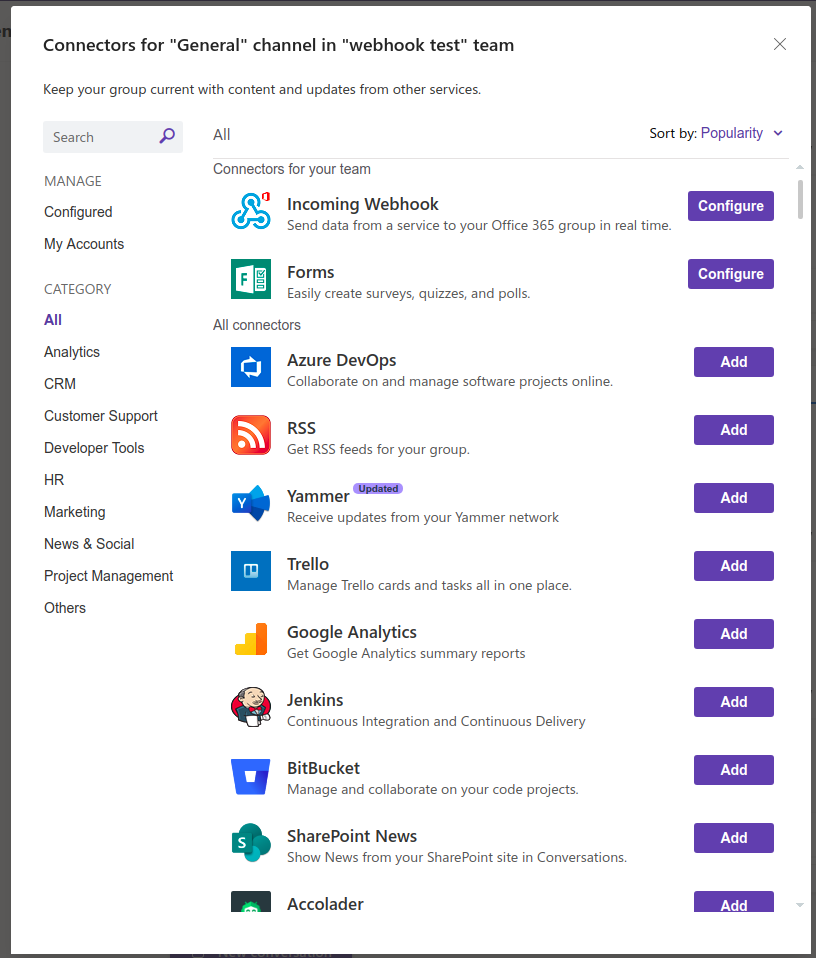

::: info
MS Teams recipient is only available in ntopng Enterprise L or above.
:::

### PagerDuty {#pagerduty}

First of all, create a PagerDuty account. For information about the PagerDuty account, please refer to the following link: [PagerDuty](https://developer.pagerduty.com/sign-up/).
After that, you will be able to see the PagerDuty Endpoint.

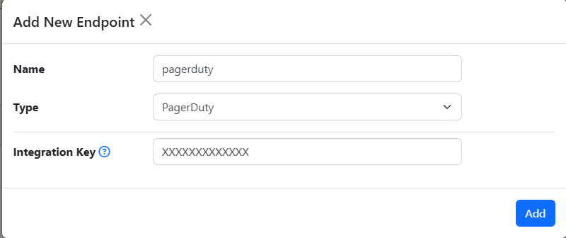

It is necessary to specify the `Integration Key` known also as [routing_key](https://developer.pagerduty.com/docs/ZG9jOjExMDI5NTgx-send-an-alert-event).

To obtain the Integration Key, after logging into PagerDuty, it is necessary to create a new Integration under the Automation panel.

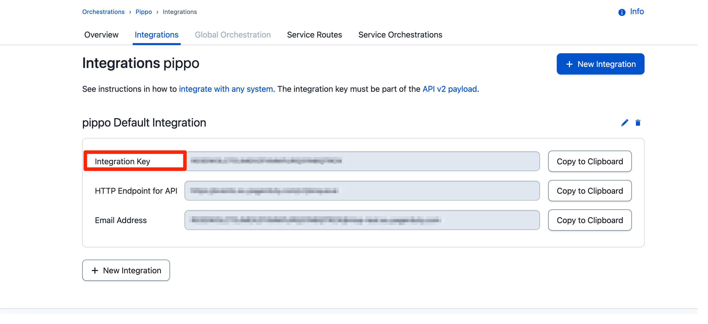

Once the new integration is created, the user will have the integration key required for the ntopng endpoint.

After creating the endpoint, proceed to create a new recipient to associate with the newly created endpoint.

::: info
PagerDuty recipient is only available in ntopng Enterprise L or above.
:::

### Shell Script {#shell-script}

Create the script you want to execute each time the alert is triggered and put it inside the directory `/usr/share/ntopng/scripts/shell/`.

::: info
The script must be a shell script (.sh extention) with execution permission.
:::

The full alert information are provided to the script through the standard input in JSON format.

A new Endpoint should be created, by selecting the script that has been created.

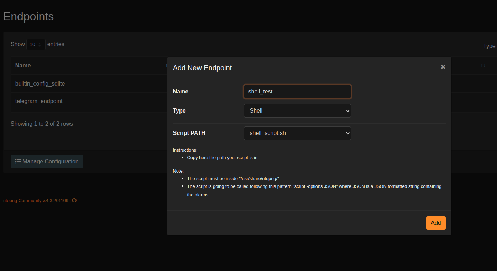

After that, a new recipient should be created, associated with the new endpoint just created.

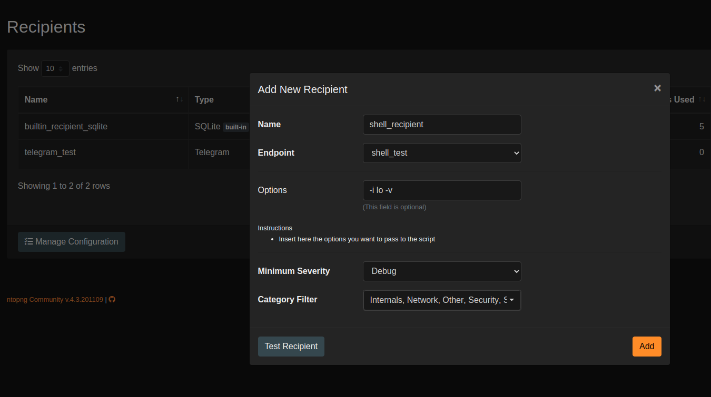

Example of simple shell script reading the alert information from the standard input and logging them to file:

```bash
#!/bin/bash
cat - >> /tmp/shell-script.log
```

### Slack {#slack}

[Slack](https://slack.com) is a IRC-like business communication platform that can be used by ntopng to deliver alerts. In order to deliver alerts to a slack channel you need to:

- Create a new channel to be used for notifications
- Create a new Slack app from [Here](https://api.slack.com/apps?new_app=1)

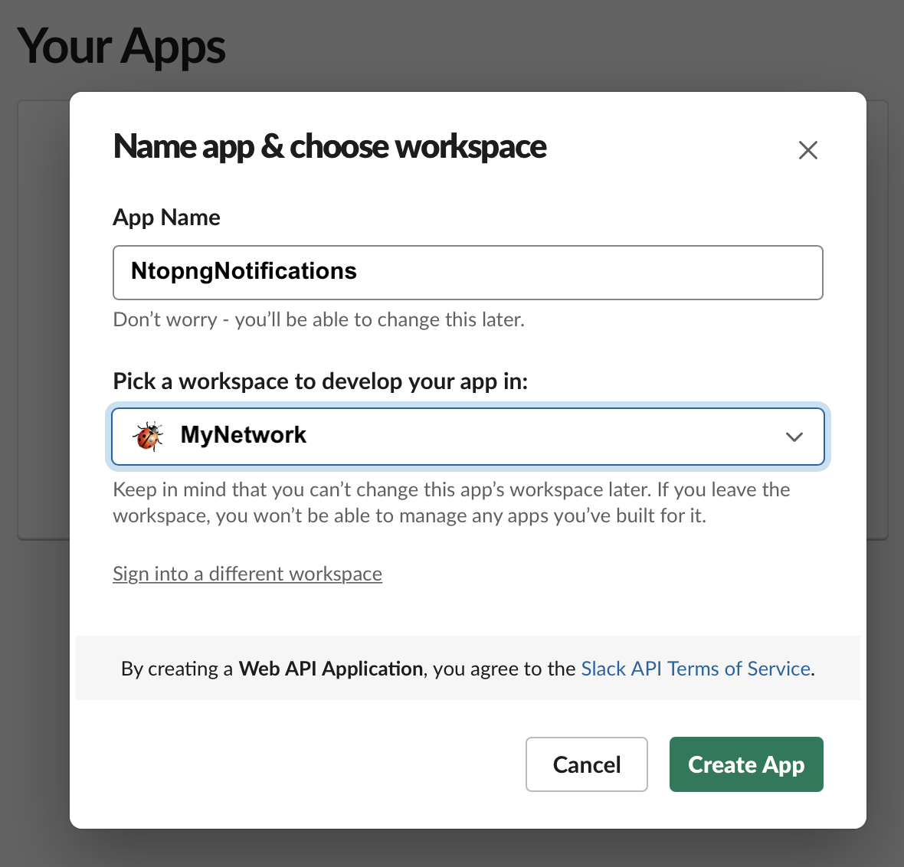

- After creating a Slack app, select Incoming Webhooks

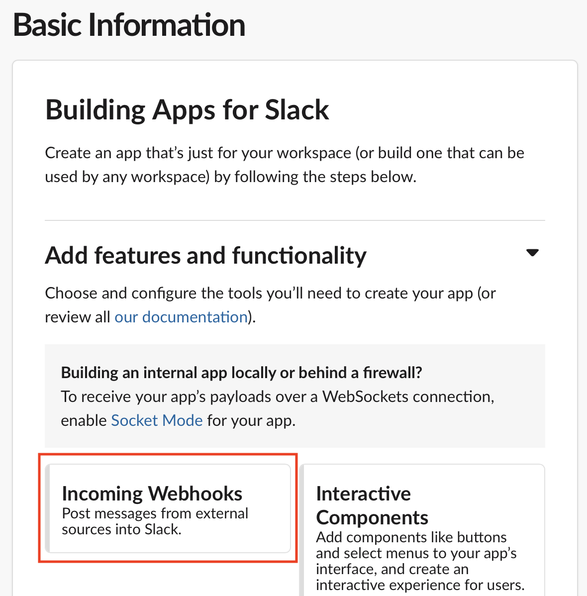

- Activate Incoming Webhooks

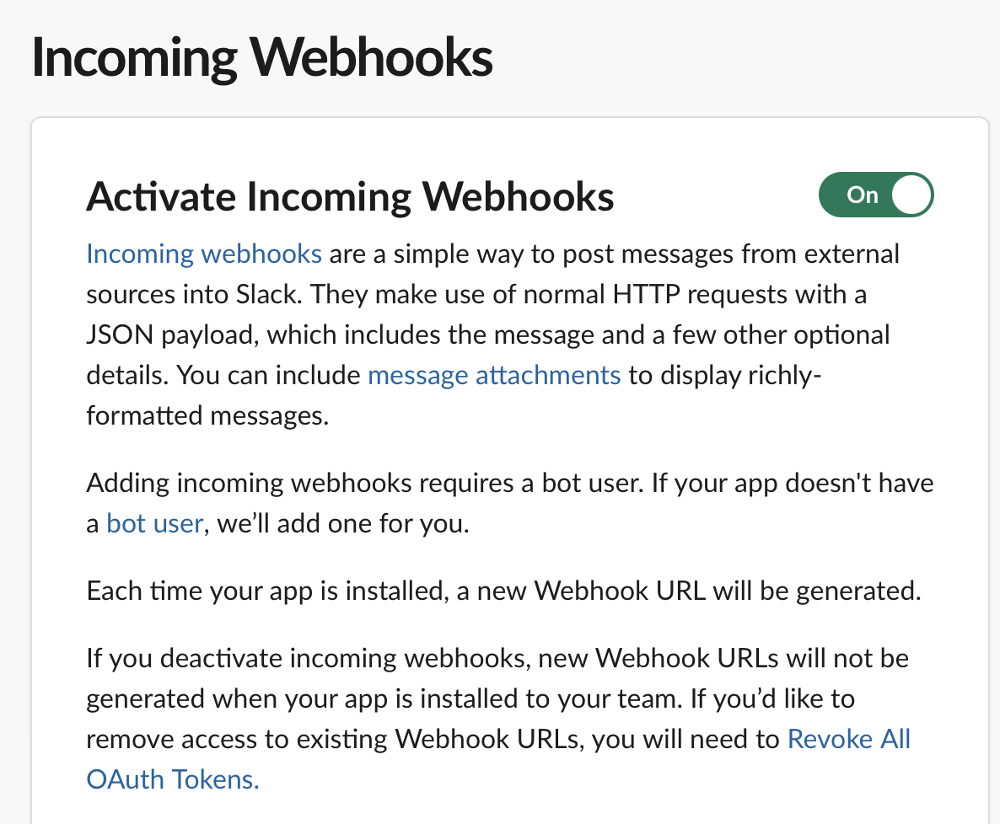

- At the bottom of the page, Add a new Webhook, selecting the channel you previously created for notifications

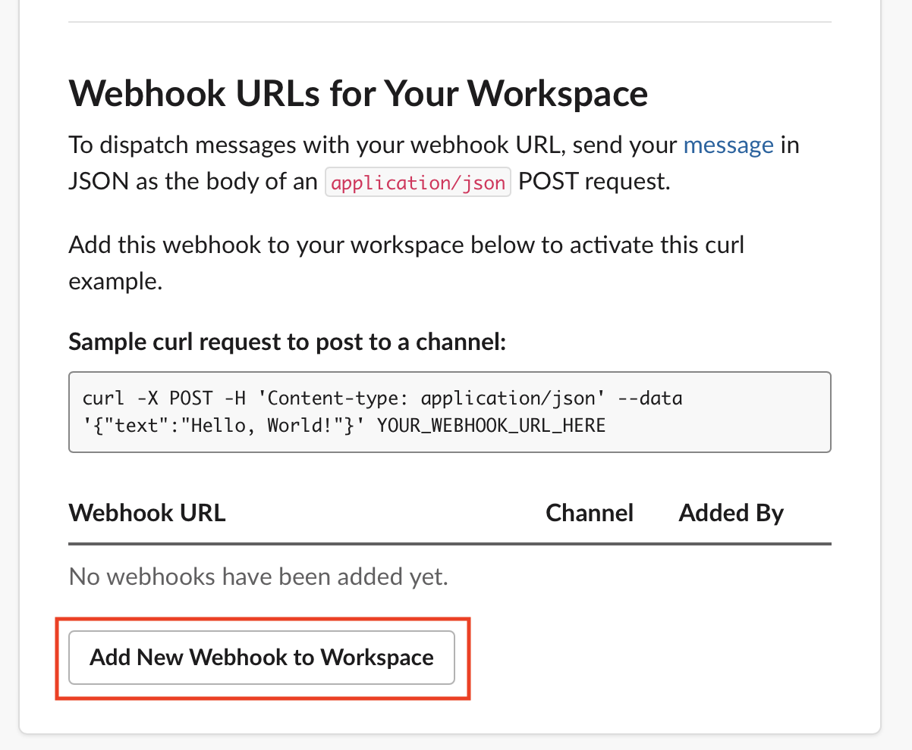

- Copy the Webhook URL to the Notification Webhook field in ntopng

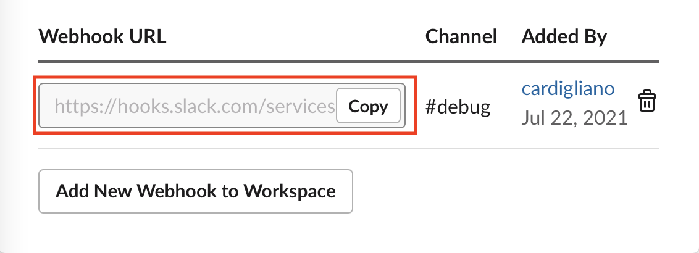

### Syslog {#syslog}

Alerts are sent to syslog using standard syslog severities as per RFC 5424.

::: info
From ntopng 7.1.260919 it is possible to add multiple syslog endpoints (previosly it was limited just to 1 syslog endpoint)
:::

ntopng alert severities are mapped to standard syslog severities as follow:

- *Info* becomes syslog `LOG_INFO` equal to the integer 6
- *Warning* becomes syslog `LOG_WARNING` equal to the integer 4
- *Error* becomes syslog `LOG_ERR` equal to the integer 3

A few formats are available when sending alerts to syslog: Text (plaintext), JSON (Raw), ECS, Checkmk, CEF.
The default format is Text and can be changed from the ntopng preferences page.

**Text**

Plaintext alerts have the following format:

```bash
[tstamp][severity][type][entity][entity value][action] ... and a plain text message...
```

Fields have the following meaning:

- `[tstamp]` is the time at which ntopng detected the alert. This time
  is not necessarily equal to the time the alert has reached syslog.
- `[severity]` is the severity of the alert. Severities are also
  used when dispatching messages to syslog. Severities are "Warning", "Error" of "Info".
- `[type]` is a string that indicates the type of alert.
- `[entity]` is a class that categorizes the originator of the
  alert. It can be an "host", an "interface" and so on.
- `[entity value]` is an identifier that uniquely identifies the
  originator along with the `[entity]`. For example, entity
  value for an "host" is its IP address, for an "interface" is its
  name, for a "device" is its MAC address, and so on.
- `[action]` indicates whether this is an engaged alert, an
  alert that has been released or if it just an alert that has to be stored.

Alert types, entities, and actions are explained in detail in section [Alerts](/basic_concepts/alerts.md#basicconceptalerts).

Examples of alerts sent to syslog are

```bash
devel ntopng: [<tstamp>][Info][Device Connection][Device][58:40:4E:CE:28:29] The device Apple_CE:28:29 has connected to the network.
devel ntopng: [<tstamp>][Error][Threshold Cross][Interface][iface_0][Engaged] Minute traffic crossed by interface eno1 [1.08 MB > 2 Bytes]
devel ntopng: [<tstamp>][Warning][Remote to Remote Flow][Flow] Remote client and remote server [Flow: 192.168.1.100:138 192.168.1.255:138] [L4 Protocol: UDP]
```

**JSON**

JSON alerts have the following keys that are in common with plaintext alerts, namely `[entity]`, `[entity value]`, `[action]`, `[tstamp]`, `[severity]` and `[type]`.

The additional keys are:

- `message`: is a text message describing the alert.
- `ifid`: the id of the monitored ntopng interface
- `alert_key`: is a string that, for threshold-based alerts, represents the check interval (e.g., min, 5min, hour) and the type of threshold checked (e.g., bytes, packets).

Examples of JSON alerts sent to syslog are

```bash
develv ntopng: {"entity_value":"ntopng","ifid":1,"action":"store","tstamp":1536245738,"type":"process_notification","entity_type":"host","message":"[<tstamp>]][Process] Stopped ntopng v.3.7.180906 (CentOS Linux release 7.5.1804 (Core) ) [pid: 4783][options: --interface \"eno1\" --interface \"lo\" --dump-flows \"[hidden]\" --https-port \"4433\" --dont-change-user ]","severity":"info"}
devel ntopng: {"message":"[<tstamp>][Threshold Cross][Engaged] Minute traffic crossed by interface eno1 [891.58 KB > 1 Byte]","entity_value":"iface_0","ifid":0,"alert_key":"min_bytes","tstamp":1536247320,"type":"threshold_cross","action":"engage","severity":"error","entity_type":"interface"}
```

**Checkmk**

This format is used to track ntopng events within checkmk.

In order to export alerts to Checkmk, the Checkmk host, port and protocol should be configured in the syslog endpoint configuration in ntopng.

Please check the *Setting up the Event Console* section of the Checkmk documentation to configure syslog ingestion in Checkmk. This usually requires enabling the syslog addon by using the omd tool, and adding a filter for the ntopng alerts under `Setup -> Event Console`.

After that, alerts exported by ntopng should be visible under `Monitor -> Events` in Checkmk.

Alerts exported using the Checkmk format have the following format:

```bash [Checkmk@18662 sl="family_id" comment="(Interface) (Severity) (Type) (Entity) (Entity Value) (Action)" severity="severity"] ... and a plain text message...

```

Fields have the following meanings:

- `sl`: an identifier of the event, used, for example, to perform searches.
- `comment`: contain the information described in the Plaintext section, except for timestamp, which is assigned by checkmk to the event.
- `severity`: the severity of the alert.

Example of alert sent to syslog with the Checkmk format:

```bash
devel ntopng: [Checkmk@18662 sl="4" comment=" (Interface: enp0s3) (Severity: Warning) (Flow) (Binary file/data transfer (attempt)) (vbox:43972 -> it.archive.ubuntu.com:80)  Binary file/data transfer (attempt)" severity="Warning"] Binary file/data transfer (attempt)
```

The service level values have to be manualy mapped inside Checkmk under `Setup -> Global settings > Notifications > Service Levels`.

The final result should look like the one showed in the image below.

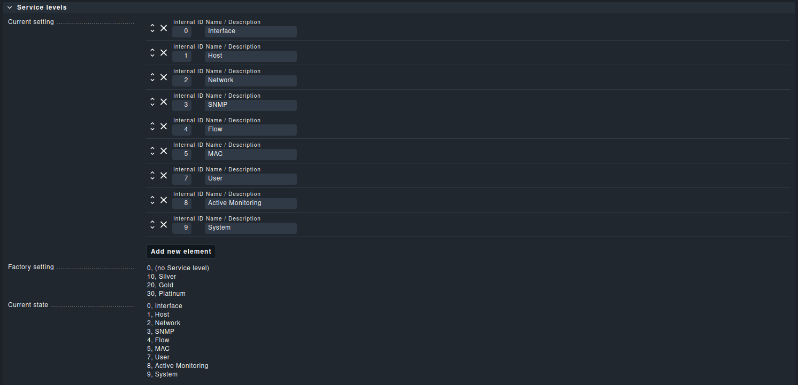

### CEF (Common Event Format) for SIEM {#cef-common-event-format-for-siem}

ntopng can export its alerts to a SIEM (Security Information and Event Management) in the Common Event Format (CEF), over syslog.
CEF is understood by Splunk, ArcSight, Microsoft Sentinel, IBM QRadar, Elastic and most other SIEMs and log management platforms,
so network and security alerts detected by ntopng can be correlated with the events of the rest of the infrastructure.
This feature requires an Enterprise XL license.

To export alerts to a SIEM, create a *Syslog* endpoint, set the *Format* to *CEF (Common Event Format, for SIEM)*, and set the host, port and protocol (UDP or TCP)
on which the SIEM receives syslog. Then create a recipient for the endpoint and add it to a notification policy: the *Minimum Severity*
and the other filters of the policy can be used to send only the alerts that are of interest, instead of all the alerts.

::: info
A recipient that uses the CEF format can receive only alerts and issues. Reports and other notification types are not available.
:::

All the alert types are exported (flow, host, network, interface, SNMP device, MAC, user, active monitoring, AS and system alerts).
Each alert is sent as a syslog message that contains a CEF event:

```bash
CEF:0|ntop|ntopng|Version|Alert id|Alert name|Severity|key=value key=value ...
```

The header fields are:

- `Version`: the ntopng version.
- `Alert id`: the numeric identifier of the alert type. The same id is used by different entities, so the alert type is identified together with the entity (`ntopEntity`) or by the `ntopAlertKey` field.
- `Alert name`: the readable name of the alert, for example *Low Goodput Ratio*.
- `Severity`: a number from 0 to 10, computed from the alert score.

After the header there is a list of `key=value` fields. The main ones are the following:

| Field | Description |
|---|---|
| :code:`start`, :code:`end` | Start and end time of the alert, in milliseconds since the epoch. |
| :code:`src`, :code:`spt` | Source (client) IP address and port. |
| :code:`dst`, :code:`dpt` | Destination (server) IP address and port. |
| :code:`shost`, :code:`dhost` | Names of the source and destination hosts, as known by ntopng. |
| :code:`proto`, :code:`app` | Transport protocol (TCP, UDP...) and application protocol (nDPI). |
| :code:`in`, :code:`out` | Bytes from the server to the client and from the client to the server. |
| :code:`msg` | The description of the alert, as shown in the ntopng alerts page. |
| :code:`cat` | The name of the alert. |
| :code:`deviceInboundInterface` | The name of the ntopng interface that generated the alert. |
| :code:`ntopCliNetwork`, :code:`ntopSrvNetwork` | Name given to the network of the client and of the server (flow alerts). Host alerts use ntopNetwork. |
| :code:`ntopAlertKey` | A text that identifies the alert type, for example alert_flow_low_goodput. |

Alerts that are not about flows are about a single entity, so they have different fields. For example, SNMP device alerts have `dvc` (device address)
and `dvchost` (device name), MAC alerts have `smac`, and user alerts have `suser`.

All the other information that ntopng has about the alert (autonomous system, geolocation, blacklists, attacker and victim flags, flow risks, the details specific to the alert type, and so on)
is sent as additional fields, whose name starts with `ntop` followed by the name of the field, for example `ntopCliAsn`. Fields with no value are not sent.

#### Splunk {#splunk}

ntopng alerts in CEF format are indexed by Splunk and can be searched, charted and used in dashboards and Splunk alerts, like the events of any other SIEM data source.

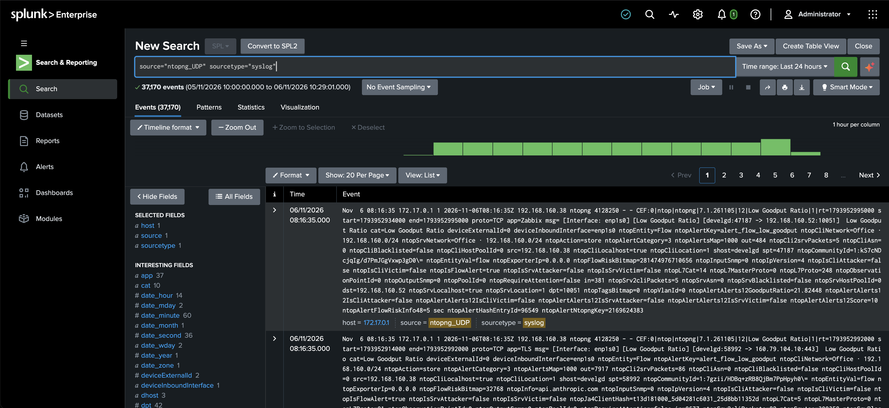

By expanding an event, all the fields of the alert are available, and can be used in searches, dashboards and Splunk alerts.

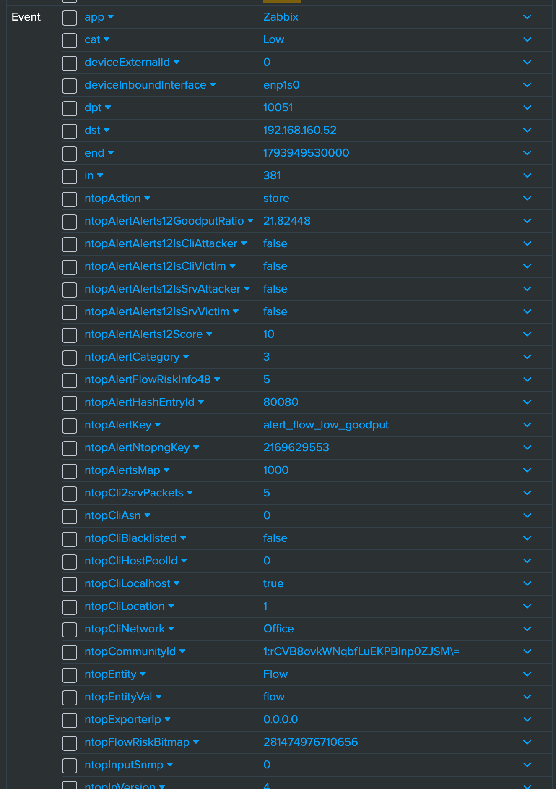

### Telegram {#telegram}

First of all navigate from the Web GUI into the section Notification->Endpoints; after that, click on the `+` on the right corner of the Endpoint window, this way it will add a new Endpoint for the notification system. Select inside the `Type` window `Telegram`. Then open Telegram, search for `@BotFather` and start a new conversion with it.

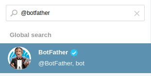

After that, send the following messages in this order:
: - `/newbot`
  - `bot_name` (the name that's going to have the bot, e.g. `ntopng_telegram_script`)
  - `bot_username` (the username that's going to have the bot, e.g. `ntopng_telegram_script_bot`)

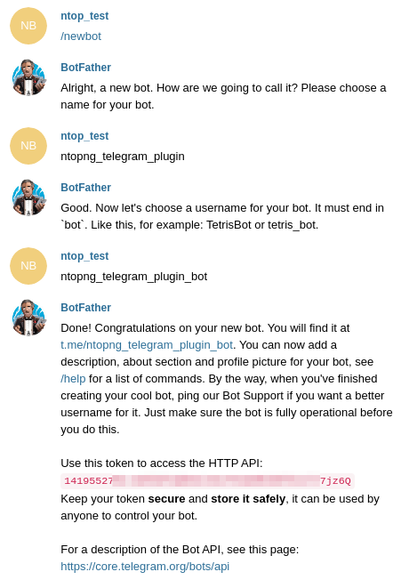

Now @BotFather will give a token, useful to enable ntopng to talk with the bot actually created; copy this token and paste it into the `Add New Endpoint` window of ntopng previously opened, name the Endpoint (e.g. `telegram_endpoint`) and click `Add`.

After that navigate to Notification->Recipients and, just like before, click on the `+` simbol on the right high corner of the Recipient window. Now select into the Endpoint section of `Add New Recipient` the endpoint previously created, name it (e.g. telegram_recipient_mychat), select the Minimum Severity of the notifications and the Category of the notification desired.

Then go back to Telegram.
If the bot have to personally send the alarms directly into the private chat then follow these steps:

> - start a conversation with the ntopng bot in Telegram (a bot can't initiate conversation with a user!)
> - search for `@getidsbot` and start a conversation with it
> - copy the id `@getidsbot` gave to you

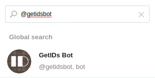

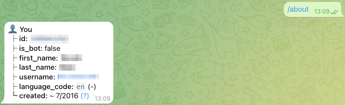

Otherwise if you want to add the bot to a group chat and send messagges on that group, follow the following steps:
: - add the bot you previosly created (searching for his name) to your group chat
  - call the REST API: `https://api.telegram.org/bot<botToken>/getUpdates` to find out the group chat id
  - copy the id the REST Response gave to you

Now paste the id into the `Add New Recipient` window of ntopng and click `Add` (click `Test Recipient` to test if the bot is working correctly).

Now add to the relative Pool the Telegram recipient you just created and it's done!

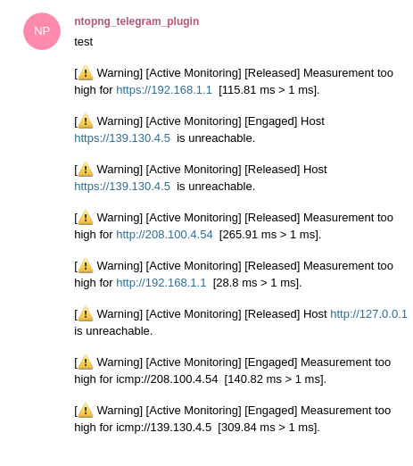

### Webhook {#webhook}

Webhooks can be used to deliver alert information to a HTTP endpoint by configuring the URL in ntopng. Alert information are provided to the webhook in JSON format by means of POST requests.

A Shared Secret can be configured in ntopng, which is an arbitrary string included in all JSON messages.

A Username and Password can also be used to use HTTP Basic authentication.

### WeChat {#wechat}

WeChat can be used to deliver alert information to a WeChat HTTP endpoint by configuring the URL in ntopng.

To obtain a valid WebHook URL of WeChat the user must be signed up on [WeChat](https://www.wechat.com/). After that, it is necessary to create a group chat and add a group robot there in order to obtain the WebHook URL of the group robot. For more information, check [here](https://open.work.weixin.qq.com/help2/pc/14206).

Alert information are provided to the webhook in JSON format by means of POST requests.

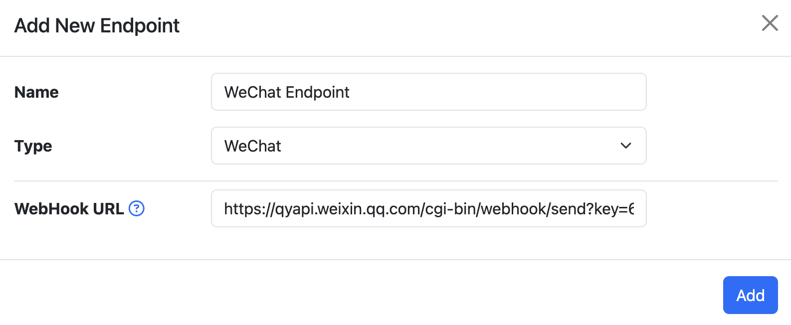

### TheHive {#thehive}

First of all, install TheHive. For information about the downloads and installation, please refer to the following link: [TheHive](https://docs.strangebee.com/thehive/setup/installation/step-by-step-guide/#cortex-misp).
After that, you will be able to see the TheHive Endpoint.

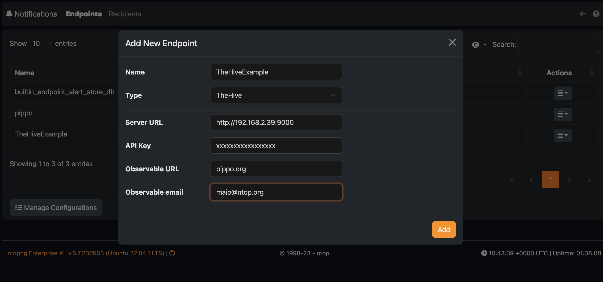

It is necessary to specify the following:
: - the Server URL of your TheHive.
  - the API Key for a user with the "manageAlert/create" profile.
  - the observable URl;
  - the observable email.

Once you have created the endpoint, proceed to create a new recipient to associate with the newly created endpoint.

::: info
TheHive recipient is only available in ntopng Enterprise M or above.
:::
