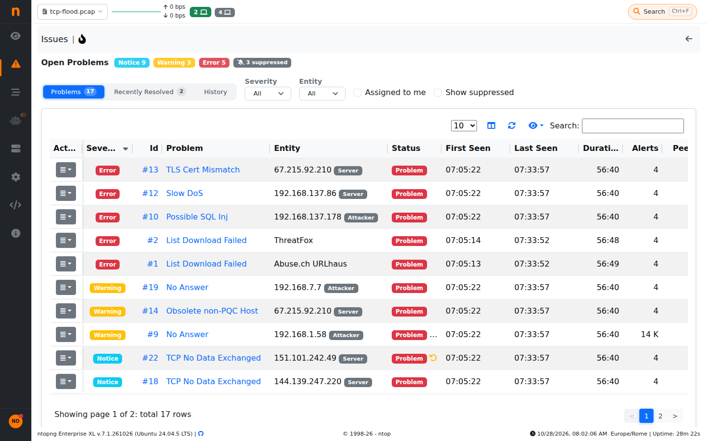
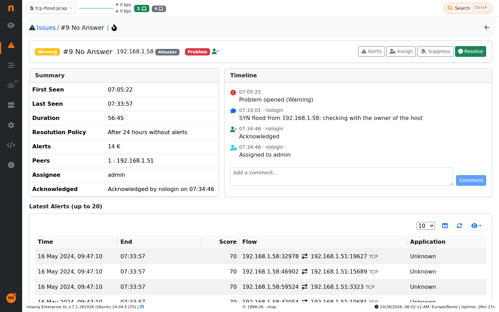

.. _Issues:

Issues
######

Alerts are events: when the same problem keeps happening (for instance a host
scanning the network, contacting hundreds of servers) it generates many alerts,
one per flow or per check. Issues group the alerts of the same problem into a
single item with a status, so that each problem is seen, handled and notified
once.

.. note::
    This feature is available from the Enterprise XXL license. It is an experimental
    feature, off by default: enable *Issues* in *Settings > Preferences > Alerts*.
    When it is off, no issue is built, the Issues pages and REST API are not
    available, and the recipients sending *Issues* receive the alerts.
    The issues built before are kept, and shown again when it is turned on.

An issue is either *Open* (a problem) or *Resolved*. Its alerts are called
*signals*: they are still stored and shown in the Alerts Explorer, and each of
them is linked to its issue.

Only alerts at least as severe as *Issues Minimum Severity* (in *Settings >
Preferences > Alerts*, *Warning* by default) open or reopen an issue. Less
severe alerts still update the issues already open.

At most *Issues Maximum Open* issues (same page, 50000 by default) are open at
the same time: above it no new issue is opened, the alerts are still stored, and
a warning is logged. Open issues are kept in memory, so raise it with care.

  Issues

How Alerts Are Grouped
======================

Alerts of the same type and on the same entity belong to the same issue:

- Host, interface, network, SNMP, system and the other alerts are grouped by
  alert type and entity (e.g. the host, or the interface), and by alert subtype
  when the alert has one.
- Flow alerts are grouped by alert type and by the host the alert is about: the
  attacker when known, otherwise the victim, otherwise the server. The other
  hosts of the flows are the *peers* of the issue (their number and a sample are
  shown). A flow with several alerts is a signal of an issue for each of its
  alert types.

The severity of an issue is the highest severity of its signals: when it is
raised the issue is *escalated*. The score of an issue is the sum of the scores
of its signals: a problem that keeps happening scores more than a single alert of
the same severity.

How Issues Are Resolved
=======================

Each alert type resolves its issues in one of these ways:

- **When the alert ends**: alerts that are engaged (e.g. thresholds) resolve the
  issue when the last engaged alert of the issue is released. An alert released
  only because it was engaged for too long, or because ntopng was restarted, does
  not resolve the issue unless it is not engaged again within a few minutes.
- **After 24 hours without alerts**: alerts that have no duration (e.g. flow
  alerts) resolve the issue when no signal is received for 24 hours.
- **Only by a user**: alerts that indicate a compromise are never resolved
  automatically. These are *Malware Host Contacted*, *Malicious Fingerprint*,
  *Malicious SHA1 Certificate*, *Data Exfiltration*, *DNS Data Exfiltration*,
  *Lateral Movement*, *Web Mining* and *Local Host Blacklisted*.

In the issues list and in the details, an open issue shows how it is resolved: a
*Manual* badge when only a user can resolve it, otherwise an icon whose tooltip tells
it is resolved automatically when its alert ends (spinner icon) or at what time, if no
new alert arrives (hourglass icon). The *Resolved* filter shows the open issues
resolved in each way: select *Only by a user* for the issues waiting for a user.

A new signal within *Issues Reopen Window* (in *Settings > Preferences >
Alerts*, 60 minutes by default, from 5 minutes to 24 hours) of the resolution
reopens the issue instead of opening a new one, so that flapping problems are
tracked as one issue. The reopened issue keeps its history: severity (the
highest reached), assignee, suppression, first seen and counters. The resolved
issues are kept in memory for this time: a longer window takes more memory.

Informational alerts that do not report a problem (e.g. *User Activity*,
*Process Notification*, *List Download Succeeded*, *Cloud Reconnected*,
*Shell Script Executed*, *Fail2Ban Executed*, *Network Discovery Executed*)
do not open issues. Neither do some alerts raised for each flow when an alert of
the hosts already reports the same problem, this includes for example 
*Obsolete non-PQC Flow* (see *Obsolete non-PQC Host*).

Issues are tracked per ntopng instance, across all its interfaces.

Issues Page
===========

The *Issues* page is in the *Alerts* menu. The dashboard shows the open
issues in place of the *Engaged Alerts*: a badge with the number of open issues
of each severity (emergency, critical, error and warning), colored as the most
severe with open issues (red for emergency and critical, orange for error,
yellow for warning, gray without open issues). Click on a severity to show its
issues.

The *All*, *Last 48h*, *Last 24h* and *Last Hour* tabs show only the issues first
seen (open since) in that time.

Above the issues, a heatmap shows the selected time (the last 48 hours for
*All*) in slots of 30 minutes (48 hours), 15 minutes (24 hours) or 1 minute, one
row per severity (only those from *Issues Minimum Severity*): the color of a slot is the number of issues opened, reopened
or escalated to that severity in it (move the mouse over a slot for the number).
Issues active for a long time are counted when they start, not over all their
life. The heatmap takes into account the filters.

The page has three views:

- **Open Issues**: the issues not resolved yet (problems).
- **Recently Resolved**: the issues resolved in the last 24 hours, useful to
  spot problems that keep coming back.
- **History**: all the issues active in the selected time range.

The search box above the table finds the issues whose entity contains the
text (e.g. part of an IP address). It also finds an issue by its ID: type
the number, with or without ``#`` (e.g. ``1573`` or ``#1573``).

The *Filters* box on the left counts the issues by family (entity type, e.g. host, flow, interface), severity, category,
MITRE tactic, problem (alert type), assignee, tag, suppression and how open issues are resolved: click on a value to show only its issues,
again to remove it. The selected values are shown as badges above the table
(click on a badge to remove it, or on *Clear filters*). Values of the same
filter are alternatives (e.g. two severities), different filters must all
match; the counts of each filter take into account the other filters.

The *List*, *By Problem* and *By Host* tabs show the issues as a list, or grouped
by problem (alert type) or by host
(the issues of a host and the flow issues about it; the issues of the other
entities, e.g. interfaces, by entity). Each group shows its number of issues,
its highest severity, its alerts, its score (the sum of the scores of its issues)
and when it was last seen, and expands into
its issues, the most severe first. Groups are sorted by highest severity, then
by number of issues, and take into account the filters.

Click on the entity of an issue (e.g. a host) to show only the issues of that
entity: for a host, its issues and the flow issues about it.

The *Tags* column shows the tags of the issue: all the tags its alerts carried
when they were triggered (see :doc:`../settings/tags`). These are the tags of the
check that triggered the alerts (see :ref:`Check Tags <CheckTags>`), for all the
entities, and the tags of the host or of the flow, for host and flow alerts. A flow
issue gets the tags of the flow (e.g. those bound to its application or to its
risks), not the tags of its hosts, and only the tags of its own check, not those
of the other checks that triggered alerts on the same flow. Click on a tag to show only the issues with that tag. The *Tag*
filter on the left lists the tags of the issues with their counts; the other
tags are under *Other tags*, so that any tag can be chosen.

The *Assignee* filter shows the users the issues are assigned to (the current
user first, marked as *me*) and the unassigned issues: an issue assigned to
several users is counted for each of them. In the open issues, the
*Suppression* filter shows the suppressed issues, hidden unless *Suppressed* is
selected (select also *Not suppressed* to show all the issues).

The issues of a host are also shown in the *Issues* tab of the host details
(the fire icon): the issues of the host and the flow issues about it,
whatever its role in the flows (attacker, victim or server).

Issue Details
=============

Clicking on an issue opens its details:

- the summary: first and last seen, duration, how the issue is resolved, the
  number of signals, the score, the peers, the tags, the assignee;
- the timeline: what happened to the issue (opened, escalated, resolved,
  reopened) and who did what, with the comments of the users;
- the latest alerts of the issue. The *Alerts* button opens the Alerts Explorer
  with all the alerts of the issue, using the *Issue* filter.

  Issue Details

Actions
=======

The following actions are available from the issues list and from the details:

- **Acknowledge**: tells the other users that someone is handling the problem.
  The acknowledgement is cleared when the issue is escalated or reopened.
- **Assign**: assigns the issue to one or more users (select none to unassign
  it).
- **Change Severity**: sets the severity of an open issue, e.g. to escalate it.
  A higher severity is an escalation: the acknowledgement is cleared and the
  recipients of the issues are notified. Alerts more severe than the severity
  chosen still raise it. The severity set by a user is marked with a user icon.
- **Comment**: adds a comment to the timeline.
- **Suppress**: stops the notifications of the issue for a time (1 hour to 1
  week), e.g. during a maintenance. The issue keeps tracking its signals.
- **Resolve**: closes the problem, with an optional comment added to the
  timeline (e.g. the reason).
- **Reopen**: reopens a resolved issue. An issue reopened by a user is then
  resolved only by a user.

In the *Open Issues* view, the *Resolve All* button (next to the active filters)
resolves all the open issues matching the filters, on all the pages of the list,
after a confirmation with their number and an optional comment, added to the
timeline of each issue resolved (e.g. select *Notice* in the *Severity*
filter to close all the notice issues). Each issue is resolved as by its
*Resolve* action: the recipients of the issues are notified, and a new alert
within *Issues Reopen Window* reopens it. The suppressed issues are resolved only when
shown (*Suppressed* selected in the *Suppression* filter).

