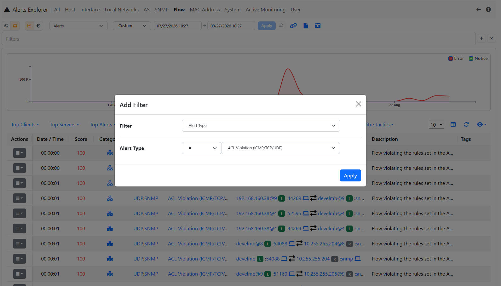
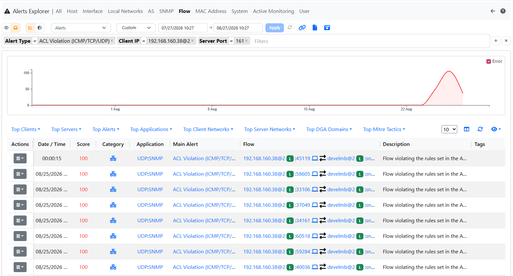

.. _AlertsFilters:

Alerts Filters
--------------

Clicking on the `+` icon enables the specification of multiple filters in the alerts explorer page.

  Add Filter on Alert Explorer

The filter types correspond to each column on the alerts explorer page. 

By adding two filters of the same type, they will be combined using OR operator. 
Otherwise, adding two filters of different types will combine them using AND operator.

  (Severity `>=` Error AND Client Name = office AND (Alert Type = Binary Application Transfer OR Alert Type = ICMP Data Exfiltration))

For each alert entity (such as Host, Flow, Interface, etc.), it's possible that ntopng has emitted more than one issue. 
For instance, a single Flow could have issues like 'Susp Device Protocol,' 'Clear-Text Credentials,' and 'HTTP Susp User-Agent.'

Typically, the 'Alert Type' filter in ntopng searches for the main issue (the one with the highest score indicated in the 'Description' column of the Alerts Explorer page) emitted for a Flow, Host, or other alert entities. 
However, if ClickHouse is enabled and the 'Alert Type' filter is used, ntopng can search for the specified 'Alert Type' across all issues (also secondary) emitted for every Flow, Host, etc.

In the *Flow* tab, the *Custom Script* filter selects the alerts raised by the custom flow scripts (see :ref:`CustomDetections`) by script title:
use *=* for the exact title (e.g. :code:`Modbus custom function code rate`) or *contains* for a part of it. The filter searches all the scripts that
raised an alert on the flow, also when the main alert of the flow is a different one.
