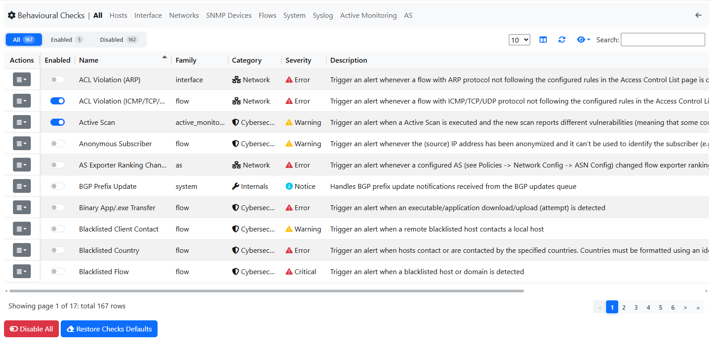

# Behavioural Checks {#behavioural-checks}

Checks are executed for hosts, interfaces, SNMP devices, and other network elements, and are configurable under Checks from the Settings left sidebar.

Checks are desiged to verify specific conditions and when they are not met, trigger an alert.

## Check Tags {#check-tags}

Each check can be given one or more [Tags](/user_interface/shared/settings/tags.md#tags): click on the edit button of the check
and choose them in the *Tags* field. The *Tags* column of the checks list shows the tags of each
check.

The tags of a check are added to every alert it triggers, together with the tags the alert
already has (e.g. the tags of the host). This makes it possible to group checks by topic or by
team (e.g. tag all the DNS-related checks *DNS-Team*) and then:

- send their alerts to a dedicated recipient, with a notification policy filtering on the tags
  (see [Notification Policies](/user_interface/shared/alerts/available_endpoints.md#notificationpolicies));
- find their [issues](/user_interface/shared/alerts/issues.md) (Enterprise XXL) with the *Tag* filter: an issue gets the
  tags of the check of its alerts.

When a flow (connection) triggers alerts from several checks, the flow alert shows the tags of
all of them, while each issue only gets the tags of its own check. The tags are added when the
alert is triggered: changing the tags of a check does not change past alerts and issues.
Deleting a tag also removes it from the checks.

Click *Simulate Notifications* in the edit dialog of a check to see who is notified when it triggers an alert,
with the values in the dialog (see [Simulating the Notifications](/user_interface/shared/alerts/available_endpoints.md#notificationsimulation)).

## Interface Types {#interface-types}

Checks can be available on both, ZMQ Interfaces and Packets Interfaces, or just on one of them;

- Packet interface: 

* ZMQ interface: 

## Alerts List {#alerts-list}

Below, the list of all the available alerts divided per family and which license is needed for each one.

- [Alerts List per License](/user_interface/shared/alerts/others/alerts_list_per_license.md)
  - [Host Behavioural Checks](/user_interface/shared/alerts/others/alerts_list_per_license.md#host-behavioural-checks)
  - [Interface Behavioural Checks](/user_interface/shared/alerts/others/alerts_list_per_license.md#interface-behavioural-checks)
  - [Local Networks Behavioural Checks](/user_interface/shared/alerts/others/alerts_list_per_license.md#local-networks-behavioural-checks)
  - [SNMP Behavioural Checks](/user_interface/shared/alerts/others/alerts_list_per_license.md#snmp-behavioural-checks)
  - [Flow Behavioural Checks](/user_interface/shared/alerts/others/alerts_list_per_license.md#flow-behavioural-checks)
  - [System Behavioural Checks](/user_interface/shared/alerts/others/alerts_list_per_license.md#system-behavioural-checks)
  - [Autonomous Systems Behavioural Checks](/user_interface/shared/alerts/others/alerts_list_per_license.md#autonomous-systems-behavioural-checks)
  - [Active Monitoring Behavioural Checks](/user_interface/shared/alerts/others/alerts_list_per_license.md#active-monitoring-behavioural-checks)
  - [Syslog Behavioural Checks](/user_interface/shared/alerts/others/alerts_list_per_license.md#syslog-behavioural-checks)
- [Host Behavioural Checks](/user_interface/shared/alerts/others/host_checks.md)
  - [Countries Contacts](/user_interface/shared/alerts/others/host_checks.md#countries-contacts)
  - [Dangerous Host](/user_interface/shared/alerts/others/host_checks.md#dangerous-host)
  - [DNS Flood](/user_interface/shared/alerts/others/host_checks.md#dns-flood)
  - [DNS Server Contacts](/user_interface/shared/alerts/others/host_checks.md#dns-server-contacts)
  - [DNS Traffic](/user_interface/shared/alerts/others/host_checks.md#dns-traffic)
  - [Domain Name Contacts](/user_interface/shared/alerts/others/host_checks.md#domain-name-contacts)
  - [Flow Flood](/user_interface/shared/alerts/others/host_checks.md#flow-flood)
  - [Flows Anomaly](/user_interface/shared/alerts/others/host_checks.md#flows-anomaly)
  - [Host External Check (REST)](/user_interface/shared/alerts/others/host_checks.md#host-external-check-rest)
  - [Host User Check Script](/user_interface/shared/alerts/others/host_checks.md#host-user-check-script)
  - [ICMP Flood](/user_interface/shared/alerts/others/host_checks.md#icmp-flood)
  - [NAT Detected](/user_interface/shared/alerts/others/host_checks.md#nat-detected)
  - [NTP Server Contacts](/user_interface/shared/alerts/others/host_checks.md#ntp-server-contacts)
  - [Remote Connection](/user_interface/shared/alerts/others/host_checks.md#remote-connection)
  - [Scan](/user_interface/shared/alerts/others/host_checks.md#scan)
  - [Scan Realtime](/user_interface/shared/alerts/others/host_checks.md#scan-realtime)
  - [Score Anomaly](/user_interface/shared/alerts/others/host_checks.md#score-anomaly)
  - [Score Threshold Exceeded](/user_interface/shared/alerts/others/host_checks.md#score-threshold-exceeded)
  - [Server Port Detected](/user_interface/shared/alerts/others/host_checks.md#server-port-detected)
  - [SMTP Server Contacts](/user_interface/shared/alerts/others/host_checks.md#smtp-server-contacts)
  - [SNMP Flood](/user_interface/shared/alerts/others/host_checks.md#snmp-flood)
  - [SYN Flood](/user_interface/shared/alerts/others/host_checks.md#syn-flood)
  - [Too Many RX-only Host Contacts](/user_interface/shared/alerts/others/host_checks.md#too-many-rx-only-host-contacts)
  - [Unexpected Gateway](/user_interface/shared/alerts/others/host_checks.md#unexpected-gateway)
  - [VPN Detection](/user_interface/shared/alerts/others/host_checks.md#vpn-detection)
  - [Wazuh Info Changed](/user_interface/shared/alerts/others/host_checks.md#wazuh-info-changed)
- [Interface Behavioural Checks](/user_interface/shared/alerts/others/interface_checks.md)
  - [ACL Violation (ARP)](/user_interface/shared/alerts/others/interface_checks.md#acl-violation-arp)
  - [Device/MAC Address Tracking](/user_interface/shared/alerts/others/interface_checks.md#device-mac-address-tracking)
  - [DHCP Storm](/user_interface/shared/alerts/others/interface_checks.md#dhcp-storm)
  - [Ghost Networks](/user_interface/shared/alerts/others/interface_checks.md#ghost-networks)
  - [Interface Alerts Drops](/user_interface/shared/alerts/others/interface_checks.md#interface-alerts-drops)
  - [Interface Periodic Activity Not Executed](/user_interface/shared/alerts/others/interface_checks.md#interface-periodic-activity-not-executed)
  - [Interface Slow Periodic Activity](/user_interface/shared/alerts/others/interface_checks.md#interface-slow-periodic-activity)
  - [No Exporter Activity](/user_interface/shared/alerts/others/interface_checks.md#no-exporter-activity)
  - [No Traffic Activity](/user_interface/shared/alerts/others/interface_checks.md#no-traffic-activity)
  - [Packet Drops](/user_interface/shared/alerts/others/interface_checks.md#packet-drops)
  - [Unexpected Score Behaviour](/user_interface/shared/alerts/others/interface_checks.md#unexpected-score-behaviour)
  - [Unexpected Traffic Behaviour](/user_interface/shared/alerts/others/interface_checks.md#unexpected-traffic-behaviour)
- [Local Networks Behavioural Checks](/user_interface/shared/alerts/others/local_network_checks.md)
  - [Broadcast Domain Too Large](/user_interface/shared/alerts/others/local_network_checks.md#broadcast-domain-too-large)
  - [Flow Flood Victim](/user_interface/shared/alerts/others/local_network_checks.md#flow-flood-victim)
  - [IP/MAC Reassoc/Spoofing](/user_interface/shared/alerts/others/local_network_checks.md#ip-mac-reassoc-spoofing)
  - [Network Discovery](/user_interface/shared/alerts/others/local_network_checks.md#network-discovery)
  - [Network Issues](/user_interface/shared/alerts/others/local_network_checks.md#network-issues)
  - [Network Score per Host](/user_interface/shared/alerts/others/local_network_checks.md#network-score-per-host)
  - [SYN Flood Victim](/user_interface/shared/alerts/others/local_network_checks.md#syn-flood-victim)
  - [SYN Scan Victim](/user_interface/shared/alerts/others/local_network_checks.md#syn-scan-victim)
- [SNMP Behavioural Checks](/user_interface/shared/alerts/others/snmp_checks.md)
  - [Duplex Status Change](/user_interface/shared/alerts/others/snmp_checks.md#duplex-status-change)
  - [High Interface Discards/Errors](/user_interface/shared/alerts/others/snmp_checks.md#high-interface-discards-errors)
  - [Interface Errors Exceeded](/user_interface/shared/alerts/others/snmp_checks.md#interface-errors-exceeded)
  - [LLDP/CDP Topology Monitor](/user_interface/shared/alerts/others/snmp_checks.md#lldp-cdp-topology-monitor)
  - [MAC Detection (SNMP)](/user_interface/shared/alerts/others/snmp_checks.md#mac-detection-snmp)
  - [MAC Port Changed (SNMP)](/user_interface/shared/alerts/others/snmp_checks.md#mac-port-changed-snmp)
  - [Oper. Status Change](/user_interface/shared/alerts/others/snmp_checks.md#oper-status-change)
  - [SNMP Device Restart](/user_interface/shared/alerts/others/snmp_checks.md#snmp-device-restart)
  - [Threshold Crossed](/user_interface/shared/alerts/others/snmp_checks.md#threshold-crossed)
  - [Too Many MACs on Non-Trunk](/user_interface/shared/alerts/others/snmp_checks.md#too-many-macs-on-non-trunk)
  - [Traffic Change Detected](/user_interface/shared/alerts/others/snmp_checks.md#traffic-change-detected)
- [Flow Behavioural Checks](/user_interface/shared/alerts/others/flow_checks.md)
  - [ACL Violation (ICMP/TCP/UDP)](/user_interface/shared/alerts/others/flow_checks.md#acl-violation-icmp-tcp-udp)
  - [ALPN/SNI Mismatch](/user_interface/shared/alerts/others/flow_checks.md#alpn-sni-mismatch)
  - [Anonymous Subscriber](/user_interface/shared/alerts/others/flow_checks.md#anonymous-subscriber)
  - [Binary App/.exe Transfer](/user_interface/shared/alerts/others/flow_checks.md#binary-app-exe-transfer)
  - [Binary file/data transfer (attempt)](/user_interface/shared/alerts/others/flow_checks.md#binary-file-data-transfer-attempt)
  - [Blacklisted Client Contact](/user_interface/shared/alerts/others/flow_checks.md#blacklisted-client-contact)
  - [Blacklisted Country](/user_interface/shared/alerts/others/flow_checks.md#blacklisted-country)
  - [Blacklisted Flow](/user_interface/shared/alerts/others/flow_checks.md#blacklisted-flow)
  - [Blacklisted Server Contact](/user_interface/shared/alerts/others/flow_checks.md#blacklisted-server-contact)
  - [Broadcast Non-UDP Traffic](/user_interface/shared/alerts/others/flow_checks.md#broadcast-non-udp-traffic)
  - [Clear-Text Credentials](/user_interface/shared/alerts/others/flow_checks.md#clear-text-credentials)
  - [Crawler/Bot](/user_interface/shared/alerts/others/flow_checks.md#crawler-bot)
  - [Desktop/File Sharing](/user_interface/shared/alerts/others/flow_checks.md#desktop-file-sharing)
  - [DNS Data Exfiltration](/user_interface/shared/alerts/others/flow_checks.md#dns-data-exfiltration)
  - [DNS Invalid Characters](/user_interface/shared/alerts/others/flow_checks.md#dns-invalid-characters)
  - [Elephant flow](/user_interface/shared/alerts/others/flow_checks.md#elephant-flow)
  - [Error Code](/user_interface/shared/alerts/others/flow_checks.md#error-code)
  - [External Alert](/user_interface/shared/alerts/others/flow_checks.md#external-alert)
  - [Flow User Check Script](/user_interface/shared/alerts/others/flow_checks.md#flow-user-check-script)
  - [Fragmented DNS Message](/user_interface/shared/alerts/others/flow_checks.md#fragmented-dns-message)
  - [Fully Encrypted Flow](/user_interface/shared/alerts/others/flow_checks.md#fully-encrypted-flow)
  - [Host Policy](/user_interface/shared/alerts/others/flow_checks.md#host-policy)
  - [HTTP Obsolete Server](/user_interface/shared/alerts/others/flow_checks.md#http-obsolete-server)
  - [HTTP Susp. Content](/user_interface/shared/alerts/others/flow_checks.md#http-susp-content)
  - [HTTP Susp. Header](/user_interface/shared/alerts/others/flow_checks.md#http-susp-header)
  - [HTTP Susp. URL](/user_interface/shared/alerts/others/flow_checks.md#http-susp-url)
  - [HTTP Susp. User-Agent](/user_interface/shared/alerts/others/flow_checks.md#http-susp-user-agent)
  - [HTTP/TLS/QUIC Numeric Hostname/SNI](/user_interface/shared/alerts/others/flow_checks.md#http-tls-quic-numeric-hostname-sni)
  - [ICMP Data Exfiltration](/user_interface/shared/alerts/others/flow_checks.md#icmp-data-exfiltration)
  - [IEC Invalid Command Transition](/user_interface/shared/alerts/others/flow_checks.md#iec-invalid-command-transition)
  - [IEC Invalid Transition](/user_interface/shared/alerts/others/flow_checks.md#iec-invalid-transition)
  - [IEC Unexpected TypeID](/user_interface/shared/alerts/others/flow_checks.md#iec-unexpected-typeid)
  - [Invalid DNS Query](/user_interface/shared/alerts/others/flow_checks.md#invalid-dns-query)
  - [Known Proto on Non Std Port](/user_interface/shared/alerts/others/flow_checks.md#known-proto-on-non-std-port)
  - [Large DNS Packet (512+ bytes)](/user_interface/shared/alerts/others/flow_checks.md#large-dns-packet-512-bytes)
  - [Long Lived](/user_interface/shared/alerts/others/flow_checks.md#long-lived)
  - [Low Goodput](/user_interface/shared/alerts/others/flow_checks.md#low-goodput)
  - [Malformed packets](/user_interface/shared/alerts/others/flow_checks.md#malformed-packets)
  - [Malicious JA3 Fingerp.](/user_interface/shared/alerts/others/flow_checks.md#malicious-ja3-fingerp)
  - [Malicious JA3 SHA1 Cert.](/user_interface/shared/alerts/others/flow_checks.md#malicious-ja3-sha1-cert)
  - [Malware Host Contacted](/user_interface/shared/alerts/others/flow_checks.md#malware-host-contacted)
  - [Minor Issues](/user_interface/shared/alerts/others/flow_checks.md#minor-issues)
  - [Mismatching Protocol with IP](/user_interface/shared/alerts/others/flow_checks.md#mismatching-protocol-with-ip)
  - [Missing SNI TLS Extn](/user_interface/shared/alerts/others/flow_checks.md#missing-sni-tls-extn)
  - [ModbusTCP Invalid Transition](/user_interface/shared/alerts/others/flow_checks.md#modbustcp-invalid-transition)
  - [ModbusTCP Too Many Exceptions](/user_interface/shared/alerts/others/flow_checks.md#modbustcp-too-many-exceptions)
  - [ModbusTCP Unexpected Function Code](/user_interface/shared/alerts/others/flow_checks.md#modbustcp-unexpected-function-code)
  - [Not Purged](/user_interface/shared/alerts/others/flow_checks.md#not-purged)
  - [Obfuscated Traffic](/user_interface/shared/alerts/others/flow_checks.md#obfuscated-traffic)
  - [Obsolete non-PQC Flow](/user_interface/shared/alerts/others/flow_checks.md#obsolete-non-pqc-flow)
  - [Obsolete non-PQC Host](/user_interface/shared/alerts/others/flow_checks.md#obsolete-non-pqc-host)
  - [Obsolete SSH Client Version or Cipher](/user_interface/shared/alerts/others/flow_checks.md#obsolete-ssh-client-version-or-cipher)
  - [Obsolete SSH Server Version or Cipher](/user_interface/shared/alerts/others/flow_checks.md#obsolete-ssh-server-version-or-cipher)
  - [Old TLS Version](/user_interface/shared/alerts/others/flow_checks.md#old-tls-version)
  - [Periodic Flow](/user_interface/shared/alerts/others/flow_checks.md#periodic-flow)
  - [Periodicity Changed](/user_interface/shared/alerts/others/flow_checks.md#periodicity-changed)
  - [Possible AI Inference Traffic](/user_interface/shared/alerts/others/flow_checks.md#possible-ai-inference-traffic)
  - [Possible Exploit](/user_interface/shared/alerts/others/flow_checks.md#possible-exploit)
  - [Possible Remote Code Execution (RCE)](/user_interface/shared/alerts/others/flow_checks.md#possible-remote-code-execution-rce)
  - [Possible SQL Inj](/user_interface/shared/alerts/others/flow_checks.md#possible-sql-inj)
  - [Probing Attempt](/user_interface/shared/alerts/others/flow_checks.md#probing-attempt)
  - [Profinet Too Many Errors](/user_interface/shared/alerts/others/flow_checks.md#profinet-too-many-errors)
  - [Punicody IDN](/user_interface/shared/alerts/others/flow_checks.md#punicody-idn)
  - [QoE Issues](/user_interface/shared/alerts/others/flow_checks.md#qoe-issues)
  - [Rare Destination](/user_interface/shared/alerts/others/flow_checks.md#rare-destination)
  - [Remote Access](/user_interface/shared/alerts/others/flow_checks.md#remote-access)
  - [Remote to Local Insecure Protocol](/user_interface/shared/alerts/others/flow_checks.md#remote-to-local-insecure-protocol)
  - [Remote to Remote Flow](/user_interface/shared/alerts/others/flow_checks.md#remote-to-remote-flow)
  - [Risky ASN](/user_interface/shared/alerts/others/flow_checks.md#risky-asn)
  - [Risky Domain](/user_interface/shared/alerts/others/flow_checks.md#risky-domain)
  - [S7Comm Invalid Transition](/user_interface/shared/alerts/others/flow_checks.md#s7comm-invalid-transition)
  - [S7Comm Too Many Errors](/user_interface/shared/alerts/others/flow_checks.md#s7comm-too-many-errors)
  - [S7Comm Unexpected Function Code](/user_interface/shared/alerts/others/flow_checks.md#s7comm-unexpected-function-code)
  - [Service Map Lateral Movement Detection](/user_interface/shared/alerts/others/flow_checks.md#service-map-lateral-movement-detection)
  - [Slow DoS](/user_interface/shared/alerts/others/flow_checks.md#slow-dos)
  - [SMB insecure](/user_interface/shared/alerts/others/flow_checks.md#smb-insecure)
  - [Susp. Device Protocol](/user_interface/shared/alerts/others/flow_checks.md#susp-device-protocol)
  - [Susp. DGA Domain name](/user_interface/shared/alerts/others/flow_checks.md#susp-dga-domain-name)
  - [Susp. DNS traffic](/user_interface/shared/alerts/others/flow_checks.md#susp-dns-traffic)
  - [Susp. Entropy](/user_interface/shared/alerts/others/flow_checks.md#susp-entropy)
  - [Susp. Domain Scan](/user_interface/shared/alerts/others/flow_checks.md#susp-domain-scan)
  - [TCP connection Issues](/user_interface/shared/alerts/others/flow_checks.md#tcp-connection-issues)
  - [TCP connection refused](/user_interface/shared/alerts/others/flow_checks.md#tcp-connection-refused)
  - [TCP Flow Reset](/user_interface/shared/alerts/others/flow_checks.md#tcp-flow-reset)
  - [TCP No Data Exchanged](/user_interface/shared/alerts/others/flow_checks.md#tcp-no-data-exchanged)
  - [TCP Packets Issues](/user_interface/shared/alerts/others/flow_checks.md#tcp-packets-issues)
  - [TCP With No Answer](/user_interface/shared/alerts/others/flow_checks.md#tcp-with-no-answer)
  - [TCP Zero Window](/user_interface/shared/alerts/others/flow_checks.md#tcp-zero-window)
  - [TLS (probably) Not Carrying HTTPS](/user_interface/shared/alerts/others/flow_checks.md#tls-probably-not-carrying-https)
  - [TLS Cert About To Expire](/user_interface/shared/alerts/others/flow_checks.md#tls-cert-about-to-expire)
  - [TLS Cert Expired](/user_interface/shared/alerts/others/flow_checks.md#tls-cert-expired)
  - [TLS Cert Issues](/user_interface/shared/alerts/others/flow_checks.md#tls-cert-issues)
  - [TLS Cert Self-Signed](/user_interface/shared/alerts/others/flow_checks.md#tls-cert-self-signed)
  - [TLS Cert Validity Too Long](/user_interface/shared/alerts/others/flow_checks.md#tls-cert-validity-too-long)
  - [TLS Fatal Alert](/user_interface/shared/alerts/others/flow_checks.md#tls-fatal-alert)
  - [TLS Susp ESNI Usage](/user_interface/shared/alerts/others/flow_checks.md#tls-susp-esni-usage)
  - [TLS Susp. Extension](/user_interface/shared/alerts/others/flow_checks.md#tls-susp-extension)
  - [TLS Uncommon ALPN](/user_interface/shared/alerts/others/flow_checks.md#tls-uncommon-alpn)
  - [TLS Unsafe Ciphers](/user_interface/shared/alerts/others/flow_checks.md#tls-unsafe-ciphers)
  - [Unexpected DHCP](/user_interface/shared/alerts/others/flow_checks.md#unexpected-dhcp)
  - [Unexpected DNS Server](/user_interface/shared/alerts/others/flow_checks.md#unexpected-dns-server)
  - [Unexpected NTP Server](/user_interface/shared/alerts/others/flow_checks.md#unexpected-ntp-server)
  - [Unexpected SMTP Server](/user_interface/shared/alerts/others/flow_checks.md#unexpected-smtp-server)
  - [Unidirectional Flow](/user_interface/shared/alerts/others/flow_checks.md#unidirectional-flow)
  - [Unresolved Hostname](/user_interface/shared/alerts/others/flow_checks.md#unresolved-hostname)
  - [Unsafe protocol](/user_interface/shared/alerts/others/flow_checks.md#unsafe-protocol)
  - [VLAN Bidirectional Flow](/user_interface/shared/alerts/others/flow_checks.md#vlan-bidirectional-flow)
  - [WEb Mining](/user_interface/shared/alerts/others/flow_checks.md#web-mining)
  - [XSS Attack](/user_interface/shared/alerts/others/flow_checks.md#xss-attack)
- [System Behavioural Checks](/user_interface/shared/alerts/others/system_checks.md)
  - [BGP Prefix Update](/user_interface/shared/alerts/others/system_checks.md#bgp-prefix-update)
  - [Disk Space Low](/user_interface/shared/alerts/others/system_checks.md#disk-space-low)
  - [Exporters Limit Exceeded](/user_interface/shared/alerts/others/system_checks.md#exporters-limit-exceeded)
  - [Intrusion Detection and Prevention Log](/user_interface/shared/alerts/others/system_checks.md#intrusion-detection-and-prevention-log)
  - [Periodic Activity Not Executed](/user_interface/shared/alerts/others/system_checks.md#periodic-activity-not-executed)
  - [Redis Reads Writes Exceeded](/user_interface/shared/alerts/others/system_checks.md#redis-reads-writes-exceeded)
  - [Slow Periodic Activity](/user_interface/shared/alerts/others/system_checks.md#slow-periodic-activity)
  - [System Alerts Drops](/user_interface/shared/alerts/others/system_checks.md#system-alerts-drops)
  - [System Error](/user_interface/shared/alerts/others/system_checks.md#system-error)
  - [Always Enabled System Alerts](/user_interface/shared/alerts/others/system_checks.md#always-enabled-system-alerts)
  - [Process](/user_interface/shared/alerts/others/system_checks.md#process)
  - [Login Failed](/user_interface/shared/alerts/others/system_checks.md#login-failed)
  - [User Activity](/user_interface/shared/alerts/others/system_checks.md#user-activity)
  - [Endpoint Shell Script Executed](/user_interface/shared/alerts/others/system_checks.md#endpoint-shell-script-executed)
  - [Fail2Ban Command Executed](/user_interface/shared/alerts/others/system_checks.md#fail2ban-command-executed)
  - [Misconfigured App](/user_interface/shared/alerts/others/system_checks.md#misconfigured-app)
  - [Packets Queue Flushed](/user_interface/shared/alerts/others/system_checks.md#packets-queue-flushed)
  - [List Download Failed](/user_interface/shared/alerts/others/system_checks.md#list-download-failed)
  - [List Download Succeeded](/user_interface/shared/alerts/others/system_checks.md#list-download-succeeded)
  - [Gateway Unreachable](/user_interface/shared/alerts/others/system_checks.md#gateway-unreachable)
  - [Misconfigured DHCP Range](/user_interface/shared/alerts/others/system_checks.md#misconfigured-dhcp-range)
- [Active Monitoring Behavioural Checks](/user_interface/shared/alerts/others/active_monitoring_checks.md)
  - [Vulnerability Scan](/user_interface/shared/alerts/others/active_monitoring_checks.md#vulnerability-scan)
- [Syslog Behavioural Checks](/user_interface/shared/alerts/others/syslog_checks.md)
  - [Fortinet](/user_interface/shared/alerts/others/syslog_checks.md#fortinet)
  - [Host Log](/user_interface/shared/alerts/others/syslog_checks.md#host-log)
  - [Kerberos/NXLog](/user_interface/shared/alerts/others/syslog_checks.md#kerberos-nxlog)
  - [nBox](/user_interface/shared/alerts/others/syslog_checks.md#nbox)
  - [OpenVPN](/user_interface/shared/alerts/others/syslog_checks.md#openvpn)
  - [OPNsense](/user_interface/shared/alerts/others/syslog_checks.md#opnsense)
  - [SonicWALL](/user_interface/shared/alerts/others/syslog_checks.md#sonicwall)
  - [Sophos](/user_interface/shared/alerts/others/syslog_checks.md#sophos)
  - [Suricata](/user_interface/shared/alerts/others/syslog_checks.md#suricata)
- [Autonomous Systems Behavioural Checks](/user_interface/shared/alerts/others/as_checks.md)
  - [AS Exporter Ranking Changed](/user_interface/shared/alerts/others/as_checks.md#as-exporter-ranking-changed)

