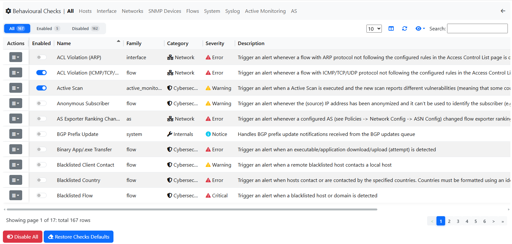
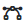

.. _BehaviouralChecks:

Behavioural Checks
==================

Checks are executed for hosts, interfaces, SNMP devices, and other network elements, and are configurable under Checks from the Settings left sidebar.

  
Checks are desiged to verify specific conditions and when they are not met, trigger an alert.

.. _CheckTags:

Check Tags
~~~~~~~~~~

Each check can be given one or more :ref:`Tags <Tags>`: click on the edit button of the check
and choose them in the *Tags* field. The *Tags* column of the checks list shows the tags of each
check.

The tags of a check are added to every alert it triggers, together with the tags the alert
already has (e.g. the tags of the host). This makes it possible to group checks by topic or by
team (e.g. tag all the DNS-related checks *DNS-Team*) and then:

- send their alerts to a dedicated recipient, using the tags as delivery criterion
  (see :ref:`Tags <Tags>`);
- find their :doc:`issues <../issues>` (Enterprise XXL) with the *Tag* filter: an issue gets the
  tags of the check of its alerts.

When a flow (connection) triggers alerts from several checks, the flow alert shows the tags of
all of them, while each issue only gets the tags of its own check. The tags are added when the
alert is triggered: changing the tags of a check does not change past alerts and issues.
Deleting a tag also removes it from the checks.

Interface Types
~~~~~~~~~~~~~~~

Checks can be available on both, ZMQ Interfaces and Packets Interfaces, or just on one of them;

- Packet interface: |packet_interface|

- ZMQ interface: |zmq_interface|

Alerts List
~~~~~~~~~~~

Below, the list of all the available alerts divided per family and which license is needed for each one.

.. toctree::
    :maxdepth: 2

    alerts_list_per_license
    host_checks
    interface_checks
    local_network_checks
    snmp_checks
    flow_checks
    system_checks
    active_monitoring_checks
    syslog_checks
    as_checks
    

