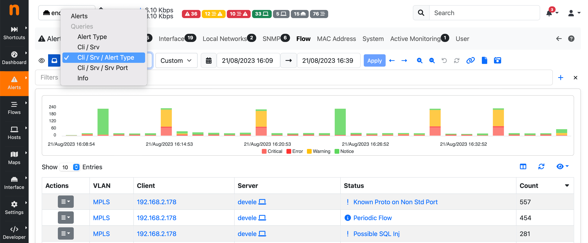

<a id="customqueries"></a>

# Custom Queries {#custom-queries}

In a system which analyses traffic of a large network, the amount of alerts
(in particular those which are about Network issues) can be high, also depending
on the number of Behavioural Checks we enable, and how we tune them. Checking
the health of the Network, by looking at those alerts one by one, may definitely
be a challenging and time-consuming task. For this reason the Alerts Explorer
computates and display alerts statistics through dropdowns at the top of each page,
including Top Alert Types, Clients, Servers, etc, to summarize what are the main
issues affecting our networks, and who are the main actors.

In order to analyze alerts when cardinality is high, ntopng also provides the ability
to build additional custom views that can be defined by means of custom queries, and
that can aggregate alerts according to some criteria, or manipulate them in any way
allowed by SQL.

Custom queries can be defined using a simple JSON syntax, placed as .json files on
the filesystem, and automatically appear in a dropdown under the Queries section in
the Alerts Explorer. It is possible to build a query which groups alerts based on
Client, Server and Alert Type for instance, and list all alerts matching a specific
3-tuple from the table Actions.

The default view in the Alerts Explorer is "Alerts", which shows the full list of raw alerts.
In addition to the raw "Alerts", additional built-in views are available, which are
built on top of the Custom Queries engine and include:

> - Alert Type: group and count alerts by Alert Type
> - Cli / Srv: group and count alerts by Client and Server
> - Cli / Srv / Alert Type: group and count alerts by Client, Server and Type
> - Cli / Srv / Srv Port: group and count alerts by Client, Server and Server Port
> - Info: group and count alerts by domain or URL



The above built-in Custom Queries can be extended by the user by creating
simple JSON files containing the query description. The query definitions corresponding
to the above built-in queries are available on the filesystem as JSON files under

/usr/share/ntopng/scripts/historical/alerts/{alert entity}/{query name}.json

Example:

/usr/share/ntopng/scripts/historical/alerts/flow/alert_types.json

Adding a new alerts view is as simple as placing one more JSON file within the same folder.

Here is an example JSON file for the Clients flow view.

```json
{
   "name" : "Alert Type",
   "i18n_name" : "alert_types",
   "select" : {
      "items" : [
         {
            "name" : "alert_id"
         },
         {
            "name" : "count",
            "func" : "COUNT",
            "param" : "*",
            "value_type" : "number"
         }
      ]
   },
   "filters" : {
      "items" : [
         {
            "name" : "alert_id"
         }
      ]
   },
   "groupby" : {
      "items" : [
         {
            "name" : "alert_id"
         }
      ]
   },
   "sortby" : {
      "items" : [
         {
            "name" : "count",
            "order" : "DESC"
         }
      ]
   }
}
```

The JSON format is self-explanatory. It is possible to define the columns to be shown under the select tree,
the columns on which the group-by is applied under the groupby tree, and the default column on which sorting is
applied under the sortby tree. Aggregation functions can also be defined, such as the 'count' item, which is
used in the example to display the number of alerts for each 3-tuple.
For more complicated examples, it is recommended to take a look at the built-in query definitions available in the same folders.

The complete list of columns is available in the database schema located at /usr/share/ntopng/httpdocs/misc/alert_store_schema.sql
