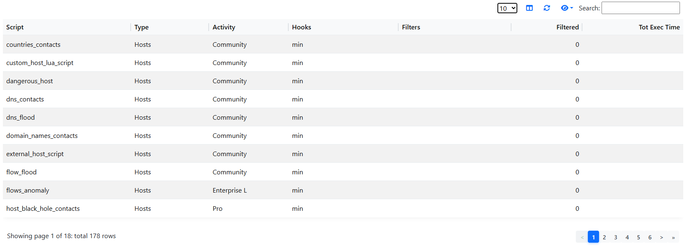

# Behavioural Checks {#behavioural-checks}

Here the list of all scripts and checks can found, with the License availability, the frequency (Hooks), filters and Execution time (in case of performances issues).

