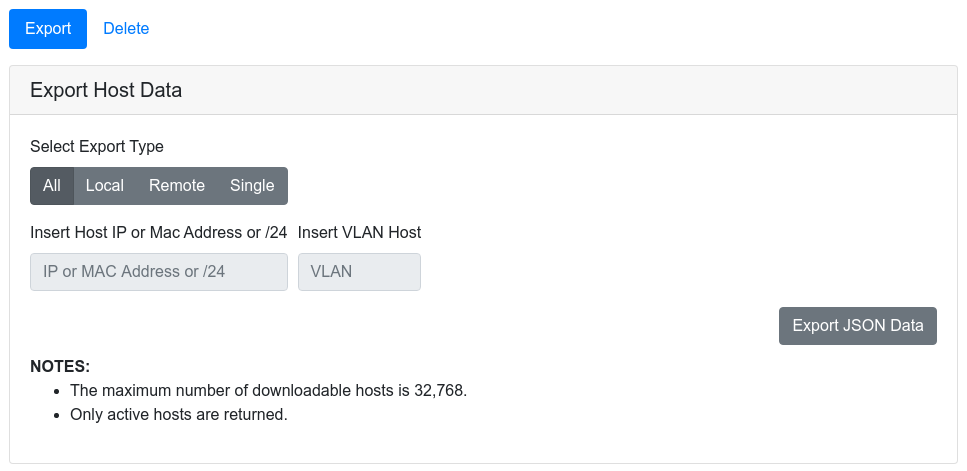
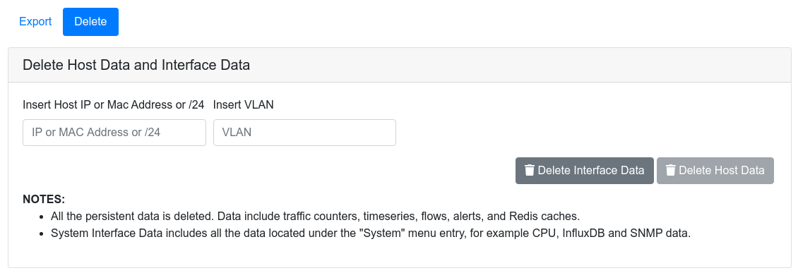

# Manage Data {#manage-data}

Through the manage data page it is possible to export or delete the interface data.

It is possible to choose between the following options:

- Export all the hosts data
- Export all the local hosts data
- Export all the remote hosts data
- Export a specific host data, by specifying its IP or MAC address and optionally a VLAN

The JSON data can be downloaded and easily analyzed.

The Delete tab is similar to the export tab.
It provides a convenient way to delete all the data associated to a particular
host or group of hosts (via a /24 network CIDR). It is also possible to delete
all the data associated to the active interface.

The Manage Data page is accessible when a non system interface is selected. On the system interface,
the delete data functionality can be directly accessed via the Settings menu. In this case,
it is possible to:

- Delete the system interface data
- Delete the inactive interfaces data. This can be very useful to free some disk space for old
  interfaces.
