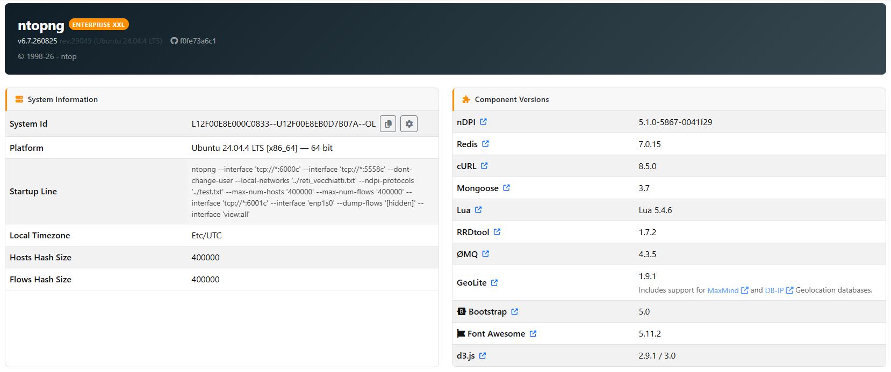

# About {#about}

Shows information about ntopng Version, Platform, Currently Logged User, Uptime value and some details related to its internals.

The upgrade from Community to Professional Version can be done by clicking on the system ID. The browser will be redirected to the ntop shop to generate a valid license. The generated id should be save in the appropriate field in License field.
