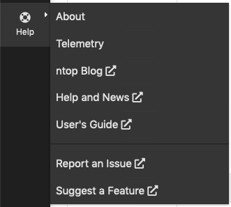

# Help {#help}

The help menu shows several entries useful to know more about ntopng as well as to find extra information from external sources.

- [About](/user_interface/shared/help/about.md)
- [ntop Blog](/user_interface/shared/help/ntop_blog.md)
- [Report an Issue](/user_interface/shared/help/report_an_issue.md)

