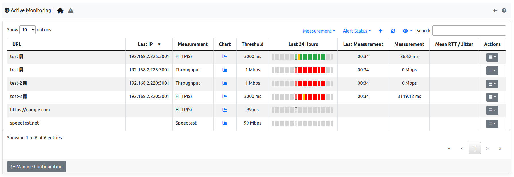
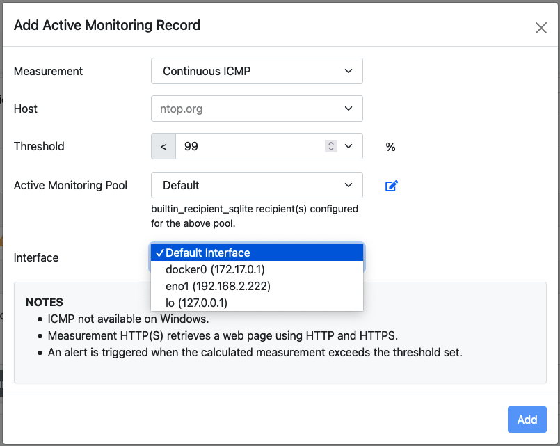
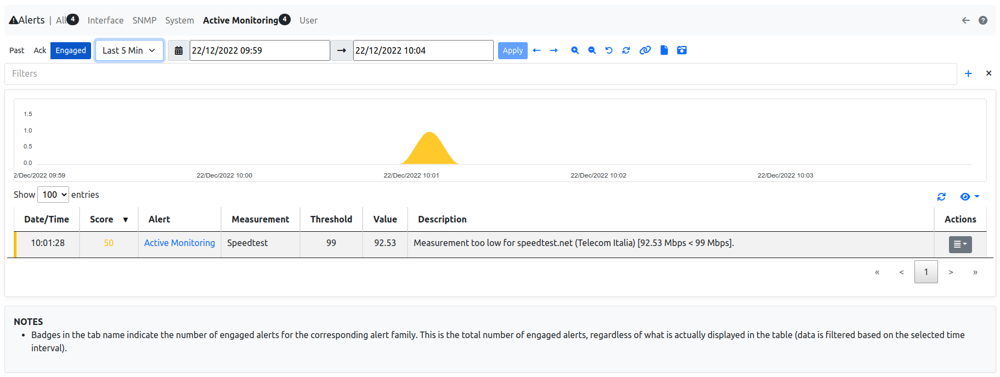
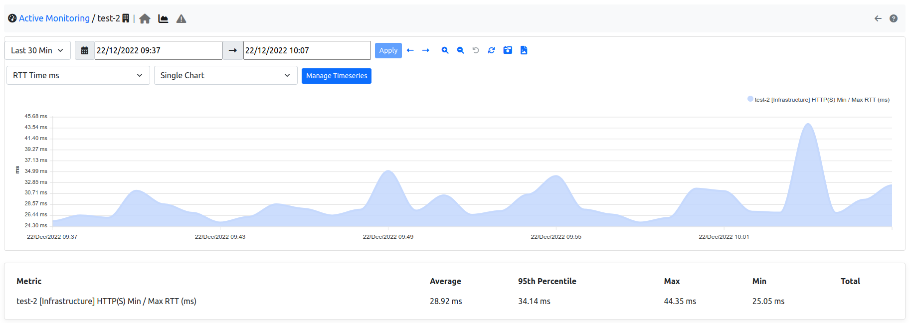
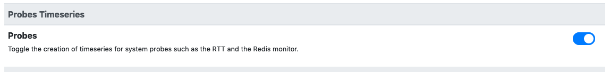

# Active Monitoring {#active-monitoring}

ntopng supports active monitoring of hosts and devices. Active monitoring means ntopng proactively and periodically reaches hosts and devices to check their status or the status of their services. This section documents active monitoring functionalities offered by ntopng.

Active Monitoring is available under the [System Interface](/basic_concepts/system_interface.md#basicconceptsysteminterface). The Active monitoring probes configured hosts on a minute-by-minute basis to check:

- IP reachability.
- Functionality of certain services.

Some checks measure the RTT, that is, the time it takes to reach a certain host and receive a response from it. Other checks measure the bandwith. The following checks are currently supported:

- ICMP and ICMPv6: to check host IP reachability.
- HTTP and HTTPS: to check functionalities of possible host web servers.
- Throughput: to check the Internet throughput.
- Speedtest: to check for Internet bandwidth.

All the monitored hosts are shown in a table.

The *Tags* of a measurement (see [Tags](/user_interface/shared/settings/tags.md#tags)) are added to its alerts (threshold crossed and host
unreachable) and to the issues they open or update: notification policies can then select the
alerts of some measurements by tag, e.g. to send the alerts of the core routers to the NOC.

Click *Simulate Notifications* in the measurement dialog to see who is notified when the host crosses the
threshold or is unreachable (see [Simulating the Notifications](/user_interface/shared/alerts/available_endpoints.md#notificationsimulation)).

The table has the following columns:

- `URL`: The full URL of the monitored host. The URL is the concatenation of the host name or IP address with a prefix which indicates the type of probe, namely one of:

  - `icmp`
  - `icmpv6`
  - `http`
  - `https`
  - `speedtest`

- `Chart`: A link to the measure chart, present when [Measure Timeseries](/user_interface/shared/monitoring/active_monitoring.md#measure-timeseries) are enabled.

- `Threshold`: A threshold used to trigger [Measure Alerts](/user_interface/shared/monitoring/active_monitoring.md#measure-alerts).

- `Last Measurement`: The time of the last measurement performed.

- `Last IP`: The latest IP address resolved for the host name indicated in the URL.

- `Measurement`: The value of the latest measure.

- `Actions`: Buttons to delete or edit the configured host.

Hosts can be added to the active monitor using the `plus` sign in the top-right corner of the table.

Four fields need to be input when adding a host:

- `measurement`: The type of check.
- `host`: The host name or the IP address of the host which needs to be monitored.
- `periodicity`: How often to perform the check.
- `rtt threshold`: A threshold used to trigger [Measure Alerts](/user_interface/shared/monitoring/active_monitoring.md#measure-alerts)
- `active monitoring pool`: The active monitoring pool associated to this host
- `default interface`: The interface to be used when checking this host (only availble for icmp)

## Measure Alerts {#measure-alerts}

Alerts are triggered when the measured value is above the configured threshold, or when the host is unreachable. Configuring a threshold is contextual to the addition of an host among those monitored. Alerts are shown under the triangle entry of the Active Monitor menu bar.

Alerts can either be engaged, for currently ongoing issues, or past, for issues occurred in the past.

## Measure Timeseries {#measure-timeseries}

Measure timeseries are written automatically by default for any of the monitored hosts. For example, the image below shows the RTT timeseries written for host `http://ntop.org`.

Timeseries can be disabled from the ntopngPreferences, tab *Timeseries->System Probes*.

In case of HTTP monitoring, the "HTTP Stats" timeseries show additional insights on the HTTP traffic:

- `Name Lookup`: time spent resolving the host name
- `App Connect`: time spent in the SSL handshake
- `Other`: remaining time for the HTTP request and response
