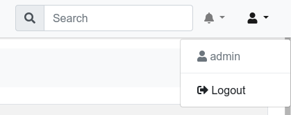
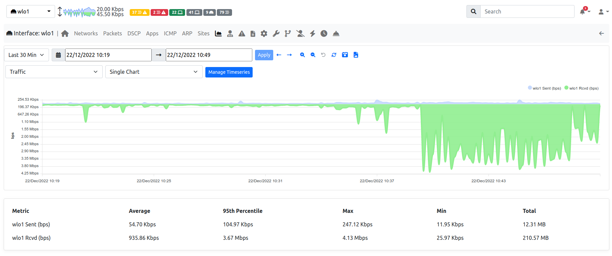
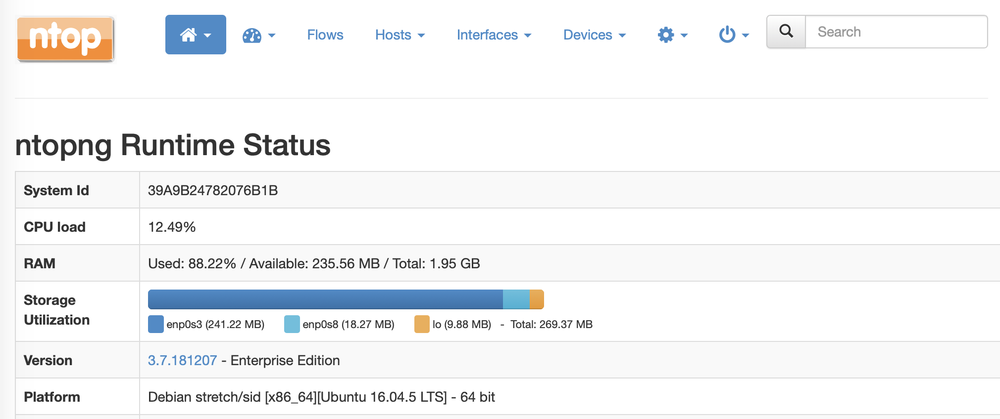
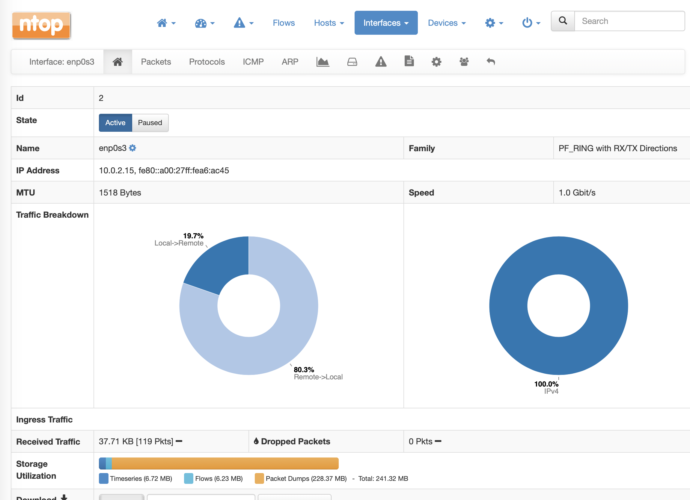
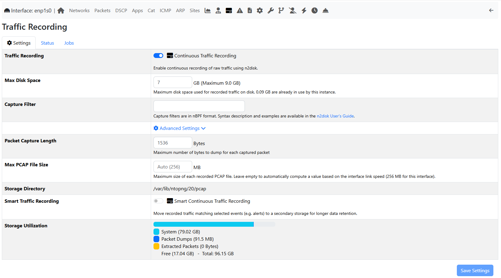
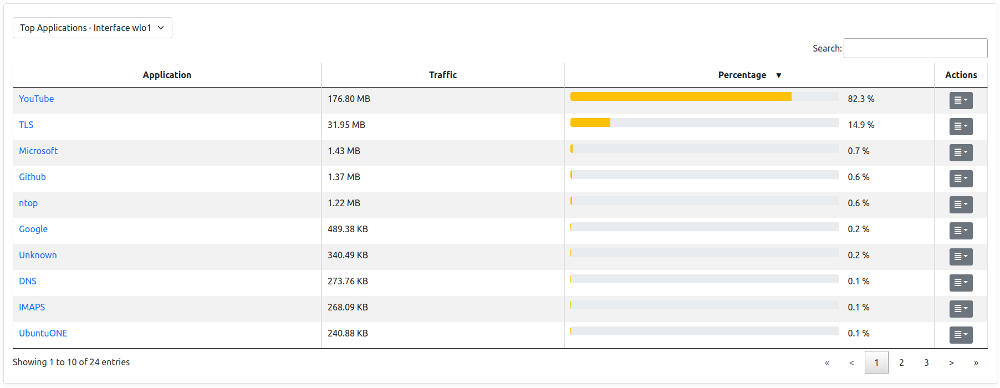

Other Pages and Info
####################

Administration
--------------

This section shows the currently logged in user along with a logout button to disconnect the user from the ntopng GUI.

The notifications bell shows news from the `ntop blog`_.

.. _`ntop blog`: https://www.ntop.org/blog

.. _GlobalSearch:

Search
------

  The Search Box

The Search button at the top right of the header bar (or :kbd:`Ctrl+F` on any page) opens the search
box. While typing, the results are listed in groups, with the searched text highlighted:

- Menu pages: the entries of the menu, grouped by menu section (all of them while the search box is
  empty). A page that is not available (missing license, preference or data) is greyed out with a lock
  icon whose tooltip explains why.
- Preferences: the preferences that can be switched on or off, up to 8, those whose name starts with
  the searched text first.
- Hosts, MACs, networks & more: hosts (by IP address or name), MAC addresses, local networks, Autonomous
  Systems, SNMP devices and interfaces, and the assets of the Assets Inventory. The icons on the left
  tell the type of the result, the badges add details such as the interface where the host was found,
  IPv6 or Inactive. The icons on the right open the alerts and, with ClickHouse, the historical flows of
  the host. When nothing matches exactly, a shortcut looks for the searched text in the historical flows.

The up and down arrows move through the results, :kbd:`Enter` opens the selected one and :kbd:`Esc`
closes the search box.

Clicking a preference (or pressing :kbd:`Enter` on it) switches it on or off at once, without leaving the
current page. Preferences that cannot be changed (missing license, value set from the command line, or a 
setting that depends on another one which is off) are shown greyed out with a lock icon whose tooltip 
explains why. Preferences are listed only to users allowed to change them, and only while the Search 
Preferences toggle (on by default) is enabled.

Search Preferences
^^^^^^^^^^^^^^^^^^

The slider icon next to the search field shows the Search Preferences (also in *Settings* → *Preferences*
→ *User Interface*), which choose what the search looks up. A change is saved at once and the results are
refreshed:

- *Search In All Interfaces*: looks for hosts on all the interfaces, not only on the selected one. Off by
  default; always on in the Overview (see :ref:`Lightview`).
- *Search Hosts*, *Search Networks*, *Search Autonomous Systems*: on by default.
- *Search SNMP*: on by default, requires an Enterprise M license.
- *Search Historical Flows*: on by default, requires ClickHouse.
- *Search Assets*: off by default, as it queries the assets database at every search. Requires an
  Enterprise M license.
- *Search Preferences*: lists the preferences in the results, on by default.

Users not allowed to change the preferences see them read-only.

Historical Charts
-----------------

ntopng provides historical views on the `recorded timeseries data`_ .

  Historical Charts

From the top left dropdown it's possible to select the timeseries data to display.
Other than the actual timeseries data, the chart will also show:

  - A comparison series with the past. In the picture above, `30m ago` will show the
    interface traffic 30 minutes ago.
  
  - The average line, a straight line outlining the average value for the timeseries.

  - 95th percentile, a straight line outlining the 95th `percentile`_ value of the traffic.
    It indicates the value for which 95% of the timeseries points are below it.

By using the time selectors is possible to specify a specific time frame to graph.
It is also possible the predefined resolutions to display the latest data for predefined intervals,
e.g. latest 5 or 30 minutes. By clicking on `-30` and `+30` buttons is also possible to jump to
the corresponding interval in the past or future.

Timeseries data is shown on the charts is sampled. In order to get more accurate data is necessary
to zoom into the chart. This can be performed easily by dragging the mouse on the specified interval;
chart will update dynamically and show the interval data with higher resolution. A double click on the
chart performs a zoom out.

By clicking on the |permalink_icon| icon it's possible to get a permanent link to the current view to share
with others. If `traffic recording`_ is enabled, by clicking the |pcap_download_icon| icon it's possible to
download a PCAP file of the interface or host traffic in the specified time frame. Depending on the selected
historical timeseries, this could be available or not.

By clicking on the |snapshot_icon| icon it's possible to :ref:`ManageSnapshots`.

Storage Monitor
---------------

According to the configuration, ntopng stores different types of information to disk, including:

- Timeseries (e.g. RRD)
- Packet Dumps (Traffic Recording)
- Flows

The amount of resources in terms of disk space can vary a lot according to the configured data 
retention for each component, the number of hosts and flows. Monitoring the space used by ntopng 
on disk becomes crucial to make sure you are now exceeding the expected amount of resources, 
and check that the automatic space reclaim facilities in ntopng have been configured properly.

The Runtime Status page of the :ref:`BasicConceptSystemInterface` in ntopng shows the current *Storage Utilization*, providing the total
disk space in use, and a breakdown with the disk space used by ntopng to for storing information
for each interface.

  The Runtime Status Page

By clicking on an interface, you get redirected to the *Interface Status* page. In this page
you can see the total disk space used for the current interface, and a breakdown with the 
amount of space used for each component (Timeseries, Packet Dumps, Flows).

  The Interface Status Page

From the *Interface Status* page we can easily check if some component is using more space than
expected. At this point we can move to the configuration page for that specific component, and
review the data retention settings. For example, going to the *Traffic Recording* page, we can 
see what is the actual disk utilization, checking the disk space used for Packet Dumps, and we can
review the configured *Max Disk Space* based on the amount of resources that we want to reserve
for this component.

  The Interface Traffic Recording Page

Tabular View
------------

Under the timeseries charts there is a tabular view which shows historical data for the
specified timeframe in a tabular format.

  Historical Tabular View

By clicking on the dropdown on the left it's possible to select the specific data to view.
Currently, the following views are implemented:

  - Top Protocols: the top protocols traffic and the percentage of each protocol on the total traffic.

  - Top Categories: the top categories traffic and the percentage of each category on the total traffic.

  - Top Senders: the top local sender hosts and their traffic.

  - Top Receivers: the top local receiver hosts and their traffic.

  - Top Interfaces: the top interfaces of a SNMP device.

Error Page
----------

When a page cannot be shown, ntopng opens an error page instead. The page shows:

  - The error code (e.g. *Error 404*) and what went wrong.

  - What you can do to fix it.

  - The address of the page you tried to open.

These are the possible errors:

  - *The requested page cannot be found* (404): the address is wrong or the page does not
    exist in this ntopng version. Check the address.

  - *Forbidden page* (403): your user is not allowed to open the page. Ask an administrator
    to change your `user`_ permissions.

  - *Professional/Enterprise edition license required* and *Enterprise edition license
    required* (403): the page is part of an ntopng edition you do not have. See
    :ref:`AvailableVersions` to know which edition you need.

  - *The URL specified contains invalid/dangerous characters* (400): the address contains
    characters that ntopng refuses for security reasons. Remove them and try again.

  - *Internal server error* (500): ntopng could not build the page. Try again later; if the
    problem persists, check the ntopng log.

  - *Unable to serve requests at this time* (503): ntopng is starting up or shutting down.
    Wait a few seconds, then reload the page.

Click *Go Back* to return to the page you came from, or *Home* to open the ntopng dashboard.

.. _`recorded timeseries data`: ../basic_concepts/timeseries.html
.. _`user`: settings/users.html
.. _`traffic recording`: ../traffic_recording.html
.. _`manage snapshot`: ../advanced_features/snapshots.html
.. _`Exponential Moving Average`: https://en.wikipedia.org/wiki/Moving_average#Exponential_moving_average
.. _`Simple Moving Average`: https://en.wikipedia.org/wiki/Moving_average#Simple_moving_average
.. _`Relative Strength Index`: https://en.wikipedia.org/wiki/Relative_strength_index
.. _`percentile`: https://es.wikipedia.org/wiki/Percentil
