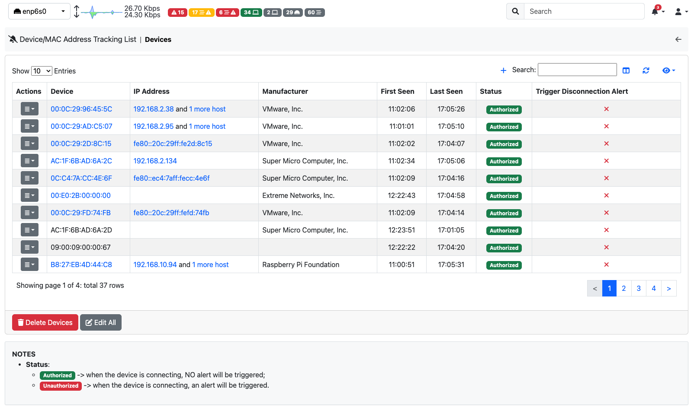
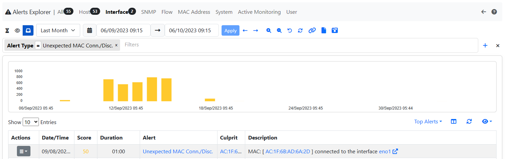
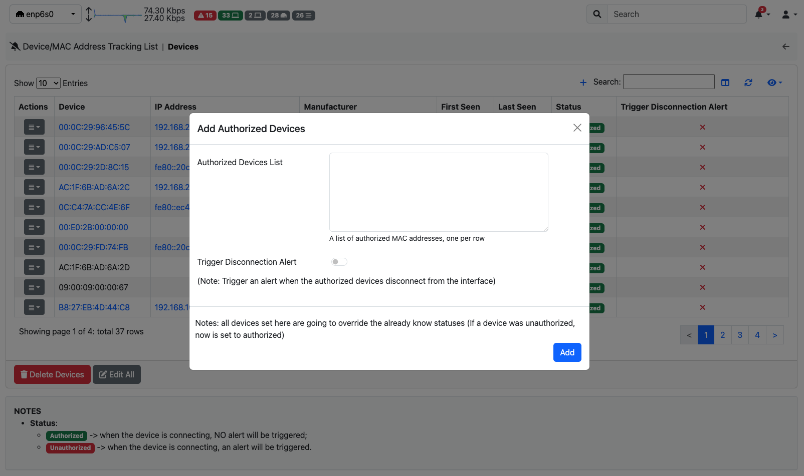

.. _DeviceMacAddressTracking:

Device/MAC Address Tracking
---------------------------

ntopng detects the devices (identified by their MAC addresses) that connect to a network. On closed networks, such as datacenters or industrial IoT networks, only some devices are allowed to connect, and any other device is a threat.

The `Unexpected Device Connected/Disconnected` alert (see `here <../alerts/others/interface_checks.html#unexpected-device-connected-disconnected>`_) is triggered when an unauthorized device connects to the network and, optionally, when an authorized device disconnects.

.. note::

  This feature needs ntopng Enterprise M or better and the 'Device/MAC Address Tracking' behavioural check enabled. Only administrators can open the page. When the check is disabled the page says so and tells how to enable it.

The page (left sidebar menu: Settings -> Device/MAC Address Tracking) lists the devices seen on the selected interface.

  Devices Exclusion

For each device the table shows:

  - Device: its MAC address (and its name, if set), and whether it is online or offline. The icon next to it opens the device details;
  - IP Address: the first host seen with this MAC address (the icon opens the host details; "+N more" lists all the hosts with this MAC address);
  - Manufacturer, First Seen and Last Seen (empty while the device is online);
  - Status: Authorized (no alert when it connects), Unauthorized (an alert is triggered when it connects) or Undecided;
  - Trigger Alert on Disconnection: whether an alert is triggered when the device disconnects.

Click a MAC address, an IP address or a manufacturer to search the table for that value. The search box finds MAC addresses and manufacturers.

The button of each row edits the device; its menu also opens the Historical Flows of the device (it needs ClickHouse) and deletes it. A deleted device that connects again gets the status set in Preferences for new devices.

  Devices Exclusion Alert

Above the table:

  - Add Authorized Devices: paste a list of MAC addresses (one per row). The devices already seen are set to authorized; invalid MAC addresses are shown before adding. You can also choose to trigger an alert when they disconnect;
  - Edit All: set the status and the disconnection alert of all the devices at once.

Editing one device you can also give it a name (one word, without spaces).

  Devices Exclusion Add Modal

Below the table, Delete Devices removes all the devices: ntopng starts learning them again, and a message under the page description says so. The status given to a new device during and after the learning period (Authorized, Unauthorized or Undecided) is set in Preferences.

The link in the alert of an unexpected device opens this page already searching for that device.
