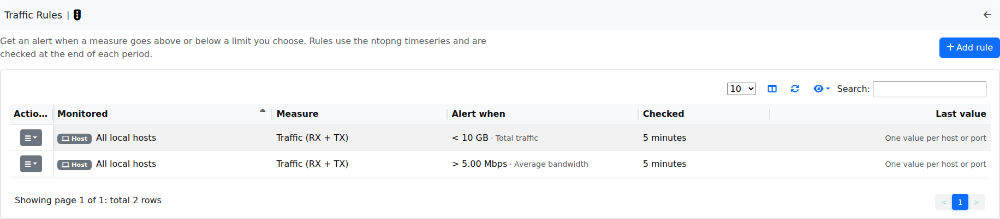
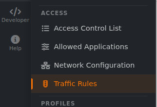
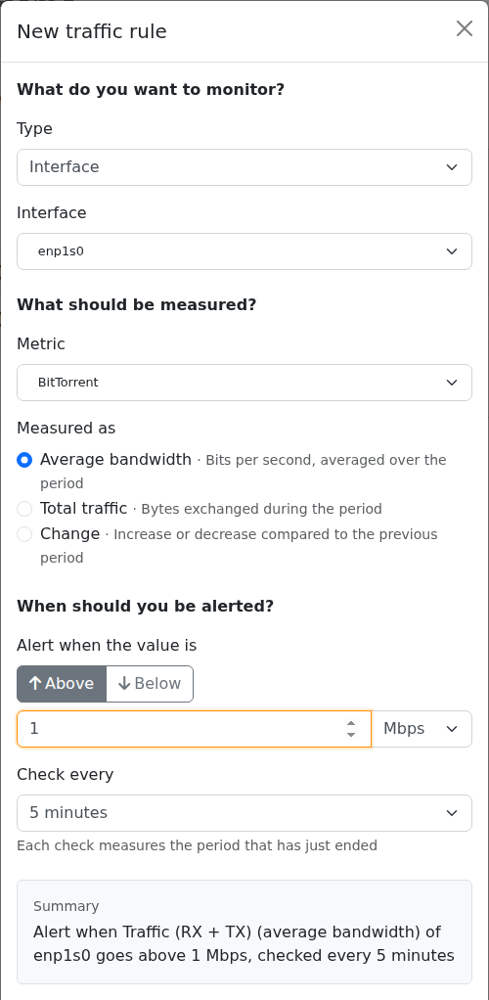
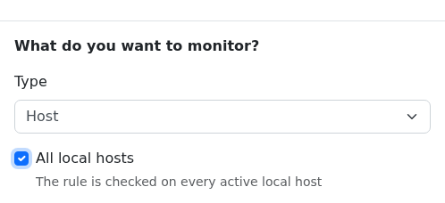
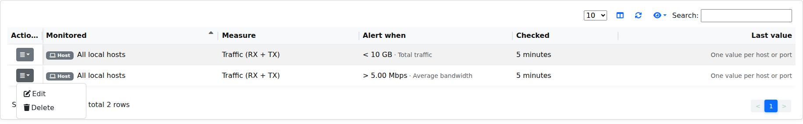

# Traffic Rules {#traffic-rules}

ntopng can trigger customizable alerts, based on timeseries. This is useful to identify missbehaviors from devices, interfaces...

::: info
This feature is available only from Enterprise M license or superior.
:::

Here some example of rules:
: - The daily traffic of ens160 network interfce does not have to exceed 15 GB in total;
  - The daily traffic of 192.168.2.28 does not have to be less than 2 GB in total;
  - The NTP daily traffic of 192.168.1.1 does not have to exceed 2 GB in total;
  - The 1kxun traffic every 5 minutes of 1.1.1.1 does not have to exceed 15% from the precedent 5 minutes total traffic;
  - The traffic every 5 minutes of 1.1.1.1 does not have to exceed 1 Mbps;

Whenever a condition is met, ntopng is going to trigger an alert. The alerts of all the rules are
switched on and off by the *Traffic Rules* interface check in the [Behavioural Checks](/user_interface/shared/alerts/others/available_alerts.md#behaviouralchecks) page, which also sets their tags: when the check is disabled the rules are
still measured, but no alert is triggered. The severity of the alerts is set by each rule (see
*Severity* below).

::: info
To page is accessible from the Settings -> Traffic Rules
:::

## Available Rules {#available-rules}

The rules can be set for each timeseries currently available in ntopng. The rules can be configured for:

- Flow Exporters;
- Host Pools;
- Interfaces;
- Local Hosts;
- Networks;
- Traffic Profiles;
- VLANs;

## Configure Rules {#configure-rules}

To add a new rule, click the 'Add rule' button at the top right of the page

At this point, fill the fields with the correct informations:
: - Type: select the kind of subject to be analyzed (Interface, Host, Host pool, Network, VLAN, Traffic profile, Autonomous system or Flow exporter);
  - Interface / Host / Network / ...: select the subject to be analyzed (e.g. the interface enp1s0, or the IP address of a Host);
  - All local hosts: available for the Host type, tick this checkbox to analyze every active local host at once (e.g. All local hosts). This replaces the previous * wildcard target, which is no longer used;
  - Metric: select the metric to be analyzed (e.g. Traffic (RX + TX), Score or an application such as DNS -> the DNS traffic). For interfaces you can also choose Live Flows (flows are connections), Active Hosts and Active Local Hosts;
  - Measured as: select how the metric is measured: Average bandwidth (bits per second, averaged over the period), Total traffic (bytes exchanged during the period) or Change (increase or decrease compared to the previous period);
  - Alert when the value is: choose Above or Below, then type the threshold value and choose its unit (e.g. Kbps, Mbps or Gbps), that, if exceeded, is going to trigger an alert;
  - Check every: choose the frequency of the analysis: 5 minutes, Hour, Day or Month;
  - Severity: the severity of the alerts triggered by the rule (Info, Notice, Warning, Error, Critical or Emergency, default Error). The rules created before this option was available keep triggering Error alerts. The severity is shown in the Severity column of the rules table, in the alerts and is used by the notification policies (e.g. a minimum severity).

A Summary box at the bottom of the form describes the rule in plain words before it is added.

Values that are counted over time, such as Live Flows, Active Hosts, Active Local Hosts and Score, are checked against their highest value in the period for *Above* rules, and their lowest value for *Below* rules. For example, a rule "Live Flows above 500, checked every 5 minutes" triggers if the number of live flows went over 500 at any moment of those 5 minutes. For daily and monthly rules the highest and lowest values are smoothed, because the older data is kept as averages.

::: info
The available metrics to be analyzed depend on the available timeseries; this means that if the Application Timeseries are not enabled from the preferences, it's not possible to configure/trigger a rule based on Applications
:::

## Monitor All Local Hosts {#monitor-all-local-hosts}

To apply a rule to every local host, select the Host type and tick the 'All local hosts' checkbox: the rule is then checked on every active local host, and the Host field is disabled.

::: info
The * wildcard used in previous versions in the Target field is no longer available: use the 'All local hosts' checkbox instead.
:::

From now on, a new entry with the configured fields is going to be added to the table and whenever the threshold is exceeded a new alert is going to be triggered.

## Edit/Delete Rules {#edit-delete-rules}

It is moreover possible to edit or delete an already created rule.

To do so, use the button of the rule that needs changes: the button itself opens Edit, the arrow next to it opens the menu with Delete:

> - `Edit`: It is possible to change the rule of an already existing one; the modal is the same as the one used to add a new rule, so please refer to the above section;
> - `Delete`: It is possible to remove a rule; when removed the alert is not going to be triggered anymore;

::: info
Traffic rules are evaluated according to the rule frequency specified. For instance Daily rules are evaluated every midnight considering the traffic of the previous day.
:::

Click *Simulate Notifications* in the rule dialog to see who is notified when the rule triggers an alert, with the severity selected in the dialog (see [Simulating the Notifications](/user_interface/shared/alerts/available_endpoints.md#notificationsimulation)).

::: info
A host can have only one Traffic Rule alert engaged at a time: when several rules on the same host are exceeded, the alert keeps the severity of the rule that triggered it first, until it is released.
:::
