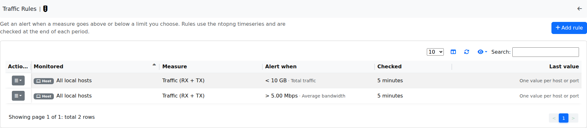
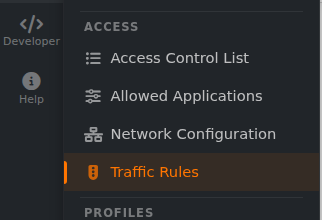
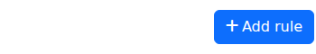
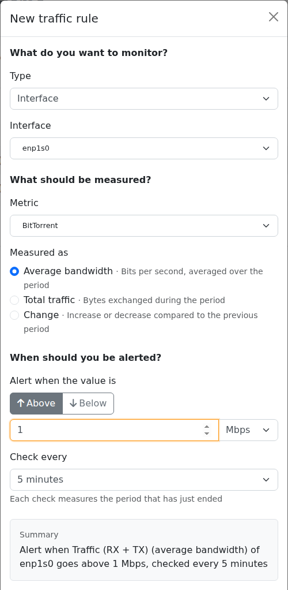
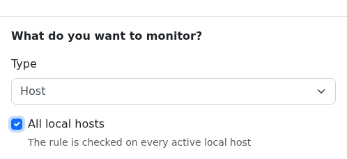
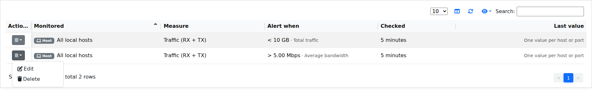

.. _TrafficRules:

Traffic Rules
-------------

ntopng can trigger customizable alerts, based on timeseries. This is useful to identify missbehaviors from devices, interfaces...

.. note::

  This feature is available only from Enterprise M license or superior.

  Configured Traffic Rules

Here some example of rules:
  - The daily traffic of ens160 network interfce does not have to exceed 15 GB in total;
  - The daily traffic of 192.168.2.28 does not have to be less than 2 GB in total;
  - The NTP daily traffic of 192.168.1.1 does not have to exceed 2 GB in total;
  - The 1kxun traffic every 5 minutes of 1.1.1.1 does not have to exceed 15% from the precedent 5 minutes total traffic;
  - The traffic every 5 minutes of 1.1.1.1 does not have to exceed 1 Mbps;

Whenever a condition is met, ntopng is going to trigger an alert.

.. note::
  To page is accessible from the Settings -> Traffic Rules

  

  Access Traffic Rules

Available Rules
^^^^^^^^^^^^^^^

The rules can be set for each timeseries currently available in ntopng. The rules can be configured for:

- Flow Exporters;
- Host Pools;
- Interfaces;
- Local Hosts;
- Networks;
- Traffic Profiles;
- VLANs;

Configure Rules
^^^^^^^^^^^^^^^

To add a new rule, click the 'Add rule' button at the top right of the page

  Add a Traffic Rule

At this point, fill the fields with the correct informations:
  - Type: select the kind of subject to be analyzed (Interface, Host, Host pool, Network, VLAN, Traffic profile, Autonomous system or Flow exporter);
  - Interface / Host / Network / ...: select the subject to be analyzed (e.g. the interface enp1s0, or the IP address of a Host);
  - All local hosts: available for the Host type, tick this checkbox to analyze every active local host at once (e.g. All local hosts). This replaces the previous * wildcard target, which is no longer used;
  - Metric: select the metric to be analyzed (e.g. Traffic (RX + TX), Score or an application such as DNS -> the DNS traffic);
  - Measured as: select how the metric is measured: Average bandwidth (bits per second, averaged over the period), Total traffic (bytes exchanged during the period) or Change (increase or decrease compared to the previous period);
  - Alert when the value is: select Above or Below, then the threshold value and its unit, that, if exceeded, is going to trigger an alert;
  - Check every: select the frequency of the analysis (e.g. 5 minutes -> analyzed every 5 minutes, hour, day or month).

A Summary box at the bottom of the form describes the rule in plain words before it is added.

.. note::
  The available metrics to be analyzed depend on the available timeseries; this means that if the Application Timeseries are not enabled from the preferences, it's not possible to configure/trigger a rule based on Applications

  Example of Traffic Rule on an interface, triggering an alert when the traffic is above 1 Mbps

Monitor All Local Hosts
^^^^^^^^^^^^^^^^^^^^^^^

To apply a rule to every local host, select the Host type and tick the 'All local hosts' checkbox: the rule is then checked on every active local host, and the Host field is disabled.

  Selecting All local hosts to monitor every local host

.. note::
  The * wildcard used in previous versions in the Target field is no longer available: use the 'All local hosts' checkbox instead.

From now on, a new entry with the configured fields is going to be added to the table and whenever the threshold is exceeded a new alert is going to be triggered.

Edit/Delete Rules
^^^^^^^^^^^^^^^^^

It is moreover possible to edit or delete an already created rule.

To do so, click on the action button of the rule that needs changes and select the desired action:

  - :code:`Edit`: It is possible to change the rule of an already existing one; the modal is the same as the one used to add a new rule, so please refer to the above section;
  - :code:`Delete`: It is possible to remove a rule; when removed the alert is not going to be triggered anymore;

  Remove a Traffic Rule

.. note::
   
  Traffic rules are evaluated according to the rule frequency specified. For instance Daily rules are evaluated every midnight considering the traffic of the previous day.

