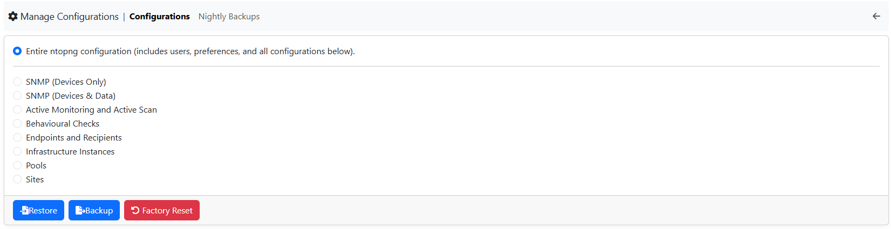
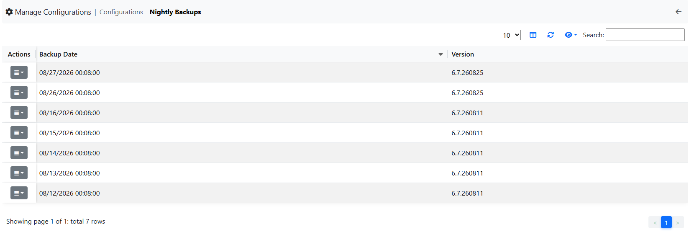

<a id="configurations"></a>

# Configurations {#configurations}


<a id="configurationimportexport"></a>

ntopng provides the ability to backup its configuration, in order to be able to restore it in case of system
failures and reinstallations, or to clone it to other systems requiring the very same configuration (e.g. in
a cluster or in a high-availability deployment), saving a lot of time for manually copying all the settings.

Through the web GUI it is possible to export selected configurations, including:

- SNMP configuration
- Active Monitoring configuration
- Checks configuration
- Alerts Endpoints and Recipients
- All Pools (this will also include all the previous items, as this depends on them)

or export the entire ntopng configuration, which includes *Users* and *Preferences* in addition to all the
above items. In both cases, a small JSON file containing the configuration is generated.

It is also possible to import back a configuration which as been exported before, providing the JSON file.
The configuration items contained in the imported configuration will be added to those already present in
the current ntopng configuration (e.g. endpoint already configured in ntopng, if any, will not be deleted when
importing additional endpoints).

Resetting the configuration to factory defaults is also possible. This is also useful when importing
a configuration and preserving the old one is not required nor wanted (e.g. when adding a set of recipients
and endpoints without preserving those already present).

All this is available from the *Settings* -> *Configurations* menu, as shown in the below picture.



Every night, ntopng automatically creates a backup of the whole application configuration. No backup is created if the configuration didn't change since the previous day. Currently the last 7 backups are stored and older ones are automatically discarded. You can download a backup using the Download menu under the Actions colums. This backup can be restored using the Import button on the main configuration page.



## Pool Import via CSV {#pool-import-via-csv}

In addition to the standard JSON format, pools can also be imported using a CSV file.

**Accessing the import dialog**

To import host pool members from a CSV file:

1. Navigate to *Settings* -> *Configurations*.
2. Select the **Pools** radio button.
3. Click the **Import** button and choose the CSV file.

Alternatively, the same dialog is reachable from the *Pools* -> *Host Pool Members* page by clicking
the **Import Hosts** button at the bottom of the page, which opens the *Configurations* page with
the *Pools* item pre-selected.

::: info
The uploaded file must have a `.csv` extension (in addition to files with a `.json` extension
which are also supported).
:::

**File format**

Each line of the CSV file defines a single pool member assignment:

```
<ip_or_mac><separator><pool_name>
```

The supported separators are: space, comma (`,`), and semicolon (`;`). The following are all equivalent
and valid:

```
192.168.1.2/32@10 myPool
192.168.1.2/32@10,myPool
192.168.1.2/32@10;myPool
```

**IP addresses** must be specified in CIDR notation with an optional VLAN tag:

```
x.y.z.k/p@v
```

where `p` is the prefix length (e.g. `32` for a single host, `24` for a /24 subnet) and `v` is
the VLAN ID. The VLAN tag is optional: if omitted, VLAN `0` is assumed. The following two entries are
therefore equivalent:

```
192.168.1.1/32;myPool
192.168.1.1/32@0;myPool
```

**MAC addresses** must be specified in the standard colon-separated hex format:

```
AA:BB:CC:DD:EE:FF;myPool
```

Empty lines and lines starting with `#` are ignored and can be used as comments. Multiple members can be
assigned to the same pool by repeating the pool name across different lines. Members belonging to different
pools can be mixed freely in the same file.

A complete example file:

```
# Office hosts
192.168.1.10/32   OfficePool
192.168.1.0/24    OfficePool

# Guest devices
192.168.2.0/24;GuestPool
AA:BB:CC:DD:EE:FF,GuestPool

# VLAN-tagged host (VLAN 10)
10.0.0.5/32@10 ServerPool
```

**Merge behaviour**

CSV import **adds** members to pools. If a pool with the matching name already exists, the imported
members are merged into it. If no pool with that name exists, a new one is created. Existing members
and pools that are not mentioned in the CSV file are not removed.

## Import/Export via API {#import-export-via-api}

Configuration can also be imported and exported programmatically via API. Following is an example that uses the REST API to export and then import the global ntopng configuration.

To export the global ntopng configuration in a local JSON file `all_config.json` from an host `office`, user `admin` (identified with password `admin`) can call the following endpoint

```bash
$ curl -u admin:admin1 "http://office:3000/lua/rest/v2/export/all/config.lua?download=1" > all_config.json
```

To import the configuration, the contents of `all_config.json` must be POST-ed as the value of a string `JSON` to the following endpoint:

```bash
$ curl -uadmin:admin1 -H "Content-Type: application/x-www-form-urlencoded" --data-urlencode "JSON=`cat all_config.json`" "http://office:3000/lua/rest/v2/import/all/config.lua"
```

A successful POST is confirmed by the following message:

```bash
{"rc":0,"rc_str":"OK","rc_str_hr":"Success","rsp":[]}
```

A restart of ntopng is required after the import of the global configuration.
