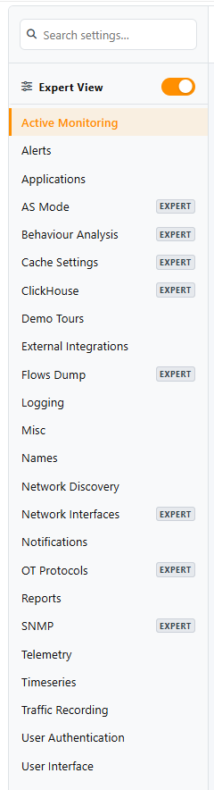
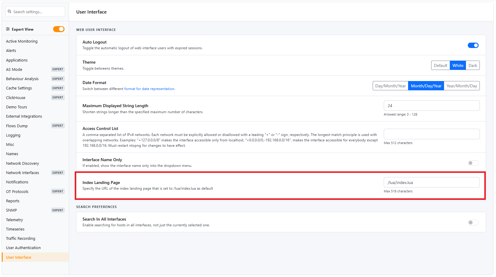
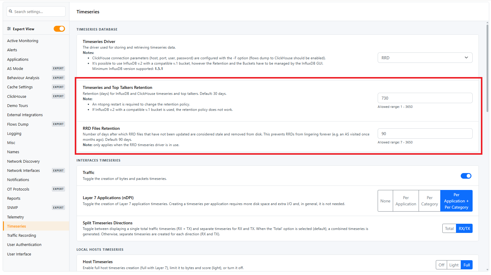

<a id="preferences"></a>

# Preferences {#preferences}

Preferences menu entry enables the user to change runtime configurations. The sections are listed in alphabetical order on the left, and all of them are always shown.



A thorough help is reported below every preference directly into ntopng web GUI.

Some preferences are available only when another one is enabled (or set to a given value): they are shown indented below it, with a line on their left, one step for each level.

The search box above the sections list looks for a text in the section names and in the name and description of every preference. While searching, the `Search results` entry at the top of the list shows the matching preferences of all the sections together, grouped by section, so they can be changed without opening each section.
Clicking a section in the list, or its name in the results, opens the whole section with the matching preferences highlighted; `Search results` brings back the results. A matching preference that depends on a disabled one is shown anyway, read-only, with a lock icon whose tooltip says which preference to change to edit it. Changes are kept when moving between sections or searches, and `Save changes` saves all of them at once.

## Change ntopng Index Page {#change-ntopng-index-page}

It is possible to change the ntopng index page (e.g., instead of displaying the 'Traffic Dashboard' when opening ntopng, display the 'SNMP' page), by jumping to the 'Settings' and 'Preferences' tab.
From here jump to the 'User Interface' section and modify the 'Index Page' with the ntopng page desired to be displayed as an index.



For instance, by setting the 'Index Page' to '/lua/pro/enterprise/snmpdevices_stats.lua', when opening ntopng, the default page displayed is going to be the 'SNMP' one.


<a id="data-retention"></a>

## Data Retention {#data-retention}

Data retention is configurable from the preferences.



Data retention is expressed in days and it affects:

- Top Talkers stored in sqlite
- Timeseries
- Historical flows

::: info
When using RRDs for timeseries, changing the data retention only affects new RRDs created after the change.
:::


<a id="days-data-retention"></a>

### Flows/Alerts Data Retention {#flows-alerts-data-retention}

When flows are stored in ClickHouse, the *Flows/Alerts Data Retention* preference
(ClickHouse section) sets the number of days raw (unaggregated) flows and alerts are
kept. The default is 30 days.

The check runs daily: since ClickHouse data is partitioned by day, ntopng deletes the
whole daily partitions older than the configured number of days.

- Other ClickHouse data has its own retention, configured in the same section:
  aggregated flows, aggregated ASN data, vulnerability scan reports, Wazuh alerts and
  the journal of the assets (see [Assets Journal](/advanced_features/assets_journal.md#assetsjournal)).
  Timeseries follow the *Timeseries and Top Talkers Retention*.
- Aggregated flows must be kept longer than raw flows: when the raw flows retention
  is set to a value equal or greater than the aggregated flows retention, the latter
  is automatically set to the raw flows retention plus one day.
- If *Archive Flows Before TTL Deletion* is enabled, each day is archived to the
  *Flows Archive Path* before it is deleted (see the Historical Flows Archive for
  Compliance section of the ClickHouse documentation).


<a id="max-disk-space-retention"></a>

### Flows/Alerts Max Disk Space {#flows-alerts-max-disk-space}

When flows are stored in ClickHouse, retention can also be limited by disk space,
in addition to days. This lets ntopng keep as many days of flows as fit in the
available space, instead of a fixed number of days.

The *Flows/Alerts Max Disk Space (GB)* preference (ClickHouse section) sets the
maximum size of the ClickHouse database. The check runs daily: when the database
exceeds the limit, ntopng deletes the oldest days of raw (unaggregated) flows and
alerts, one daily partition at a time, until the database is back under the limit.

- The limit applies to the whole ntopng ClickHouse database, but only raw flows and
  alerts are deleted. Aggregated flows, aggregated ASN data, vulnerability scan reports,
  Wazuh alerts, the journal of the assets and timeseries keep their own retention.
- The current day is never deleted.
- The day-based [Flows/Alerts Data Retention](/user_interface/shared/settings/preferences.md#days-data-retention) still applies: data is deleted when
  either limit is reached.
- If archiving before deletion is enabled, each day is archived before it is deleted.
- Set the value to 0 (default) to disable the limit.

::: info
This preference reads partition sizes from the ClickHouse `system.parts` table.
When the ClickHouse user configured in ntopng is not allowed to read it (e.g. it is
granted only on the ntopng database and `select_from_system_db_requires_grant`
is enabled), the limit is not enforced and a warning is logged. In this case
grant access to it, for instance:

```sql
GRANT SELECT ON system.parts TO <ntopng user>;
```

The day-based retention does not require this grant.
:::

## User Authentication {#user-authentication}

Authentication settings have moved to the dedicated [User Authentication](/authentication.md) page.
