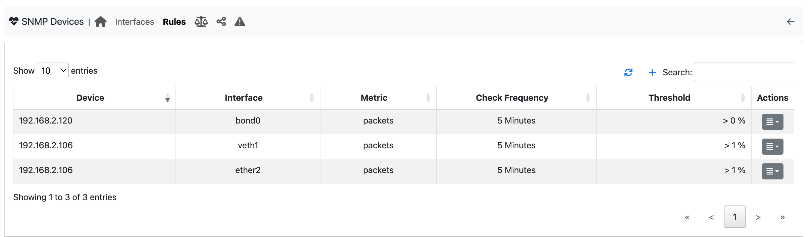
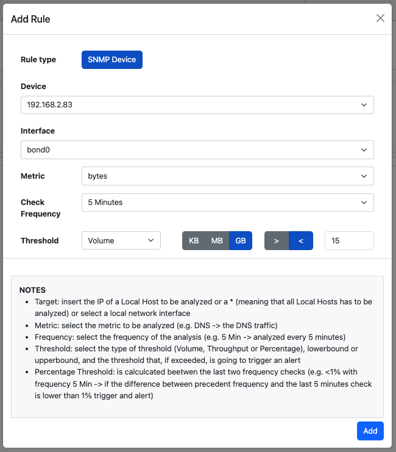

Device rules
-----------------

.. note::

  This feature needs ntopng Enterprise L and the SNMP timeseries enabled in Preferences. To receive the alerts, the 'SNMP Threshold Crossed' check must be enabled: the page shows a warning when it is not. Only administrators can add, edit or delete the rules.

With the SNMP device rules (SNMP Devices -> Rules tab), ntopng triggers an alert when a metric of an interface of an SNMP device goes above or below a limit you choose. The page works like the Traffic Rules page, but only for SNMP devices.

  SNMP Devices Rules

The table lists the rules: what is monitored (device / interface), the measure, when the alert is triggered (e.g. > 5 Gbps) and how often the rule is checked. The button of each row edits the rule; the arrow next to it opens the menu with Delete.

Click Add rule to create one. The dialog asks three questions and shows a summary of the rule in plain words:

  - What do you want to monitor: an SNMP device (or all of them) and one of its interfaces (or all of them);
  - What should be measured:

    - Traffic, measured as average bandwidth (bits per second during the period), total traffic (bytes exchanged during the period) or change (increase or decrease compared to the previous period, in %);
    - Errors: the number of interface errors during the period (alert only above the limit);
    - Port usage: the percentage of the interface speed used during the period (uplink or downlink);

  - When should you be alerted: above or below the limit (a whole number, with its unit: Kbps/Mbps/Gbps, KB/MB/GB or %), checked every 5 minutes, hour or day. Each check measures the period that has just ended.

For example, "Traffic (total traffic) above 1 GB, checked every 5 minutes" triggers an alert when the interface exchanges more than 1 GB in 5 minutes; "Traffic (change) above 20%, checked every day" triggers it when the traffic of the last day is at least 20% more than the day before.

  Add SNMP Device Rule

Two rules with the same device, interface, metric, frequency and direction (above/below) cannot exist: the dialog says so when you try to save the second one.

These checks are useful for spotting misbehaving interfaces that instead would not have been noticed otherwise.
