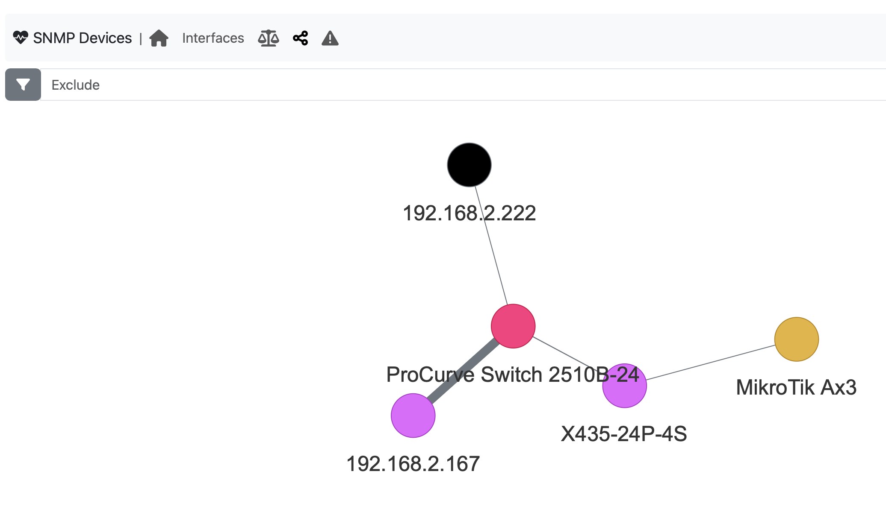
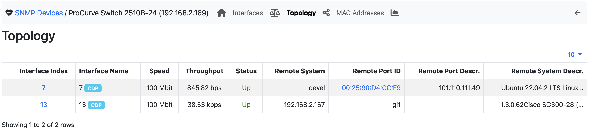

Network Topology
----------------

With SNMP it is possible not only to detect what devices are connected to a switch port, but also how ports are connected together. This is implemented with the `LLDP <https://en.wikipedia.org/wiki/Link_Layer_Discovery_Protocol>`_ and `CDP <https://en.wikipedia.org/wiki/Cisco_Discovery_Protocol>`_ MIBs. During polling, if these MIBs are detected, they are polled and the device information is merged

The Topology tab of the SNMP devices page shows the connections in two views, chosen with the Table and Map buttons above them. The Map shows the connected devices, with thicker lines for the links with more traffic: click a device to open its page. The Table lists the same connections, one per row, to read which port of a device is connected to which port of another one. The tab is available when at least one device answered the LLDP or CDP MIB.

