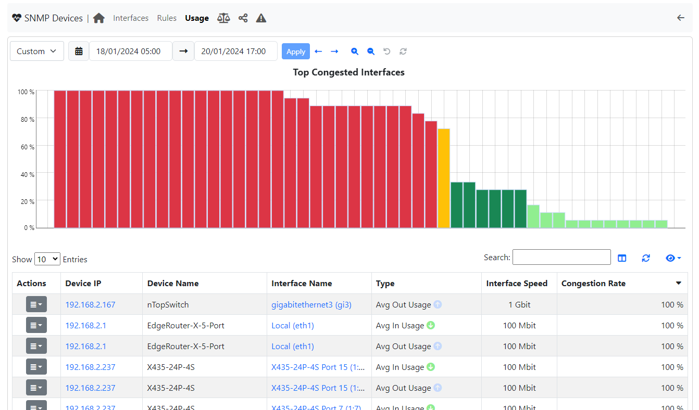
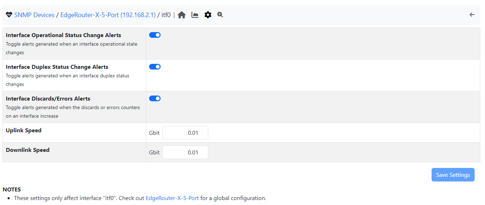
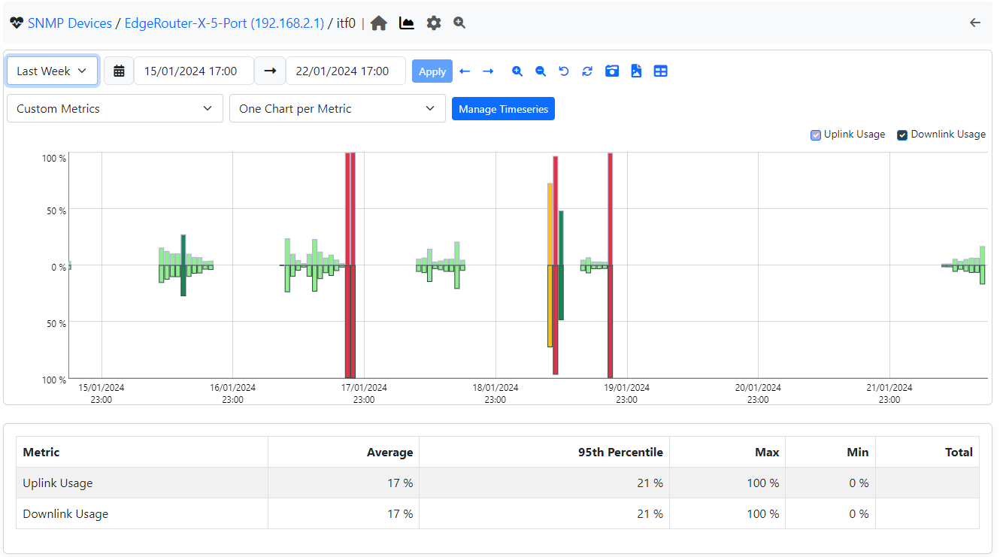
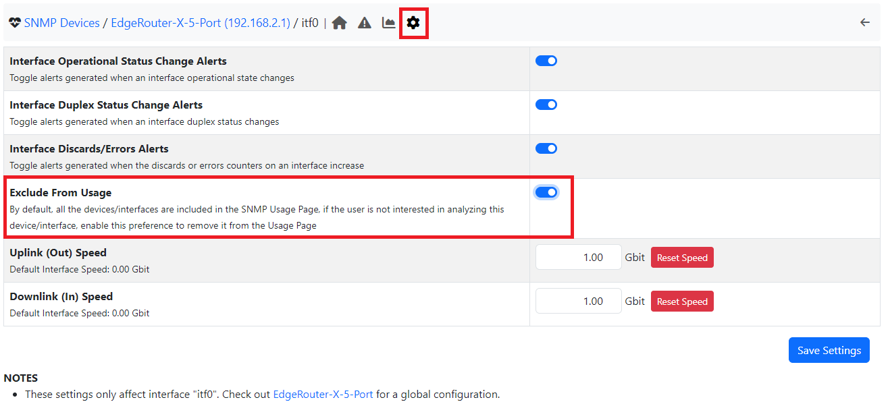
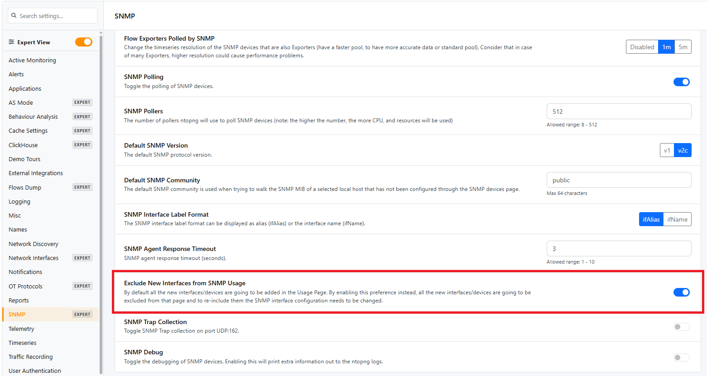

# SNMP Usage {#snmp-usage}

ntopng has the ability to monitor the usage percentage of each interfaces for each SNMP device.

::: info
Enterprise L license or above is required
:::

::: warning
It is mandatory to have the SNMP timeseries enabled; then a new Usage page is going to be accessible.
:::

Here it is possible to understand the congested interfaces.

The chart shows the 20 most congested interface directions (in and out are separate bars). An interface is congested when more than 75% of its link is used. When no interface is congested in the period, the chart says so. The chart follows the search of the table.
The link speed (up and down) info, is provided by SNMP in most cases, however sometimes the link speed is not correct. It is however possible to manually configure it by jumping to the SNMP Interface configuration page.

Every 5 minutes ntopng compares the traffic of each interface with its link speed and saves the usage percentage. In the period selected above the chart, the congestion rate is the percentage of these points above 75%. Periods without data (for example the device was not reachable) are not counted.

::: info
Being the congestion, dependent on the usage timeseries, it can have at most 1 point per 5 minutes (the usage timeseries is updated every 5 minutes).
:::

The table shows, for each interface, the link speed and, in separate In and Out columns, the congestion rate, the average and the maximum usage. The minimum and the last usage measured are hidden by default: show them from the columns menu of the table. The table is sorted by Congestion In, every column can be sorted.
By clicking on the 'Action' button, it is possible to jump to the interface configuration (in case of misconfiguration) or directly drill-down to the Usage timeserie.

::: info
An other way to drill-down to the timeserie is by clicking on the corresponding bar in the chart
:::

Note that both, the Usage timeseries and the Top Congested Interfaces charts, have different colored bars based on the percentage:

- between 0 and 24, the bar has a light green color
- between 25 and 49, the bar has a green color
- between 50 and 75, the bar has a yellow color
- between 76 and 100, the bar has a red color

## Exclude Interfaces {#exclude-interfaces}

By default, every SNMP interface is shown in the Usage page. To hide the ones you are not interested in, jump to the interface summary (by clicking on an SNMP interface) and open its configuration page.

Here enable the 'Exclude From Usage' preference.

### Exclude by Default {#exclude-by-default}

To show only a few interfaces, the default can be inverted: jump to Settings, Preferences, SNMP and enable the 'Exclude SNMP Interfaces from Usage by Default' preference.
From now on, the interfaces without their own setting are hidden from the Usage page; include the ones to watch by disabling 'Exclude From Usage' in their configuration page.

