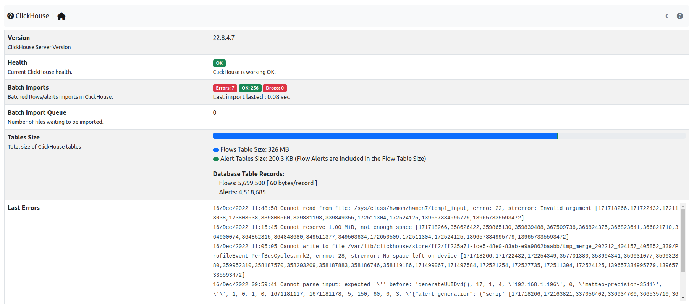

.. _ClickHouse:

ClickHouse
----------

ntopng features ClickHouse to export flows to `ClickHouse <https://clickhouse.com/>`_. Enabling the export into ClickHouse Database is going to make the :doc:`Historical Flow Explorer <../clickhouse/historical_flow_explorer>` page available.

.. note::
    ClickHouse export is available only with Enterprise license. See :doc:`../../../flow_dump/clickhouse/clickhouse` for how to configure ClickHouse support in ntopng.

  The ClickHouse Monitor Home

The page shows a *Status* card, refreshed every 10 seconds, with the following items:

- :code:`Version`: The version of the ClickHouse server.
- :code:`Health`: A badge which is either green or red. The badge is green when ntopng can query ClickHouse, red when it cannot: in this case expect the historical pages to malfunction.
- :code:`Tables Size`: Disk space used by the flows table, the hourly flows table and the alert tables, with a bar comparing them. Flow alerts are counted in the flows table size.
- :code:`Table Records`: The number of flows and hourly flows stored, with the average space used by one record, and the number of alerts (flow alerts excluded).
- :code:`Last Errors`: The last errors reported by ClickHouse, useful to check if something went wrong while storing or querying the flows.
