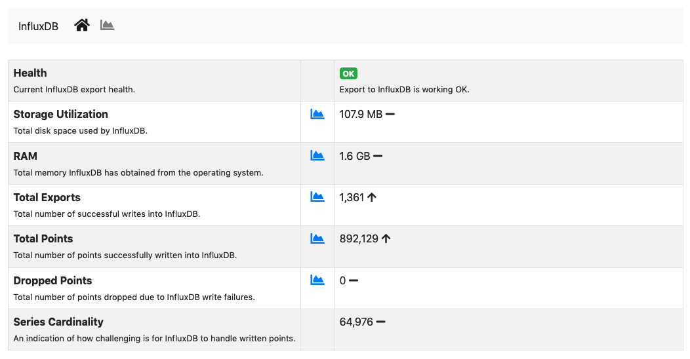
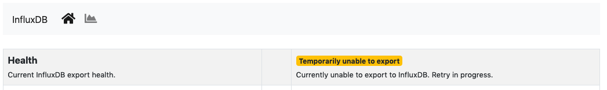
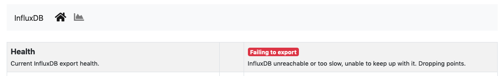
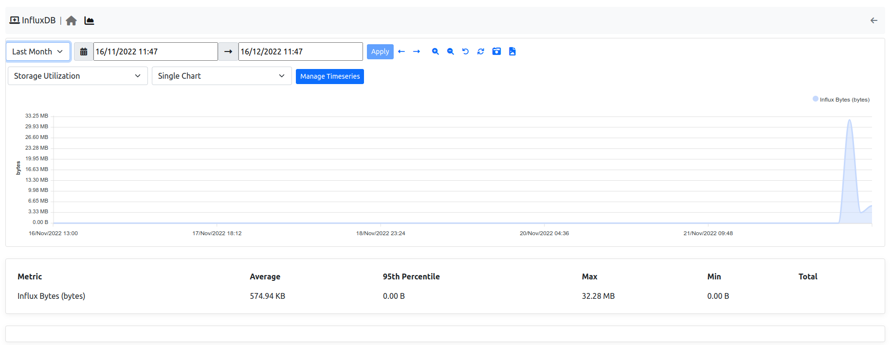

# InfluxDB {#influxdb}

ntopng features an [InfluxDB Driver](/basic_concepts/timeseries.md#influxdb-driver) to export timeseries to [InfluxDB](https://www.influxdata.com/). Using InfluxDB causes ntopng to enable and periodically execute the InfluxDB monitor. The InfluxDB monitor checks InfluxDB health and status. The page has two tabs: *Overview* and *Historical Data*. The overview, refreshed every 5 seconds, shows

The *Status* card has the following items:

- `health`: A badge which is either green, yellow or red, depending on the status of InfluxDB. The badge is green when ntopng is correctly exporting to InfluxDB, yellow when there are export errors that are recoverable and didn't cause any data loss, red when export errors are persistent and data loss is occurring.
- `storage utilization`: Total disk space used by InfluxDB.
- `ram`: Total memory InfluxDB has obtained from the operating system.
- `total exports`. Total number of successful writes into InfluxDB. A single write writes multiple points at once.
- `total points`: Total number of points successfully written into InfluxDB.
- `series cardinality`: An indication of how challenging is for InfluxDB to handle written points. A warning icon appears when it gets so high that it can slow down InfluxDB.

Storage utilization, RAM and series cardinality are shown only when ntopng can read the InfluxDB internal monitoring database. The chart icon next to a value opens its chart.

When InfluxDB is temporarily unable to export, the `health` turns yellow.

`Temporarily unable to export` means ntopng is actively retrying failing exports. Exports typically fails when InfluxDB is down or cannot ingest new data. After several attempts, ntopng gives up and drops the data it couldn't export. In this case, the `health` turns into red.

`Failing to export` also causes alerts to be triggered with the reason of the failure to help the administrator fixing the issue.

ntopng keeps retrying even when the `health` is red to recover as soon as InfluxDB becomes fully functional again.

Timeseries of the items shown in the overview are available in the *Historical Data* tab.

Timeseries can be disabled from the ntopngPreferences, tab *Timeseries->System Probes*: the *Historical Data* tab and the chart icons are then disabled.
