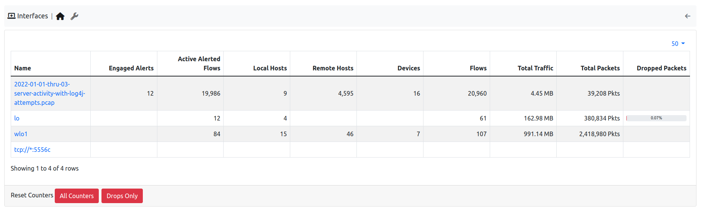

Interfaces
----------

  Interfaces Monitoring

In the Interfaces Health monitoring, the state of the interfaces analyzed by ntopng is going to be displayed, from the number of alerts, to the number of hosts,
flows, devices, packets received and dropped. The *Overview* table refreshes every 5 seconds; empty cells mean zero. The *Dropped Packets* column shows the
percentage of packets lost since the last counters reset. Click the icon next to an interface name to open that interface.

Administrators can reset the counters of all the interfaces with the buttons below the table: *All Counters* or *Drops Only*. A confirmation is asked first.

The *Internals* tab shows the hash tables, periodic activities and checks of all the interfaces together (see :ref:`Internals`): the *Interface* column says which interface (or the system one) each hash table and periodic activity belongs to. Choose an *Interface* in the filter, or click an interface name, to see only its rows. It replaces the Internals tab of each interface.
