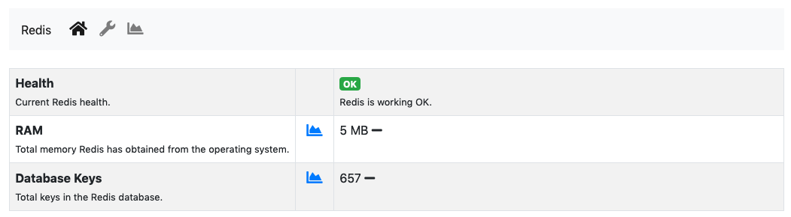
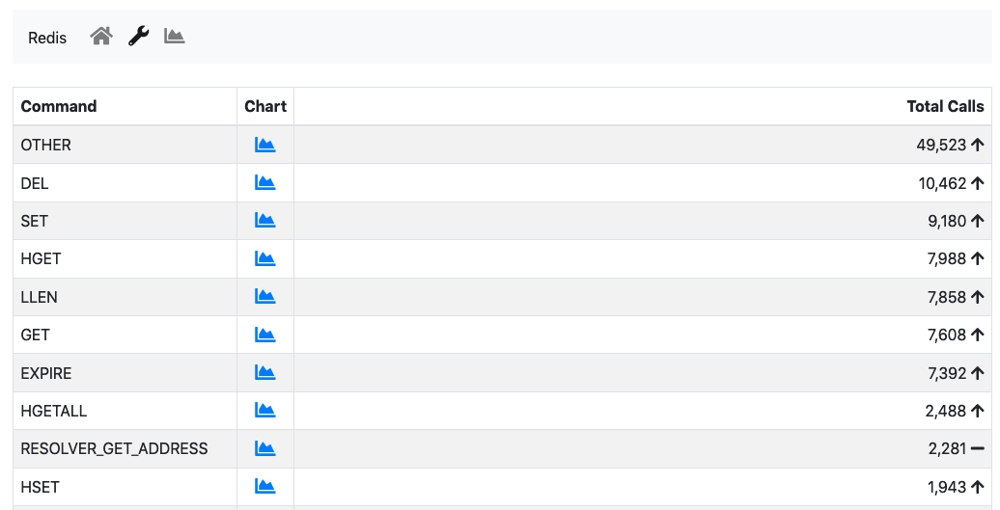

.. _Redis:

Redis
-----

`Redis <https://redis.io/>`_ is a key-value store used by ntopng to cache data and preferences. Redis runs as an external service both on Linux and on Windows. ntopng connects to Redis using sockets. Failing to connect to Redis would cause ntopng to malfunction. Redis must always be up, running and reachable to ensure ntopng functionalities.

Aim of this monitor is to check Redis health and resources used. The page has two tabs: *Overview* and *Historical Data*.

  The Redis Monitor Overview

The *Status* card, refreshed every 5 seconds, has three items:

- :code:`Health`: A badge which is either green or red, depending on the status of Redis. The badge is red when Redis fails to save its data to disk (or, when the Redis Append Only File (AOF) is enabled, to write it), otherwise it is green.
- :code:`RAM`: Total memory Redis has obtained from the operating system.
- :code:`Database Keys`: Total number of keys currently stored in Redis.

On Windows Redis does not report its health and the number of keys: only the RAM is shown. The chart icon next to a value opens its chart.

ntopng interacts with Redis using `commands <https://redis.io/commands>`_. Below the card, a table reports how many times each command was issued since ntopng started. The chart button of a row opens the calls of that command over time.

  The Redis Commands

This table is mostly useful to debug anomalous uses of commands and is not really relevant for a user.

The *Historical Data* tab shows the charts:

- A stacked `Top Commands Call` to have an overview of the top commands used in time.
- RAM used
- Database keys
- Number of calls for a subset of Redis commands used.

Timeseries can be disabled from the :ref:`ntopngPreferences`, tab *Timeseries->System Probes*: the *Historical Data* tab and the chart buttons are then disabled.
